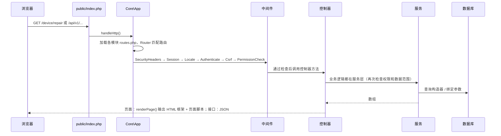

# OMPS 代码结构说明

[English version](CODE_STRUCTURE.en.md)

面向：维护和二次开发 OMPS 的技术人员。安装见 [INSTALL.md](INSTALL.md)，编码规则见 [CODING_RULES.md](CODING_RULES.md)，数据库见 [DATABASE.md](DATABASE.md)。

## 1. 技术选型

| 部分 | 做法 |
|---|---|
| 运行环境 | 单位现有的 XAMPP 7.2.3：PHP 7.2.3（32 位）+ MariaDB 10.1.31 + Apache 2.4；同一份代码也在 PHP 8.2 / 8.4 上测试 |
| 后端 | 纯 PHP，不用 Composer、不用第三方框架；内核（路由、中间件、查询构造器、模板、Excel / Word 读写）都是自己写的 |
| 前端 | 原生 JavaScript（ES5 写法，无构建步骤）+ 一个 CSS 文件；不引入任何前端库 |
| 数据库 | MariaDB 10.1 与 MySQL 8 的共同语法；不用 JSON 列、CTE、窗口函数 |
| 依赖 | 只用 PHP 自带扩展（pdo_mysql、openssl、mbstring、zip、gd 等，XAMPP 默认都有） |

## 2. 目录结构

```
OMPS/
├─ omps                  命令行入口（php omps <命令>）
├─ app/
│  ├─ bootstrap.php      自动加载、读取 .env、错误处理、时区
│  ├─ Core/              内核：应用、路由、请求 / 响应、视图、语言、加密、Excel / Word
│  ├─ Database/          数据库连接、查询构造器、建表执行器、基础数据
│  ├─ Middleware/        中间件：安全头、会话、语言、登录、CSRF、权限
│  ├─ Engines/           跨模块的公共能力：权限、审计、通知、文件、备份、清理、自定义字段、文档
│  ├─ Helpers/           全局函数 __()、e()、url()、now() 等
│  ├─ Console/           命令行命令、兼容检查、语言检查、环境检查、测试运行器
│  └─ Modules/           业务模块（每个模块一个文件夹，见第 6 节）
├─ config/               app.php、database.php、security.php（都从 .env 读取）
├─ database/
│  ├─ migrations/        建表与升级脚本（按文件名顺序执行，已发布的不再修改）
│  └─ seeds/base.php     基础数据：语言、角色、权限、菜单、字典（不含任何账号密码）
├─ public/               唯一对外的目录（Apache 文档根目录 / 别名指向这里）
│  ├─ index.php          唯一的网页入口
│  ├─ .htaccess          重写规则、上传大小
│  └─ assets/            css/omps.css、js/omps.js、js/icons.js、js/pages/*.js、img/
├─ resources/
│  ├─ languages/         语言包 zh-CN/*.json、en-US/*.json（按模块分文件）
│  └─ views/             页面框架 layouts/app.php、auth.php，错误页
├─ storage/              运行时数据，不能通过网址访问
│  ├─ logs/  cache/  temp/  uploads/
│  ├─ files/             上传的文件（可用 .env 的 FILES_PATH 改到别处）
│  └─ backups/           备份（可用 BACKUP_PATH 改到别处）
├─ collector/            设备采集客户端（PowerShell 脚本 + 安装 / 卸载 .cmd，在页面上下载）
├─ tests/                自动测试（php omps test）
├─ scripts/              辅助脚本
└─ docs/                 文档
```

## 3. 一次请求的处理过程



- **页面请求**：控制器调用 `renderPage()`，输出页面框架（`resources/views/layouts/app.php`）。框架里有 BOOT 数据（当前用户、权限码、语言包、CSRF 令牌），以 JSON 放在页面中，然后加载 `assets/js/pages/<页面>.js`。页面内容都由 JS 调用接口生成。
- **接口请求**（`/api/v1/...`）：返回 `{"ok": true, "data": ...}`；出错时返回 `{"ok": false, "error": {"code", "message", "fields"}}`，`fields` 是表单字段的错误。
- **路由选项**（`app/Core/Router.php`）：`auth`（默认需要登录）、`perm`（需要的权限码）、`csrf`（修改类请求默认检查）。
- **没有 mod_rewrite 时**：网址自动改为 `index.php?r=/路径`（`APP_REWRITE=auto`）。

## 4. 内核 `app/Core`

| 文件 | 作用 |
|---|---|
| `App.php` | 应用：加载模块路由、执行中间件、把异常转换为响应 |
| `Router.php` | 路由表、路径参数 `{id}`、路由选项、分组 |
| `Request.php` / `Response.php` | 请求（参数、上传文件、IP）和响应（HTML、JSON、文件下载） |
| `Controller.php` | 控制器基类：`renderPage()`、`pageArgs()`（分页，默认每页 30）、`filterArgs()`（列表筛选） |
| `View.php` | PHP 模板，输出时一律经过 `e()` 转义 |
| `Auth.php` / `Cookie.php` | 登录、密码校验、会话 Cookie |
| `Lang.php` | 翻译：语言文件 + 数据库中的覆盖；找不到的键显示 `⟦key⟧` 并记录 |
| `Settings.php` | 系统设置读写（`system_settings` 表） |
| `Crypto.php` | AES-256-GCM 加密 + HMAC（证件号、家属电话和住址），密钥为 `.env` 的 `APP_KEY` |
| `Validator.php` / `ValidationException.php` / `HttpException.php` | 输入校验和统一的错误 |
| `Xlsx.php` / `Docx.php` / `DocxBuilder.php` / `DocxFill.php` | 自写的 Excel 读写和 Word 生成、模板填充（用 PHP 自带的 zip） |
| `Env.php` / `Config.php` / `Url.php` / `Logger.php` / `ErrorHandler.php` / `Modules.php` | .env、配置、网址（含子路径和无重写）、日志、错误处理、模块发现 |

## 5. 数据库层与公共引擎

**`app/Database`**

| 文件 | 作用 |
|---|---|
| `DB.php` | PDO 连接（固定字符集和严格 sql_mode）、`select / value / statement / transaction` |
| `QueryBuilder.php` | 查询构造器：`DB::table('t a')->join()->where()->whereFilters()->paginate()`；拒绝没有 WHERE 的 UPDATE / DELETE |
| `Migrator.php` | 执行 `database/migrations/`，升级前自动备份 |
| `Seeder.php` | 同步基础数据和各模块的权限、菜单 |

**`app/Engines`**（多个模块共用）

| 文件 | 作用 |
|---|---|
| `Permission.php` | 权限码判断、数据范围（本人 / 本部门 / 全单位 / 全部）、给查询加范围条件 |
| `Audit.php` | 操作日志 `op()`、审计日志 `log()`、越权访问记录 |
| `Notify.php` | 发送站内通知（按类型和参数，去重），找设备管理员、单位负责人等收件人 |
| `Files.php` | 上传检查、保存到网站目录之外、相同文件只存一份、回收站、下载权限 |
| `Backup.php` | 备份（数据库 zip + 文件夹）、恢复、每日自动备份、按期限删除旧备份 |
| `Retention.php` | 自动清理：按期限删除旧日志和审计日志（业务数据从不删除） |
| `CustomFields.php` | 自定义字段的读写、搜索、导出 |
| `Documents.php` / `DocLayouts.php` | 综合报告和人员登记表的 Word 生成（内置版式或上传的模板） |
| `WorkCalendar.php` | 工作日和工作时间（提醒只在工作时间发出） |

## 6. 业务模块 `app/Modules`

每个模块的文件夹结构相同：

```
app/Modules/Device/
├─ module.json        代码、版本、加载顺序、依赖的模块
├─ routes.php         页面和接口路由（带 perm 权限码）
├─ permissions.php    本模块的权限码（同步到 permissions 表）
├─ menus.php          左侧菜单项（同步到 menus 表）
├─ Controllers/       控制器：只处理参数和调用服务
├─ Services/          业务逻辑、权限和数据范围检查、数据库操作
└─ views/             页面框架片段（通常只有一个 <div id="view">）
```

| 模块 | 内容 | 主要服务 | 页面脚本 |
|---|---|---|---|
| System | 工作台、用户、角色权限、菜单、多语言、日志、备份与清理、系统设置 | `UserService`、`RoleService`、`MenuService`、`LanguageService`、`I18nService`、`BackupService`、`WorkbenchService` | `home.js`、`users.js`、`roles.js`、`menus.js`、`i18n.js`、`logs.js`、`backup.js`、`settings.js` |
| Organization | 部门、人员列表、调动、待审核资料 | `DeptService`、`StaffService` | `depts.js`、`staff.js` |
| Personnel | 人员档案详情、本人资料、家属、导入导出 | `PersonnelService`、`ChangeRequests`、`FamilyService`、`ImportExport`、`Fields` | `person.js`、`profile.js`、`family.js` |
| Plan | 计划树、我的任务、时间显示 | `PlanService`、`PlanLabel` | `plans.js`、`plan.js` |
| Performance | 写业绩、业绩审核、完成度汇总、执行统计 | `PerformanceService`、`PerfStatsService` | `perf.js`、`review.js`、`perfstats.js` |
| Report | 综合报告 | `ReportService` | `reports.js` |
| Affairs | 待办（含已处理）、下发事项、记事本、通知、提醒规则与定时提醒 | `TodoService`、`IssueService`、`NoteService`、`NotificationService`、`RuleService`、`Scheduler`、`ReminderCalc` | `todo.js`、`issues.js`、`notes.js`、`notify.js`、`rules.js` |
| Device | 设备档案、使用与监测、故障与维修、采集客户端接口 | `DeviceService`、`DeviceImport`、`CollectorService`、`RepairService` | `devices.js`、`device.js`（公共部分）、`monitor.js`、`repair.js` |
| Custom | 自定义字段、主题与 Logo、Word 模板 | `FieldService`、`ThemeService`、`DocTemplateService` | `custom.js` |
| Stats | 人员统计、部门统计、自定义统计页 | `StatService`、`StatEngine` | `stats.js`、`charts.js` |
| Files | 文件管理、回收站 | `FileManagerService` | `files.js` |

## 7. 前端

- **页面框架**：`resources/views/layouts/app.php` 输出左侧菜单、顶部栏和 BOOT 数据。BOOT 包括当前用户、权限码、整份语言包和 CSRF 令牌。
- **`public/assets/js/omps.js`**：公共函数，挂在 `window.OMPS`（页面里写作 `O`）。

  | 函数 | 作用 |
  |---|---|
  | `O.api(method, path, body, query)` | 调用接口，自动带 CSRF；带 `page` 的请求自动加上每页条数 |
  | `O.t(key, params)` | 翻译 |
  | `O.esc()` | HTML 转义（拼 HTML 时必须用） |
  | `O.table()` / `O.pager()` | 表格（行内图标按钮）和分页栏 |
  | `O.filters()` / `O.filterQuery()` | 列表的搜索框和“筛选”面板（时间、搜索范围、页面自己的下拉框） |
  | `O.form()` / `O.submit()` | 表单生成、提交并显示字段错误 |
  | `O.modal()` / `O.confirm()` / `O.drawer()` / `O.dropdown()` | 弹窗、确认框、侧边抽屉、下拉菜单 |
  | `O.upload()` / `O.pickFiles()` | 上传 |
  | `O.dateInput()` | 自带的日期选择器，避免浏览器语言混入 |
  | `O.go()` / `O.qs()` / `O.focusBar()` / `O.flash()` | 跳转、读取网址参数、跳转定位后的高亮 |
  | `O.has(perm)` | 判断当前用户是否有某个权限（只用于显示，服务器另外检查） |

- **`assets/js/pages/*.js`**：一个页面一个文件，自己包在 `(function () { ... })()` 里，只通过 `O` 使用公共函数。
- **`assets/js/icons.js`**：16 像素线条图标集（`O.icon(name)`）。
- **`assets/css/omps.css`**：颜色和尺寸都用 CSS 变量定义，深色模式和主题色只换变量。
- **缓存**：静态文件网址带 `?v=文件修改时间`，更新程序后普通刷新即可拿到新文件。
- **安全**：内容安全策略禁止内联脚本，页面数据放在 `<script type="application/json">` 中。

## 8. 多语言

- 程序文字都在 `resources/languages/<语言>/<模块>.json`，键名如 `device.fault.reported_at`。PHP 里用 `__('key', 参数)`，JS 里用 `t('key', 参数)`。
- 每个语言的键必须完全一致；界面上不能出现写死的中文（`php omps i18n:check` 会检查）。
- 超级管理员在“多语言管理”中改的文字存进 `translations` 表（namespace `ui`），覆盖语言文件。
- 通知、日志只存代码和参数，按查看人的语言显示。

## 9. 权限与数据范围

- **角色**：4 个内置角色，加自定义角色。
  - 超级管理员：all。
  - 单位负责人：unit。
  - 部门负责人：dept。
  - 普通成员：self。
- **兼任设备管理员**：账号上的标记，有此标记自动获得全部设备权限。
- **检查两次**：
  - 路由上的 `perm` 由 `PermissionCheck` 中间件检查；
  - 服务层再按数据范围检查，用 `Permission::scopePersonnel()`、`DeviceService::scopeQuery()` 等。
- **越权访问**：看不到的记录一律按"不存在"（404）返回，并记录越权日志。

## 10. 命令行与定时任务

`php omps <命令>`（`app/Console/Console.php`）：

| 命令 | 作用 |
|---|---|
| `migrate [--seed]` / `migrate:status` / `seed` | 建表、升级（先自动备份）、同步基础数据 |
| `admin:create` / `key:generate` | 创建超级管理员（密码当场输入）、生成 APP_KEY |
| `schedule:run` | 每 5 分钟运行一次：发提醒、每日自动备份、每日自动清理（没有任务计划时，打开的页面也会定时触发） |
| `cleanup` | 每天一次：临时文件、回收站 30 天、过期日志 |
| `backup:create` / `backup:restore <文件>` | 立即备份、恢复 |
| `env:check` / `compat:check` / `i18n:check` / `test` | 环境检查、PHP 兼容检查、语言检查、自动测试 |

## 11. 测试与检查

- **测试**：`tests/*Test.php` 由 `app/Console/TestRunner.php` 运行，使用 `.env.testing` 指定的测试数据库，每次运行都重建。
- **测试方式**：大部分测试直接调用接口，经过完整的中间件，所以会同时检查权限和数据范围。
- **提交前**：在 PHP 7.2.3、8.2、8.4 上都运行一遍：
  - `php omps compat:check`
  - `php omps i18n:check`
  - `php omps test`

## 12. 设备采集客户端 `collector/`

- **文件**：`omps-collector.ps1`（明文 PowerShell 脚本，PowerShell 2.0 起都能运行）、`install.cmd`、`uninstall.cmd`、`readme.txt`。
- **注册**：在设备详情生成一次性注册码，客户端用它换取设备令牌。
- **上报**：开机后和每天 10:00 上报，只采集"采集范围"中勾选的项目。接口是 `/api/v1/collector/register` 和 `/report`。
- **更新**：用新的 `omps-collector.ps1` 覆盖旧文件即可，不需要重新注册。

## 13. 新增一个功能的步骤

1. **数据库**：需要新表或新字段时，在 `database/migrations/` 新增一个脚本（文件名按日期递增），并更新 [DATABASE.md](DATABASE.md)。
2. **权限和菜单**：权限码写在模块的 `permissions.php`，菜单写在 `menus.php`。运行 `php omps migrate --seed` 同步。
3. **服务和接口**：业务逻辑写在 `Services/`，权限和数据范围在服务里检查；控制器只做转发；路由写在 `routes.php` 并带上 `perm`。
4. **页面**：在 `public/assets/js/pages/` 新增或修改页面脚本。列表统一用 `O.table` + `O.filters` + `O.pager`。
5. **文字**：所有界面文字都要在 zh-CN 和 en-US 两个语言包中添加。
6. **测试**：在 `tests/` 增加测试，然后在三个 PHP 版本上跑完检查和测试。
