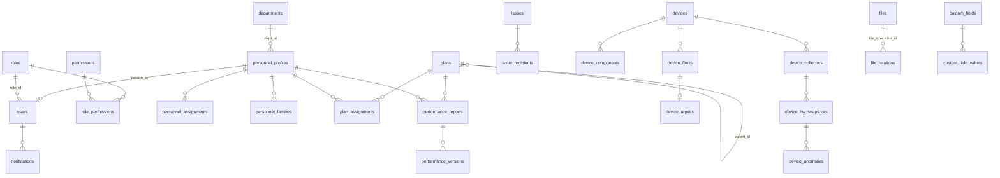

# OMPS Database Schema

[中文版](DATABASE.md)

For: developers who maintain or extend OMPS.

> The column lists are generated from the actual database (up to migration `2026_11_30_000014`: 65 tables, 688 columns); table and key column descriptions are written by hand. Update this file after changing the schema.

## 1. Overview

- Database: MariaDB 10.1 (syntax shared with MySQL 8), InnoDB, `utf8mb4` (codes and keys use `ascii`).
- The schema is created and upgraded only by the scripts in `database/migrations/`, run in file-name order (`php omps migrate`); the ones already run are recorded in the `migrations` table. **Never edit a released migration; add a new one.**
- Two database accounts: `omps_app` (day-to-day, data only) and `omps_migrate` (only for `php omps migrate`); see `docs/INSTALL.en.md`.
- Base data (languages, roles, permissions, menus, dictionaries) is synced from `database/seeds/base.php` (`php omps migrate --seed`); it contains no accounts or passwords.

## 2. Conventions

| Convention | Meaning |
|---|---|
| Common columns | `id` auto-increment key; `org_id` organization (always 1 for now); `created_at/by`, `updated_at/by` time and account |
| Soft delete | Tables with `deleted_at` only set the time when deleting; queries leave such rows out; files go to a recycle bin for 30 days |
| Optimistic lock | Tables with `version` compare it on save: if someone saved first, the user is asked to reload instead of overwriting |
| JSON | No JSON column type; JSON is stored as text in `LONGTEXT` / `TEXT` |
| Sensitive data | ID numbers, family phone and address: `*_enc` = AES-256-GCM (key = `APP_KEY` in `.env`), `*_hash` = HMAC (duplicates), `*_mask` = shown mask. **Without APP_KEY they cannot be decrypted**: back up `.env` with the database |
| Tokens | Session tokens, collector registration codes and device tokens are stored as SHA-256 only |
| Texts | Program texts are not in the database; notifications store a type and parameters and are shown in the viewer's language; configuration texts are in `translations` |
| Foreign keys | Only where parent and child must exist together; elsewhere the code keeps the links (simpler soft delete and restore) |
| Clean-up | Log tables (operation, sign-in, device usage, hardware snapshots) and audit logs are deleted after the periods in Backups → automatic clean-up; business data is never deleted automatically |

## 3. Main relations

## 4. Tables

**System and configuration**

| Table | Purpose |
|---|---|
| [`system_settings`](#system-settings) | Key/value system settings (unit, sign-in security, work hours, backup and clean-up periods, theme...) |
| [`languages`](#languages) | Languages; only a fully translated language can be enabled; one is the default |
| [`translations`](#translations) | Texts produced by configuration (custom role names, menus, custom fields, statistics pages...) and program texts changed in Language management (namespace ui, laid over the language files) |
| [`missing_translations`](#missing-translations) | Translation keys asked for but missing at run time; the super admins are told the first time |
| [`module_registry`](#module-registry) | Installed modules |
| [`dictionaries`](#dictionaries) | Data dictionaries (device categories, education levels...) |
| [`dictionary_items`](#dictionary-items) | Dictionary items; names are translation keys |
| [`menus`](#menus) | The side menu tree: route, required permission, device-admin only; user_sort / enabled are changes made in Menu management |
| [`user_prefs`](#user-prefs) | Personal preferences (quiet hours, pop-up notices...) |
| [`backup_logs`](#backup-logs) | One row per backup: kind (manual, auto, pre-restore, pre-upgrade), result, sizes, checksum |

**Accounts and permissions**

| Table | Purpose |
|---|---|
| [`users`](#users) | Sign-in accounts |
| [`roles`](#roles) | Roles: 4 built-in (super admin, unit head, department head, member) plus custom ones; scope = data scope (all / unit / dept / self) |
| [`permissions`](#permissions) | Permission codes (e.g |
| [`role_permissions`](#role-permissions) | Permissions of each role |
| [`user_sessions`](#user-sessions) | Sign-in sessions |
| [`login_attempts`](#login-attempts) | Failed sign-in attempts by IP and account, for lock-out and throttling; wrong collector registration codes too (username #collector) |

**Logs**

| Table | Purpose |
|---|---|
| [`operation_logs`](#operation-logs) | Operation log: who did what and when; actions are codes translated when viewed |
| [`audit_logs`](#audit-logs) | Audit log: data before and after a change, views of full ID numbers and other sensitive actions |
| [`login_logs`](#login-logs) | Sign-ins, sign-outs and failures |
| [`data_versions`](#data-versions) | History snapshots of important records |

**Organization and personnel**

| Table | Purpose |
|---|---|
| [`departments`](#departments) | Department tree (path = ancestor path such as /1/5/) |
| [`personnel_profiles`](#personnel-profiles) | Personnel records |
| [`personnel_assignments`](#personnel-assignments) | Posts and transfers (department, position, dates, type of change) |
| [`personnel_education`](#personnel-education) | Education |
| [`personnel_work_experience`](#personnel-work-experience) | Work experience |
| [`personnel_titles`](#personnel-titles) | Professional titles |
| [`personnel_achievements`](#personnel-achievements) | Achievements, awards, certificates |
| [`personnel_families`](#personnel-families) | Family members |
| [`profile_field_policies`](#profile-field-policies) | What people may change in their own record: forbid / direct / review |
| [`profile_change_requests`](#profile-change-requests) | Changes people submit to their own record, with the review result (data before / after) |

**Plans, results and reports**

| Table | Purpose |
|---|---|
| [`plans`](#plans) | The plan tree (long-term, annual, quarter, month, week, day) |
| [`plan_paths`](#plan-paths) | Ancestor / descendant pairs of plans (including each plan itself, depth 0) for fast subtree queries |
| [`plan_assignments`](#plan-assignments) | Who a plan is assigned to (several people allowed) |
| [`performance_reports`](#performance-reports) | Results: one per plan and assignee |
| [`performance_versions`](#performance-versions) | Every save, submit, approval, edit-and-approve, return and withdrawal of a result |
| [`reports`](#reports) | Comprehensive reports (generated from conditions or written by hand); only the creator sees them |
| [`report_versions`](#report-versions) | Versions of a report (content snapshots) |
| [`report_exports`](#report-exports) | Prints and downloads of reports |

**My affairs**

| Table | Purpose |
|---|---|
| [`notifications`](#notifications) | In-app notifications (the bell) |
| [`notes`](#notes) | Notebook: private until submitted to the superior; locked after that; the superior may reply |
| [`issues`](#issues) | Issued items: tips, documents (read only) and orders (complete and reply by a deadline) |
| [`issue_recipients`](#issue-recipients) | Each recipient of an issued item: read, done, reply, reminders sent |
| [`reminder_rules`](#reminder-rules) | Reminder rules (one row per kind) |
| [`reminder_triggers`](#reminder-triggers) | When a rule fires (how long before, time of day, weekday / day of month, repeat) |

**Devices**

| Table | Purpose |
|---|---|
| [`devices`](#devices) | Device records |
| [`device_holders`](#device-holders) | Holder history: a change of holder closes the open row and adds a new one |
| [`device_components`](#device-components) | Parts (CPU, memory, disks, keyboard, mouse...) |
| [`device_component_history`](#device-component-history) | Install / replace / remove history of parts, noting a repair or a confirmed hardware change |
| [`device_licenses`](#device-licenses) | Software licences (expiry reminders) |
| [`device_faults`](#device-faults) | Fault reports: anyone may report; assigned, fixed or cancelled |
| [`device_repairs`](#device-repairs) | Repairs: one per fault report (repairer, cost, result) |
| [`device_collectors`](#device-collectors) | Collector clients: the one-time code and the device token are stored as SHA-256 only |
| [`device_hw_snapshots`](#device-hw-snapshots) | Hardware snapshots reported by collectors (JSON) |
| [`device_anomalies`](#device-anomalies) | Hardware changes: parts added / missing, waiting to be confirmed or ignored |
| [`device_usage_logs`](#device-usage-logs) | Usage records: collector registration and every report (time, IP, computer name, changed or not) |

**Files**

| Table | Purpose |
|---|---|
| [`files`](#files) | Uploaded files, stored outside the web root (FILES_PATH) in folders that mirror the platform; identical content (sha256) is stored once |
| [`file_relations`](#file-relations) | Which business record a file belongs to (biz_type + biz_id); a file may be referenced by several records |
| [`file_trash_relations`](#file-trash-relations) | References of files in the recycle bin, for restoring within 30 days |

**Custom fields, statistics and documents**

| Table | Purpose |
|---|---|
| [`custom_fields`](#custom-fields) | Custom field definitions (personnel, devices, plans) |
| [`custom_field_options`](#custom-field-options) | Options of custom drop-down fields |
| [`custom_field_values`](#custom-field-values) | Custom field values in typed columns so they compare, sort and sum correctly; no business table is altered |
| [`stat_pages`](#stat-pages) | Custom statistics pages |
| [`stat_widgets`](#stat-widgets) | Widgets of a statistics page; def is a controlled query definition (never SQL) |
| [`doc_templates`](#doc-templates) | Uploaded Word templates (reports, personnel forms) with the placeholder check |
| [`generated_documents`](#generated-documents) | Documents generated |

## 5. Table details

### System and configuration

#### `system_settings`

Key/value system settings (unit, sign-in security, work hours, backup and clean-up periods, theme...). Values are JSON text.

| Column | Type | Null | Default | Notes |
|---|---|---|---|---|
| `id` | bigint(20) unsigned AUTO_INCREMENT |  |  | Primary key, auto increment |
| `org_id` | bigint(20) unsigned |  | 1 | Organization (always 1 for now; reserved for several units) |
| `skey` | varchar(100) |  |  | Setting key |
| `svalue` | longtext | yes |  | Value (JSON) |
| `updated_at` | datetime | yes |  | Updated at |
| `updated_by` | bigint(20) unsigned | yes |  | Updated by (users.id) |

- Indexes: primary `PRIMARY`(id); unique `uk_org_key`(org_id,skey)

#### `languages`

Languages; only a fully translated language can be enabled; one is the default.

| Column | Type | Null | Default | Notes |
|---|---|---|---|---|
| `id` | bigint(20) unsigned AUTO_INCREMENT |  |  | Primary key, auto increment |
| `code` | varchar(20) |  |  |  |
| `name` | varchar(50) |  |  |  |
| `enabled` | tinyint(1) |  | 0 |  |
| `is_default` | tinyint(1) |  | 0 |  |
| `sort` | int(11) |  | 0 | Sort order |
| `created_at` | datetime |  |  | Created at |
| `updated_at` | datetime | yes |  | Updated at |

- Indexes: primary `PRIMARY`(id); unique `uk_code`(code)

#### `translations`

Texts produced by configuration (custom role names, menus, custom fields, statistics pages...) and program texts changed in Language management (namespace ui, laid over the language files).

| Column | Type | Null | Default | Notes |
|---|---|---|---|---|
| `id` | bigint(20) unsigned AUTO_INCREMENT |  |  | Primary key, auto increment |
| `namespace` | varchar(50) |  |  | ui = program text override; role / menu / cf (custom field) / cfo (field option) / stat / banner |
| `tkey` | varchar(150) |  |  |  |
| `lang` | varchar(20) |  |  |  |
| `text` | text |  |  |  |
| `updated_at` | datetime | yes |  | Updated at |
| `updated_by` | bigint(20) unsigned | yes |  | Updated by (users.id) |

- Indexes: primary `PRIMARY`(id); unique `uk_ns_key_lang`(namespace,tkey,lang)

#### `missing_translations`

Translation keys asked for but missing at run time; the super admins are told the first time.

| Column | Type | Null | Default | Notes |
|---|---|---|---|---|
| `id` | bigint(20) unsigned AUTO_INCREMENT |  |  | Primary key, auto increment |
| `lang` | varchar(20) |  |  |  |
| `tkey` | varchar(190) |  |  |  |
| `hits` | int(10) unsigned |  | 1 |  |
| `first_seen` | datetime |  |  |  |
| `last_seen` | datetime |  |  |  |

- Indexes: primary `PRIMARY`(id); unique `uk_lang_key`(lang,tkey)

#### `module_registry`

Installed modules.

| Column | Type | Null | Default | Notes |
|---|---|---|---|---|
| `id` | bigint(20) unsigned AUTO_INCREMENT |  |  | Primary key, auto increment |
| `code` | varchar(50) |  |  |  |
| `version` | varchar(20) |  |  | Optimistic lock: checked on save so two people do not overwrite each other |
| `enabled` | tinyint(1) |  | 1 |  |
| `installed_at` | datetime |  |  |  |
| `updated_at` | datetime | yes |  | Updated at |

- Indexes: primary `PRIMARY`(id); unique `uk_code`(code)

#### `dictionaries`

Data dictionaries (device categories, education levels...).

| Column | Type | Null | Default | Notes |
|---|---|---|---|---|
| `id` | bigint(20) unsigned AUTO_INCREMENT |  |  | Primary key, auto increment |
| `code` | varchar(50) |  |  |  |
| `name_key` | varchar(100) |  |  | Translation key of the name |
| `is_builtin` | tinyint(1) |  | 1 |  |

- Indexes: primary `PRIMARY`(id); unique `uk_code`(code)

#### `dictionary_items`

Dictionary items; names are translation keys.

| Column | Type | Null | Default | Notes |
|---|---|---|---|---|
| `id` | bigint(20) unsigned AUTO_INCREMENT |  |  | Primary key, auto increment |
| `dict_id` | bigint(20) unsigned |  |  |  |
| `code` | varchar(50) |  |  |  |
| `name_key` | varchar(100) |  |  | Translation key of the name |
| `sort` | int(11) |  | 0 | Sort order |
| `enabled` | tinyint(1) |  | 1 |  |

- Indexes: primary `PRIMARY`(id); unique `uk_dict_code`(dict_id,code)
- Foreign keys: `dict_id` → `dictionaries.id`

#### `menus`

The side menu tree: route, required permission, device-admin only; user_sort / enabled are changes made in Menu management.

| Column | Type | Null | Default | Notes |
|---|---|---|---|---|
| `id` | bigint(20) unsigned AUTO_INCREMENT |  |  | Primary key, auto increment |
| `parent_id` | bigint(20) unsigned | yes |  |  |
| `code` | varchar(50) |  |  |  |
| `title_key` | varchar(100) |  |  | Translation key of the title |
| `icon` | varchar(30) | yes |  |  |
| `route` | varchar(191) | yes |  |  |
| `permission_code` | varchar(100) | yes |  |  |
| `requires_device_admin` | tinyint(1) |  | 0 | Shown only to device administrators |
| `module` | varchar(50) |  |  | Module code |
| `sort` | int(11) |  | 0 | Sort order |
| `user_sort` | int(11) | yes |  | Order set in Menu management (empty = default) |
| `enabled` | tinyint(1) |  | 1 |  |

- Indexes: index `idx_parent`(parent_id); primary `PRIMARY`(id); unique `uk_code`(code)

#### `user_prefs`

Personal preferences (quiet hours, pop-up notices...).

| Column | Type | Null | Default | Notes |
|---|---|---|---|---|
| `user_id` | bigint(20) unsigned |  |  | Account (users.id) |
| `pkey` | varchar(40) |  |  |  |
| `pvalue` | varchar(500) | yes |  |  |

- Indexes: primary `PRIMARY`(user_id,pkey)

#### `backup_logs`

One row per backup: kind (manual, auto, pre-restore, pre-upgrade), result, sizes, checksum. The files themselves are in BACKUP_PATH.

| Column | Type | Null | Default | Notes |
|---|---|---|---|---|
| `id` | bigint(20) unsigned AUTO_INCREMENT |  |  | Primary key, auto increment |
| `file_name` | varchar(120) |  |  |  |
| `kind` | enum('manual','auto','pre_restore','pre_migrate') |  |  | manual / auto / pre_restore / pre_migrate |
| `status` | enum('running','ok','failed') |  |  | Status (values in the type) |
| `db_bytes` | bigint(20) unsigned |  | 0 |  |
| `files_bytes` | bigint(20) unsigned |  | 0 |  |
| `files_count` | int(10) unsigned |  | 0 |  |
| `size` | bigint(20) unsigned |  | 0 |  |
| `sha256` | char(64) | yes |  | Checksum of the backup file |
| `message` | varchar(500) | yes |  |  |
| `started_at` | datetime |  |  |  |
| `finished_at` | datetime | yes |  |  |
| `created_by` | bigint(20) unsigned | yes |  | Created by (users.id) |

- Indexes: index `idx_started`(started_at); primary `PRIMARY`(id)

### Accounts and permissions

#### `users`

Sign-in accounts. An account links to at most one person; the role sets permissions and data scope; is_device_admin = also device administrator.

| Column | Type | Null | Default | Notes |
|---|---|---|---|---|
| `id` | bigint(20) unsigned AUTO_INCREMENT |  |  | Primary key, auto increment |
| `org_id` | bigint(20) unsigned |  | 1 | Organization (always 1 for now; reserved for several units) |
| `person_id` | bigint(20) unsigned | yes |  | Person (personnel_profiles.id) |
| `username` | varchar(50) |  |  |  |
| `display_name` | varchar(50) |  |  |  |
| `password_hash` | varchar(255) |  |  | Password hash (password_hash); never plain text |
| `role_id` | bigint(20) unsigned |  |  |  |
| `is_device_admin` | tinyint(1) |  | 0 | Also device administrator (gets every device permission) |
| `lang` | varchar(20) | yes |  |  |
| `status` | enum('active','disabled') |  | active | Status (values in the type) |
| `session_version` | int(10) unsigned |  | 1 | Incremented to end all sessions of the account (password change, sign-out everywhere) |
| `failed_count` | int(10) unsigned |  | 0 | Consecutive failed sign-ins |
| `locked_until` | datetime | yes |  | Locked until |
| `must_change_password` | tinyint(1) |  | 0 | Must change the password at next sign-in (temporary password) |
| `password_changed_at` | datetime | yes |  |  |
| `last_login_at` | datetime | yes |  |  |
| `last_login_ip` | varchar(45) | yes |  |  |
| `created_at` | datetime |  |  | Created at |
| `created_by` | bigint(20) unsigned | yes |  | Created by (users.id) |
| `updated_at` | datetime | yes |  | Updated at |
| `updated_by` | bigint(20) unsigned | yes |  | Updated by (users.id) |
| `deleted_at` | datetime | yes |  | Soft delete time; set = deleted |
| `deleted_by` | bigint(20) unsigned | yes |  | Deleted by |
| `version` | int(10) unsigned |  | 1 | Optimistic lock: checked on save so two people do not overwrite each other |

- Indexes: index `idx_person`(person_id); index `idx_role`(role_id); primary `PRIMARY`(id); unique `uk_username`(username)
- Foreign keys: `role_id` → `roles.id`

#### `roles`

Roles: 4 built-in (super admin, unit head, department head, member) plus custom ones; scope = data scope (all / unit / dept / self).

| Column | Type | Null | Default | Notes |
|---|---|---|---|---|
| `id` | bigint(20) unsigned AUTO_INCREMENT |  |  | Primary key, auto increment |
| `code` | varchar(50) |  |  |  |
| `name_key` | varchar(100) | yes |  | Translation key of the name |
| `is_builtin` | tinyint(1) |  | 0 |  |
| `role_rank` | int(11) |  | 0 | Rank (for the review chain) |
| `scope` | enum('self','dept','unit','all') |  | self | Data scope: all / unit / dept / self |
| `description` | varchar(200) | yes |  |  |
| `sort` | int(11) |  | 0 | Sort order |
| `created_at` | datetime |  |  | Created at |
| `created_by` | bigint(20) unsigned | yes |  | Created by (users.id) |
| `updated_at` | datetime | yes |  | Updated at |
| `updated_by` | bigint(20) unsigned | yes |  | Updated by (users.id) |

- Indexes: primary `PRIMARY`(id); unique `uk_code`(code)

#### `permissions`

Permission codes (e.g. device.edit), synced from each module's permissions.php.

| Column | Type | Null | Default | Notes |
|---|---|---|---|---|
| `id` | bigint(20) unsigned AUTO_INCREMENT |  |  | Primary key, auto increment |
| `code` | varchar(100) |  |  |  |
| `module` | varchar(50) |  |  | Module code |
| `action` | varchar(50) |  |  | Action code |
| `type` | enum('action','sensitive','technical') |  | action |  |
| `sort` | int(11) |  | 0 | Sort order |

- Indexes: primary `PRIMARY`(id); unique `uk_code`(code)

#### `role_permissions`

Permissions of each role.

| Column | Type | Null | Default | Notes |
|---|---|---|---|---|
| `role_id` | bigint(20) unsigned |  |  |  |
| `permission_id` | bigint(20) unsigned |  |  |  |

- Indexes: index `fk_rp_perm`(permission_id); primary `PRIMARY`(role_id,permission_id)
- Foreign keys: `permission_id` → `permissions.id`; `role_id` → `roles.id`

#### `user_sessions`

Sign-in sessions. id = SHA-256 of the cookie token (the token itself is never stored); can be revoked.

| Column | Type | Null | Default | Notes |
|---|---|---|---|---|
| `id` | char(64) |  |  | SHA-256 of the cookie token |
| `user_id` | bigint(20) unsigned |  |  | Account (users.id) |
| `session_version` | int(10) unsigned |  |  |  |
| `csrf_token` | char(64) |  |  | CSRF token of the session |
| `ip` | varchar(45) | yes |  | IP address |
| `user_agent` | varchar(255) | yes |  |  |
| `created_at` | datetime |  |  | Created at |
| `last_active` | datetime |  |  |  |
| `expires_at` | datetime |  |  |  |
| `revoked_at` | datetime | yes |  |  |
| `revoke_reason` | varchar(50) | yes |  |  |

- Indexes: index `idx_user`(user_id); primary `PRIMARY`(id)

#### `login_attempts`

Failed sign-in attempts by IP and account, for lock-out and throttling; wrong collector registration codes too (username #collector).

| Column | Type | Null | Default | Notes |
|---|---|---|---|---|
| `id` | bigint(20) unsigned AUTO_INCREMENT |  |  | Primary key, auto increment |
| `ip` | varchar(45) |  |  | IP address |
| `username` | varchar(50) |  |  |  |
| `created_at` | datetime |  |  | Created at |

- Indexes: index `idx_ip_time`(ip,created_at); primary `PRIMARY`(id)

### Logs

#### `operation_logs`

Operation log: who did what and when; actions are codes translated when viewed. Deleted after the logs period of the automatic clean-up.

| Column | Type | Null | Default | Notes |
|---|---|---|---|---|
| `id` | bigint(20) unsigned AUTO_INCREMENT |  |  | Primary key, auto increment |
| `org_id` | bigint(20) unsigned |  | 1 | Organization (always 1 for now; reserved for several units) |
| `user_id` | bigint(20) unsigned | yes |  | Account (users.id) |
| `username` | varchar(50) | yes |  |  |
| `module` | varchar(50) |  |  | Module code |
| `action` | varchar(50) |  |  | Action code |
| `target_type` | varchar(50) | yes |  | Target type |
| `target_id` | bigint(20) unsigned | yes |  | Target id |
| `target_label` | varchar(191) | yes |  | Target name (as it was then) |
| `detail` | longtext | yes |  | Details (JSON) |
| `ip` | varchar(45) | yes |  | IP address |
| `created_at` | datetime |  |  | Created at |

- Indexes: index `idx_created`(created_at); index `idx_module`(module); index `idx_user`(user_id); primary `PRIMARY`(id)

#### `audit_logs`

Audit log: data before and after a change, views of full ID numbers and other sensitive actions. Own kept period (for ever by default).

| Column | Type | Null | Default | Notes |
|---|---|---|---|---|
| `id` | bigint(20) unsigned AUTO_INCREMENT |  |  | Primary key, auto increment |
| `org_id` | bigint(20) unsigned |  | 1 | Organization (always 1 for now; reserved for several units) |
| `user_id` | bigint(20) unsigned | yes |  | Account (users.id) |
| `username` | varchar(50) | yes |  |  |
| `module` | varchar(50) |  |  | Module code |
| `action` | varchar(50) |  |  | Action code |
| `target_type` | varchar(50) | yes |  | Target type |
| `target_id` | bigint(20) unsigned | yes |  | Target id |
| `target_label` | varchar(191) | yes |  | Target name (as it was then) |
| `before_data` | longtext | yes |  | Data before (JSON) |
| `after_data` | longtext | yes |  | Data after (JSON) |
| `ip` | varchar(45) | yes |  | IP address |
| `created_at` | datetime |  |  | Created at |

- Indexes: index `idx_action`(action); index `idx_created`(created_at); index `idx_user`(user_id); primary `PRIMARY`(id)

#### `login_logs`

Sign-ins, sign-outs and failures.

| Column | Type | Null | Default | Notes |
|---|---|---|---|---|
| `id` | bigint(20) unsigned AUTO_INCREMENT |  |  | Primary key, auto increment |
| `org_id` | bigint(20) unsigned |  | 1 | Organization (always 1 for now; reserved for several units) |
| `user_id` | bigint(20) unsigned | yes |  | Account (users.id) |
| `username` | varchar(50) |  |  |  |
| `ip` | varchar(45) | yes |  | IP address |
| `user_agent` | varchar(255) | yes |  |  |
| `result` | enum('success','fail','locked','disabled','ip_blocked','logout') |  |  | success / fail / locked / disabled / ip_blocked / logout |
| `reason` | varchar(50) | yes |  |  |
| `created_at` | datetime |  |  | Created at |

- Indexes: index `idx_created`(created_at); index `idx_user`(user_id); primary `PRIMARY`(id)

#### `data_versions`

History snapshots of important records.

| Column | Type | Null | Default | Notes |
|---|---|---|---|---|
| `id` | bigint(20) unsigned AUTO_INCREMENT |  |  | Primary key, auto increment |
| `org_id` | bigint(20) unsigned |  | 1 | Organization (always 1 for now; reserved for several units) |
| `entity_type` | varchar(50) |  |  |  |
| `entity_id` | bigint(20) unsigned |  |  |  |
| `version` | int(10) unsigned |  |  | Optimistic lock: checked on save so two people do not overwrite each other |
| `snapshot` | longtext |  |  | JSON snapshot |
| `created_by` | bigint(20) unsigned | yes |  | Created by (users.id) |
| `created_at` | datetime |  |  | Created at |

- Indexes: index `idx_entity`(entity_type,entity_id); primary `PRIMARY`(id)

### Organization and personnel

#### `departments`

Department tree (path = ancestor path such as /1/5/).

| Column | Type | Null | Default | Notes |
|---|---|---|---|---|
| `id` | bigint(20) unsigned AUTO_INCREMENT |  |  | Primary key, auto increment |
| `org_id` | bigint(20) unsigned |  | 1 | Organization (always 1 for now; reserved for several units) |
| `parent_id` | bigint(20) unsigned | yes |  |  |
| `path` | varchar(191) |  | / | Ancestor path such as /1/5/ |
| `code` | varchar(50) |  |  |  |
| `name` | varchar(100) |  |  |  |
| `leader_person_id` | bigint(20) unsigned | yes |  | Department head (person) |
| `sort` | int(11) |  | 0 | Sort order |
| `status` | enum('active','disabled') |  | active | Status (values in the type) |
| `remark` | varchar(500) | yes |  | Remark |
| `created_at` | datetime |  |  | Created at |
| `created_by` | bigint(20) unsigned | yes |  | Created by (users.id) |
| `updated_at` | datetime | yes |  | Updated at |
| `updated_by` | bigint(20) unsigned | yes |  | Updated by (users.id) |
| `deleted_at` | datetime | yes |  | Soft delete time; set = deleted |
| `deleted_by` | bigint(20) unsigned | yes |  | Deleted by |
| `version` | int(10) unsigned |  | 1 | Optimistic lock: checked on save so two people do not overwrite each other |

- Indexes: index `idx_org`(org_id); index `idx_parent`(parent_id); index `idx_path`(path); primary `PRIMARY`(id); unique `uk_org_code`(org_id,code)

#### `personnel_profiles`

Personnel records. The ID number is encrypted: id_number_enc (AES-256-GCM), id_number_hash (HMAC for duplicates and exact lookup), id_number_mask (shown).

| Column | Type | Null | Default | Notes |
|---|---|---|---|---|
| `id` | bigint(20) unsigned AUTO_INCREMENT |  |  | Primary key, auto increment |
| `org_id` | bigint(20) unsigned |  | 1 | Organization (always 1 for now; reserved for several units) |
| `staff_no` | varchar(50) |  |  | Staff number |
| `photo_file_id` | bigint(20) unsigned | yes |  | Photo (files.id) |
| `name` | varchar(50) |  |  |  |
| `gender` | enum('male','female') |  |  |  |
| `birth_date` | date | yes |  |  |
| `ethnicity` | varchar(30) | yes |  |  |
| `id_type` | varchar(30) | yes |  |  |
| `id_number_enc` | varchar(255) | yes |  | ID number, encrypted (AES-256-GCM) |
| `id_number_hash` | char(64) | yes |  | ID number HMAC (duplicates, exact lookup) |
| `id_number_mask` | varchar(40) | yes |  | ID number mask (shown in lists) |
| `dept_id` | bigint(20) unsigned | yes |  | Department (departments.id) |
| `position` | varchar(100) | yes |  |  |
| `phone` | varchar(30) | yes |  |  |
| `email` | varchar(100) | yes |  |  |
| `address` | varchar(200) | yes |  |  |
| `hukou_address` | varchar(200) | yes |  |  |
| `hire_date` | date | yes |  |  |
| `status` | enum('active','disabled','left','retired') |  | active | Status (values in the type) |
| `unassigned` | tinyint(1) |  | 0 | Moved out of a department, waiting for a new one |
| `remark` | text | yes |  | Remark |
| `created_at` | datetime |  |  | Created at |
| `created_by` | bigint(20) unsigned | yes |  | Created by (users.id) |
| `updated_at` | datetime | yes |  | Updated at |
| `updated_by` | bigint(20) unsigned | yes |  | Updated by (users.id) |
| `deleted_at` | datetime | yes |  | Soft delete time; set = deleted |
| `deleted_by` | bigint(20) unsigned | yes |  | Deleted by |
| `version` | int(10) unsigned |  | 1 | Optimistic lock: checked on save so two people do not overwrite each other |

- Indexes: index `idx_dept`(dept_id); index `idx_id_hash`(id_number_hash); index `idx_name`(name); index `idx_org`(org_id); primary `PRIMARY`(id); unique `uk_org_staffno`(org_id,staff_no)

#### `personnel_assignments`

Posts and transfers (department, position, dates, type of change).

| Column | Type | Null | Default | Notes |
|---|---|---|---|---|
| `id` | bigint(20) unsigned AUTO_INCREMENT |  |  | Primary key, auto increment |
| `org_id` | bigint(20) unsigned |  | 1 | Organization (always 1 for now; reserved for several units) |
| `person_id` | bigint(20) unsigned |  |  | Person (personnel_profiles.id) |
| `dept_id` | bigint(20) unsigned | yes |  | Department (departments.id) |
| `from_dept_id` | bigint(20) unsigned | yes |  |  |
| `position` | varchar(100) | yes |  |  |
| `change_type` | enum('join','transfer','move_out','promote','leave','retire') |  |  | join / transfer / move_out / promote / leave / retire |
| `start_date` | date |  |  |  |
| `end_date` | date | yes |  |  |
| `note` | varchar(500) | yes |  | Note |
| `created_at` | datetime |  |  | Created at |
| `created_by` | bigint(20) unsigned | yes |  | Created by (users.id) |

- Indexes: index `idx_dept`(dept_id); index `idx_person`(person_id); primary `PRIMARY`(id)
- Foreign keys: `person_id` → `personnel_profiles.id`

#### `personnel_education`

Education.

| Column | Type | Null | Default | Notes |
|---|---|---|---|---|
| `id` | bigint(20) unsigned AUTO_INCREMENT |  |  | Primary key, auto increment |
| `person_id` | bigint(20) unsigned |  |  | Person (personnel_profiles.id) |
| `start_ym` | char(7) | yes |  |  |
| `end_ym` | char(7) | yes |  |  |
| `school` | varchar(100) |  |  |  |
| `country_region` | varchar(50) | yes |  |  |
| `major` | varchar(100) | yes |  |  |
| `degree_level` | varchar(30) | yes |  |  |
| `degree` | varchar(30) | yes |  |  |
| `graduated` | tinyint(1) |  | 1 |  |
| `certificate_no` | varchar(50) | yes |  |  |
| `sort` | int(11) |  | 0 | Sort order |
| `created_at` | datetime |  |  | Created at |
| `updated_at` | datetime | yes |  | Updated at |

- Indexes: index `idx_person`(person_id); primary `PRIMARY`(id)

#### `personnel_work_experience`

Work experience.

| Column | Type | Null | Default | Notes |
|---|---|---|---|---|
| `id` | bigint(20) unsigned AUTO_INCREMENT |  |  | Primary key, auto increment |
| `person_id` | bigint(20) unsigned |  |  | Person (personnel_profiles.id) |
| `start_ym` | char(7) | yes |  |  |
| `end_ym` | char(7) | yes |  |  |
| `employer` | varchar(100) |  |  |  |
| `position` | varchar(100) | yes |  |  |
| `duties` | varchar(500) | yes |  |  |
| `leave_reason` | varchar(200) | yes |  |  |
| `sort` | int(11) |  | 0 | Sort order |
| `created_at` | datetime |  |  | Created at |
| `updated_at` | datetime | yes |  | Updated at |

- Indexes: index `idx_person`(person_id); primary `PRIMARY`(id)

#### `personnel_titles`

Professional titles.

| Column | Type | Null | Default | Notes |
|---|---|---|---|---|
| `id` | bigint(20) unsigned AUTO_INCREMENT |  |  | Primary key, auto increment |
| `person_id` | bigint(20) unsigned |  |  | Person (personnel_profiles.id) |
| `title` | varchar(100) |  |  |  |
| `duty` | varchar(100) | yes |  |  |
| `level` | varchar(50) | yes |  |  |
| `obtained_ym` | char(7) | yes |  |  |
| `issuer` | varchar(100) | yes |  |  |
| `sort` | int(11) |  | 0 | Sort order |
| `created_at` | datetime |  |  | Created at |
| `updated_at` | datetime | yes |  | Updated at |

- Indexes: index `idx_person`(person_id); primary `PRIMARY`(id)

#### `personnel_achievements`

Achievements, awards, certificates.

| Column | Type | Null | Default | Notes |
|---|---|---|---|---|
| `id` | bigint(20) unsigned AUTO_INCREMENT |  |  | Primary key, auto increment |
| `person_id` | bigint(20) unsigned |  |  | Person (personnel_profiles.id) |
| `name` | varchar(150) |  |  |  |
| `type` | varchar(30) | yes |  |  |
| `obtained_date` | date | yes |  |  |
| `issuer` | varchar(100) | yes |  |  |
| `certificate_no` | varchar(50) | yes |  |  |
| `sort` | int(11) |  | 0 | Sort order |
| `created_at` | datetime |  |  | Created at |
| `updated_at` | datetime | yes |  | Updated at |

- Indexes: index `idx_person`(person_id); primary `PRIMARY`(id)

#### `personnel_families`

Family members. Highly sensitive: phone and address are encrypted (*_enc); the phone also has a mask.

| Column | Type | Null | Default | Notes |
|---|---|---|---|---|
| `id` | bigint(20) unsigned AUTO_INCREMENT |  |  | Primary key, auto increment |
| `person_id` | bigint(20) unsigned |  |  | Person (personnel_profiles.id) |
| `name` | varchar(50) |  |  |  |
| `relation` | varchar(30) |  |  |  |
| `gender` | enum('male','female') | yes |  |  |
| `birth_date` | date | yes |  |  |
| `employer` | varchar(100) | yes |  |  |
| `position` | varchar(100) | yes |  |  |
| `phone_enc` | varchar(255) | yes |  | Phone, encrypted |
| `phone_mask` | varchar(40) | yes |  | Phone mask |
| `address_enc` | varchar(600) | yes |  | Address, encrypted |
| `sort` | int(11) |  | 0 | Sort order |
| `created_at` | datetime |  |  | Created at |
| `created_by` | bigint(20) unsigned | yes |  | Created by (users.id) |
| `updated_at` | datetime | yes |  | Updated at |
| `updated_by` | bigint(20) unsigned | yes |  | Updated by (users.id) |

- Indexes: index `idx_person`(person_id); primary `PRIMARY`(id)

#### `profile_field_policies`

What people may change in their own record: forbid / direct / review.

| Column | Type | Null | Default | Notes |
|---|---|---|---|---|
| `id` | bigint(20) unsigned AUTO_INCREMENT |  |  | Primary key, auto increment |
| `entity` | varchar(30) |  |  |  |
| `field_key` | varchar(50) |  |  |  |
| `self_edit` | enum('forbid','direct','review') |  | review | forbid / direct / review |
| `admin_only` | tinyint(1) |  | 0 |  |

- Indexes: primary `PRIMARY`(id); unique `uk_entity_field`(entity,field_key)

#### `profile_change_requests`

Changes people submit to their own record, with the review result (data before / after).

| Column | Type | Null | Default | Notes |
|---|---|---|---|---|
| `id` | bigint(20) unsigned AUTO_INCREMENT |  |  | Primary key, auto increment |
| `org_id` | bigint(20) unsigned |  | 1 | Organization (always 1 for now; reserved for several units) |
| `person_id` | bigint(20) unsigned |  |  | Person (personnel_profiles.id) |
| `entity` | varchar(30) |  |  | Which part is changed (profile, education, family...) |
| `record_id` | bigint(20) unsigned | yes |  |  |
| `action` | enum('create','update','delete') |  |  | Action code |
| `before_data` | longtext | yes |  |  |
| `after_data` | longtext | yes |  |  |
| `status` | enum('pending','approved','returned','withdrawn') |  | pending | Status (values in the type) |
| `submitted_by` | bigint(20) unsigned |  |  |  |
| `submitted_at` | datetime |  |  |  |
| `reviewed_by` | bigint(20) unsigned | yes |  |  |
| `reviewed_at` | datetime | yes |  |  |
| `review_comment` | varchar(500) | yes |  |  |

- Indexes: index `idx_person`(person_id); index `idx_status`(status); primary `PRIMARY`(id)

### Plans, results and reports

#### `plans`

The plan tree (long-term, annual, quarter, month, week, day). level follows the dates; local_weight = share of the parent (%); period_key for period queries.

| Column | Type | Null | Default | Notes |
|---|---|---|---|---|
| `id` | bigint(20) unsigned AUTO_INCREMENT |  |  | Primary key, auto increment |
| `org_id` | bigint(20) unsigned |  | 1 | Organization (always 1 for now; reserved for several units) |
| `parent_id` | bigint(20) unsigned | yes |  | Parent plan |
| `dept_id` | bigint(20) unsigned | yes |  | Department (departments.id) |
| `level` | enum('long','annual','quarter','month','week','day') |  |  | long / annual / quarter / month / week / day, derived from the dates |
| `period_key` | varchar(20) |  |  | Period key (2026, 2026-Q1, 2026-03...) |
| `code` | varchar(30) |  |  |  |
| `title` | varchar(150) |  |  |  |
| `goal` | text | yes |  |  |
| `content` | text | yes |  |  |
| `start_date` | date |  |  |  |
| `end_date` | date |  |  |  |
| `time_label_mode` | varchar(10) |  | auto | How the time is shown (auto / shortcut / custom text) |
| `time_label_text` | varchar(20) | yes |  |  |
| `local_weight` | decimal(6,2) |  | 100.00 | Share of the parent plan (%) |
| `priority` | enum('high','medium','low') | yes |  |  |
| `status` | enum('active','done','cancelled') |  | active | Status (values in the type) |
| `owner_person_id` | bigint(20) unsigned | yes |  | Owner |
| `created_at` | datetime |  |  | Created at |
| `created_by` | bigint(20) unsigned | yes |  | Created by (users.id) |
| `updated_at` | datetime | yes |  | Updated at |
| `updated_by` | bigint(20) unsigned | yes |  | Updated by (users.id) |
| `deleted_at` | datetime | yes |  | Soft delete time; set = deleted |
| `deleted_by` | bigint(20) unsigned | yes |  | Deleted by |
| `version` | int(10) unsigned |  | 1 | Optimistic lock: checked on save so two people do not overwrite each other |

- Indexes: index `idx_dates`(start_date,end_date); index `idx_dept`(dept_id); index `idx_parent`(parent_id); index `idx_period`(period_key); primary `PRIMARY`(id); unique `uk_code`(code)

#### `plan_paths`

Ancestor / descendant pairs of plans (including each plan itself, depth 0) for fast subtree queries.

| Column | Type | Null | Default | Notes |
|---|---|---|---|---|
| `ancestor_id` | bigint(20) unsigned |  |  |  |
| `descendant_id` | bigint(20) unsigned |  |  |  |
| `depth` | int(11) |  |  | Levels between them (0 = itself) |

- Indexes: index `idx_desc`(descendant_id); primary `PRIMARY`(ancestor_id,descendant_id)

#### `plan_assignments`

Who a plan is assigned to (several people allowed).

| Column | Type | Null | Default | Notes |
|---|---|---|---|---|
| `id` | bigint(20) unsigned AUTO_INCREMENT |  |  | Primary key, auto increment |
| `plan_id` | bigint(20) unsigned |  |  | Plan (plans.id) |
| `person_id` | bigint(20) unsigned |  |  | Person (personnel_profiles.id) |
| `assigned_by` | bigint(20) unsigned | yes |  |  |
| `created_at` | datetime |  |  | Created at |

- Indexes: index `idx_person`(person_id); primary `PRIMARY`(id); unique `uk_plan_person`(plan_id,person_id)

#### `performance_reports`

Results: one per plan and assignee. appr_* keep the last approved values; completion and reports use only these, so a person may edit without changing what was approved.

| Column | Type | Null | Default | Notes |
|---|---|---|---|---|
| `id` | bigint(20) unsigned AUTO_INCREMENT |  |  | Primary key, auto increment |
| `org_id` | bigint(20) unsigned |  | 1 | Organization (always 1 for now; reserved for several units) |
| `plan_id` | bigint(20) unsigned |  |  | Plan (plans.id) |
| `person_id` | bigint(20) unsigned |  |  | Person (personnel_profiles.id) |
| `progress` | decimal(5,2) | yes |  | Completion % entered by the person |
| `done_content` | text | yes |  |  |
| `problems` | text | yes |  |  |
| `next_steps` | text | yes |  |  |
| `status` | enum('draft','submitted','approved','returned','withdrawn') |  | draft | Status (values in the type) |
| `submitted_at` | datetime | yes |  |  |
| `submitted_by` | bigint(20) unsigned | yes |  |  |
| `reviewed_at` | datetime | yes |  |  |
| `reviewed_by` | bigint(20) unsigned | yes |  |  |
| `review_comment` | varchar(500) | yes |  |  |
| `score` | decimal(5,2) | yes |  |  |
| `reviewer_edited` | tinyint(1) |  | 0 | Approved with the reviewer's edits |
| `appr_progress` | decimal(5,2) | yes |  | Last approved completion % (the only one rolled up) |
| `appr_content` | text | yes |  |  |
| `appr_problems` | text | yes |  |  |
| `appr_next` | text | yes |  |  |
| `appr_at` | datetime | yes |  |  |
| `created_at` | datetime |  |  | Created at |
| `created_by` | bigint(20) unsigned | yes |  | Created by (users.id) |
| `updated_at` | datetime | yes |  | Updated at |
| `updated_by` | bigint(20) unsigned | yes |  | Updated by (users.id) |
| `version` | int(10) unsigned |  | 1 | Optimistic lock: checked on save so two people do not overwrite each other |

- Indexes: index `idx_person_status`(person_id,status); index `idx_status`(status); primary `PRIMARY`(id); unique `uk_plan_person`(plan_id,person_id)

#### `performance_versions`

Every save, submit, approval, edit-and-approve, return and withdrawal of a result.

| Column | Type | Null | Default | Notes |
|---|---|---|---|---|
| `id` | bigint(20) unsigned AUTO_INCREMENT |  |  | Primary key, auto increment |
| `report_id` | bigint(20) unsigned |  |  | Parent record |
| `version_no` | int(10) unsigned |  |  |  |
| `kind` | varchar(20) |  |  | save / submit / self_approve / approve / edit_approve / return / withdraw |
| `snapshot` | longtext |  |  | JSON snapshot |
| `created_by` | bigint(20) unsigned | yes |  | Created by (users.id) |
| `created_at` | datetime |  |  | Created at |

- Indexes: index `idx_report`(report_id,version_no); primary `PRIMARY`(id)

#### `reports`

Comprehensive reports (generated from conditions or written by hand); only the creator sees them.

| Column | Type | Null | Default | Notes |
|---|---|---|---|---|
| `id` | bigint(20) unsigned AUTO_INCREMENT |  |  | Primary key, auto increment |
| `org_id` | bigint(20) unsigned |  | 1 | Organization (always 1 for now; reserved for several units) |
| `kind` | enum('gen','manual') |  |  | gen (from conditions) / manual |
| `title` | varchar(200) | yes |  |  |
| `period_start` | date | yes |  |  |
| `period_end` | date | yes |  |  |
| `plan_ids` | longtext | yes |  |  |
| `person_ids` | longtext | yes |  |  |
| `data_as_of` | datetime | yes |  | Data as of |
| `current_version` | int(10) unsigned |  | 1 |  |
| `created_by` | bigint(20) unsigned |  |  | Created by (users.id) |
| `created_at` | datetime |  |  | Created at |
| `updated_at` | datetime | yes |  | Updated at |
| `deleted_at` | datetime | yes |  | Soft delete time; set = deleted |
| `deleted_by` | bigint(20) unsigned | yes |  | Deleted by |

- Indexes: index `idx_creator`(created_by,deleted_at); primary `PRIMARY`(id)

#### `report_versions`

Versions of a report (content snapshots).

| Column | Type | Null | Default | Notes |
|---|---|---|---|---|
| `id` | bigint(20) unsigned AUTO_INCREMENT |  |  | Primary key, auto increment |
| `report_id` | bigint(20) unsigned |  |  | Parent record |
| `version_no` | int(10) unsigned |  |  |  |
| `title` | varchar(200) | yes |  |  |
| `period_start` | date | yes |  |  |
| `period_end` | date | yes |  |  |
| `intro` | text | yes |  |  |
| `outro` | text | yes |  |  |
| `content` | longtext | yes |  |  |
| `body` | longtext | yes |  |  |
| `created_by` | bigint(20) unsigned | yes |  | Created by (users.id) |
| `created_at` | datetime |  |  | Created at |

- Indexes: primary `PRIMARY`(id); unique `uk_report_version`(report_id,version_no)

#### `report_exports`

Prints and downloads of reports.

| Column | Type | Null | Default | Notes |
|---|---|---|---|---|
| `id` | bigint(20) unsigned AUTO_INCREMENT |  |  | Primary key, auto increment |
| `report_id` | bigint(20) unsigned |  |  | Parent record |
| `version_no` | int(10) unsigned |  |  |  |
| `format` | varchar(10) |  |  |  |
| `exported_by` | bigint(20) unsigned | yes |  |  |
| `created_at` | datetime |  |  | Created at |

- Indexes: index `idx_report`(report_id); primary `PRIMARY`(id)

### My affairs

#### `notifications`

In-app notifications (the bell). One row per recipient; no text is stored, only type + params rendered in the viewer's language. dedupe_key prevents duplicates. Read ones are kept 6 months at most.

| Column | Type | Null | Default | Notes |
|---|---|---|---|---|
| `id` | bigint(20) unsigned AUTO_INCREMENT |  |  | Primary key, auto increment |
| `org_id` | bigint(20) unsigned |  | 1 | Organization (always 1 for now; reserved for several units) |
| `user_id` | bigint(20) unsigned |  |  | Account (users.id) |
| `type` | varchar(40) |  |  | Type (translation key notify.msg.<type>) |
| `level` | enum('info','warn','urgent') |  | info |  |
| `params` | text | yes |  | Text parameters (JSON) |
| `link` | varchar(191) | yes |  | Page opened on click |
| `biz_type` | varchar(50) | yes |  | Business type (personnel, device, device_fault, issue...) |
| `biz_id` | bigint(20) unsigned | yes |  | Business record id |
| `actor_id` | bigint(20) unsigned | yes |  | Who caused it |
| `dedupe_key` | char(40) | yes |  | De-duplication key (one per rule / object / recipient / moment) |
| `read_at` | datetime | yes |  |  |
| `created_at` | datetime |  |  | Created at |

- Indexes: index `idx_biz`(biz_type,biz_id); index `idx_user_read`(user_id,read_at); primary `PRIMARY`(id); unique `uk_dedupe`(dedupe_key)

#### `notes`

Notebook: private until submitted to the superior; locked after that; the superior may reply.

| Column | Type | Null | Default | Notes |
|---|---|---|---|---|
| `id` | bigint(20) unsigned AUTO_INCREMENT |  |  | Primary key, auto increment |
| `org_id` | bigint(20) unsigned |  | 1 | Organization (always 1 for now; reserved for several units) |
| `owner_id` | bigint(20) unsigned |  |  |  |
| `title` | varchar(200) |  |  |  |
| `body` | mediumtext | yes |  |  |
| `plan_id` | bigint(20) unsigned | yes |  | Plan (plans.id) |
| `status` | enum('private','submitted','read') |  | private | Status (values in the type) |
| `submitted_to` | bigint(20) unsigned | yes |  | Submitted to (users.id) |
| `submitted_at` | datetime | yes |  |  |
| `read_at` | datetime | yes |  |  |
| `reply` | text | yes |  | Superior's reply |
| `created_at` | datetime |  |  | Created at |
| `updated_at` | datetime | yes |  | Updated at |
| `version` | int(10) unsigned |  | 1 | Optimistic lock: checked on save so two people do not overwrite each other |

- Indexes: index `idx_owner`(owner_id,updated_at); index `idx_to`(submitted_to,status); primary `PRIMARY`(id)

#### `issues`

Issued items: tips, documents (read only) and orders (complete and reply by a deadline).

| Column | Type | Null | Default | Notes |
|---|---|---|---|---|
| `id` | bigint(20) unsigned AUTO_INCREMENT |  |  | Primary key, auto increment |
| `org_id` | bigint(20) unsigned |  | 1 | Organization (always 1 for now; reserved for several units) |
| `sender_id` | bigint(20) unsigned |  |  |  |
| `kind` | enum('tip','doc','order') |  |  | tip / doc / order |
| `title` | varchar(200) |  |  |  |
| `body` | text | yes |  |  |
| `need_reply` | tinyint(1) |  | 0 | Needs completion and a reply |
| `due_at` | datetime | yes |  |  |
| `remind_freq` | enum('auto','day','half','2h') |  | auto | Reminder frequency |
| `status` | enum('active','withdrawn') |  | active | Status (values in the type) |
| `withdrawn_at` | datetime | yes |  |  |
| `overdue_told` | tinyint(1) |  | 0 |  |
| `created_at` | datetime |  |  | Created at |

- Indexes: index `idx_sender`(sender_id,created_at); index `idx_status_due`(status,due_at); primary `PRIMARY`(id)

#### `issue_recipients`

Each recipient of an issued item: read, done, reply, reminders sent.

| Column | Type | Null | Default | Notes |
|---|---|---|---|---|
| `id` | bigint(20) unsigned AUTO_INCREMENT |  |  | Primary key, auto increment |
| `issue_id` | bigint(20) unsigned |  |  |  |
| `user_id` | bigint(20) unsigned |  |  | Account (users.id) |
| `read_at` | datetime | yes |  |  |
| `done_at` | datetime | yes |  |  |
| `reply` | text | yes |  |  |
| `nudge_count` | int(10) unsigned |  | 0 | Times nudged |
| `nudged_at` | datetime | yes |  |  |

- Indexes: index `idx_user`(user_id,done_at); primary `PRIMARY`(id); unique `uk_issue_user`(issue_id,user_id)
- Foreign keys: `issue_id` → `issues.id`

#### `reminder_rules`

Reminder rules (one row per kind).

| Column | Type | Null | Default | Notes |
|---|---|---|---|---|
| `id` | bigint(20) unsigned AUTO_INCREMENT |  |  | Primary key, auto increment |
| `code` | varchar(40) |  |  |  |
| `level` | enum('info','warn','urgent') |  | info |  |
| `max_repeat` | int(10) unsigned |  | 0 |  |
| `escalate` | tinyint(1) |  | 0 |  |
| `enabled` | tinyint(1) |  | 1 |  |
| `sort` | int(11) |  | 0 | Sort order |
| `updated_at` | datetime | yes |  | Updated at |
| `updated_by` | bigint(20) unsigned | yes |  | Updated by (users.id) |

- Indexes: primary `PRIMARY`(id); unique `uk_code`(code)

#### `reminder_triggers`

When a rule fires (how long before, time of day, weekday / day of month, repeat).

| Column | Type | Null | Default | Notes |
|---|---|---|---|---|
| `id` | bigint(20) unsigned AUTO_INCREMENT |  |  | Primary key, auto increment |
| `rule_id` | bigint(20) unsigned |  |  |  |
| `mode` | varchar(10) |  |  |  |
| `amount` | int(10) unsigned |  | 0 |  |
| `unit` | varchar(5) | yes |  |  |
| `time_of_day` | char(5) | yes |  |  |
| `weekday` | tinyint(3) unsigned | yes |  |  |
| `month_day` | tinyint(3) unsigned | yes |  |  |
| `repeat_mode` | varchar(5) | yes |  |  |
| `sort` | int(11) |  | 0 | Sort order |

- Indexes: index `idx_rule`(rule_id); primary `PRIMARY`(id)
- Foreign keys: `rule_id` → `reminder_rules.id`

### Devices

#### `devices`

Device records. run_status = normal, fault, repairing, disabled, scrapped.

| Column | Type | Null | Default | Notes |
|---|---|---|---|---|
| `id` | bigint(20) unsigned AUTO_INCREMENT |  |  | Primary key, auto increment |
| `org_id` | bigint(20) unsigned |  | 1 | Organization (always 1 for now; reserved for several units) |
| `asset_no` | varchar(50) |  |  | Asset number (unique) |
| `name` | varchar(100) |  |  |  |
| `category` | varchar(30) |  |  |  |
| `brand` | varchar(50) | yes |  |  |
| `model` | varchar(100) | yes |  |  |
| `serial_no` | varchar(100) | yes |  |  |
| `dept_id` | bigint(20) unsigned | yes |  | Department (departments.id) |
| `holder_person_id` | bigint(20) unsigned | yes |  | Current holder |
| `location` | varchar(100) | yes |  |  |
| `purchase_date` | date | yes |  |  |
| `received_date` | date | yes |  |  |
| `price` | decimal(12,2) | yes |  |  |
| `warranty_until` | date | yes |  |  |
| `run_status` | enum('normal','fault','repairing','disabled','scrapped') |  | normal | normal / fault / repairing / disabled / scrapped |
| `remark` | varchar(500) | yes |  | Remark |
| `created_at` | datetime |  |  | Created at |
| `created_by` | bigint(20) unsigned | yes |  | Created by (users.id) |
| `updated_at` | datetime | yes |  | Updated at |
| `updated_by` | bigint(20) unsigned | yes |  | Updated by (users.id) |
| `deleted_at` | datetime | yes |  | Soft delete time; set = deleted |
| `deleted_by` | bigint(20) unsigned | yes |  | Deleted by |
| `version` | int(10) unsigned |  | 1 | Optimistic lock: checked on save so two people do not overwrite each other |

- Indexes: index `idx_dept`(dept_id); index `idx_holder`(holder_person_id); index `idx_status`(run_status); primary `PRIMARY`(id); unique `uk_asset`(org_id,asset_no)

#### `device_holders`

Holder history: a change of holder closes the open row and adds a new one.

| Column | Type | Null | Default | Notes |
|---|---|---|---|---|
| `id` | bigint(20) unsigned AUTO_INCREMENT |  |  | Primary key, auto increment |
| `device_id` | bigint(20) unsigned |  |  | Device (devices.id) |
| `person_id` | bigint(20) unsigned | yes |  | Person (personnel_profiles.id) |
| `dept_id` | bigint(20) unsigned | yes |  | Department (departments.id) |
| `start_date` | date |  |  |  |
| `end_date` | date | yes |  |  |
| `note` | varchar(200) | yes |  | Note |
| `created_at` | datetime |  |  | Created at |
| `created_by` | bigint(20) unsigned | yes |  | Created by (users.id) |

- Indexes: index `idx_device`(device_id); index `idx_person`(person_id); primary `PRIMARY`(id)

#### `device_components`

Parts (CPU, memory, disks, keyboard, mouse...). Replacing = close the old row (removed_on) + new row + history; nothing is overwritten.

| Column | Type | Null | Default | Notes |
|---|---|---|---|---|
| `id` | bigint(20) unsigned AUTO_INCREMENT |  |  | Primary key, auto increment |
| `device_id` | bigint(20) unsigned |  |  | Device (devices.id) |
| `ctype` | varchar(20) |  |  | Part type: cpu / memory / disk / board / monitor / nic / keyboard / mouse / gpu / other |
| `model` | varchar(150) | yes |  |  |
| `serial_no` | varchar(100) | yes |  |  |
| `spec` | varchar(100) | yes |  | Spec (size, cores, or vendor:product ID for keyboards and mice) |
| `installed_on` | date | yes |  |  |
| `removed_on` | date | yes |  | Removed on; empty = in use |
| `source` | enum('manual','collector') |  | manual | manual / collector |
| `created_at` | datetime |  |  | Created at |
| `created_by` | bigint(20) unsigned | yes |  | Created by (users.id) |

- Indexes: index `idx_device`(device_id,removed_on); primary `PRIMARY`(id)

#### `device_component_history`

Install / replace / remove history of parts, noting a repair or a confirmed hardware change.

| Column | Type | Null | Default | Notes |
|---|---|---|---|---|
| `id` | bigint(20) unsigned AUTO_INCREMENT |  |  | Primary key, auto increment |
| `device_id` | bigint(20) unsigned |  |  | Device (devices.id) |
| `component_id` | bigint(20) unsigned |  |  |  |
| `action` | enum('install','replace','remove') |  |  | Action code |
| `replaced_component_id` | bigint(20) unsigned | yes |  |  |
| `repair_id` | bigint(20) unsigned | yes |  |  |
| `anomaly_id` | bigint(20) unsigned | yes |  |  |
| `note` | varchar(200) | yes |  | Note |
| `happened_at` | datetime |  |  |  |
| `created_by` | bigint(20) unsigned | yes |  | Created by (users.id) |

- Indexes: index `idx_device`(device_id); primary `PRIMARY`(id)

#### `device_licenses`

Software licences (expiry reminders).

| Column | Type | Null | Default | Notes |
|---|---|---|---|---|
| `id` | bigint(20) unsigned AUTO_INCREMENT |  |  | Primary key, auto increment |
| `device_id` | bigint(20) unsigned |  |  | Device (devices.id) |
| `name` | varchar(100) |  |  |  |
| `license_no` | varchar(200) | yes |  |  |
| `seats` | int(10) unsigned | yes |  |  |
| `expires_on` | date | yes |  |  |
| `remark` | varchar(200) | yes |  | Remark |
| `created_at` | datetime |  |  | Created at |
| `created_by` | bigint(20) unsigned | yes |  | Created by (users.id) |
| `updated_at` | datetime | yes |  | Updated at |

- Indexes: index `idx_device`(device_id); index `idx_expires`(expires_on); primary `PRIMARY`(id)

#### `device_faults`

Fault reports: anyone may report; assigned, fixed or cancelled. closed_by = who fixed or cancelled it.

| Column | Type | Null | Default | Notes |
|---|---|---|---|---|
| `id` | bigint(20) unsigned AUTO_INCREMENT |  |  | Primary key, auto increment |
| `org_id` | bigint(20) unsigned |  | 1 | Organization (always 1 for now; reserved for several units) |
| `device_id` | bigint(20) unsigned |  |  | Device (devices.id) |
| `reported_by` | bigint(20) unsigned |  |  | Reported by (users.id) |
| `reported_at` | datetime |  |  |  |
| `description` | text |  |  |  |
| `status` | enum('open','repairing','fixed','cancelled') |  | open | Status (values in the type) |
| `closed_at` | datetime | yes |  |  |
| `closed_by` | bigint(20) unsigned | yes |  | Fixed or cancelled by (users.id) |
| `cancel_reason` | varchar(200) | yes |  |  |
| `version` | int(10) unsigned |  | 1 | Optimistic lock: checked on save so two people do not overwrite each other |

- Indexes: index `idx_closed_by`(closed_by); index `idx_device`(device_id); index `idx_reporter`(reported_by); index `idx_status`(status); primary `PRIMARY`(id)

#### `device_repairs`

Repairs: one per fault report (repairer, cost, result).

| Column | Type | Null | Default | Notes |
|---|---|---|---|---|
| `id` | bigint(20) unsigned AUTO_INCREMENT |  |  | Primary key, auto increment |
| `fault_id` | bigint(20) unsigned |  |  |  |
| `device_id` | bigint(20) unsigned |  |  | Device (devices.id) |
| `repairer_user_id` | bigint(20) unsigned | yes |  | Repairer account; empty for an outside repairer (repairer_name) |
| `repairer_name` | varchar(100) | yes |  |  |
| `started_at` | datetime |  |  |  |
| `fixed_at` | datetime | yes |  |  |
| `cost` | decimal(12,2) | yes |  |  |
| `result` | text | yes |  |  |
| `created_by` | bigint(20) unsigned | yes |  | Assigned by |

- Indexes: index `idx_device`(device_id); index `idx_repairer`(repairer_user_id); primary `PRIMARY`(id); unique `uk_fault`(fault_id)

#### `device_collectors`

Collector clients: the one-time code and the device token are stored as SHA-256 only.

| Column | Type | Null | Default | Notes |
|---|---|---|---|---|
| `id` | bigint(20) unsigned AUTO_INCREMENT |  |  | Primary key, auto increment |
| `device_id` | bigint(20) unsigned |  |  | Device (devices.id) |
| `enroll_hash` | char(64) | yes |  | SHA-256 of the one-time registration code |
| `enroll_expires` | datetime | yes |  |  |
| `token_hash` | char(64) | yes |  | SHA-256 of the device token |
| `status` | enum('pending','active','revoked') |  | pending | Status (values in the type) |
| `computer_name` | varchar(100) | yes |  |  |
| `os` | varchar(150) | yes |  |  |
| `client_version` | varchar(20) | yes |  | Client version (below 1.1 shown as "update needed") |
| `registered_at` | datetime | yes |  |  |
| `last_seen` | datetime | yes |  |  |
| `last_ip` | varchar(45) | yes |  |  |
| `created_at` | datetime |  |  | Created at |
| `created_by` | bigint(20) unsigned | yes |  | Created by (users.id) |

- Indexes: index `idx_device`(device_id); primary `PRIMARY`(id); unique `uk_enroll`(enroll_hash); unique `uk_token`(token_hash)

#### `device_hw_snapshots`

Hardware snapshots reported by collectors (JSON). The clean-up keeps the latest per device and those a hardware change points to.

| Column | Type | Null | Default | Notes |
|---|---|---|---|---|
| `id` | bigint(20) unsigned AUTO_INCREMENT |  |  | Primary key, auto increment |
| `collector_id` | bigint(20) unsigned |  |  |  |
| `device_id` | bigint(20) unsigned |  |  | Device (devices.id) |
| `collected_at` | datetime |  |  |  |
| `data` | longtext |  |  | Reported hardware (JSON) |
| `data_hash` | char(64) |  |  | Content hash; same as last time = no comparison |

- Indexes: index `idx_device`(device_id,id); primary `PRIMARY`(id)

#### `device_anomalies`

Hardware changes: parts added / missing, waiting to be confirmed or ignored.

| Column | Type | Null | Default | Notes |
|---|---|---|---|---|
| `id` | bigint(20) unsigned AUTO_INCREMENT |  |  | Primary key, auto increment |
| `device_id` | bigint(20) unsigned |  |  | Device (devices.id) |
| `snapshot_id` | bigint(20) unsigned |  |  |  |
| `diff` | longtext |  |  | Parts added / missing (JSON) |
| `status` | enum('pending','confirmed','ignored') |  | pending | Status (values in the type) |
| `note` | varchar(200) | yes |  | Note |
| `created_at` | datetime |  |  | Created at |
| `handled_by` | bigint(20) unsigned | yes |  |  |
| `handled_at` | datetime | yes |  |  |

- Indexes: index `idx_device`(device_id); index `idx_status`(status); primary `PRIMARY`(id)

#### `device_usage_logs`

Usage records: collector registration and every report (time, IP, computer name, changed or not).

| Column | Type | Null | Default | Notes |
|---|---|---|---|---|
| `id` | bigint(20) unsigned AUTO_INCREMENT |  |  | Primary key, auto increment |
| `device_id` | bigint(20) unsigned |  |  | Device (devices.id) |
| `collector_id` | bigint(20) unsigned | yes |  |  |
| `event` | enum('register','boot','daily','manual') |  |  | register / boot / daily / manual |
| `ip` | varchar(45) | yes |  | IP address |
| `computer_name` | varchar(100) | yes |  |  |
| `changed` | tinyint(1) |  | 0 | Hardware differs from last time |
| `created_at` | datetime |  |  | Created at |

- Indexes: index `idx_created`(created_at); index `idx_device`(device_id,created_at); primary `PRIMARY`(id)

### Files

#### `files`

Uploaded files, stored outside the web root (FILES_PATH) in folders that mirror the platform; identical content (sha256) is stored once.

| Column | Type | Null | Default | Notes |
|---|---|---|---|---|
| `id` | bigint(20) unsigned AUTO_INCREMENT |  |  | Primary key, auto increment |
| `org_id` | bigint(20) unsigned |  | 1 | Organization (always 1 for now; reserved for several units) |
| `rel_path` | varchar(500) |  |  | Path under FILES_PATH |
| `original_name` | varchar(200) |  |  |  |
| `ext` | varchar(10) |  |  |  |
| `mime` | varchar(100) |  |  |  |
| `size` | bigint(20) unsigned |  |  |  |
| `sha256` | char(64) |  |  | Content hash (identical files stored once) |
| `uploaded_by` | bigint(20) unsigned | yes |  |  |
| `uploaded_at` | datetime |  |  |  |
| `status` | enum('normal','trash') |  | normal | normal / trash (purged after 30 days) |
| `deleted_at` | datetime | yes |  | Soft delete time; set = deleted |
| `deleted_by` | bigint(20) unsigned | yes |  | Deleted by |

- Indexes: index `idx_sha`(sha256); index `idx_uploader`(uploaded_by); primary `PRIMARY`(id)

#### `file_relations`

Which business record a file belongs to (biz_type + biz_id); a file may be referenced by several records.

| Column | Type | Null | Default | Notes |
|---|---|---|---|---|
| `id` | bigint(20) unsigned AUTO_INCREMENT |  |  | Primary key, auto increment |
| `file_id` | bigint(20) unsigned |  |  | File (files.id) |
| `biz_type` | varchar(30) |  |  | Business type (personnel, device, device_fault, issue...) |
| `biz_id` | bigint(20) unsigned |  |  | Business record id |
| `biz_group` | varchar(30) | yes |  | Group within the record (photo, attachment...) |
| `person_id` | bigint(20) unsigned | yes |  | Person (personnel_profiles.id) |
| `is_reference` | tinyint(1) |  | 0 | Reference left after merging duplicates |
| `created_by` | bigint(20) unsigned | yes |  | Created by (users.id) |
| `created_at` | datetime |  |  | Created at |

- Indexes: index `idx_biz`(biz_type,biz_id); index `idx_file`(file_id); primary `PRIMARY`(id)

#### `file_trash_relations`

References of files in the recycle bin, for restoring within 30 days.

| Column | Type | Null | Default | Notes |
|---|---|---|---|---|
| `id` | bigint(20) unsigned AUTO_INCREMENT |  |  | Primary key, auto increment |
| `file_id` | bigint(20) unsigned |  |  | File (files.id) |
| `biz_type` | varchar(30) |  |  | Business type (personnel, device, device_fault, issue...) |
| `biz_id` | bigint(20) unsigned |  |  | Business record id |
| `biz_group` | varchar(30) | yes |  |  |
| `person_id` | bigint(20) unsigned | yes |  | Person (personnel_profiles.id) |
| `is_reference` | tinyint(1) |  | 0 |  |
| `created_by` | bigint(20) unsigned | yes |  | Created by (users.id) |
| `created_at` | datetime | yes |  | Created at |
| `removed_by` | bigint(20) unsigned | yes |  |  |
| `removed_at` | datetime |  |  |  |

- Indexes: index `idx_file`(file_id); primary `PRIMARY`(id)

### Custom fields, statistics and documents

#### `custom_fields`

Custom field definitions (personnel, devices, plans).

| Column | Type | Null | Default | Notes |
|---|---|---|---|---|
| `id` | bigint(20) unsigned AUTO_INCREMENT |  |  | Primary key, auto increment |
| `entity` | enum('personnel','device','plan') |  |  | personnel / device / plan |
| `field_key` | varchar(40) |  |  |  |
| `data_type` | enum('text','textarea','int','decimal','date','select','bool') |  |  | text / textarea / int / decimal / date / select / bool |
| `is_required` | tinyint(1) |  | 0 |  |
| `searchable` | tinyint(1) |  | 0 |  |
| `statable` | tinyint(1) |  | 0 |  |
| `in_list` | tinyint(1) |  | 0 |  |
| `enabled` | tinyint(1) |  | 1 |  |
| `sort` | int(11) |  | 0 | Sort order |
| `created_at` | datetime |  |  | Created at |
| `created_by` | bigint(20) unsigned | yes |  | Created by (users.id) |
| `updated_at` | datetime | yes |  | Updated at |
| `updated_by` | bigint(20) unsigned | yes |  | Updated by (users.id) |

- Indexes: primary `PRIMARY`(id); unique `uk_entity_key`(entity,field_key)

#### `custom_field_options`

Options of custom drop-down fields.

| Column | Type | Null | Default | Notes |
|---|---|---|---|---|
| `id` | bigint(20) unsigned AUTO_INCREMENT |  |  | Primary key, auto increment |
| `field_id` | bigint(20) unsigned |  |  | Custom field (custom_fields.id) |
| `opt_key` | varchar(40) |  |  |  |
| `sort` | int(11) |  | 0 | Sort order |
| `enabled` | tinyint(1) |  | 1 |  |

- Indexes: primary `PRIMARY`(id); unique `uk_field_opt`(field_id,opt_key)
- Foreign keys: `field_id` → `custom_fields.id`

#### `custom_field_values`

Custom field values in typed columns so they compare, sort and sum correctly; no business table is altered.

| Column | Type | Null | Default | Notes |
|---|---|---|---|---|
| `id` | bigint(20) unsigned AUTO_INCREMENT |  |  | Primary key, auto increment |
| `entity` | enum('personnel','device','plan') |  |  |  |
| `entity_id` | bigint(20) unsigned |  |  | Record id |
| `field_id` | bigint(20) unsigned |  |  | Custom field (custom_fields.id) |
| `v_string` | varchar(500) | yes |  |  |
| `v_text` | mediumtext | yes |  |  |
| `v_int` | bigint(20) | yes |  |  |
| `v_decimal` | decimal(18,4) | yes |  |  |
| `v_date` | date | yes |  |  |

- Indexes: index `idx_field_date`(field_id,v_date); index `idx_field_int`(field_id,v_int); index `idx_field_string`(field_id,v_string); primary `PRIMARY`(id); unique `uk_value`(entity,entity_id,field_id)
- Foreign keys: `field_id` → `custom_fields.id`

#### `stat_pages`

Custom statistics pages.

| Column | Type | Null | Default | Notes |
|---|---|---|---|---|
| `id` | bigint(20) unsigned AUTO_INCREMENT |  |  | Primary key, auto increment |
| `sort` | int(11) |  | 0 | Sort order |
| `enabled` | tinyint(1) |  | 1 |  |
| `created_at` | datetime |  |  | Created at |
| `created_by` | bigint(20) unsigned | yes |  | Created by (users.id) |
| `updated_at` | datetime | yes |  | Updated at |
| `updated_by` | bigint(20) unsigned | yes |  | Updated by (users.id) |

- Indexes: primary `PRIMARY`(id)

#### `stat_widgets`

Widgets of a statistics page; def is a controlled query definition (never SQL).

| Column | Type | Null | Default | Notes |
|---|---|---|---|---|
| `id` | bigint(20) unsigned AUTO_INCREMENT |  |  | Primary key, auto increment |
| `page_id` | bigint(20) unsigned |  |  |  |
| `chart` | enum('bar','pie','line','table','number') |  |  |  |
| `def` | text |  |  | Query definition (JSON, controlled fields, not SQL) |
| `sort` | int(11) |  | 0 | Sort order |

- Indexes: index `idx_page`(page_id,sort); primary `PRIMARY`(id)
- Foreign keys: `page_id` → `stat_pages.id`

#### `doc_templates`

Uploaded Word templates (reports, personnel forms) with the placeholder check.

| Column | Type | Null | Default | Notes |
|---|---|---|---|---|
| `id` | bigint(20) unsigned AUTO_INCREMENT |  |  | Primary key, auto increment |
| `doc_type` | enum('report','person') |  |  |  |
| `name` | varchar(100) |  |  |  |
| `relation_id` | bigint(20) unsigned |  |  | Template file (file_relations) |
| `names_ok` | text | yes |  |  |
| `names_unknown` | text | yes |  |  |
| `is_default` | tinyint(1) |  | 0 |  |
| `created_by` | bigint(20) unsigned | yes |  | Created by (users.id) |
| `created_at` | datetime |  |  | Created at |

- Indexes: index `idx_type`(doc_type,is_default); primary `PRIMARY`(id)

#### `generated_documents`

Documents generated.

| Column | Type | Null | Default | Notes |
|---|---|---|---|---|
| `id` | bigint(20) unsigned AUTO_INCREMENT |  |  | Primary key, auto increment |
| `template_id` | bigint(20) unsigned | yes |  |  |
| `doc_type` | enum('report','person') |  |  |  |
| `biz_type` | varchar(30) |  |  | Business type (personnel, device, device_fault, issue...) |
| `biz_id` | bigint(20) unsigned |  |  | Business record id |
| `format` | enum('docx','doc') |  |  |  |
| `created_by` | bigint(20) unsigned | yes |  | Created by (users.id) |
| `created_at` | datetime |  |  | Created at |

- Indexes: index `idx_biz`(biz_type,biz_id); index `idx_created`(created_at); primary `PRIMARY`(id)
