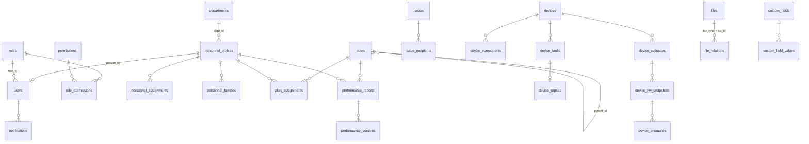

# OMPS 数据库结构说明

[English version](DATABASE.en.md)

面向：维护和二次开发 OMPS 的技术人员。

> 本文的字段清单由实际数据库结构生成（截至建表脚本 `2026_12_02_000016`，共 67 张表、713 个字段），表和关键字段的用途为人工说明。修改表结构后请同步更新本文。

## 1. 概述

- 数据库：MariaDB 10.1（兼容 MySQL 8 语法子集），引擎 InnoDB，字符集 `utf8mb4`（代码、键等用 `ascii`）。
- 建表和升级只通过 `database/migrations/` 中的建表脚本，按文件名顺序执行（`php omps migrate`），已执行的记在 `migrations` 表；**已发布的建表脚本不要修改，改结构就新增一个脚本**。
- 两个数据库账号：日常账号 `omps_app` 只有增删改查权限；升级账号 `omps_migrate` 只在运行 `php omps migrate` 时使用（见 `docs/INSTALL.md`）。
- 基础数据（语言、角色、权限、菜单、字典）由 `database/seeds/base.php` 同步（`php omps migrate --seed`），不含任何账号或密码。

## 2. 约定

| 约定 | 说明 |
|---|---|
| 公共字段 | `id` 自增主键；`org_id` 单位（目前固定 1）；`created_at/by`、`updated_at/by` 创建和修改的时间与账号 |
| 软删除 | 有 `deleted_at` 的表删除时只填时间，查询默认排除；文件进回收站 30 天 |
| 乐观锁 | 有 `version` 的表保存时比较版本号，别人先保存过就提示刷新，不会互相覆盖 |
| JSON | 不使用 JSON 列类型，统一存为 `LONGTEXT` / `TEXT` 中的 JSON 文本 |
| 敏感数据 | 证件号、家属电话和住址：`*_enc` 为 AES-256-GCM 密文（密钥是 `.env` 的 `APP_KEY`），`*_hash` 为 HMAC（查重），`*_mask` 为显示用掩码。**丢失 APP_KEY 无法解密**，备份时同时备份 `.env` |
| 令牌 | 会话令牌、采集客户端注册码和设备令牌只存 SHA-256 |
| 文字 | 程序文字不存数据库；通知只存类型和参数，按查看人的语言显示；配置产生的文字在 `translations` |
| 外键 | 只在少数“父子必须同时存在”的地方加外键，其余由程序保证（便于软删除和恢复） |
| 清理 | 日志类表（操作日志、登录日志、设备使用记录、硬件快照）和审计日志按“数据备份 → 自动清理”的期限删除；业务数据不会被自动删除 |

## 3. 主要关系

## 4. 表清单

**系统与配置**

| 表 | 用途 |
|---|---|
| [`system_settings`](#system-settings) | 系统设置的键值（单位信息、登录安全、工作时间、备份与清理期限、主题等）。 |
| [`languages`](#languages) | 可用语言，只有翻译 100% 的语言才能启用；一个为默认语言。 |
| [`translations`](#translations) | 配置产生的文字（自定义角色名、菜单名、自定义字段、统计页等），以及在“多语言管理”中改过或新增语言的程序文字（namespace = ui，覆盖语言文件）。 |
| [`missing_translations`](#missing-translations) | 运行时找不到的翻译键，首次出现时通知超级管理员。 |
| [`module_registry`](#module-registry) | 已安装的业务模块。 |
| [`dictionaries`](#dictionaries) | 数据字典（如设备类别、学历层次）。 |
| [`dictionary_items`](#dictionary-items) | 字典项，名称是翻译键。 |
| [`menus`](#menus) | 左侧菜单树：路由、所需权限、是否只给兼任设备管理员；user_sort / enabled 是“菜单管理”中的调整。 |
| [`user_prefs`](#user-prefs) | 个人偏好（免打扰时段、弹窗提醒等）。 |
| [`backup_logs`](#backup-logs) | 每份备份的记录：类型（手动、自动、恢复前、升级前）、结果、大小、校验值。 |
| [`holidays`](#holidays) | 节假日与调休（系统设置 → 节假日与调休）：kind = off 放假（不算工作日），work 调休上班（算工作日）。 |

**账号与权限**

| 表 | 用途 |
|---|---|
| [`users`](#users) | 登录账号。 |
| [`roles`](#roles) | 角色：4 个内置角色（超级管理员、单位负责人、部门负责人、普通成员）和自定义角色；scope 为数据范围（all / unit / dept / self）。 |
| [`permissions`](#permissions) | 权限码（如 device.edit），由各模块的 permissions.php 同步。 |
| [`role_permissions`](#role-permissions) | 角色拥有的权限。 |
| [`user_sessions`](#user-sessions) | 登录会话。 |
| [`login_attempts`](#login-attempts) | 失败的登录尝试（按 IP 和账号），用于锁定和限流；采集客户端的错误注册码也记在这里（username = #collector）。 |

**日志**

| 表 | 用途 |
|---|---|
| [`operation_logs`](#operation-logs) | 操作日志：谁在什么时候做了什么。 |
| [`audit_logs`](#audit-logs) | 审计日志：修改前后的数据、查看完整证件号等敏感操作。 |
| [`login_logs`](#login-logs) | 登录、退出和失败记录。 |
| [`data_versions`](#data-versions) | 重要记录的历史快照。 |

**组织与人员**

| 表 | 用途 |
|---|---|
| [`departments`](#departments) | 部门树（path 为祖先路径，如 /1/5/）。 |
| [`personnel_profiles`](#personnel-profiles) | 人员档案主表。 |
| [`personnel_assignments`](#personnel-assignments) | 任职与调动记录（部门、岗位、起止日期、变动类型）。 |
| [`personnel_education`](#personnel-education) | 学历。 |
| [`personnel_work_experience`](#personnel-work-experience) | 工作经历。 |
| [`personnel_titles`](#personnel-titles) | 职称、职务。 |
| [`personnel_achievements`](#personnel-achievements) | 成果、奖励、证书。 |
| [`personnel_families`](#personnel-families) | 家属资料。 |
| [`profile_field_policies`](#profile-field-policies) | 本人修改自己档案的规则：禁止 / 直接生效 / 需审核。 |
| [`profile_change_requests`](#profile-change-requests) | 本人提交的资料修改申请及审核结果（修改前后的数据）。 |

**计划、业绩与报告**

| 表 | 用途 |
|---|---|
| [`plans`](#plans) | 计划树（长期、年度、季度、月、周、日）。 |
| [`plan_paths`](#plan-paths) | 计划的祖先 / 后代关系表（含自身，depth 0），用于快速查询整棵子树。 |
| [`plan_assignments`](#plan-assignments) | 计划分配给哪些人（可多人）。 |
| [`performance_reports`](#performance-reports) | 业绩：每个计划每个执行人一份。 |
| [`performance_versions`](#performance-versions) | 业绩的每次保存、提交、审核、修改并通过、退回、撤回。 |
| [`person_leaves`](#person-leaves) | 人员请假，按整天：本人在“我的请假”中申请（status = pending），审核其业绩的负责人批准或不批准；负责人直接登记的立即批准。 |
| [`reports`](#reports) | 综合报告（按条件生成或手写），只有创建人能看到。 |
| [`report_versions`](#report-versions) | 报告的各个版本（内容快照）。 |
| [`report_exports`](#report-exports) | 报告的打印和下载记录。 |

**我的事务**

| 表 | 用途 |
|---|---|
| [`notifications`](#notifications) | 站内通知（铃铛）。 |
| [`notes`](#notes) | 记事本：提交给上级前只有自己能看；提交后锁定，上级可批示（reply）。 |
| [`issues`](#issues) | 下发事项：提示、文档（只读）和指令（需在期限内完成并回复）。 |
| [`issue_recipients`](#issue-recipients) | 下发事项的每个收件人：阅读、完成、回复、催办次数。 |
| [`reminder_rules`](#reminder-rules) | 提醒规则（每种提醒一行）。 |
| [`reminder_triggers`](#reminder-triggers) | 提醒规则的触发时间（提前多少、几点、每周 / 每月哪天、是否重复）。 |

**设备管理**

| 表 | 用途 |
|---|---|
| [`devices`](#devices) | 设备档案。 |
| [`device_holders`](#device-holders) | 设备使用人历史：更换使用人时关闭旧记录、新增一行。 |
| [`device_components`](#device-components) | 设备部件（CPU、内存、硬盘、键盘、鼠标等）。 |
| [`device_component_history`](#device-component-history) | 部件的安装、更换、拆除历史，标明是否来自维修或硬件变化确认。 |
| [`device_licenses`](#device-licenses) | 软件许可证（到期提醒）。 |
| [`device_faults`](#device-faults) | 报修单：任何人可报修；派修、修好或取消。 |
| [`device_repairs`](#device-repairs) | 维修：每张报修单一次维修（维修人、费用、结果）。 |
| [`device_collectors`](#device-collectors) | 采集客户端：一次性注册码和设备令牌都只存 SHA-256。 |
| [`device_hw_snapshots`](#device-hw-snapshots) | 采集客户端上报的硬件快照（JSON）。 |
| [`device_anomalies`](#device-anomalies) | 硬件变化（异常记录）：新出现 / 不见了的部件，待确认或忽略。 |
| [`device_usage_logs`](#device-usage-logs) | 使用记录：采集客户端的注册和每次上报（时间、IP、计算机名、有无变化）。 |

**文件**

| 表 | 用途 |
|---|---|
| [`files`](#files) | 上传的文件。 |
| [`file_relations`](#file-relations) | 文件属于哪条业务记录（biz_type + biz_id）；一个文件可被多条记录引用。 |
| [`file_trash_relations`](#file-trash-relations) | 回收站中文件原来的引用，用于 30 天内恢复。 |

**自定义、统计与文档**

| 表 | 用途 |
|---|---|
| [`custom_fields`](#custom-fields) | 自定义字段定义（人员档案、设备档案、计划）。 |
| [`custom_field_options`](#custom-field-options) | 自定义下拉字段的选项。 |
| [`custom_field_values`](#custom-field-values) | 自定义字段的值，按类型分列存储，能正确比较、排序、求和；不改业务表结构。 |
| [`stat_pages`](#stat-pages) | 自定义统计页面。 |
| [`stat_widgets`](#stat-widgets) | 统计页面上的图表，def 是受控的查询定义（不是 SQL）。 |
| [`doc_templates`](#doc-templates) | 上传的 Word 模板（综合报告、人员登记表），记录占位符检查结果。 |
| [`generated_documents`](#generated-documents) | 生成过的文档记录。 |

## 5. 各表详情

### 系统与配置

#### `system_settings`

系统设置的键值（单位信息、登录安全、工作时间、备份与清理期限、主题等）。值为 JSON 文本。

| 字段 | 类型 | 可空 | 默认 | 说明 |
|---|---|---|---|---|
| `id` | bigint(20) unsigned AUTO_INCREMENT |  |  | 主键，自增 |
| `org_id` | bigint(20) unsigned |  | 1 | 单位编号（目前固定为 1，预留多单位） |
| `skey` | varchar(100) |  |  | 设置键 |
| `svalue` | longtext | 是 |  | 设置值（JSON） |
| `updated_at` | datetime | 是 |  | 修改时间 |
| `updated_by` | bigint(20) unsigned | 是 |  | 修改人（users.id） |

- 索引: 主键 `PRIMARY`(id); 唯一 `uk_org_key`(org_id,skey)

#### `languages`

可用语言，只有翻译 100% 的语言才能启用；一个为默认语言。

| 字段 | 类型 | 可空 | 默认 | 说明 |
|---|---|---|---|---|
| `id` | bigint(20) unsigned AUTO_INCREMENT |  |  | 主键，自增 |
| `code` | varchar(20) |  |  |  |
| `name` | varchar(50) |  |  |  |
| `enabled` | tinyint(1) |  | 0 |  |
| `is_default` | tinyint(1) |  | 0 |  |
| `sort` | int(11) |  | 0 | 排序 |
| `created_at` | datetime |  |  | 创建时间 |
| `updated_at` | datetime | 是 |  | 修改时间 |

- 索引: 主键 `PRIMARY`(id); 唯一 `uk_code`(code)

#### `translations`

配置产生的文字（自定义角色名、菜单名、自定义字段、统计页等），以及在“多语言管理”中改过或新增语言的程序文字（namespace = ui，覆盖语言文件）。

| 字段 | 类型 | 可空 | 默认 | 说明 |
|---|---|---|---|---|
| `id` | bigint(20) unsigned AUTO_INCREMENT |  |  | 主键，自增 |
| `namespace` | varchar(50) |  |  | ui = 程序文字覆盖；role 角色 / menu 菜单 / cf 自定义字段 / cfo 字段选项 / stat 统计页 / banner 登录页文字 |
| `tkey` | varchar(150) |  |  |  |
| `lang` | varchar(20) |  |  |  |
| `text` | text |  |  |  |
| `updated_at` | datetime | 是 |  | 修改时间 |
| `updated_by` | bigint(20) unsigned | 是 |  | 修改人（users.id） |

- 索引: 主键 `PRIMARY`(id); 唯一 `uk_ns_key_lang`(namespace,tkey,lang)

#### `missing_translations`

运行时找不到的翻译键，首次出现时通知超级管理员。

| 字段 | 类型 | 可空 | 默认 | 说明 |
|---|---|---|---|---|
| `id` | bigint(20) unsigned AUTO_INCREMENT |  |  | 主键，自增 |
| `lang` | varchar(20) |  |  |  |
| `tkey` | varchar(190) |  |  |  |
| `hits` | int(10) unsigned |  | 1 |  |
| `first_seen` | datetime |  |  |  |
| `last_seen` | datetime |  |  |  |

- 索引: 主键 `PRIMARY`(id); 唯一 `uk_lang_key`(lang,tkey)

#### `module_registry`

已安装的业务模块。

| 字段 | 类型 | 可空 | 默认 | 说明 |
|---|---|---|---|---|
| `id` | bigint(20) unsigned AUTO_INCREMENT |  |  | 主键，自增 |
| `code` | varchar(50) |  |  |  |
| `version` | varchar(20) |  |  | 乐观锁版本号：保存时检查，防止两人同时修改互相覆盖 |
| `enabled` | tinyint(1) |  | 1 |  |
| `installed_at` | datetime |  |  |  |
| `updated_at` | datetime | 是 |  | 修改时间 |

- 索引: 主键 `PRIMARY`(id); 唯一 `uk_code`(code)

#### `dictionaries`

数据字典（如设备类别、学历层次）。

| 字段 | 类型 | 可空 | 默认 | 说明 |
|---|---|---|---|---|
| `id` | bigint(20) unsigned AUTO_INCREMENT |  |  | 主键，自增 |
| `code` | varchar(50) |  |  |  |
| `name_key` | varchar(100) |  |  | 名称的翻译键 |
| `is_builtin` | tinyint(1) |  | 1 |  |

- 索引: 主键 `PRIMARY`(id); 唯一 `uk_code`(code)

#### `dictionary_items`

字典项，名称是翻译键。

| 字段 | 类型 | 可空 | 默认 | 说明 |
|---|---|---|---|---|
| `id` | bigint(20) unsigned AUTO_INCREMENT |  |  | 主键，自增 |
| `dict_id` | bigint(20) unsigned |  |  |  |
| `code` | varchar(50) |  |  |  |
| `name_key` | varchar(100) |  |  | 名称的翻译键 |
| `sort` | int(11) |  | 0 | 排序 |
| `enabled` | tinyint(1) |  | 1 |  |

- 索引: 主键 `PRIMARY`(id); 唯一 `uk_dict_code`(dict_id,code)
- 外键: `dict_id` → `dictionaries.id`

#### `menus`

左侧菜单树：路由、所需权限、是否只给兼任设备管理员；user_sort / enabled 是“菜单管理”中的调整。

| 字段 | 类型 | 可空 | 默认 | 说明 |
|---|---|---|---|---|
| `id` | bigint(20) unsigned AUTO_INCREMENT |  |  | 主键，自增 |
| `parent_id` | bigint(20) unsigned | 是 |  |  |
| `code` | varchar(50) |  |  |  |
| `title_key` | varchar(100) |  |  | 标题的翻译键 |
| `icon` | varchar(30) | 是 |  |  |
| `route` | varchar(191) | 是 |  |  |
| `permission_code` | varchar(100) | 是 |  |  |
| `requires_device_admin` | tinyint(1) |  | 0 | 只对兼任设备管理员显示 |
| `module` | varchar(50) |  |  | 模块代码 |
| `sort` | int(11) |  | 0 | 排序 |
| `user_sort` | int(11) | 是 |  | 菜单管理中调整后的顺序（空 = 默认） |
| `enabled` | tinyint(1) |  | 1 |  |

- 索引: 普通 `idx_parent`(parent_id); 主键 `PRIMARY`(id); 唯一 `uk_code`(code)

#### `user_prefs`

个人偏好（免打扰时段、弹窗提醒等）。

| 字段 | 类型 | 可空 | 默认 | 说明 |
|---|---|---|---|---|
| `user_id` | bigint(20) unsigned |  |  | 账号（users.id） |
| `pkey` | varchar(40) |  |  |  |
| `pvalue` | varchar(500) | 是 |  |  |

- 索引: 主键 `PRIMARY`(user_id,pkey)

#### `backup_logs`

每份备份的记录：类型（手动、自动、恢复前、升级前）、结果、大小、校验值。备份文件本身在 BACKUP_PATH。

| 字段 | 类型 | 可空 | 默认 | 说明 |
|---|---|---|---|---|
| `id` | bigint(20) unsigned AUTO_INCREMENT |  |  | 主键，自增 |
| `file_name` | varchar(120) |  |  |  |
| `kind` | enum('manual','auto','pre_restore','pre_migrate') |  |  | manual 手动 / auto 自动 / pre_restore 恢复前 / pre_migrate 升级前 |
| `status` | enum('running','ok','failed') |  |  | 状态（取值见类型） |
| `db_bytes` | bigint(20) unsigned |  | 0 |  |
| `files_bytes` | bigint(20) unsigned |  | 0 |  |
| `files_count` | int(10) unsigned |  | 0 |  |
| `size` | bigint(20) unsigned |  | 0 |  |
| `sha256` | char(64) | 是 |  | 备份文件校验值 |
| `message` | varchar(500) | 是 |  |  |
| `started_at` | datetime |  |  |  |
| `finished_at` | datetime | 是 |  |  |
| `created_by` | bigint(20) unsigned | 是 |  | 创建人（users.id） |

- 索引: 普通 `idx_started`(started_at); 主键 `PRIMARY`(id)

#### `holidays`

节假日与调休（系统设置 → 节假日与调休）：kind = off 放假（不算工作日），work 调休上班（算工作日）。工作日历据此计算提醒时间和执行统计中应交的日报。

| 字段 | 类型 | 可空 | 默认 | 说明 |
|---|---|---|---|---|
| `id` | bigint(20) unsigned AUTO_INCREMENT |  |  | 主键，自增 |
| `org_id` | bigint(20) unsigned |  | 1 | 单位编号（目前固定为 1，预留多单位） |
| `name` | varchar(50) |  |  |  |
| `kind` | enum('off','work') |  | off | off 放假 / work 调休上班 |
| `start_date` | date |  |  |  |
| `end_date` | date |  |  |  |
| `created_at` | datetime |  |  | 创建时间 |
| `created_by` | bigint(20) unsigned | 是 |  | 创建人（users.id） |
| `updated_at` | datetime | 是 |  | 修改时间 |
| `updated_by` | bigint(20) unsigned | 是 |  | 修改人（users.id） |

- 索引: 普通 `idx_dates`(start_date,end_date); 主键 `PRIMARY`(id)

### 账号与权限

#### `users`

登录账号。一个账号最多关联一个人员档案；角色决定权限和数据范围，is_device_admin 为“兼任设备管理员”。

| 字段 | 类型 | 可空 | 默认 | 说明 |
|---|---|---|---|---|
| `id` | bigint(20) unsigned AUTO_INCREMENT |  |  | 主键，自增 |
| `org_id` | bigint(20) unsigned |  | 1 | 单位编号（目前固定为 1，预留多单位） |
| `person_id` | bigint(20) unsigned | 是 |  | 人员（personnel_profiles.id） |
| `username` | varchar(50) |  |  |  |
| `display_name` | varchar(50) |  |  |  |
| `password_hash` | varchar(255) |  |  | 密码哈希（password_hash），不保存明文 |
| `role_id` | bigint(20) unsigned |  |  |  |
| `is_device_admin` | tinyint(1) |  | 0 | 兼任设备管理员（自动获得全部设备权限） |
| `lang` | varchar(20) | 是 |  |  |
| `status` | enum('active','disabled') |  | active | 状态（取值见类型） |
| `session_version` | int(10) unsigned |  | 1 | 递增后该账号所有会话失效（改密码、强制下线） |
| `failed_count` | int(10) unsigned |  | 0 | 连续输错次数 |
| `locked_until` | datetime | 是 |  | 锁定到 |
| `must_change_password` | tinyint(1) |  | 0 | 下次登录必须改密码（临时密码） |
| `password_changed_at` | datetime | 是 |  |  |
| `last_login_at` | datetime | 是 |  |  |
| `last_login_ip` | varchar(45) | 是 |  |  |
| `created_at` | datetime |  |  | 创建时间 |
| `created_by` | bigint(20) unsigned | 是 |  | 创建人（users.id） |
| `updated_at` | datetime | 是 |  | 修改时间 |
| `updated_by` | bigint(20) unsigned | 是 |  | 修改人（users.id） |
| `deleted_at` | datetime | 是 |  | 软删除时间；非空表示已删除 |
| `deleted_by` | bigint(20) unsigned | 是 |  | 删除人 |
| `version` | int(10) unsigned |  | 1 | 乐观锁版本号：保存时检查，防止两人同时修改互相覆盖 |

- 索引: 普通 `idx_person`(person_id); 普通 `idx_role`(role_id); 主键 `PRIMARY`(id); 唯一 `uk_username`(username)
- 外键: `role_id` → `roles.id`

#### `roles`

角色：4 个内置角色（超级管理员、单位负责人、部门负责人、普通成员）和自定义角色；scope 为数据范围（all / unit / dept / self）。

| 字段 | 类型 | 可空 | 默认 | 说明 |
|---|---|---|---|---|
| `id` | bigint(20) unsigned AUTO_INCREMENT |  |  | 主键，自增 |
| `code` | varchar(50) |  |  |  |
| `name_key` | varchar(100) | 是 |  | 名称的翻译键 |
| `is_builtin` | tinyint(1) |  | 0 |  |
| `role_rank` | int(11) |  | 0 | 角色级别（审核链用） |
| `scope` | enum('self','dept','unit','all') |  | self | 数据范围：all 全部 / unit 全单位 / dept 本部门 / self 本人 |
| `description` | varchar(200) | 是 |  |  |
| `sort` | int(11) |  | 0 | 排序 |
| `created_at` | datetime |  |  | 创建时间 |
| `created_by` | bigint(20) unsigned | 是 |  | 创建人（users.id） |
| `updated_at` | datetime | 是 |  | 修改时间 |
| `updated_by` | bigint(20) unsigned | 是 |  | 修改人（users.id） |

- 索引: 主键 `PRIMARY`(id); 唯一 `uk_code`(code)

#### `permissions`

权限码（如 device.edit），由各模块的 permissions.php 同步。

| 字段 | 类型 | 可空 | 默认 | 说明 |
|---|---|---|---|---|
| `id` | bigint(20) unsigned AUTO_INCREMENT |  |  | 主键，自增 |
| `code` | varchar(100) |  |  |  |
| `module` | varchar(50) |  |  | 模块代码 |
| `action` | varchar(50) |  |  | 操作代码 |
| `type` | enum('action','sensitive','technical') |  | action |  |
| `sort` | int(11) |  | 0 | 排序 |

- 索引: 主键 `PRIMARY`(id); 唯一 `uk_code`(code)

#### `role_permissions`

角色拥有的权限。

| 字段 | 类型 | 可空 | 默认 | 说明 |
|---|---|---|---|---|
| `role_id` | bigint(20) unsigned |  |  |  |
| `permission_id` | bigint(20) unsigned |  |  |  |

- 索引: 普通 `fk_rp_perm`(permission_id); 主键 `PRIMARY`(role_id,permission_id)
- 外键: `permission_id` → `permissions.id`; `role_id` → `roles.id`

#### `user_sessions`

登录会话。id 是 Cookie 令牌的 SHA-256，令牌原文不保存；可强制下线（revoked_at）。

| 字段 | 类型 | 可空 | 默认 | 说明 |
|---|---|---|---|---|
| `id` | char(64) |  |  | Cookie 令牌的 SHA-256 |
| `user_id` | bigint(20) unsigned |  |  | 账号（users.id） |
| `session_version` | int(10) unsigned |  |  |  |
| `csrf_token` | char(64) |  |  | 该会话的 CSRF 令牌 |
| `ip` | varchar(45) | 是 |  | IP 地址 |
| `user_agent` | varchar(255) | 是 |  |  |
| `created_at` | datetime |  |  | 创建时间 |
| `last_active` | datetime |  |  |  |
| `expires_at` | datetime |  |  |  |
| `revoked_at` | datetime | 是 |  |  |
| `revoke_reason` | varchar(50) | 是 |  |  |

- 索引: 普通 `idx_user`(user_id); 主键 `PRIMARY`(id)

#### `login_attempts`

失败的登录尝试（按 IP 和账号），用于锁定和限流；采集客户端的错误注册码也记在这里（username = #collector）。

| 字段 | 类型 | 可空 | 默认 | 说明 |
|---|---|---|---|---|
| `id` | bigint(20) unsigned AUTO_INCREMENT |  |  | 主键，自增 |
| `ip` | varchar(45) |  |  | IP 地址 |
| `username` | varchar(50) |  |  |  |
| `created_at` | datetime |  |  | 创建时间 |

- 索引: 普通 `idx_ip_time`(ip,created_at); 主键 `PRIMARY`(id)

### 日志

#### `operation_logs`

操作日志：谁在什么时候做了什么。action 存代码，查看时翻译。按“自动清理”的日志期限删除。

| 字段 | 类型 | 可空 | 默认 | 说明 |
|---|---|---|---|---|
| `id` | bigint(20) unsigned AUTO_INCREMENT |  |  | 主键，自增 |
| `org_id` | bigint(20) unsigned |  | 1 | 单位编号（目前固定为 1，预留多单位） |
| `user_id` | bigint(20) unsigned | 是 |  | 账号（users.id） |
| `username` | varchar(50) | 是 |  |  |
| `module` | varchar(50) |  |  | 模块代码 |
| `action` | varchar(50) |  |  | 操作代码 |
| `target_type` | varchar(50) | 是 |  | 对象类型 |
| `target_id` | bigint(20) unsigned | 是 |  | 对象编号 |
| `target_label` | varchar(191) | 是 |  | 对象名称（记录时的快照） |
| `detail` | longtext | 是 |  | 补充信息（JSON） |
| `ip` | varchar(45) | 是 |  | IP 地址 |
| `created_at` | datetime |  |  | 创建时间 |

- 索引: 普通 `idx_created`(created_at); 普通 `idx_module`(module); 普通 `idx_user`(user_id); 主键 `PRIMARY`(id)

#### `audit_logs`

审计日志：修改前后的数据、查看完整证件号等敏感操作。按单独的审计日志期限删除（默认永久）。

| 字段 | 类型 | 可空 | 默认 | 说明 |
|---|---|---|---|---|
| `id` | bigint(20) unsigned AUTO_INCREMENT |  |  | 主键，自增 |
| `org_id` | bigint(20) unsigned |  | 1 | 单位编号（目前固定为 1，预留多单位） |
| `user_id` | bigint(20) unsigned | 是 |  | 账号（users.id） |
| `username` | varchar(50) | 是 |  |  |
| `module` | varchar(50) |  |  | 模块代码 |
| `action` | varchar(50) |  |  | 操作代码 |
| `target_type` | varchar(50) | 是 |  | 对象类型 |
| `target_id` | bigint(20) unsigned | 是 |  | 对象编号 |
| `target_label` | varchar(191) | 是 |  | 对象名称（记录时的快照） |
| `before_data` | longtext | 是 |  | 修改前的数据（JSON） |
| `after_data` | longtext | 是 |  | 修改后的数据（JSON） |
| `ip` | varchar(45) | 是 |  | IP 地址 |
| `created_at` | datetime |  |  | 创建时间 |

- 索引: 普通 `idx_action`(action); 普通 `idx_created`(created_at); 普通 `idx_user`(user_id); 主键 `PRIMARY`(id)

#### `login_logs`

登录、退出和失败记录。

| 字段 | 类型 | 可空 | 默认 | 说明 |
|---|---|---|---|---|
| `id` | bigint(20) unsigned AUTO_INCREMENT |  |  | 主键，自增 |
| `org_id` | bigint(20) unsigned |  | 1 | 单位编号（目前固定为 1，预留多单位） |
| `user_id` | bigint(20) unsigned | 是 |  | 账号（users.id） |
| `username` | varchar(50) |  |  |  |
| `ip` | varchar(45) | 是 |  | IP 地址 |
| `user_agent` | varchar(255) | 是 |  |  |
| `result` | enum('success','fail','locked','disabled','ip_blocked','logout') |  |  | success / fail / locked / disabled / ip_blocked / logout |
| `reason` | varchar(50) | 是 |  |  |
| `created_at` | datetime |  |  | 创建时间 |

- 索引: 普通 `idx_created`(created_at); 普通 `idx_user`(user_id); 主键 `PRIMARY`(id)

#### `data_versions`

重要记录的历史快照。

| 字段 | 类型 | 可空 | 默认 | 说明 |
|---|---|---|---|---|
| `id` | bigint(20) unsigned AUTO_INCREMENT |  |  | 主键，自增 |
| `org_id` | bigint(20) unsigned |  | 1 | 单位编号（目前固定为 1，预留多单位） |
| `entity_type` | varchar(50) |  |  |  |
| `entity_id` | bigint(20) unsigned |  |  |  |
| `version` | int(10) unsigned |  |  | 乐观锁版本号：保存时检查，防止两人同时修改互相覆盖 |
| `snapshot` | longtext |  |  | JSON 快照 |
| `created_by` | bigint(20) unsigned | 是 |  | 创建人（users.id） |
| `created_at` | datetime |  |  | 创建时间 |

- 索引: 普通 `idx_entity`(entity_type,entity_id); 主键 `PRIMARY`(id)

### 组织与人员

#### `departments`

部门树（path 为祖先路径，如 /1/5/）。

| 字段 | 类型 | 可空 | 默认 | 说明 |
|---|---|---|---|---|
| `id` | bigint(20) unsigned AUTO_INCREMENT |  |  | 主键，自增 |
| `org_id` | bigint(20) unsigned |  | 1 | 单位编号（目前固定为 1，预留多单位） |
| `parent_id` | bigint(20) unsigned | 是 |  |  |
| `path` | varchar(191) |  | / | 祖先路径，如 /1/5/ |
| `code` | varchar(50) |  |  |  |
| `name` | varchar(100) |  |  |  |
| `leader_person_id` | bigint(20) unsigned | 是 |  | 部门负责人（人员） |
| `sort` | int(11) |  | 0 | 排序 |
| `status` | enum('active','disabled') |  | active | 状态（取值见类型） |
| `remark` | varchar(500) | 是 |  | 备注 |
| `created_at` | datetime |  |  | 创建时间 |
| `created_by` | bigint(20) unsigned | 是 |  | 创建人（users.id） |
| `updated_at` | datetime | 是 |  | 修改时间 |
| `updated_by` | bigint(20) unsigned | 是 |  | 修改人（users.id） |
| `deleted_at` | datetime | 是 |  | 软删除时间；非空表示已删除 |
| `deleted_by` | bigint(20) unsigned | 是 |  | 删除人 |
| `version` | int(10) unsigned |  | 1 | 乐观锁版本号：保存时检查，防止两人同时修改互相覆盖 |

- 索引: 普通 `idx_org`(org_id); 普通 `idx_parent`(parent_id); 普通 `idx_path`(path); 主键 `PRIMARY`(id); 唯一 `uk_org_code`(org_id,code)

#### `personnel_profiles`

人员档案主表。证件号加密保存：id_number_enc（AES-256-GCM 密文）、id_number_hash（HMAC，用于查重和精确查找）、id_number_mask（显示用掩码）。

| 字段 | 类型 | 可空 | 默认 | 说明 |
|---|---|---|---|---|
| `id` | bigint(20) unsigned AUTO_INCREMENT |  |  | 主键，自增 |
| `org_id` | bigint(20) unsigned |  | 1 | 单位编号（目前固定为 1，预留多单位） |
| `staff_no` | varchar(50) |  |  | 人员编号（工号） |
| `photo_file_id` | bigint(20) unsigned | 是 |  | 照片（files.id） |
| `name` | varchar(50) |  |  |  |
| `gender` | enum('male','female') |  |  |  |
| `birth_date` | date | 是 |  |  |
| `ethnicity` | varchar(30) | 是 |  |  |
| `id_type` | varchar(30) | 是 |  |  |
| `id_number_enc` | varchar(255) | 是 |  | 证件号密文（AES-256-GCM） |
| `id_number_hash` | char(64) | 是 |  | 证件号 HMAC（查重、精确查找） |
| `id_number_mask` | varchar(40) | 是 |  | 证件号掩码（列表显示） |
| `dept_id` | bigint(20) unsigned | 是 |  | 部门（departments.id） |
| `position` | varchar(100) | 是 |  |  |
| `phone` | varchar(30) | 是 |  |  |
| `email` | varchar(100) | 是 |  |  |
| `address` | varchar(200) | 是 |  |  |
| `hukou_address` | varchar(200) | 是 |  |  |
| `hire_date` | date | 是 |  |  |
| `status` | enum('active','disabled','left','retired') |  | active | 状态（取值见类型） |
| `unassigned` | tinyint(1) |  | 0 | 被移出部门、等待安排新部门 |
| `remark` | text | 是 |  | 备注 |
| `created_at` | datetime |  |  | 创建时间 |
| `created_by` | bigint(20) unsigned | 是 |  | 创建人（users.id） |
| `updated_at` | datetime | 是 |  | 修改时间 |
| `updated_by` | bigint(20) unsigned | 是 |  | 修改人（users.id） |
| `deleted_at` | datetime | 是 |  | 软删除时间；非空表示已删除 |
| `deleted_by` | bigint(20) unsigned | 是 |  | 删除人 |
| `version` | int(10) unsigned |  | 1 | 乐观锁版本号：保存时检查，防止两人同时修改互相覆盖 |

- 索引: 普通 `idx_dept`(dept_id); 普通 `idx_id_hash`(id_number_hash); 普通 `idx_name`(name); 普通 `idx_org`(org_id); 主键 `PRIMARY`(id); 唯一 `uk_org_staffno`(org_id,staff_no)

#### `personnel_assignments`

任职与调动记录（部门、岗位、起止日期、变动类型）。

| 字段 | 类型 | 可空 | 默认 | 说明 |
|---|---|---|---|---|
| `id` | bigint(20) unsigned AUTO_INCREMENT |  |  | 主键，自增 |
| `org_id` | bigint(20) unsigned |  | 1 | 单位编号（目前固定为 1，预留多单位） |
| `person_id` | bigint(20) unsigned |  |  | 人员（personnel_profiles.id） |
| `dept_id` | bigint(20) unsigned | 是 |  | 部门（departments.id） |
| `from_dept_id` | bigint(20) unsigned | 是 |  |  |
| `position` | varchar(100) | 是 |  |  |
| `change_type` | enum('join','transfer','move_out','promote','leave','retire') |  |  | join 入职 / transfer 调动 / move_out 移出部门 / promote 晋升 / leave 离职 / retire 退休 |
| `start_date` | date |  |  |  |
| `end_date` | date | 是 |  |  |
| `note` | varchar(500) | 是 |  | 备注 |
| `created_at` | datetime |  |  | 创建时间 |
| `created_by` | bigint(20) unsigned | 是 |  | 创建人（users.id） |

- 索引: 普通 `idx_dept`(dept_id); 普通 `idx_person`(person_id); 主键 `PRIMARY`(id)
- 外键: `person_id` → `personnel_profiles.id`

#### `personnel_education`

学历。

| 字段 | 类型 | 可空 | 默认 | 说明 |
|---|---|---|---|---|
| `id` | bigint(20) unsigned AUTO_INCREMENT |  |  | 主键，自增 |
| `person_id` | bigint(20) unsigned |  |  | 人员（personnel_profiles.id） |
| `start_ym` | char(7) | 是 |  |  |
| `end_ym` | char(7) | 是 |  |  |
| `school` | varchar(100) |  |  |  |
| `country_region` | varchar(50) | 是 |  |  |
| `major` | varchar(100) | 是 |  |  |
| `degree_level` | varchar(30) | 是 |  |  |
| `degree` | varchar(30) | 是 |  |  |
| `graduated` | tinyint(1) |  | 1 |  |
| `certificate_no` | varchar(50) | 是 |  |  |
| `sort` | int(11) |  | 0 | 排序 |
| `created_at` | datetime |  |  | 创建时间 |
| `updated_at` | datetime | 是 |  | 修改时间 |

- 索引: 普通 `idx_person`(person_id); 主键 `PRIMARY`(id)

#### `personnel_work_experience`

工作经历。

| 字段 | 类型 | 可空 | 默认 | 说明 |
|---|---|---|---|---|
| `id` | bigint(20) unsigned AUTO_INCREMENT |  |  | 主键，自增 |
| `person_id` | bigint(20) unsigned |  |  | 人员（personnel_profiles.id） |
| `start_ym` | char(7) | 是 |  |  |
| `end_ym` | char(7) | 是 |  |  |
| `employer` | varchar(100) |  |  |  |
| `position` | varchar(100) | 是 |  |  |
| `duties` | varchar(500) | 是 |  |  |
| `leave_reason` | varchar(200) | 是 |  |  |
| `sort` | int(11) |  | 0 | 排序 |
| `created_at` | datetime |  |  | 创建时间 |
| `updated_at` | datetime | 是 |  | 修改时间 |

- 索引: 普通 `idx_person`(person_id); 主键 `PRIMARY`(id)

#### `personnel_titles`

职称、职务。

| 字段 | 类型 | 可空 | 默认 | 说明 |
|---|---|---|---|---|
| `id` | bigint(20) unsigned AUTO_INCREMENT |  |  | 主键，自增 |
| `person_id` | bigint(20) unsigned |  |  | 人员（personnel_profiles.id） |
| `title` | varchar(100) |  |  |  |
| `duty` | varchar(100) | 是 |  |  |
| `level` | varchar(50) | 是 |  |  |
| `obtained_ym` | char(7) | 是 |  |  |
| `issuer` | varchar(100) | 是 |  |  |
| `sort` | int(11) |  | 0 | 排序 |
| `created_at` | datetime |  |  | 创建时间 |
| `updated_at` | datetime | 是 |  | 修改时间 |

- 索引: 普通 `idx_person`(person_id); 主键 `PRIMARY`(id)

#### `personnel_achievements`

成果、奖励、证书。

| 字段 | 类型 | 可空 | 默认 | 说明 |
|---|---|---|---|---|
| `id` | bigint(20) unsigned AUTO_INCREMENT |  |  | 主键，自增 |
| `person_id` | bigint(20) unsigned |  |  | 人员（personnel_profiles.id） |
| `name` | varchar(150) |  |  |  |
| `type` | varchar(30) | 是 |  |  |
| `obtained_date` | date | 是 |  |  |
| `issuer` | varchar(100) | 是 |  |  |
| `certificate_no` | varchar(50) | 是 |  |  |
| `sort` | int(11) |  | 0 | 排序 |
| `created_at` | datetime |  |  | 创建时间 |
| `updated_at` | datetime | 是 |  | 修改时间 |

- 索引: 普通 `idx_person`(person_id); 主键 `PRIMARY`(id)

#### `personnel_families`

家属资料。高度敏感：电话、住址加密保存（*_enc），电话另存掩码。

| 字段 | 类型 | 可空 | 默认 | 说明 |
|---|---|---|---|---|
| `id` | bigint(20) unsigned AUTO_INCREMENT |  |  | 主键，自增 |
| `person_id` | bigint(20) unsigned |  |  | 人员（personnel_profiles.id） |
| `name` | varchar(50) |  |  |  |
| `relation` | varchar(30) |  |  |  |
| `gender` | enum('male','female') | 是 |  |  |
| `birth_date` | date | 是 |  |  |
| `employer` | varchar(100) | 是 |  |  |
| `position` | varchar(100) | 是 |  |  |
| `phone_enc` | varchar(255) | 是 |  | 电话密文 |
| `phone_mask` | varchar(40) | 是 |  | 电话掩码 |
| `address_enc` | varchar(600) | 是 |  | 住址密文 |
| `sort` | int(11) |  | 0 | 排序 |
| `created_at` | datetime |  |  | 创建时间 |
| `created_by` | bigint(20) unsigned | 是 |  | 创建人（users.id） |
| `updated_at` | datetime | 是 |  | 修改时间 |
| `updated_by` | bigint(20) unsigned | 是 |  | 修改人（users.id） |

- 索引: 普通 `idx_person`(person_id); 主键 `PRIMARY`(id)

#### `profile_field_policies`

本人修改自己档案的规则：禁止 / 直接生效 / 需审核。

| 字段 | 类型 | 可空 | 默认 | 说明 |
|---|---|---|---|---|
| `id` | bigint(20) unsigned AUTO_INCREMENT |  |  | 主键，自增 |
| `entity` | varchar(30) |  |  |  |
| `field_key` | varchar(50) |  |  |  |
| `self_edit` | enum('forbid','direct','review') |  | review | forbid 禁止 / direct 直接生效 / review 需审核 |
| `admin_only` | tinyint(1) |  | 0 |  |

- 索引: 主键 `PRIMARY`(id); 唯一 `uk_entity_field`(entity,field_key)

#### `profile_change_requests`

本人提交的资料修改申请及审核结果（修改前后的数据）。

| 字段 | 类型 | 可空 | 默认 | 说明 |
|---|---|---|---|---|
| `id` | bigint(20) unsigned AUTO_INCREMENT |  |  | 主键，自增 |
| `org_id` | bigint(20) unsigned |  | 1 | 单位编号（目前固定为 1，预留多单位） |
| `person_id` | bigint(20) unsigned |  |  | 人员（personnel_profiles.id） |
| `entity` | varchar(30) |  |  | 修改的是哪部分（档案、学历、家属...） |
| `record_id` | bigint(20) unsigned | 是 |  |  |
| `action` | enum('create','update','delete') |  |  | 操作代码 |
| `before_data` | longtext | 是 |  |  |
| `after_data` | longtext | 是 |  |  |
| `status` | enum('pending','approved','returned','withdrawn') |  | pending | 状态（取值见类型） |
| `submitted_by` | bigint(20) unsigned |  |  |  |
| `submitted_at` | datetime |  |  |  |
| `reviewed_by` | bigint(20) unsigned | 是 |  |  |
| `reviewed_at` | datetime | 是 |  |  |
| `review_comment` | varchar(500) | 是 |  |  |

- 索引: 普通 `idx_person`(person_id); 普通 `idx_status`(status); 主键 `PRIMARY`(id)

### 计划、业绩与报告

#### `plans`

计划树（长期、年度、季度、月、周、日）。level 由起止日期自动判断；local_weight 为占上级的百分比；period_key 用于按期间查询。

| 字段 | 类型 | 可空 | 默认 | 说明 |
|---|---|---|---|---|
| `id` | bigint(20) unsigned AUTO_INCREMENT |  |  | 主键，自增 |
| `org_id` | bigint(20) unsigned |  | 1 | 单位编号（目前固定为 1，预留多单位） |
| `parent_id` | bigint(20) unsigned | 是 |  | 上级计划 |
| `dept_id` | bigint(20) unsigned | 是 |  | 部门（departments.id） |
| `level` | enum('long','annual','quarter','month','week','day') |  |  | long / annual / quarter / month / week / day，由起止日期自动判断 |
| `period_key` | varchar(20) |  |  | 期间键（如 2026、2026-Q1、2026-03） |
| `code` | varchar(30) |  |  |  |
| `title` | varchar(150) |  |  |  |
| `goal` | text | 是 |  |  |
| `content` | text | 是 |  |  |
| `start_date` | date |  |  |  |
| `end_date` | date |  |  |  |
| `time_label_mode` | varchar(10) |  | auto | 时间显示方式（自动 / 快捷 / 自定义文字） |
| `time_label_text` | varchar(20) | 是 |  |  |
| `local_weight` | decimal(6,2) |  | 100.00 | 占上级计划的百分比 |
| `priority` | enum('high','medium','low') | 是 |  |  |
| `status` | enum('active','done','cancelled') |  | active | 状态（取值见类型） |
| `owner_person_id` | bigint(20) unsigned | 是 |  | 负责人 / 制定人 |
| `created_at` | datetime |  |  | 创建时间 |
| `created_by` | bigint(20) unsigned | 是 |  | 创建人（users.id） |
| `updated_at` | datetime | 是 |  | 修改时间 |
| `updated_by` | bigint(20) unsigned | 是 |  | 修改人（users.id） |
| `deleted_at` | datetime | 是 |  | 软删除时间；非空表示已删除 |
| `deleted_by` | bigint(20) unsigned | 是 |  | 删除人 |
| `version` | int(10) unsigned |  | 1 | 乐观锁版本号：保存时检查，防止两人同时修改互相覆盖 |

- 索引: 普通 `idx_dates`(start_date,end_date); 普通 `idx_dept`(dept_id); 普通 `idx_parent`(parent_id); 普通 `idx_period`(period_key); 主键 `PRIMARY`(id); 唯一 `uk_code`(code)

#### `plan_paths`

计划的祖先 / 后代关系表（含自身，depth 0），用于快速查询整棵子树。

| 字段 | 类型 | 可空 | 默认 | 说明 |
|---|---|---|---|---|
| `ancestor_id` | bigint(20) unsigned |  |  |  |
| `descendant_id` | bigint(20) unsigned |  |  |  |
| `depth` | int(11) |  |  | 层级差（0 = 自身） |

- 索引: 普通 `idx_desc`(descendant_id); 主键 `PRIMARY`(ancestor_id,descendant_id)

#### `plan_assignments`

计划分配给哪些人（可多人）。

| 字段 | 类型 | 可空 | 默认 | 说明 |
|---|---|---|---|---|
| `id` | bigint(20) unsigned AUTO_INCREMENT |  |  | 主键，自增 |
| `plan_id` | bigint(20) unsigned |  |  | 计划（plans.id） |
| `person_id` | bigint(20) unsigned |  |  | 人员（personnel_profiles.id） |
| `assigned_by` | bigint(20) unsigned | 是 |  |  |
| `created_at` | datetime |  |  | 创建时间 |

- 索引: 普通 `idx_person`(person_id); 主键 `PRIMARY`(id); 唯一 `uk_plan_person`(plan_id,person_id)

#### `performance_reports`

业绩：每个计划每个执行人一份。appr_* 保存最后一次审核通过的内容，完成度和报告只使用 appr_*，所以本人可以修改而不影响已通过的数据。

| 字段 | 类型 | 可空 | 默认 | 说明 |
|---|---|---|---|---|
| `id` | bigint(20) unsigned AUTO_INCREMENT |  |  | 主键，自增 |
| `org_id` | bigint(20) unsigned |  | 1 | 单位编号（目前固定为 1，预留多单位） |
| `plan_id` | bigint(20) unsigned |  |  | 计划（plans.id） |
| `person_id` | bigint(20) unsigned |  |  | 人员（personnel_profiles.id） |
| `progress` | decimal(5,2) | 是 |  | 本人填写的完成百分比 |
| `done_content` | text | 是 |  |  |
| `problems` | text | 是 |  |  |
| `next_steps` | text | 是 |  |  |
| `status` | enum('draft','submitted','approved','returned','withdrawn') |  | draft | 状态（取值见类型） |
| `submitted_at` | datetime | 是 |  |  |
| `submitted_by` | bigint(20) unsigned | 是 |  |  |
| `reviewed_at` | datetime | 是 |  |  |
| `reviewed_by` | bigint(20) unsigned | 是 |  |  |
| `review_comment` | varchar(500) | 是 |  |  |
| `score` | decimal(5,2) | 是 |  |  |
| `reviewer_edited` | tinyint(1) |  | 0 | 审核人修改后通过 |
| `appr_progress` | decimal(5,2) | 是 |  | 最后审核通过的完成百分比（汇总只用它） |
| `appr_content` | text | 是 |  |  |
| `appr_problems` | text | 是 |  |  |
| `appr_next` | text | 是 |  |  |
| `appr_at` | datetime | 是 |  |  |
| `created_at` | datetime |  |  | 创建时间 |
| `created_by` | bigint(20) unsigned | 是 |  | 创建人（users.id） |
| `updated_at` | datetime | 是 |  | 修改时间 |
| `updated_by` | bigint(20) unsigned | 是 |  | 修改人（users.id） |
| `version` | int(10) unsigned |  | 1 | 乐观锁版本号：保存时检查，防止两人同时修改互相覆盖 |

- 索引: 普通 `idx_person_status`(person_id,status); 普通 `idx_status`(status); 主键 `PRIMARY`(id); 唯一 `uk_plan_person`(plan_id,person_id)

#### `performance_versions`

业绩的每次保存、提交、审核、修改并通过、退回、撤回。

| 字段 | 类型 | 可空 | 默认 | 说明 |
|---|---|---|---|---|
| `id` | bigint(20) unsigned AUTO_INCREMENT |  |  | 主键，自增 |
| `report_id` | bigint(20) unsigned |  |  | 所属记录 |
| `version_no` | int(10) unsigned |  |  |  |
| `kind` | varchar(20) |  |  | save 保存 / submit 提交 / self_approve 本人直接生效 / approve 通过 / edit_approve 修改并通过 / return 退回 / withdraw 撤回 |
| `snapshot` | longtext |  |  | JSON 快照 |
| `created_by` | bigint(20) unsigned | 是 |  | 创建人（users.id） |
| `created_at` | datetime |  |  | 创建时间 |

- 索引: 普通 `idx_report`(report_id,version_no); 主键 `PRIMARY`(id)

#### `person_leaves`

人员请假，按整天：本人在“我的请假”中申请（status = pending），审核其业绩的负责人批准或不批准；负责人直接登记的立即批准。只有已批准的请假计入：请假日不要求交日报、不发日报提醒；整个周期都在请假的，周报至年报也不要求。

| 字段 | 类型 | 可空 | 默认 | 说明 |
|---|---|---|---|---|
| `id` | bigint(20) unsigned AUTO_INCREMENT |  |  | 主键，自增 |
| `org_id` | bigint(20) unsigned |  | 1 | 单位编号（目前固定为 1，预留多单位） |
| `person_id` | bigint(20) unsigned |  |  | 人员（personnel_profiles.id） |
| `kind` | varchar(20) |  |  | annual 年假 / sick 病假 / personal 事假 / comp 调休 / marriage 婚假 / maternity 产假、陪产假 / bereavement 丧假 / other 其他 |
| `start_date` | date |  |  |  |
| `end_date` | date |  |  |  |
| `note` | varchar(200) | 是 |  | 备注 |
| `status` | enum('pending','approved','rejected','withdrawn') |  | approved | pending 待审批 / approved 已批准 / rejected 未批准 / withdrawn 已撤回 |
| `reviewed_by` | bigint(20) unsigned | 是 |  |  |
| `reviewed_at` | datetime | 是 |  |  |
| `review_comment` | varchar(200) | 是 |  | 不批准的原因 |
| `created_at` | datetime |  |  | 创建时间 |
| `created_by` | bigint(20) unsigned | 是 |  | 创建人（users.id） |
| `updated_at` | datetime | 是 |  | 修改时间 |
| `updated_by` | bigint(20) unsigned | 是 |  | 修改人（users.id） |

- 索引: 普通 `idx_dates`(start_date,end_date); 普通 `idx_person`(person_id,start_date); 普通 `idx_status`(status); 主键 `PRIMARY`(id)

#### `reports`

综合报告（按条件生成或手写），只有创建人能看到。

| 字段 | 类型 | 可空 | 默认 | 说明 |
|---|---|---|---|---|
| `id` | bigint(20) unsigned AUTO_INCREMENT |  |  | 主键，自增 |
| `org_id` | bigint(20) unsigned |  | 1 | 单位编号（目前固定为 1，预留多单位） |
| `kind` | enum('gen','manual') |  |  | gen 按条件生成 / manual 手写 |
| `title` | varchar(200) | 是 |  |  |
| `period_start` | date | 是 |  |  |
| `period_end` | date | 是 |  |  |
| `plan_ids` | longtext | 是 |  |  |
| `person_ids` | longtext | 是 |  |  |
| `data_as_of` | datetime | 是 |  | 数据截止时间 |
| `current_version` | int(10) unsigned |  | 1 |  |
| `created_by` | bigint(20) unsigned |  |  | 创建人（users.id） |
| `created_at` | datetime |  |  | 创建时间 |
| `updated_at` | datetime | 是 |  | 修改时间 |
| `deleted_at` | datetime | 是 |  | 软删除时间；非空表示已删除 |
| `deleted_by` | bigint(20) unsigned | 是 |  | 删除人 |

- 索引: 普通 `idx_creator`(created_by,deleted_at); 主键 `PRIMARY`(id)

#### `report_versions`

报告的各个版本（内容快照）。

| 字段 | 类型 | 可空 | 默认 | 说明 |
|---|---|---|---|---|
| `id` | bigint(20) unsigned AUTO_INCREMENT |  |  | 主键，自增 |
| `report_id` | bigint(20) unsigned |  |  | 所属记录 |
| `version_no` | int(10) unsigned |  |  |  |
| `title` | varchar(200) | 是 |  |  |
| `period_start` | date | 是 |  |  |
| `period_end` | date | 是 |  |  |
| `intro` | text | 是 |  |  |
| `outro` | text | 是 |  |  |
| `content` | longtext | 是 |  |  |
| `body` | longtext | 是 |  |  |
| `created_by` | bigint(20) unsigned | 是 |  | 创建人（users.id） |
| `created_at` | datetime |  |  | 创建时间 |

- 索引: 主键 `PRIMARY`(id); 唯一 `uk_report_version`(report_id,version_no)

#### `report_exports`

报告的打印和下载记录。

| 字段 | 类型 | 可空 | 默认 | 说明 |
|---|---|---|---|---|
| `id` | bigint(20) unsigned AUTO_INCREMENT |  |  | 主键，自增 |
| `report_id` | bigint(20) unsigned |  |  | 所属记录 |
| `version_no` | int(10) unsigned |  |  |  |
| `format` | varchar(10) |  |  |  |
| `exported_by` | bigint(20) unsigned | 是 |  |  |
| `created_at` | datetime |  |  | 创建时间 |

- 索引: 普通 `idx_report`(report_id); 主键 `PRIMARY`(id)

### 我的事务

#### `notifications`

站内通知（铃铛）。每个收件人一行；不保存文字，只存 type + params，按查看人的语言显示。dedupe_key 防止同一提醒重复发送。已读通知最多保留半年。

| 字段 | 类型 | 可空 | 默认 | 说明 |
|---|---|---|---|---|
| `id` | bigint(20) unsigned AUTO_INCREMENT |  |  | 主键，自增 |
| `org_id` | bigint(20) unsigned |  | 1 | 单位编号（目前固定为 1，预留多单位） |
| `user_id` | bigint(20) unsigned |  |  | 账号（users.id） |
| `type` | varchar(40) |  |  | 通知类型（翻译键 notify.msg.<type>） |
| `level` | enum('info','warn','urgent') |  | info |  |
| `params` | text | 是 |  | 文字参数（JSON） |
| `link` | varchar(191) | 是 |  | 点击后打开的页面 |
| `biz_type` | varchar(50) | 是 |  | 业务类型（如 personnel、device、device_fault、issue） |
| `biz_id` | bigint(20) unsigned | 是 |  | 业务记录编号 |
| `actor_id` | bigint(20) unsigned | 是 |  | 触发人 |
| `dedupe_key` | char(40) | 是 |  | 去重键（同一规则 / 对象 / 收件人 / 时间点只发一次） |
| `read_at` | datetime | 是 |  |  |
| `created_at` | datetime |  |  | 创建时间 |

- 索引: 普通 `idx_biz`(biz_type,biz_id); 普通 `idx_user_read`(user_id,read_at); 主键 `PRIMARY`(id); 唯一 `uk_dedupe`(dedupe_key)

#### `notes`

记事本：提交给上级前只有自己能看；提交后锁定，上级可批示（reply）。

| 字段 | 类型 | 可空 | 默认 | 说明 |
|---|---|---|---|---|
| `id` | bigint(20) unsigned AUTO_INCREMENT |  |  | 主键，自增 |
| `org_id` | bigint(20) unsigned |  | 1 | 单位编号（目前固定为 1，预留多单位） |
| `owner_id` | bigint(20) unsigned |  |  |  |
| `title` | varchar(200) |  |  |  |
| `body` | mediumtext | 是 |  |  |
| `plan_id` | bigint(20) unsigned | 是 |  | 计划（plans.id） |
| `status` | enum('private','submitted','read') |  | private | 状态（取值见类型） |
| `submitted_to` | bigint(20) unsigned | 是 |  | 提交给哪个上级（users.id） |
| `submitted_at` | datetime | 是 |  |  |
| `read_at` | datetime | 是 |  |  |
| `reply` | text | 是 |  | 上级批示 |
| `created_at` | datetime |  |  | 创建时间 |
| `updated_at` | datetime | 是 |  | 修改时间 |
| `version` | int(10) unsigned |  | 1 | 乐观锁版本号：保存时检查，防止两人同时修改互相覆盖 |

- 索引: 普通 `idx_owner`(owner_id,updated_at); 普通 `idx_to`(submitted_to,status); 主键 `PRIMARY`(id)

#### `issues`

下发事项：提示、文档（只读）和指令（需在期限内完成并回复）。

| 字段 | 类型 | 可空 | 默认 | 说明 |
|---|---|---|---|---|
| `id` | bigint(20) unsigned AUTO_INCREMENT |  |  | 主键，自增 |
| `org_id` | bigint(20) unsigned |  | 1 | 单位编号（目前固定为 1，预留多单位） |
| `sender_id` | bigint(20) unsigned |  |  |  |
| `kind` | enum('tip','doc','order') |  |  | tip 提示 / doc 文档 / order 指令 |
| `title` | varchar(200) |  |  |  |
| `body` | text | 是 |  |  |
| `need_reply` | tinyint(1) |  | 0 | 需要完成并回复 |
| `due_at` | datetime | 是 |  |  |
| `remind_freq` | enum('auto','day','half','2h') |  | auto | 催办频率 |
| `status` | enum('active','withdrawn') |  | active | 状态（取值见类型） |
| `withdrawn_at` | datetime | 是 |  |  |
| `overdue_told` | tinyint(1) |  | 0 |  |
| `created_at` | datetime |  |  | 创建时间 |

- 索引: 普通 `idx_sender`(sender_id,created_at); 普通 `idx_status_due`(status,due_at); 主键 `PRIMARY`(id)

#### `issue_recipients`

下发事项的每个收件人：阅读、完成、回复、催办次数。

| 字段 | 类型 | 可空 | 默认 | 说明 |
|---|---|---|---|---|
| `id` | bigint(20) unsigned AUTO_INCREMENT |  |  | 主键，自增 |
| `issue_id` | bigint(20) unsigned |  |  |  |
| `user_id` | bigint(20) unsigned |  |  | 账号（users.id） |
| `read_at` | datetime | 是 |  |  |
| `done_at` | datetime | 是 |  |  |
| `reply` | text | 是 |  |  |
| `nudge_count` | int(10) unsigned |  | 0 | 被催办次数 |
| `nudged_at` | datetime | 是 |  |  |

- 索引: 普通 `idx_user`(user_id,done_at); 主键 `PRIMARY`(id); 唯一 `uk_issue_user`(issue_id,user_id)
- 外键: `issue_id` → `issues.id`

#### `reminder_rules`

提醒规则（每种提醒一行）。

| 字段 | 类型 | 可空 | 默认 | 说明 |
|---|---|---|---|---|
| `id` | bigint(20) unsigned AUTO_INCREMENT |  |  | 主键，自增 |
| `code` | varchar(40) |  |  |  |
| `level` | enum('info','warn','urgent') |  | info |  |
| `max_repeat` | int(10) unsigned |  | 0 |  |
| `escalate` | tinyint(1) |  | 0 |  |
| `enabled` | tinyint(1) |  | 1 |  |
| `sort` | int(11) |  | 0 | 排序 |
| `updated_at` | datetime | 是 |  | 修改时间 |
| `updated_by` | bigint(20) unsigned | 是 |  | 修改人（users.id） |

- 索引: 主键 `PRIMARY`(id); 唯一 `uk_code`(code)

#### `reminder_triggers`

提醒规则的触发时间（提前多少、几点、每周 / 每月哪天、是否重复）。

| 字段 | 类型 | 可空 | 默认 | 说明 |
|---|---|---|---|---|
| `id` | bigint(20) unsigned AUTO_INCREMENT |  |  | 主键，自增 |
| `rule_id` | bigint(20) unsigned |  |  |  |
| `mode` | varchar(10) |  |  |  |
| `amount` | int(10) unsigned |  | 0 |  |
| `unit` | varchar(5) | 是 |  |  |
| `time_of_day` | char(5) | 是 |  |  |
| `weekday` | tinyint(3) unsigned | 是 |  |  |
| `month_day` | tinyint(3) unsigned | 是 |  |  |
| `repeat_mode` | varchar(5) | 是 |  |  |
| `sort` | int(11) |  | 0 | 排序 |

- 索引: 普通 `idx_rule`(rule_id); 主键 `PRIMARY`(id)
- 外键: `rule_id` → `reminder_rules.id`

### 设备管理

#### `devices`

设备档案。run_status 为运行状态（正常、故障、维修中、停用、报废）。

| 字段 | 类型 | 可空 | 默认 | 说明 |
|---|---|---|---|---|
| `id` | bigint(20) unsigned AUTO_INCREMENT |  |  | 主键，自增 |
| `org_id` | bigint(20) unsigned |  | 1 | 单位编号（目前固定为 1，预留多单位） |
| `asset_no` | varchar(50) |  |  | 设备编号（唯一） |
| `name` | varchar(100) |  |  |  |
| `category` | varchar(30) |  |  |  |
| `brand` | varchar(50) | 是 |  |  |
| `model` | varchar(100) | 是 |  |  |
| `serial_no` | varchar(100) | 是 |  |  |
| `dept_id` | bigint(20) unsigned | 是 |  | 部门（departments.id） |
| `holder_person_id` | bigint(20) unsigned | 是 |  | 当前使用人 |
| `location` | varchar(100) | 是 |  |  |
| `purchase_date` | date | 是 |  |  |
| `received_date` | date | 是 |  |  |
| `price` | decimal(12,2) | 是 |  |  |
| `warranty_until` | date | 是 |  |  |
| `run_status` | enum('normal','fault','repairing','disabled','scrapped') |  | normal | normal / fault / repairing / disabled / scrapped |
| `remark` | varchar(500) | 是 |  | 备注 |
| `created_at` | datetime |  |  | 创建时间 |
| `created_by` | bigint(20) unsigned | 是 |  | 创建人（users.id） |
| `updated_at` | datetime | 是 |  | 修改时间 |
| `updated_by` | bigint(20) unsigned | 是 |  | 修改人（users.id） |
| `deleted_at` | datetime | 是 |  | 软删除时间；非空表示已删除 |
| `deleted_by` | bigint(20) unsigned | 是 |  | 删除人 |
| `version` | int(10) unsigned |  | 1 | 乐观锁版本号：保存时检查，防止两人同时修改互相覆盖 |

- 索引: 普通 `idx_dept`(dept_id); 普通 `idx_holder`(holder_person_id); 普通 `idx_status`(run_status); 主键 `PRIMARY`(id); 唯一 `uk_asset`(org_id,asset_no)

#### `device_holders`

设备使用人历史：更换使用人时关闭旧记录、新增一行。

| 字段 | 类型 | 可空 | 默认 | 说明 |
|---|---|---|---|---|
| `id` | bigint(20) unsigned AUTO_INCREMENT |  |  | 主键，自增 |
| `device_id` | bigint(20) unsigned |  |  | 设备（devices.id） |
| `person_id` | bigint(20) unsigned | 是 |  | 人员（personnel_profiles.id） |
| `dept_id` | bigint(20) unsigned | 是 |  | 部门（departments.id） |
| `start_date` | date |  |  |  |
| `end_date` | date | 是 |  |  |
| `note` | varchar(200) | 是 |  | 备注 |
| `created_at` | datetime |  |  | 创建时间 |
| `created_by` | bigint(20) unsigned | 是 |  | 创建人（users.id） |

- 索引: 普通 `idx_device`(device_id); 普通 `idx_person`(person_id); 主键 `PRIMARY`(id)

#### `device_components`

设备部件（CPU、内存、硬盘、键盘、鼠标等）。更换 = 旧行填拆除日期 + 新增一行 + 一条历史，不覆盖。

| 字段 | 类型 | 可空 | 默认 | 说明 |
|---|---|---|---|---|
| `id` | bigint(20) unsigned AUTO_INCREMENT |  |  | 主键，自增 |
| `device_id` | bigint(20) unsigned |  |  | 设备（devices.id） |
| `ctype` | varchar(20) |  |  | 部件类型：cpu / memory / disk / board / monitor / nic / keyboard / mouse / gpu / other |
| `model` | varchar(150) | 是 |  |  |
| `serial_no` | varchar(100) | 是 |  |  |
| `spec` | varchar(100) | 是 |  | 规格（容量、核心数，或键盘鼠标的厂商 ID:产品 ID） |
| `installed_on` | date | 是 |  |  |
| `removed_on` | date | 是 |  | 拆除日期；空 = 在用 |
| `source` | enum('manual','collector') |  | manual | manual 手动登记 / collector 采集 |
| `created_at` | datetime |  |  | 创建时间 |
| `created_by` | bigint(20) unsigned | 是 |  | 创建人（users.id） |

- 索引: 普通 `idx_device`(device_id,removed_on); 主键 `PRIMARY`(id)

#### `device_component_history`

部件的安装、更换、拆除历史，标明是否来自维修或硬件变化确认。

| 字段 | 类型 | 可空 | 默认 | 说明 |
|---|---|---|---|---|
| `id` | bigint(20) unsigned AUTO_INCREMENT |  |  | 主键，自增 |
| `device_id` | bigint(20) unsigned |  |  | 设备（devices.id） |
| `component_id` | bigint(20) unsigned |  |  |  |
| `action` | enum('install','replace','remove') |  |  | 操作代码 |
| `replaced_component_id` | bigint(20) unsigned | 是 |  |  |
| `repair_id` | bigint(20) unsigned | 是 |  |  |
| `anomaly_id` | bigint(20) unsigned | 是 |  |  |
| `note` | varchar(200) | 是 |  | 备注 |
| `happened_at` | datetime |  |  |  |
| `created_by` | bigint(20) unsigned | 是 |  | 创建人（users.id） |

- 索引: 普通 `idx_device`(device_id); 主键 `PRIMARY`(id)

#### `device_licenses`

软件许可证（到期提醒）。

| 字段 | 类型 | 可空 | 默认 | 说明 |
|---|---|---|---|---|
| `id` | bigint(20) unsigned AUTO_INCREMENT |  |  | 主键，自增 |
| `device_id` | bigint(20) unsigned |  |  | 设备（devices.id） |
| `name` | varchar(100) |  |  |  |
| `license_no` | varchar(200) | 是 |  |  |
| `seats` | int(10) unsigned | 是 |  |  |
| `expires_on` | date | 是 |  |  |
| `remark` | varchar(200) | 是 |  | 备注 |
| `created_at` | datetime |  |  | 创建时间 |
| `created_by` | bigint(20) unsigned | 是 |  | 创建人（users.id） |
| `updated_at` | datetime | 是 |  | 修改时间 |

- 索引: 普通 `idx_device`(device_id); 普通 `idx_expires`(expires_on); 主键 `PRIMARY`(id)

#### `device_faults`

报修单：任何人可报修；派修、修好或取消。closed_by 为修好或取消的人。

| 字段 | 类型 | 可空 | 默认 | 说明 |
|---|---|---|---|---|
| `id` | bigint(20) unsigned AUTO_INCREMENT |  |  | 主键，自增 |
| `org_id` | bigint(20) unsigned |  | 1 | 单位编号（目前固定为 1，预留多单位） |
| `device_id` | bigint(20) unsigned |  |  | 设备（devices.id） |
| `reported_by` | bigint(20) unsigned |  |  | 报修人（users.id） |
| `reported_at` | datetime |  |  |  |
| `description` | text |  |  |  |
| `status` | enum('open','repairing','fixed','cancelled') |  | open | 状态（取值见类型） |
| `closed_at` | datetime | 是 |  |  |
| `closed_by` | bigint(20) unsigned | 是 |  | 修好或取消的人（users.id） |
| `cancel_reason` | varchar(200) | 是 |  |  |
| `version` | int(10) unsigned |  | 1 | 乐观锁版本号：保存时检查，防止两人同时修改互相覆盖 |

- 索引: 普通 `idx_closed_by`(closed_by); 普通 `idx_device`(device_id); 普通 `idx_reporter`(reported_by); 普通 `idx_status`(status); 主键 `PRIMARY`(id)

#### `device_repairs`

维修：每张报修单一次维修（维修人、费用、结果）。

| 字段 | 类型 | 可空 | 默认 | 说明 |
|---|---|---|---|---|
| `id` | bigint(20) unsigned AUTO_INCREMENT |  |  | 主键，自增 |
| `fault_id` | bigint(20) unsigned |  |  |  |
| `device_id` | bigint(20) unsigned |  |  | 设备（devices.id） |
| `repairer_user_id` | bigint(20) unsigned | 是 |  | 维修人账号；外部维修时为空，用 repairer_name |
| `repairer_name` | varchar(100) | 是 |  |  |
| `started_at` | datetime |  |  |  |
| `fixed_at` | datetime | 是 |  |  |
| `cost` | decimal(12,2) | 是 |  |  |
| `result` | text | 是 |  |  |
| `created_by` | bigint(20) unsigned | 是 |  | 派修人 |

- 索引: 普通 `idx_device`(device_id); 普通 `idx_repairer`(repairer_user_id); 主键 `PRIMARY`(id); 唯一 `uk_fault`(fault_id)

#### `device_collectors`

采集客户端：一次性注册码和设备令牌都只存 SHA-256。

| 字段 | 类型 | 可空 | 默认 | 说明 |
|---|---|---|---|---|
| `id` | bigint(20) unsigned AUTO_INCREMENT |  |  | 主键，自增 |
| `device_id` | bigint(20) unsigned |  |  | 设备（devices.id） |
| `enroll_hash` | char(64) | 是 |  | 一次性注册码的 SHA-256 |
| `enroll_expires` | datetime | 是 |  |  |
| `token_hash` | char(64) | 是 |  | 设备令牌的 SHA-256 |
| `status` | enum('pending','active','revoked') |  | pending | 状态（取值见类型） |
| `computer_name` | varchar(100) | 是 |  |  |
| `os` | varchar(150) | 是 |  |  |
| `client_version` | varchar(20) | 是 |  | 客户端版本（低于 1.1 显示“需更新”） |
| `registered_at` | datetime | 是 |  |  |
| `last_seen` | datetime | 是 |  |  |
| `last_ip` | varchar(45) | 是 |  |  |
| `created_at` | datetime |  |  | 创建时间 |
| `created_by` | bigint(20) unsigned | 是 |  | 创建人（users.id） |

- 索引: 普通 `idx_device`(device_id); 主键 `PRIMARY`(id); 唯一 `uk_enroll`(enroll_hash); 唯一 `uk_token`(token_hash)

#### `device_hw_snapshots`

采集客户端上报的硬件快照（JSON）。自动清理时保留每台设备最新的一份和异常记录引用的快照。

| 字段 | 类型 | 可空 | 默认 | 说明 |
|---|---|---|---|---|
| `id` | bigint(20) unsigned AUTO_INCREMENT |  |  | 主键，自增 |
| `collector_id` | bigint(20) unsigned |  |  |  |
| `device_id` | bigint(20) unsigned |  |  | 设备（devices.id） |
| `collected_at` | datetime |  |  |  |
| `data` | longtext |  |  | 上报的硬件（JSON） |
| `data_hash` | char(64) |  |  | 内容哈希，与上次相同则不再比对 |

- 索引: 普通 `idx_device`(device_id,id); 主键 `PRIMARY`(id)

#### `device_anomalies`

硬件变化（异常记录）：新出现 / 不见了的部件，待确认或忽略。

| 字段 | 类型 | 可空 | 默认 | 说明 |
|---|---|---|---|---|
| `id` | bigint(20) unsigned AUTO_INCREMENT |  |  | 主键，自增 |
| `device_id` | bigint(20) unsigned |  |  | 设备（devices.id） |
| `snapshot_id` | bigint(20) unsigned |  |  |  |
| `diff` | longtext |  |  | 新出现 / 不见了的部件（JSON） |
| `status` | enum('pending','confirmed','ignored') |  | pending | 状态（取值见类型） |
| `note` | varchar(200) | 是 |  | 备注 |
| `created_at` | datetime |  |  | 创建时间 |
| `handled_by` | bigint(20) unsigned | 是 |  |  |
| `handled_at` | datetime | 是 |  |  |

- 索引: 普通 `idx_device`(device_id); 普通 `idx_status`(status); 主键 `PRIMARY`(id)

#### `device_usage_logs`

使用记录：采集客户端的注册和每次上报（时间、IP、计算机名、有无变化）。

| 字段 | 类型 | 可空 | 默认 | 说明 |
|---|---|---|---|---|
| `id` | bigint(20) unsigned AUTO_INCREMENT |  |  | 主键，自增 |
| `device_id` | bigint(20) unsigned |  |  | 设备（devices.id） |
| `collector_id` | bigint(20) unsigned | 是 |  |  |
| `event` | enum('register','boot','daily','manual') |  |  | register 注册 / boot 开机 / daily 每天 / manual 手动 |
| `ip` | varchar(45) | 是 |  | IP 地址 |
| `computer_name` | varchar(100) | 是 |  |  |
| `changed` | tinyint(1) |  | 0 | 硬件与上次不同 |
| `created_at` | datetime |  |  | 创建时间 |

- 索引: 普通 `idx_created`(created_at); 普通 `idx_device`(device_id,created_at); 主键 `PRIMARY`(id)

### 文件

#### `files`

上传的文件。保存在网站目录之外（FILES_PATH），目录结构按平台模块；相同内容（sha256）只存一份。

| 字段 | 类型 | 可空 | 默认 | 说明 |
|---|---|---|---|---|
| `id` | bigint(20) unsigned AUTO_INCREMENT |  |  | 主键，自增 |
| `org_id` | bigint(20) unsigned |  | 1 | 单位编号（目前固定为 1，预留多单位） |
| `rel_path` | varchar(500) |  |  | 相对 FILES_PATH 的路径 |
| `original_name` | varchar(200) |  |  |  |
| `ext` | varchar(10) |  |  |  |
| `mime` | varchar(100) |  |  |  |
| `size` | bigint(20) unsigned |  |  |  |
| `sha256` | char(64) |  |  | 内容哈希（相同文件只存一份） |
| `uploaded_by` | bigint(20) unsigned | 是 |  |  |
| `uploaded_at` | datetime |  |  |  |
| `status` | enum('normal','trash') |  | normal | normal / trash（回收站，30 天后彻底删除） |
| `deleted_at` | datetime | 是 |  | 软删除时间；非空表示已删除 |
| `deleted_by` | bigint(20) unsigned | 是 |  | 删除人 |

- 索引: 普通 `idx_sha`(sha256); 普通 `idx_uploader`(uploaded_by); 主键 `PRIMARY`(id)

#### `file_relations`

文件属于哪条业务记录（biz_type + biz_id）；一个文件可被多条记录引用。

| 字段 | 类型 | 可空 | 默认 | 说明 |
|---|---|---|---|---|
| `id` | bigint(20) unsigned AUTO_INCREMENT |  |  | 主键，自增 |
| `file_id` | bigint(20) unsigned |  |  | 文件（files.id） |
| `biz_type` | varchar(30) |  |  | 业务类型（如 personnel、device、device_fault、issue） |
| `biz_id` | bigint(20) unsigned |  |  | 业务记录编号 |
| `biz_group` | varchar(30) | 是 |  | 记录内的分组（如 photo、attachment） |
| `person_id` | bigint(20) unsigned | 是 |  | 人员（personnel_profiles.id） |
| `is_reference` | tinyint(1) |  | 0 | 合并重复文件后的引用 |
| `created_by` | bigint(20) unsigned | 是 |  | 创建人（users.id） |
| `created_at` | datetime |  |  | 创建时间 |

- 索引: 普通 `idx_biz`(biz_type,biz_id); 普通 `idx_file`(file_id); 主键 `PRIMARY`(id)

#### `file_trash_relations`

回收站中文件原来的引用，用于 30 天内恢复。

| 字段 | 类型 | 可空 | 默认 | 说明 |
|---|---|---|---|---|
| `id` | bigint(20) unsigned AUTO_INCREMENT |  |  | 主键，自增 |
| `file_id` | bigint(20) unsigned |  |  | 文件（files.id） |
| `biz_type` | varchar(30) |  |  | 业务类型（如 personnel、device、device_fault、issue） |
| `biz_id` | bigint(20) unsigned |  |  | 业务记录编号 |
| `biz_group` | varchar(30) | 是 |  |  |
| `person_id` | bigint(20) unsigned | 是 |  | 人员（personnel_profiles.id） |
| `is_reference` | tinyint(1) |  | 0 |  |
| `created_by` | bigint(20) unsigned | 是 |  | 创建人（users.id） |
| `created_at` | datetime | 是 |  | 创建时间 |
| `removed_by` | bigint(20) unsigned | 是 |  |  |
| `removed_at` | datetime |  |  |  |

- 索引: 普通 `idx_file`(file_id); 主键 `PRIMARY`(id)

### 自定义、统计与文档

#### `custom_fields`

自定义字段定义（人员档案、设备档案、计划）。

| 字段 | 类型 | 可空 | 默认 | 说明 |
|---|---|---|---|---|
| `id` | bigint(20) unsigned AUTO_INCREMENT |  |  | 主键，自增 |
| `entity` | enum('personnel','device','plan') |  |  | personnel / device / plan |
| `field_key` | varchar(40) |  |  |  |
| `data_type` | enum('text','textarea','int','decimal','date','select','bool') |  |  | text 文字 / textarea 多行 / int 整数 / decimal 小数 / date 日期 / select 下拉 / bool 是否 |
| `is_required` | tinyint(1) |  | 0 |  |
| `searchable` | tinyint(1) |  | 0 |  |
| `statable` | tinyint(1) |  | 0 |  |
| `in_list` | tinyint(1) |  | 0 |  |
| `enabled` | tinyint(1) |  | 1 |  |
| `sort` | int(11) |  | 0 | 排序 |
| `created_at` | datetime |  |  | 创建时间 |
| `created_by` | bigint(20) unsigned | 是 |  | 创建人（users.id） |
| `updated_at` | datetime | 是 |  | 修改时间 |
| `updated_by` | bigint(20) unsigned | 是 |  | 修改人（users.id） |

- 索引: 主键 `PRIMARY`(id); 唯一 `uk_entity_key`(entity,field_key)

#### `custom_field_options`

自定义下拉字段的选项。

| 字段 | 类型 | 可空 | 默认 | 说明 |
|---|---|---|---|---|
| `id` | bigint(20) unsigned AUTO_INCREMENT |  |  | 主键，自增 |
| `field_id` | bigint(20) unsigned |  |  | 自定义字段（custom_fields.id） |
| `opt_key` | varchar(40) |  |  |  |
| `sort` | int(11) |  | 0 | 排序 |
| `enabled` | tinyint(1) |  | 1 |  |

- 索引: 主键 `PRIMARY`(id); 唯一 `uk_field_opt`(field_id,opt_key)
- 外键: `field_id` → `custom_fields.id`

#### `custom_field_values`

自定义字段的值，按类型分列存储，能正确比较、排序、求和；不改业务表结构。

| 字段 | 类型 | 可空 | 默认 | 说明 |
|---|---|---|---|---|
| `id` | bigint(20) unsigned AUTO_INCREMENT |  |  | 主键，自增 |
| `entity` | enum('personnel','device','plan') |  |  |  |
| `entity_id` | bigint(20) unsigned |  |  | 业务记录编号 |
| `field_id` | bigint(20) unsigned |  |  | 自定义字段（custom_fields.id） |
| `v_string` | varchar(500) | 是 |  |  |
| `v_text` | mediumtext | 是 |  |  |
| `v_int` | bigint(20) | 是 |  |  |
| `v_decimal` | decimal(18,4) | 是 |  |  |
| `v_date` | date | 是 |  |  |

- 索引: 普通 `idx_field_date`(field_id,v_date); 普通 `idx_field_int`(field_id,v_int); 普通 `idx_field_string`(field_id,v_string); 主键 `PRIMARY`(id); 唯一 `uk_value`(entity,entity_id,field_id)
- 外键: `field_id` → `custom_fields.id`

#### `stat_pages`

自定义统计页面。

| 字段 | 类型 | 可空 | 默认 | 说明 |
|---|---|---|---|---|
| `id` | bigint(20) unsigned AUTO_INCREMENT |  |  | 主键，自增 |
| `sort` | int(11) |  | 0 | 排序 |
| `enabled` | tinyint(1) |  | 1 |  |
| `created_at` | datetime |  |  | 创建时间 |
| `created_by` | bigint(20) unsigned | 是 |  | 创建人（users.id） |
| `updated_at` | datetime | 是 |  | 修改时间 |
| `updated_by` | bigint(20) unsigned | 是 |  | 修改人（users.id） |

- 索引: 主键 `PRIMARY`(id)

#### `stat_widgets`

统计页面上的图表，def 是受控的查询定义（不是 SQL）。

| 字段 | 类型 | 可空 | 默认 | 说明 |
|---|---|---|---|---|
| `id` | bigint(20) unsigned AUTO_INCREMENT |  |  | 主键，自增 |
| `page_id` | bigint(20) unsigned |  |  |  |
| `chart` | enum('bar','pie','line','table','number') |  |  |  |
| `def` | text |  |  | 查询定义（JSON，受控字段，不是 SQL） |
| `sort` | int(11) |  | 0 | 排序 |

- 索引: 普通 `idx_page`(page_id,sort); 主键 `PRIMARY`(id)
- 外键: `page_id` → `stat_pages.id`

#### `doc_templates`

上传的 Word 模板（综合报告、人员登记表），记录占位符检查结果。

| 字段 | 类型 | 可空 | 默认 | 说明 |
|---|---|---|---|---|
| `id` | bigint(20) unsigned AUTO_INCREMENT |  |  | 主键，自增 |
| `doc_type` | enum('report','person') |  |  |  |
| `name` | varchar(100) |  |  |  |
| `relation_id` | bigint(20) unsigned |  |  | 模板文件（file_relations） |
| `names_ok` | text | 是 |  |  |
| `names_unknown` | text | 是 |  |  |
| `is_default` | tinyint(1) |  | 0 |  |
| `created_by` | bigint(20) unsigned | 是 |  | 创建人（users.id） |
| `created_at` | datetime |  |  | 创建时间 |

- 索引: 普通 `idx_type`(doc_type,is_default); 主键 `PRIMARY`(id)

#### `generated_documents`

生成过的文档记录。

| 字段 | 类型 | 可空 | 默认 | 说明 |
|---|---|---|---|---|
| `id` | bigint(20) unsigned AUTO_INCREMENT |  |  | 主键，自增 |
| `template_id` | bigint(20) unsigned | 是 |  |  |
| `doc_type` | enum('report','person') |  |  |  |
| `biz_type` | varchar(30) |  |  | 业务类型（如 personnel、device、device_fault、issue） |
| `biz_id` | bigint(20) unsigned |  |  | 业务记录编号 |
| `format` | enum('docx','doc') |  |  |  |
| `created_by` | bigint(20) unsigned | 是 |  | 创建人（users.id） |
| `created_at` | datetime |  |  | 创建时间 |

- 索引: 普通 `idx_biz`(biz_type,biz_id); 普通 `idx_created`(created_at); 主键 `PRIMARY`(id)
