# OMPS Design Document

Design document for the Organization Management Platform (OMPS · Organization Management & Performance System). Design version **v0.48**, 2026-11-26.

This document explains **why the system is designed the way it is and what rules each feature follows**: architecture, permissions, plans and results, reports, reminders, devices, customization, multiple languages, interface conventions, and the implementation record of each phase. Other documents:

| Document | Content |
|---|---|
| [INSTALL.en.md](INSTALL.en.md) | Installation and upgrade |
| [CODE_STRUCTURE.en.md](CODE_STRUCTURE.en.md) | Code structure (folders, request flow, modules, shared front-end functions) |
| [DATABASE.en.md](DATABASE.en.md) | Database structure (all tables and columns, generated from the actual database) |
| [CODING_RULES.md](CODING_RULES.md) | Coding rules (Chinese) |

> [!NOTE]
> The people's names, departments and ID numbers in this document are all sample data. The interface diagrams are wireframes drawn during design and show the Chinese interface; details may differ from the actual pages. The actual program is authoritative.

## Contents

- [01 Environment check results](#01-environment-check-results)
- [02 Overall architecture](#02-overall-architecture)
- [03 Deployment topology (production hardening)](#03-deployment-topology-production-hardening)
- [04 Module relationships](#04-module-relationships)
- [05 Permission checks for one request](#05-permission-checks-for-one-request)
- [06 Roles and permissions](#06-roles-and-permissions)
- [07 Database design](#07-database-design)
- [08 Plan levels and weight calculation](#08-plan-levels-and-weight-calculation)
- [09 Plans and results](#09-plans-and-results)
- [10 Reports, notebook and issued items](#10-reports-notebook-and-issued-items)
- [11 File storage and management](#11-file-storage-and-management)
- [12 Approval workflow state machine](#12-approval-workflow-state-machine)
- [13 Reminder engine, bell and follow-up](#13-reminder-engine-bell-and-follow-up)
- [14 Device detection (two-layer approach)](#14-device-detection-two-layer-approach)
- [15 Customization: fields, statistics, theme and Banner](#15-customization-fields-statistics-theme-and-banner)
- [16 Multi-language design](#16-multi-language-design)
- [17 UI layout wireframes](#17-ui-layout-wireframes)
- [18 Folder structure](#18-folder-structure)
- [19 Handling of additional features](#19-handling-of-additional-features)
- [20 Implementation plan and completion status](#20-implementation-plan-and-completion-status)
- [Appendix: Design change log](#appendix-design-change-log)

<a id="env"></a>

## 01 Environment check results

Checked on 2026-11-21 (XAMPP 7.2.3 installed on the development machine), working directory `d:\Work\Others\OMPS`

| Item | Result | Notes |
|---|---|---|
| Unit's runtime environment | Confirmed | XAMPP 7.2.3 (control panel v3.2.2): PHP 7.2.3 + MariaDB 10.1.31 + Apache 2.4. No extra packages are installed and Composer is not used. |
| Project folder | Phase 1 code | Created according to the folder structure in section 18. |
| XAMPP | Installed | XAMPP 7.2.3 portable edition (official archive xampp-portable-win32-7.2.3-0-VC15.zip), located at `D:\xampp`; the development alias `http://localhost/omps` points to `OMPS/public`. |
| PHP | 7.2.3 | PHP 8.2.36 and 8.4.28 no-install builds are also available, used only for compatibility testing. |
| MySQL / MariaDB | 10.1.31 | The default sql_mode is not strict (NO_AUTO_CREATE_USER,NO_ENGINE_SUBSTITUTION) and innodb_large_prefix is off, as expected by the design; the program sets strict mode on every connection. Compatibility testing also uses MariaDB 10.4.34 (same series as XAMPP 8.x, strict mode by default), where all tests pass as well. |
| Apache | 2.4 | mod_rewrite is available; when it is off the program automatically falls back to `index.php?r=`. Both URL forms have been verified. |
| Composer | Not installed | Not needed. The whole system does not use Composer. |
| PHP extensions | Checked | Enabled by default in XAMPP 7.2.3: pdo_mysql, openssl, mbstring, fileinfo, gd, zip, tokenizer; intl is not enabled (not needed). So .xlsx / .docx export and file type checks can be used directly; the fallback approaches are only a backup. `php omps env:check` passes completely. |

<a id="compat"></a>

### Compatibility range

The code is written with XAMPP 7.2.3 as the minimum version, and is also guaranteed to run on newer XAMPP versions without code changes. Forward compatibility does not come automatically (PHP 8.0 has breaking changes, and MariaDB uses strict mode by default from 10.2), so it is ensured by the coding rules below and by "testing on both environments".

| Item | Minimum version (unit's current) | Supported | Not supported |
|---|---|---|---|
| PHP | 7.2.3 | 7.2 – 8.x (each phase is tested on XAMPP 8.x) | PHP 5.x |
| Database | MariaDB 10.1.31 | MariaDB 10.1 and later; MySQL 5.5, 5.6, 5.7; MySQL 8.0 (the OMPS database account must use `mysql_native_password`, because PHP 7.2 does not support the default authentication method of 8.0) | MySQL 5.0 / 5.1 (no utf8mb4, so some rare characters and emoji cannot be stored) |
| Web server | Apache 2.4 (bundled with XAMPP) | Apache 2.4; without mod_rewrite the program automatically uses the `index.php?r=` form | — |

### Coding rules (code that runs on both)

| Rule | Reason |
|---|---|
| Do not use syntax introduced in PHP 7.3 or later: arrow functions `fn()`, typed class properties, `??=`, `match`, named arguments, `str_contains`, etc. | PHP 7.2 does not recognize them and the page fails immediately |
| Do not use constructs deprecated in 7.2 and removed in 8.0: `each()`, `create_function()`, `$str{0}`, `__autoload()`, `(real)`, etc. | Removed in PHP 8.0 |
| Always compare with `===` / `!==`; convert values read from the database or forms to the column type first (`(int)`, `(string)`) before using them | PHP 8.0 changed the result of comparing strings with numbers; from PHP 8.1 numbers read from the database are integers instead of strings |
| Check the type before operating on arrays or numbers; do not pass `null` to string functions (convert to `''` first) | In PHP 8.0, `count()` on a non-array and arithmetic on non-numeric strings throw errors; from PHP 8.1 passing null gives a deprecation notice |
| Write typed parameters with a null default as `?Type $x = null`, not `Type $x = null` | From PHP 8.4 the old form gives a deprecation notice (the ? form is supported since PHP 7.1) |
| Declare all class properties up front and never add dynamic properties to objects; do not use `match`, `mixed`, etc. as function or class names | From PHP 8.2 dynamic properties give a deprecation notice; from 8.0 these are reserved words |
| Check return values of image processing (GD) and OpenSSL with `!== false`, not `is_resource()` | In PHP 8.0 these return values changed from resources to objects |
| Fix these on database connection: `charset=utf8mb4`, PDO error mode set to exceptions, emulated prepares off, and run `SET SESSION sql_mode='STRICT_TRANS_TABLES,NO_ZERO_DATE,NO_ZERO_IN_DATE,ERROR_FOR_DIVISION_BY_ZERO,NO_ENGINE_SUBSTITUTION'` | Defaults differ between versions (from PHP 8.0 PDO throws exceptions by default; from MariaDB 10.2 strict mode is the default); once fixed, both behave exactly the same |
| SQL uses only constructs common to both: no JSON type, CHECK constraints, recursive queries, window functions or sequences, and never rely on the default order of results (always write `ORDER BY`) | See "Table conventions" in section 07 |
| During development use `error_reporting(E_ALL)`; any Notice, Warning or Deprecated counts as a defect and must be fixed | Today's notice is the next version's error |

> [!WARNING]
> PHP 7.2 and MariaDB 10.1 no longer receive security updates. The system is used only on the unit's internal network and must not be exposed to the internet. When the unit later upgrades to XAMPP 8.x: copy the program files over, export and re-import the database, then run `php omps migrate` and `php omps env:check`. No code changes are needed.

Required PHP extensions: `pdo_mysql` `openssl` `mbstring`, enabled by default in XAMPP 7.2.3. The optional extensions `zip` `gd` `fileinfo` `intl` are detected automatically at system start; when one is missing, a pure-PHP alternative is used instead (see section 02), with no need to edit php.ini.

<a id="arch"></a>

## 02 Overall architecture

A self-built lightweight MVC core + layered architecture. Business modules contain only business logic; platform engines are shared globally.

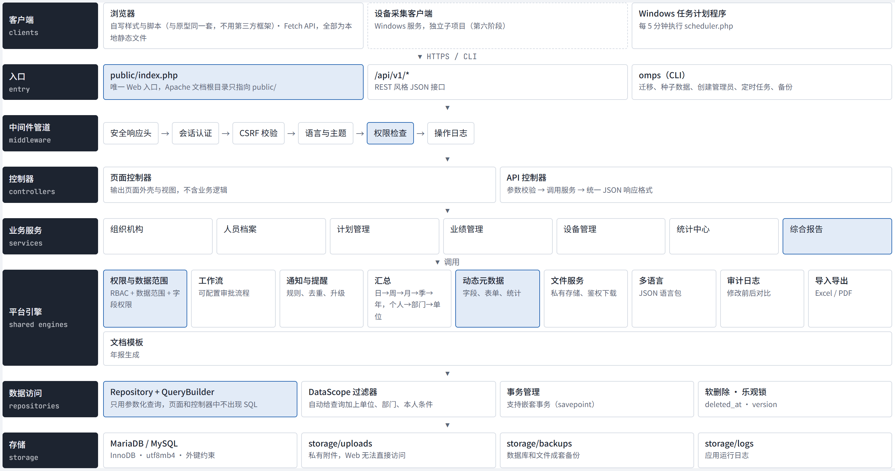

### Key architecture decisions

- **No third-party framework.** A self-built core of about 2000 lines (router, container, middleware, views, validation, query builder), using PSR-4 autoloading. Reason: an XAMPP LAN deployment cannot rely on installing from the internet, and future maintainers can read and understand all the code.
- **Page plus API pattern.** Page controllers output only the shell; table and form data are loaded by calling the API with Fetch. Permissions are decided only once, in the back end; hiding menus in the front end is only a usability improvement.
- **URL rewrite fallback.** `.htaccess` rewriting is preferred; if mod_rewrite is unavailable, the program automatically uses the `index.php?r=/path` form with no loss of function.
- **Zero extra packages, zero third-party frameworks.** The PHP core and the front-end styles and scripts are all written in-house and placed as plain files in `public/assets`; nothing is installed on the server (statistics charts were decided in phase 7: self-drawn SVG or a chart file shipped with the project). Date input uses the browser's built-in date picker, whose text follows the system language. Excel export: generates .xlsx when the zip extension is present, otherwise an XML spreadsheet or CSV that Excel opens directly. PDF export: uses a dedicated print-version page and the browser's "Print → Save as PDF". Word annual report: generates .docx when the zip extension is present, otherwise a .doc that Word can open. File type check: without fileinfo, the type is determined by reading the file's signature bytes.
- **Single unit.** The system serves only one unit; the unit contains only departments (a department can contain groups). The database keeps an `org_id` column for future expansion, but the interface has no unit management.

<a id="deploy"></a>

## 03 Deployment topology (production hardening)

XAMPP is suited to development. Before going into formal use on the LAN, harden it as shown below.

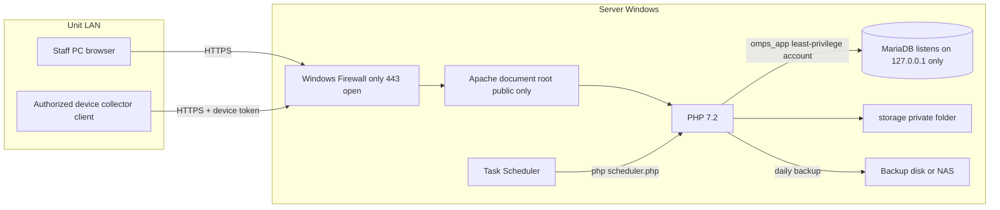

- Create two database accounts: `omps_app` has only SELECT/INSERT/UPDATE/DELETE; `omps_migrate` has table-creation rights and is used only for command-line migrations.
- Give the root account a strong password; in production, disable phpMyAdmin or allow access only from the local machine.
- HTTPS uses the unit's internal CA or a self-signed certificate; the session cookie is set with Secure, HttpOnly, SameSite=Lax.
- The storage folder is placed outside public. Even if the configuration is wrong, the upload folder blocks PHP execution through `.htaccess`.

<a id="modules"></a>

## 04 Module relationships

Business modules do not read each other's tables; they interact only through the service interfaces of the platform core.

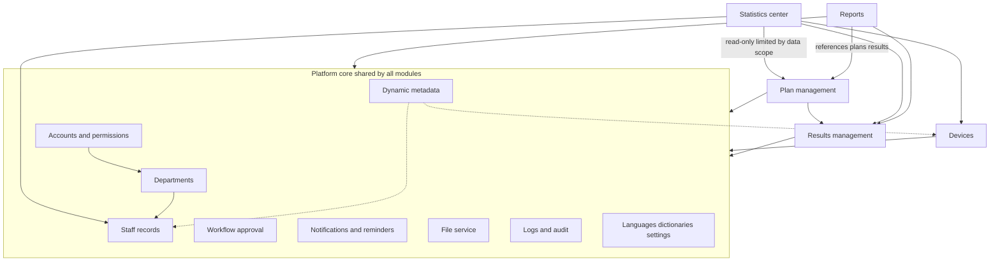

Dashed lines mean that dynamic fields can extend staff records and device records.

<a id="request"></a>

## 05 Permission checks for one request

Taking "a department head views the staff list" as an example, all three checks are done in the back end.

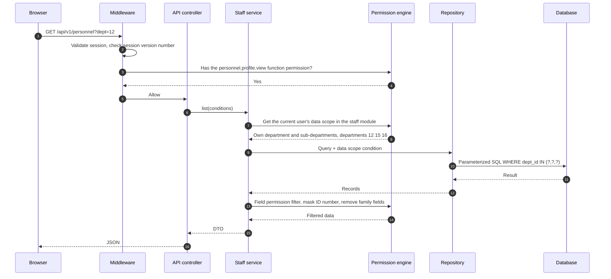

> [!NOTE]
> If a user changes the URL to another department, such as `dept=99`, the data scope condition is still intersected, the result is empty, and nothing reveals whether that department exists. When a single record is accessed (`/personnel/123`), the system first checks whether the record is within the data scope; if not, it returns 404 and writes an unauthorized-access attempt to the log.

<a id="perm"></a>

## 06 Roles and permissions

There are 4 built-in roles, from most to least permissions; when needed, custom roles (such as "Records administrator") can be added in "Roles & permissions". Device administrator is a part-time duty: tick "Also device administrator" for anyone; it is not a separate appointment.

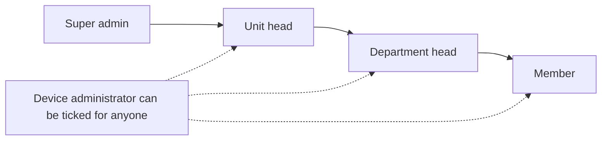

| Role | Data visible | Can do | Cannot do |
|---|---|---|---|
| **Super admin** | Everything | All permissions of the unit head, plus technical operations: Roles & permissions, Menus, Customization (Field design, Statistics page design, System theme, Banner management), Languages, Backups and restore, Settings, Logs | — |
| **Unit head** | Whole unit | Department and staff management; user accounts (create accounts, assign roles, tick device administrator); make unit plans; review department heads' results; Reports; Statistics | Technical operations |
| **Department head** | Own department (including groups under it) | Make the department's long-term and annual plans and assign them to members (multiple selection); review members' results, can edit directly and then approve, can approve in batch; view the department's staff information, add staff to the department, move subordinates out of the department (resignation, retirement, transfer out); the department's reports | See other departments' data |
| **Member** | Self, and tasks assigned to self | View tasks assigned to self; make quarter, month, week and day plans for tasks; record results; maintain own record | See other people's data |
| **Device administrator** (added) | All devices in the unit | Device records, Usage & monitoring, Faults & repairs | Does not gain any staff or plan permissions from this |

### Fixed rules

- Each user has exactly one role, and can additionally have "Also device administrator" ticked.
- Data scope is fixed by role and needs no configuration, so there is no "Data permissions" page. Every back-end API still enforces the check; changing the URL or parameters cannot retrieve data outside the scope.
- Review relationships are fixed: members' results and record changes are reviewed by the department head; department heads' by the unit head; a unit head's submissions take effect immediately. So there is no "Approval workflow" design page.
- Sensitive information (full ID number, family records): the super admin and the unit head can view it, and every view is written to the audit log; department heads and members can see only their own.
- The super admin can adjust each role's function permissions in "Roles & permissions" (except the super admin itself, which always has all permissions).

### Adding, editing and deleting roles

| Operation | Rule |
|---|---|
| **Add role** | Enter the role name (required for every enabled language, such as Simplified Chinese and English), a description (optional), the default data scope (own only / own department / whole unit), and choose "Copy permissions from which role" (member by default). After creation, adjust each item in the permission table on the right and click "Save permissions" |
| **Copy as new role** | Copy any role; the name automatically gets " (copy)" appended, the permissions are identical, then modify as needed |
| **Edit** | A custom role's name, description and data scope can be changed; built-in role names cannot be changed (they are fixed in the language data), only the description and data scope; the super admin's data scope is fixed as "All" |
| **Delete** | Only custom roles can be deleted; a role still in use by users cannot be deleted, and the message lists who they are and offers "Go to Users" to change their role; the 4 built-in roles cannot be deleted |
| **Unique names** | Role names must not repeat within the same language |
| **Multiple languages** | Custom role names are also listed in "Languages → Translations" (module role), so they are translated together when a new language is added later |
| **Effect and logging** | Adding, editing or deleting roles and changing permissions are all written to the audit log; permission changes take effect on the affected users' next action |
| **Page layout** | On the left, the role table (name, built-in / custom, number of users, action icons: view permissions · copy as new role · edit · delete); on the right, the permission table of the selected role (module × view / add / edit / delete / export / review / assign tasks / sensitive information) |

<a id="db"></a>

## 07 Database design

> [!TIP]
> This chapter is the data model and table-creation conventions from the design stage. For the actual tables and columns, [DATABASE.en.md](DATABASE.en.md) is authoritative (generated from the database structure).

About 90 tables in 7 domains. Each ER diagram below lists only the key columns; the full columns are written in DATABASE_DESIGN.md.

### Common conventions for all tables

| Column | Type | Purpose |
|---|---|---|
| `id` | BIGINT UNSIGNED auto-increment | Primary key |
| `org_id` | BIGINT UNSIGNED | Owning unit; present in every business table, used for data isolation, indexed |
| `created_at / updated_at` | DATETIME | Created and updated time |
| `created_by / updated_by` | BIGINT UNSIGNED | Creator and last updater (users.id) |
| `deleted_at / deleted_by` | DATETIME / BIGINT | Soft delete; log tables do not have these columns (cannot be deleted) |
| `version` | INT UNSIGNED | Optimistic locking, so two people editing at the same time do not overwrite each other (important business tables) |
| `biz_type + biz_id` | VARCHAR(50) + BIGINT | Polymorphic link: files, workflows, notifications and dynamic field values all use this pair of columns to attach to any business record |

### MariaDB 10.1 table-creation conventions

| Limitation | How it is handled | Effect on the design |
|---|---|---|
| No JSON column type | Columns marked `json` in the ER diagrams are actually created as `LONGTEXT`; PHP validates the JSON format before writing | None. These columns only store snapshots and are never queried into |
| Index length limit of 767 bytes | utf8mb4 text columns that need an index are at most `VARCHAR(191)`; code and key-name columns use the ascii character set; the notification de-duplication key is stored as a 64-bit hash | None |
| CHECK constraints have no effect | Rules such as value ranges and weight totals are validated in the service layer; enum values use `ENUM` or dictionary tables | None. Validation was in the service layer anyway |
| Strict mode: off by default in 10.1, on by default from 10.2 | `sql_mode` is fixed on connect (including `STRICT_TRANS_TABLES`), so 10.1 also runs in strict mode; the service layer validates by column type and length before writing | None. Both versions behave the same: data that is too long or of the wrong type raises an error and is never silently truncated |
| No recursive queries (CTE) or window functions | The organization tree uses a `path` column, the plan tree uses the closure table `plan_paths`; ranking statistics are computed in PHP | None. The design never used them |

All historical data is stored in `data_versions` (entity type, entity ID, version number, full snapshot, modified by), and audit differences are stored in `audit_logs`. The two are kept apart: the former is for "View history versions" and "Restore", the latter for "who changed what and when".

### 7.1 Departments, accounts, permissions (phase 1)

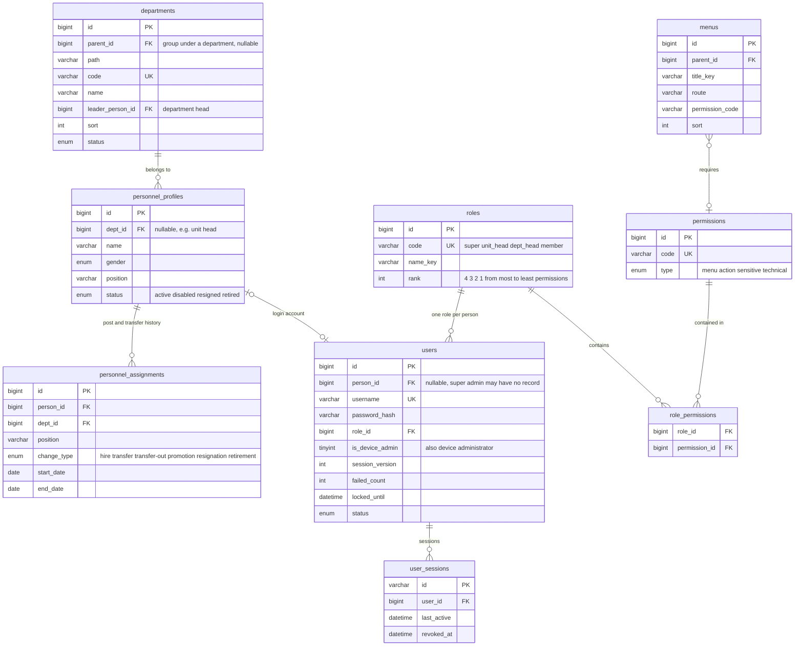

Notes: the system serves only one unit; the unit name, logo and address are stored in `system_settings`. Business tables keep the `org_id` column (fixed at 1) for future extension, and no unit management appears in the interface. The data scope is fixed by role: the super admin and the unit head see everything, a department head sees their own department (including its groups), and a member sees their own data and the tasks assigned to them.

### 7.2 Staff records (phase 2)

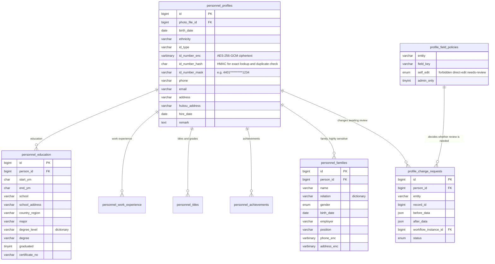

Attachments (supporting documents, achievement images, videos) are not stored as paths in these tables; they are all attached to records through `file_relations`. When a person changes a field that needs review, the change is first written to `profile_change_requests` and only written back to the official record after it is approved, so the official record always holds reviewed data.

<a id="staffdept"></a>

### Department heads adding and removing staff

A department head manages the people in their own department: they can add people and remove them. "Remove" is not delete: records, plans, results and device records are all kept, and only the unit head and the super admin can permanently delete a record.

| Action | What the department head does | What the system does automatically |
|---|---|---|
| **Add staff** | "Add staff" at the top right of the staff list, then fill in the record. "Current department" can only be their own department or one of its groups; the default is their own department | Writes a "hire" post record; notifies the unit head and the super admin; the login account is opened by the super admin (adding staff does not create an account automatically) |
| **Remove from department** | On the subordinate's row, click "Remove from department" and choose a reason: **Resigned**, **Retired** or **Transferred out of department**, then fill in the effective date and a note (optional) | A dialog shows how many unfinished plans and in-use devices the person still has, which must be arranged separately.<br>Resigned, retired: the person's status changes to resigned or retired, and the login account is disabled.<br>Transferred out: the person becomes "To be assigned", the account is kept, and the unit head receives the to-do "Assign a department for XX"; after a new department is set with "Transfer", the to-do completes automatically |
| **Decided by permissions** | In the "Roles & permissions" matrix: **Staff records · Add** = add staff; **Staff records · Delete** = remove staff; **Staff records · Edit** = edit records. Department heads have all three checked by default; once the super admin unchecks one, the button disappears immediately and the back-end API also refuses | Whom the action can apply to depends on the role's default data scope: **own department**: can only add to their own department and remove people from it (as in the two rows above); **whole unit**: can also "Transfer" and permanently delete records (the unit head's default); **own**: even if checked, can only change their own record. Custom roles (such as "department records clerk") work the same way |
| **Not allowed** | Cannot add to other departments; cannot remove themselves; cannot change a person's status directly in the record form (they must use "Remove from department", so there is always a post record); cannot permanently delete records | Every add and remove writes an audit log entry (department and status before and after); in transfer records, a department head only sees records of people in their own department |

### 7.3 Plans, results, scoring, targets (phases 3 and 4)

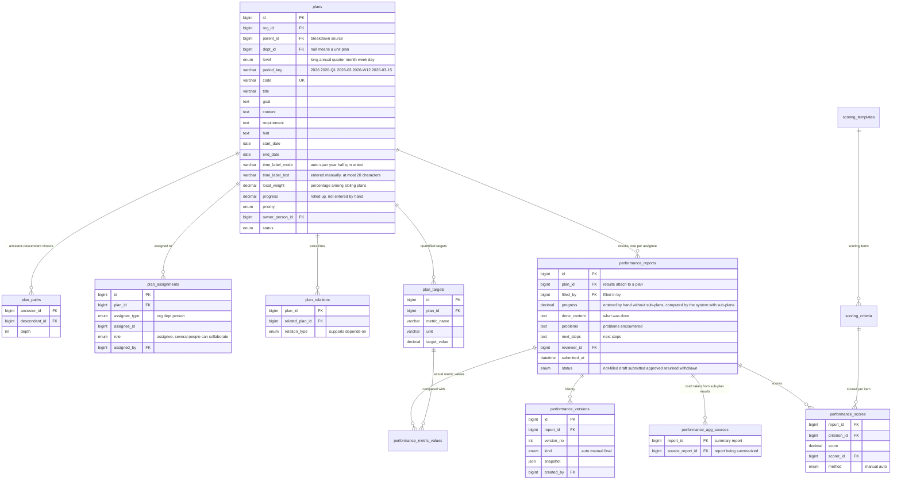

### 7.4 Workflow approval (used from phase 2)

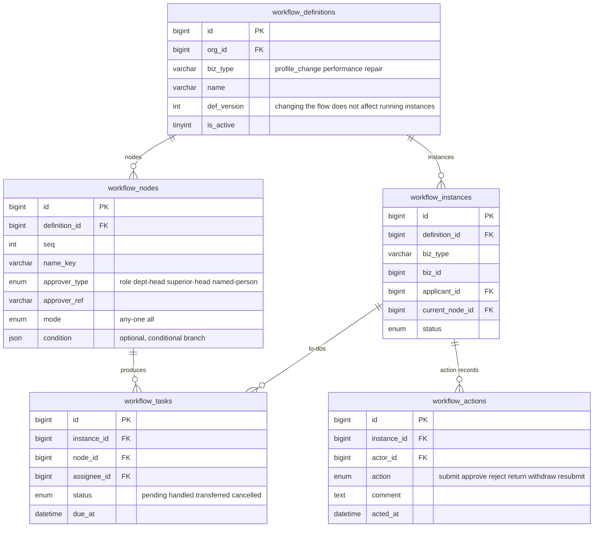

### 7.5 Devices (phase 6)

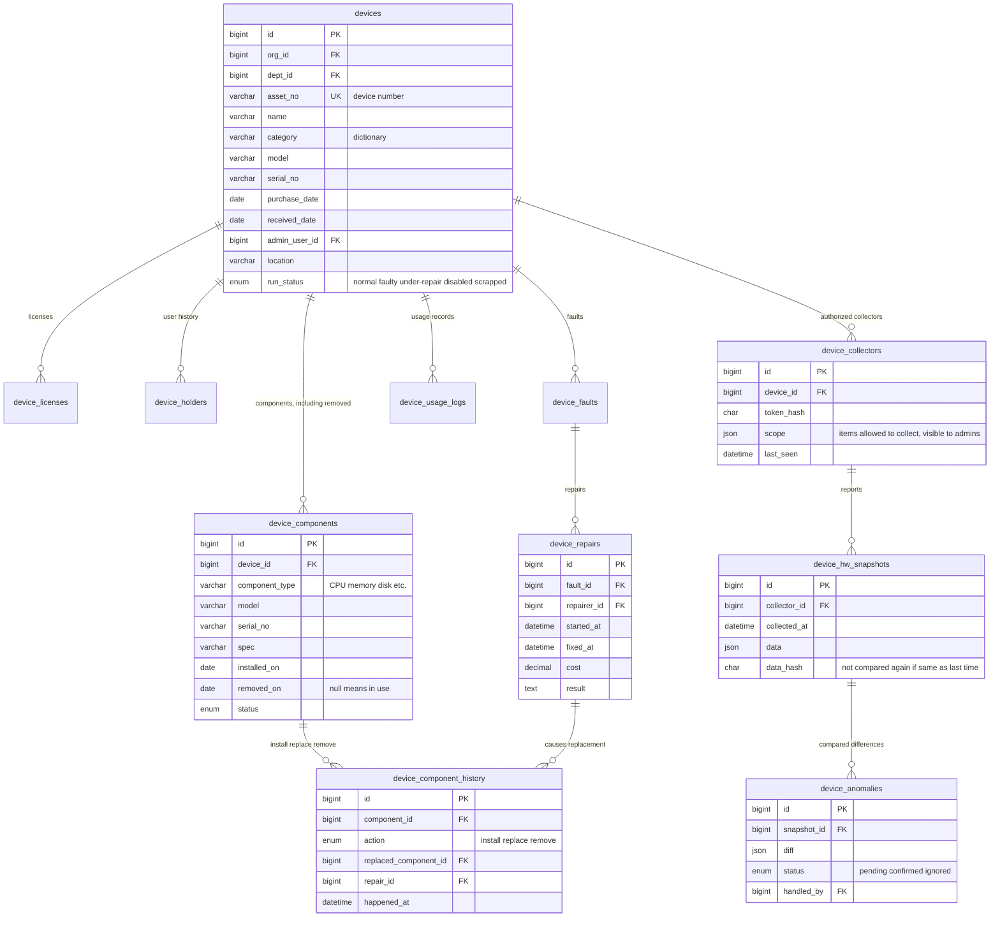

Replacing a component = fill in `removed_on` on the old component row + add a new row for the new component + write one history entry; the original data is not overwritten.

### 7.6 Dynamic fields and statistics (phase 7)

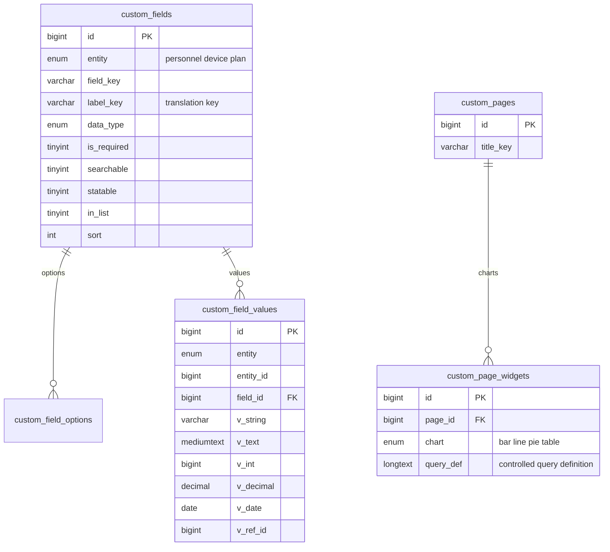

### 7.7 Notifications, files, logs, system, import, templates, upgrades

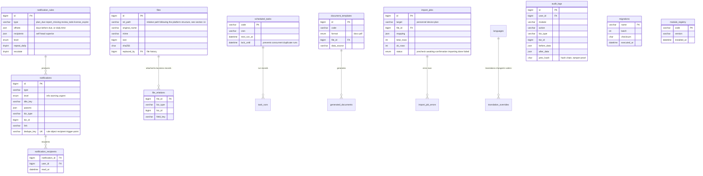

Other system tables: `login_logs`, `login_attempts` (failure rate limiting), `operation_logs`, `backup_logs`, `system_settings`, `dictionaries` / `dictionary_items`, `themes`, `banners`, `data_versions`, `upgrade_logs`, `missing_translations`.

<a id="plan"></a>

## 08 Plan levels and weight calculation

Parent-child relationships are stored in `plans.parent_id` and in the closure table `plan_paths`; they are not inferred from names or dates. The level is not chosen by the user; it is determined automatically from the start and end dates.

### Breaking goals down level by level (example)

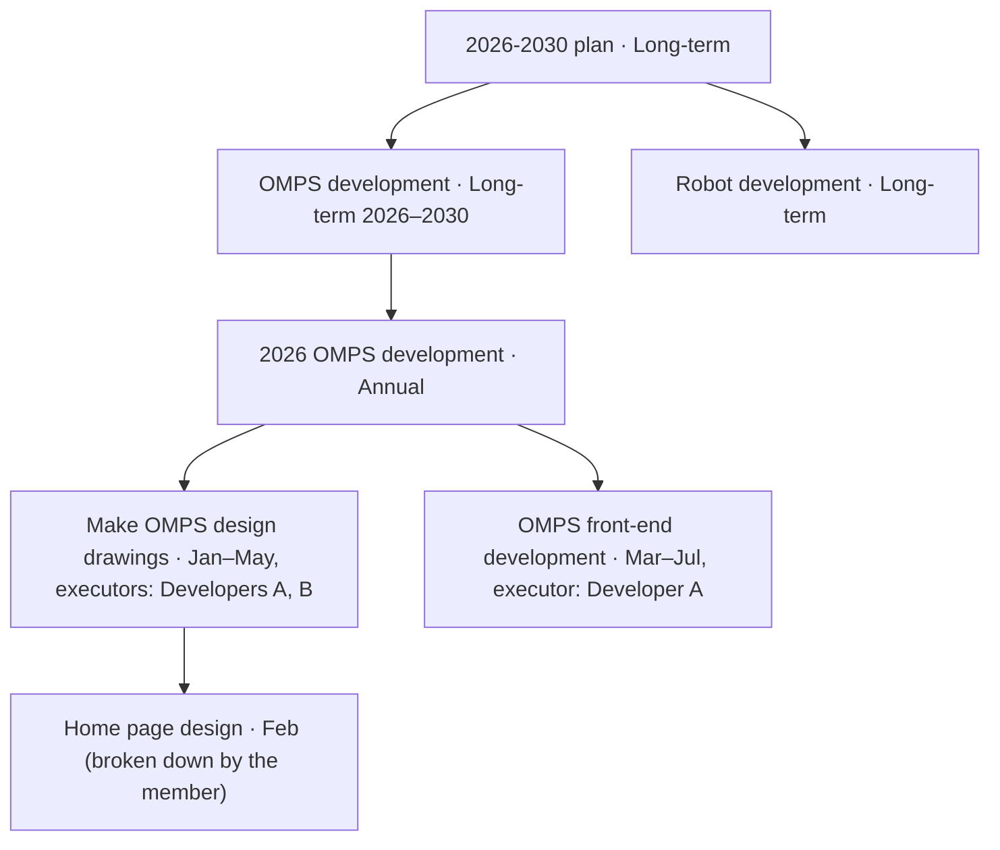

| Rule | Description |
|---|---|
| **Level determined by dates** | The smallest calendar period that contains the time span is used: same day = Day, same week = Week, same month = Month, same quarter = Quarter, same year = Annual, spanning years = Long-term. For example, Jan 1 – May 31 is "Annual", and the time shown in the list is "Jan–May" |
| **Same-level nesting allowed** | A sub-plan can be at the same level as its parent or lower; it cannot be longer than its parent (a goal spanning years cannot be added under an annual goal). So a long-term plan can be split into several multi-year goals, and an annual goal can be split into sub-goals of any length |
| **Who can create what length** | Heads (unit head, department head) can add sub-goals of any length and choose the executors (multiple selection allowed); a member can only add sub-plans of up to one quarter, under tasks assigned to them |
| **Changing dates** | When progress slips, the dates can be changed directly, and the level changes with the dates; if the dates fall outside the parent's time range, the plan is still saved and a warning is shown |
| **Dates for a new plan** | Default to one level below the parent (this year under a long-term plan, this quarter under an annual plan, and so on). "Quick time selection" fills in dates with one click: same as parent, 5 years, one year, one quarter, one month, one week, one day, limited to the parent's range |

### Breaking down by period (weight calculation example)

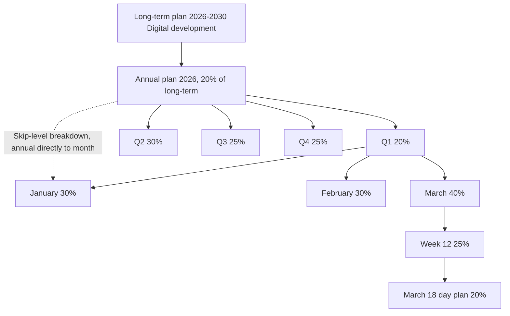

### Calculation rules

1. **Local weight:** Each plan stores only its share relative to its sibling plans, `local_weight`. The sub-plans under the same parent plan should total 100%. The administrator can set the check mode: enforce (cannot be saved unless the total equals 100%), warn, or off.
2. **Effective weight (calculated automatically, not stored):** multiplied along the path.

```text
Effective weight (day plan March 18) = 20% × 20% × 40% × 25% × 20% = 0.08% (of the long-term plan)
```

1. **Progress rolls up:** A leaf plan's progress comes from the completion ratio of its approved results; parent plan progress = Σ(sub-plan local weight × sub-plan progress). A parent plan's progress is always calculated and cannot be entered by hand, so two conflicting progress values can never exist.

```text
Progress(Q1) = 30% × Progress(January) + 30% × Progress(February) + 40% × Progress(March)
```

1. **No double counting:** Each amount of completed work is counted only once, at the level where it was reported. Upper levels only apply weights; they do not add up the lower-level result entries again. If a day plan supports two parent plans at the same time, the primary relationship goes through `parent_id` and counts toward progress; the secondary relationship goes through `plan_relations` and is for display only, not counted toward progress.
2. **Period codes:** `period_key` is used throughout (`2026`, `2026-Q1`, `2026-03`, `2026-W12`, `2026-03-18`). Weeks follow ISO weeks; this can be changed in Settings to a custom period start day. Target comparison and year-over-year comparison both use this code.

<a id="agg"></a>

## 09 Plans and results

Plans, from long-term down to day plans, are kept in one tree; results and the completion percentage are written directly on each plan in the tree.

### 9.1 Who sets what

| Role | Sets | Assigns | Results |
|---|---|---|---|
| Unit head | The unit's long-term and annual plans, and goals of any length under them | Assigns to department heads | Reviews department heads' results |
| Department head | The department's long-term and annual plans; can break them down level by level into multiple multi-year goals, annual goals and sub-goals of any length (such as Jan–May) | Assigns to members of the department, **multiple selection allowed**, several people working together | Reviews members' results: can edit and approve directly, can approve in bulk |
| Member | For tasks assigned to them, sets sub-plans of up to one quarter (quarter, month, week, day, or any period within that) | — | Records results and fills in the completion percentage on tasks and sub-plans |

**Where to create:** Department heads and unit heads have "+ New plan / New main plan" on both the "My tasks" and "Plans & Results" pages, and executors can be multi-selected (in "My tasks", the user is ticked by default). Members do not have this button; they can only add sub-plans of up to one quarter under tasks assigned to them. **The level is not chosen**: fill in the start and end dates and the system determines it automatically (see [section 08](#plan)). Dates default to one level below the parent; you can also click "Quick time selection": same as parent, 5 years, one year, one quarter, one month, one week, one day. When there is a parent plan, the dates do not go beyond the parent plan's time range (for example, under the 2027 annual plan, the default is Q1 2027).

**Several people working together:** When a task is assigned to several people, each person sets their own sub-plans and records their own results. The task's completion percentage = the average of each person's completion percentage; the task page lists each person's results separately.

### 9.2 My tasks (a member's home page after login)

Shows at a glance all tasks assigned to the user and the sub-plans the user has set under them. Every row offers "+ Sub-plan" or "Record results" directly; sub-plans the user added can also be "Edit"-ed and "Delete"-d. Tasks assigned by a head cannot be changed; the user can only record results and add sub-plans.

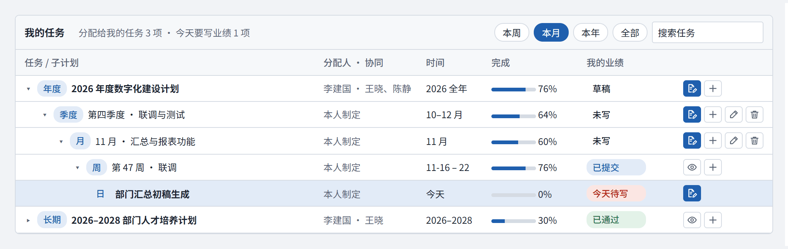


### 9.3 Record results dialog

The upper part automatically lists the results the user has already written for sub-plans under this task; in the lower part the user adds to or changes them on that basis.

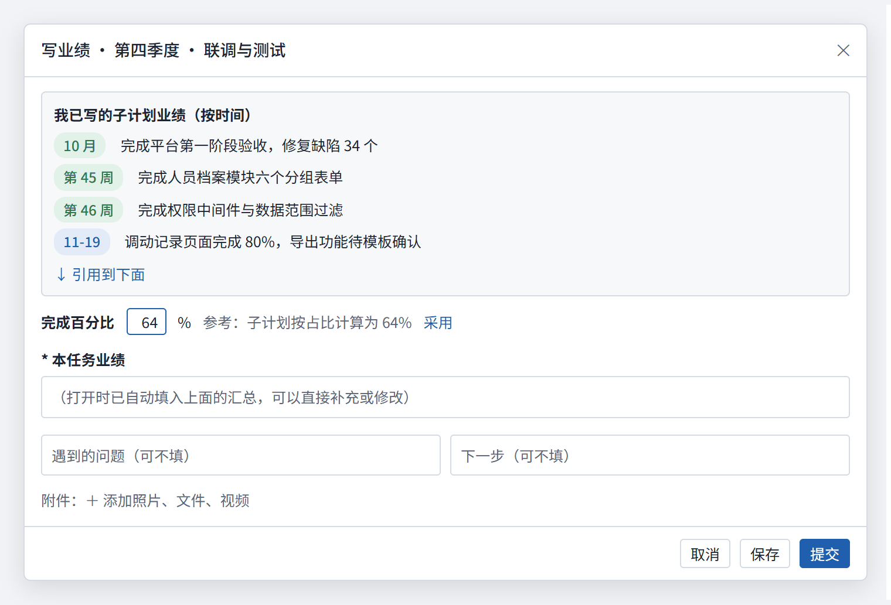

### 9.4 Plans & Results (one page, tree view)

Everything from long-term plans to day plans is on this one page. Users can create main plans, add sub-plans, and fill in completion percentages and results directly. Department heads and unit heads manage all plans from this page.

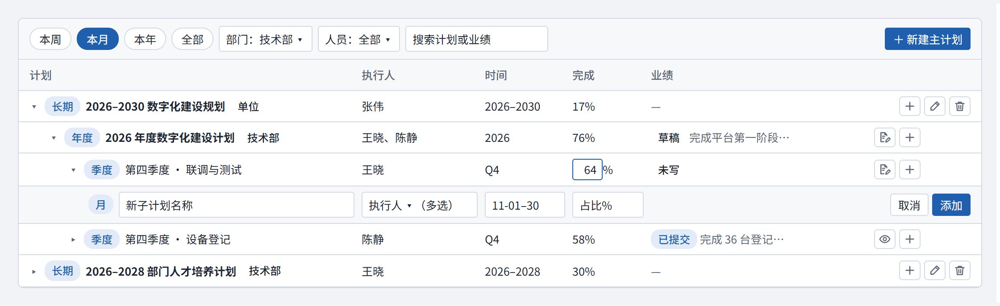


- **Filters:** This week, This month, This year, All; can filter by department and person; the search box searches both plan names and result content. When filtering, the parents of matching plans are also shown (in gray), so you can see which task a plan belongs to.
- **Direct actions:** Clicking the add-sub-plan icon (+) opens a row of input boxes under that row; fill in the name, executors (multiple selection), time and share to add it. For plans the user is responsible for, the percentage can be changed directly in the "Done" column; clicking the record-results icon opens the dialog from 9.3.
- **Unit plans and department plans:** The name is followed by "Unit" or the department name; departments can also have their own long-term plans.

### 9.5 Results review

Department heads handle results submitted by members here: they can edit and approve directly, or tick several and approve them in bulk. All actions are logged.

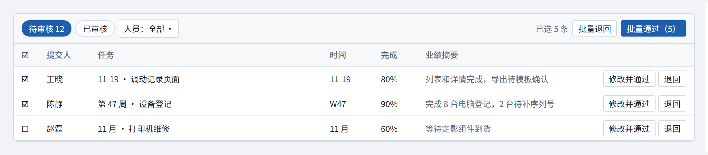

- **Edit and approve:** Open the submission; the department head can change the completion percentage and the result text directly and click "Save and approve". The original submission is kept in the history, and the submitter receives an "Edited and approved" notification.
- **Bulk approve:** Tick several entries and click "Bulk approve"; one confirmation is enough. Returning requires a reason (several entries can share one reason).
- **Log:** Each approval, return and edit is recorded separately in the operation log; edits record the content before and after the change.

<a id="perf-stats"></a>

#### 9.5.1 Execution statistics (v0.48)

The "Results review" menu item is renamed **Review & statistics**; the page has two sub-pages: **Review** and **Statistics**. Statistics covers the people in the reviewer's scope (with a login, not the reviewer), per person: how many assigned plans were executed and how many were not, how many daily, weekly, monthly, quarterly and annual reports were due, submitted and missing, and the percentages. Every figure can be opened to see exactly which ones.

| Part | Content |
|---|---|
| **Filters** | Period (this month by default; today, this week, this year, all, custom), department (with its sub-departments), person, show "All" or "Only people with something not done or not submitted", search by name |
| **Overview** | Six figures: assigned plans executed, daily / weekly / monthly / quarterly / annual reports submitted; each shows the percentage, a bar and "executed / not executed / due" or "submitted / missing / due". "—" when nothing is due in the period |
| **By person** | One row per person, one column per kind: percentage, bar, "submitted / due", plus "n not executed", "n missing", "n overdue" when something is missing; a total row at the end. Click a column title to sort by the percentage; kinds with nothing due for anyone have no column |
| **Lists** | Click a figure or a cell to open its list, filter by state (all, executed, not executed, not started, overdue; or all, submitted, missing), with paging; plans open directly |
| **Export** | "Export Excel" exports the by-person table with the total |

| Rule | Description |
|---|---|
| Assigned plans | Plans a leader gave to the person; sub-plans people add for themselves are not counted. A plan counts when its dates overlap the period; cancelled plans are left out |
| Executed | The person has submitted a result (submitted or approved) on the plan or on an own sub-plan under it. "Completed" when the approved completion is 100% or the plan is marked done, otherwise "in progress" |
| Not executed, not started, overdue | Started but no result submitted: not executed. Not started and nothing submitted: not started, left out of the rate. Past the end date and not completed: overdue |
| Daily to annual reports | Results written on plans of that length (day, week, month, quarter, year, i.e. the plan level). One daily report per workday, and one per week, month, quarter and year |
| Due | A report is due at the end of the last workday of its period (workdays and work hours are in the system settings). It counts when its due day is in the period and the due time has passed; nothing is due before the person's record was created or the hire date |
| Submitted, missing | Submitted and approved count as submitted (early ones too); draft, returned, withdrawn, not written and no plan count as missing |
| Colours | 90% and above green, 60%–90% amber, below 60% red; the numbers are always shown, never colour alone |
| Permission | Same as results review (`perf.audit`): department heads see their department and its sub-departments, unit heads the whole unit |

### 9.6 System rules (no user settings needed)

|   |   |
|---|---|
| Completion percentage | Filled in by the user. When there are sub-plans, the system calculates a suggested value from the sub-plan shares and shows it next to the input box; click "Use" to fill it in |
| Several people working together | Task completion percentage = the average of the executors' completion percentages |
| Results summary | The upper part of the dialog lists only the results the user has written for sub-plans at all levels under this task, in time order; the original results of the sub-plans are not changed |
| Reminders | Before 17:00 each day, the user is reminded if today's day plan has no results yet; week, month, quarter and annual plans are reminded one working day before they end |
| Time display | The time in the list is shown from the plan's start and end dates: when it is exactly a whole year, quarter, month or week (Monday to Sunday), the name is shown (such as "2026", "Q4", "November", "Week 47"); otherwise the exact dates are shown (such as "11-01 – 11-20", with the year when it spans years). The period is calculated by the system from the dates, and the list updates immediately after the dates change.<br>**It can also be set by hand**: when editing a plan, "Time display" defaults to "Auto"; when the period is long, click a short form the system offers based on the dates (such as "2025–2030", "2026", "First half", "Q1", "November", "Week 47"), or type your own (up to 20 characters). Short forms follow the language switch and date changes, and revert to "Auto" automatically when the dates change so that they no longer apply; your own text is shown as typed, and after the dates change the system asks you to confirm it. The plan details also show the exact dates |
| Beyond the parent's time | A sub-plan whose time goes beyond the parent plan can still be saved; the system shows a yellow notice stating the parent plan's time range; the times before and after the change are recorded in the operation log |
| Editing and deleting sub-plans | Sub-plans the user added can be edited (name, time, time display, share, target, work content) and deleted. On deletion, the sub-plans under it are deleted too, unsubmitted result drafts are deleted too, and attachments are moved to the recycle bin (recoverable within 30 days). If anything under it has submitted or approved results, it cannot be deleted until they are withdrawn; approved results can only be withdrawn after the head returns them. Members cannot edit or delete tasks assigned by a head |
| History | Every save, submission, edit, approval and return is recorded and can be viewed and compared; editing and deleting plans is recorded in the operation log |

> [!NOTE]
> Compared with v0.6: the six plan-level menus and "My work" are merged into two pages, "My tasks" and "Plans & Results"; plans can be worked on by several people together; departments can have long-term plans; members are responsible for quarter, month, week and day plans; the review page allows direct editing and bulk approval; the "Results statistics" page is removed.

<a id="report"></a>

## 10 Reports, notebook and issued items

Reports can be generated for any period, any tasks and any people: the system goes task by task, listing lower-level tasks and results, and the report can be annotated, printed and downloaded. All reports are saved in the "Report list", and reports can also be created by hand and report documents uploaded. The notebook is for the user's own notes, which can be submitted to the superior when needed; issued items are reminders, documents and instructions with deadlines that superiors send to subordinates. New messages in both directions go to the bell ([section 13](#remind)).

### 10.1 Report criteria

Each of the three criteria can be set to "All", "Multiple" or "One", in any combination.

| Criterion | How to choose | Default |
|---|---|---|
| **Period** | Any start date – end date; quick buttons: This week, This month, This quarter, This year | This year |
| **Tasks** | "All tasks", or tick one or more tasks in the task tree (long-term, annual, quarterly and monthly can all be chosen) | All tasks |
| **People** | "All people", or tick one or more people; grouped by department, a whole department can be selected with one click | All people |

- Only tasks that overlap the period are listed; only tasks the selected people take part in, and their results, are listed.
- When a task and its parent task are both selected, it is listed only once, under the parent task, without duplication.
- Scope is limited by role: the unit head can choose the whole unit; a department head can only choose tasks and people of their own department; for a member, the person is fixed to themselves.

### 10.2 Listing rules

1. **One section per selected task,** listing its own results, then each lower-level task within the period: name, executors, completion percentage, results.
2. **When a lower-level task has no results of its own, look further down.** For example, if an annual plan has no annual results, its quarterly results (or monthly results when there are no quarterly results) are listed one by one in time order.
3. **Only approved results are used**, and the original results are not changed.

### 10.3 Page design

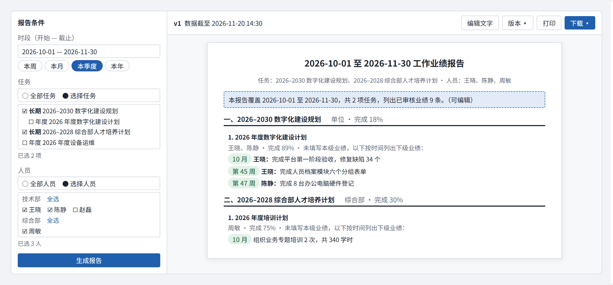

### 10.4 Edit, print, download

#### Edit

- Only the explanatory text can be changed (opening note, additional note); tasks, completion percentages and results come from the data and cannot be changed
- Each save automatically keeps a version, and versions can be switched between for viewing

#### Print and download

- Print: an A4 print page; use the browser's "Print → Save as PDF" to get a PDF
- Download: Word (.docx when the zip extension is available, otherwise .doc), Excel details
- Every print and download is logged

<a id="rplist"></a>

### 10.5 Report list (report history)

The Reports page has two sub-pages: **Report list** (default) and **Generate by criteria**. Generated reports are saved to the report list automatically, with no separate save click needed; reports can also be created by hand.

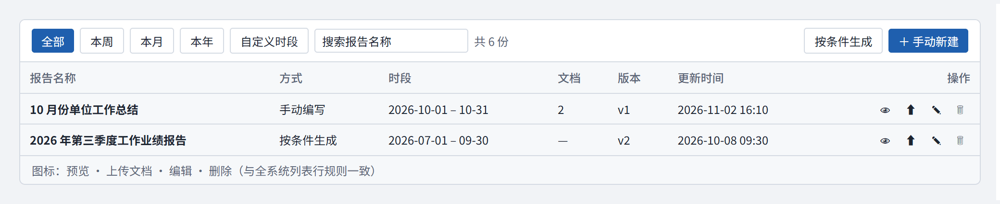

| Action | How |
|---|---|
| **Filter** | Above the list: **All** (default) · **This week** · **This month** · **This year** · **Custom period** (when selected, start and end date boxes appear), optionally plus a name search. Filtering is by **report period**: a report is shown only if its period falls entirely within the selected range. "This month" shows this month's weekly and monthly reports, not reports spanning years; "This year" shows all reports within this year. Reports without a period are counted by creation date. After filtering, "By report period: n / total reports" is shown; when there are no results, a "Show all" button appears |
| **Preview** | Click the report name or the eye icon to open the report page; below it are this report's "Report documents". Buttons at the top: ← Report list · Edit · Versions · Print · Download · Delete |
| **Edit** | Reports generated by criteria: the title, opening note and additional note can be changed; tasks, completion percentages and results come from the data and cannot be changed. Hand-written reports: the name, period and body can be changed. Each save keeps a version, and versions can be switched between for viewing |
| **Create by hand** | Fill in the report name, period (default this month) and body; documents can be uploaded at the same time. At least one of body or document is required; when there is only a final Word version, just upload it |
| **Upload, delete report documents** | Click the upload icon in the list row, or click "Upload document" on the preview page. Word, PDF, Excel and images are supported, up to 50 MB each; identical files are not stored twice ([section 11](#files)). Deleted documents go to the recycle bin and can be recovered within 30 days |
| **Delete report** | After confirmation, the report and all its versions are deleted; its report documents are moved to the recycle bin and can be recovered in "Files" within 30 days |
| **Who can see it** | The report list shows only reports the user created. Who a report is for is up to the user, who sends it on after printing, downloading or uploading documents |
| **Log** | Generating, creating, editing, deleting, printing, downloading and uploading are all recorded in the operation log |

### 10.6 Data tables

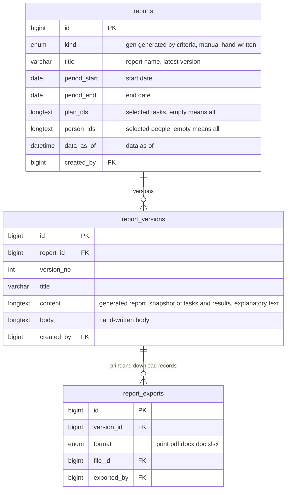

### 10.7 Notebook

Each person's own notebook. What is written is **visible only to the writer** by default; when the superior needs to know, one button submits it, and after reading, the superior can write a comment. The menu is under "My affairs" on the left.

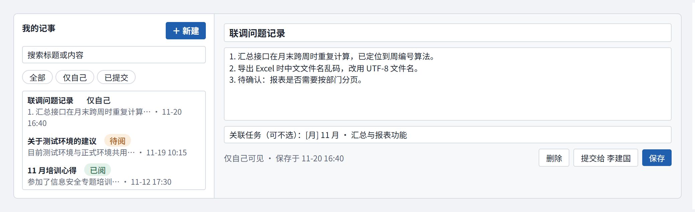

| Rule | Description |
|---|---|
| **Writing and saving** | Title + body, optionally linked to one of the user's own tasks. Click "Save"; when switching to another note the system saves automatically, so nothing is lost |
| **Visible only to the writer** | Unsubmitted notes are visible only to the writer. Superiors, the unit head and the super admin cannot see them in the interface |
| **Submit to superior** | The button shows the recipient's name directly, decided by the system: member → head of their department; department head → unit head; the unit head has no superior, so their notes stay with them. After submission the recipient gets a to-do and a notification |
| **After submission** | The note is locked and cannot be changed or deleted. Before the recipient reads it, it can be "Withdrawn"; after withdrawal it is visible only to the writer again and can be edited further |
| **Superior reading** | Department heads and the unit head have an extra sub-page "Received notes" (the unread count is shown on the tab). After opening one, they can write a comment (optional) and click "Read"; the submitter gets a notification and sees the comment below the note |
| **After being read** | Kept as a record and cannot be changed or deleted; to keep writing, click "Copy as new note" |
| **Log** | Creating, submitting, withdrawing, reading and deleting are recorded in the operation log, with only the title and action, not the body |

### 10.8 Notebook data table

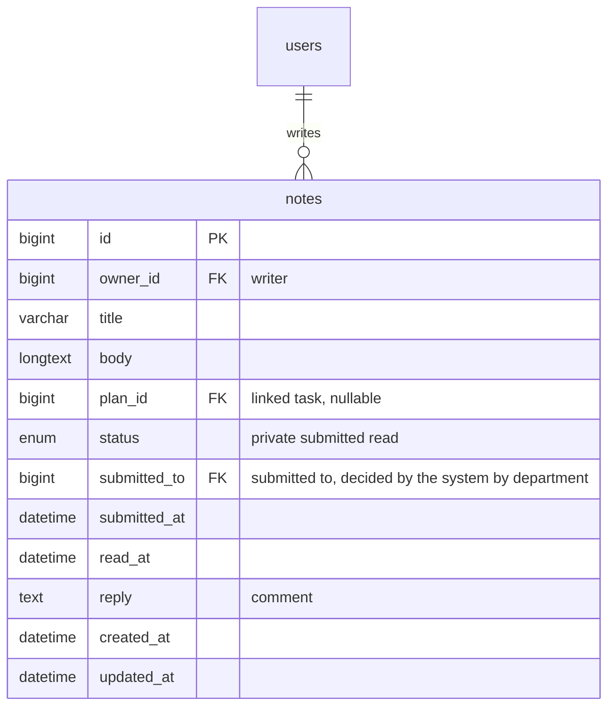

> [!NOTE]
> In actual development, both the note list and the read endpoint filter by "the user's own, or submitted to the user"; no role can bypass this rule to see someone else's private notes in the interface.

### 10.9 Issued items (superior → subordinate)

The menu is under "My affairs" on the left. Everyone has "Received"; department heads and the unit head have an extra sub-page "Issued by me". One form can send three kinds of things, and the system classifies them automatically by content:

| Type | How to send | What the recipient does |
|---|---|---|
| **Reminder** | Write only a title and content, choose "Read only" | Opening it marks it as read |
| **Document** | Upload a document, choose "Read only" | Open, preview or download; opening it marks it as read |
| **Instruction** | Choose "Complete and reply", fill in a deadline | Write the completion status (materials can be uploaded) and click "Complete and reply"; until it is done, the system follows up according to the rules ([13.2](#remind)) |

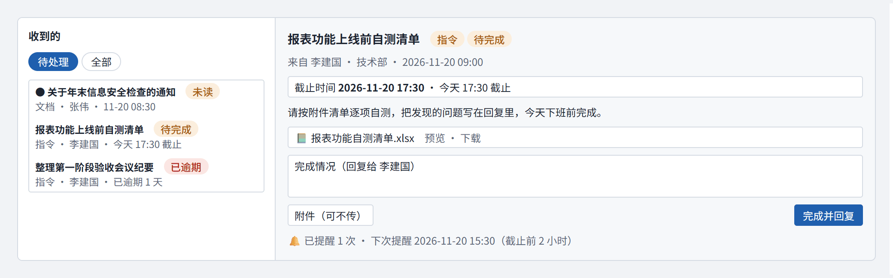

| Rule | Description |
|---|---|
| **Who to issue to** | Department head: people in their department (including groups); unit head: people in the whole unit, with "All department heads" and "Everyone" quick selections. Members cannot issue items; to report upward they use the notebook |
| **Issue form** | Title, content, documents (optional), recipients, requirement (Read only / Complete and reply), deadline. Follow-up frequency is under "More options", default "System automatic" |
| **Issued by me** | Each row shows progress (read x/n or done x/n) and the number of overdue recipients; icons: View (each person's read, done, reply, attachments, reminder count and next reminder) · Nudge · Withdraw |
| **Nudge** | Sent only to people who have not yet read (reminders, documents) or not yet completed (instructions); the same person can be nudged at most once per hour, to avoid flooding |
| **Withdraw** | Recipients get a withdrawal notification; the item turns gray, no longer needs handling, and follow-ups stop |
| **Files** | Saved to `D:\OMPS\files\Issued items\sender\title\uploader\`. The sender's documents are visible to all recipients; materials in replies are visible only to the sender and the uploader |
| **Log** | Issuing, nudging, withdrawing, and completing and replying are recorded in the operation log |

### 10.10 Issued items data tables

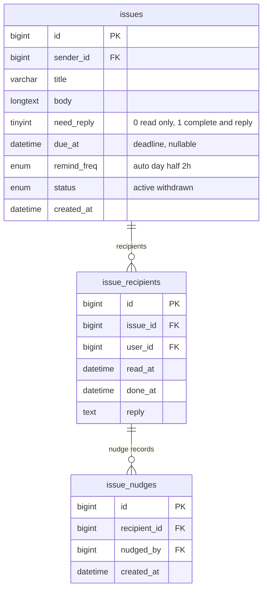

> [!NOTE]
> Attachments use the file table's business link (biz_type = issue), and like other modules they are deduplicated and go to the recycle bin.

<a id="files"></a>

## 11 File storage and management

Files uploaded to the server are placed into folders that follow the platform's structure; the last folder level is the uploader's name. Files are uploaded when recording results; on the "Files" page you can browse, preview, download and delete them using the same structure.

### 11.1 Folder structure on the server

> [!NOTE]
> The folders the system creates are named in Simplified Chinese on the server (the base language, e.g. `计划与业绩` for "Plans & Results"); they are translated below for readability. The "Files" page shows them in each user's own language.

```text
D:\OMPS\files\                                   # file storage root, outside the web root, not reachable by URL
├── Plans & Results\                              # one folder per plan level, nested level by level
│   ├── 2026–2030 Digitalization plan\
│   │   └── 2026 annual digitalization plan\
│   │       ├── Q4 · Integration and testing\
│   │       │   ├── October · Phase 1 acceptance\
│   │       │   │   └── Wang Xiao\                # last level is the uploader
│   │       │   │       ├── Phase 1 acceptance report.pdf
│   │       │   │       └── Acceptance meeting photo.jpg
│   │       │   └── November · Summary and report features\ …
│   │       └── Q4 · Device registration and inspection\
│   │           └── Chen Jing\Computer register.xlsx
│   └── 2026–2028 General Office talent development plan\ …
├── Staff records\                                # department → group → name → record section
│   └── Technology Dept.\Software Group\Wang Xiao\Education\Diploma.pdf
├── Devices\                                      # device number and name → device records / faults & repairs → uploader
│   └── SJZX-PR-0004 Laser printer\Faults & repairs\Zhao Lei\Fault photo.jpg
├── Reports\                                      # creator → report name
│   └── Zhang Wei\October unit work summary\October unit work summary (final).docx
└── System\Theme and Banner\ …                    # logo, login page images
```

### 11.2 Rules

|   |   |
|---|---|
| Automatic folders | The first time a file is uploaded to a plan, record or device, the system creates the folders following the structure above; empty folders are not created in advance. |
| Follow the platform | When a plan is renamed or moved to a different parent, the system renames or moves its folder accordingly and writes a log entry. The database records are authoritative; the folders only make it easier to find files on the server. |
| File names | The original file name is kept; characters Windows does not allow, such as \ / : \* ? " &lt; > \|, are removed; if a file with the same name but different content already exists in the same folder, "(2)" is appended automatically. |
| Path length | Each folder name is at most 30 characters; the storage root uses the short path D:\OMPS\files; if the full path is too long, it is truncated and a number is appended. PHP 7.2 on Windows supports Chinese paths. |
| Security | Downloads and previews both go through a permission check and are logged; uploads are checked for type, size and file content; no scripts are executed in the storage folder. |

### 11.3 Avoiding duplicate files

1. **Check on upload.** The server computes the file's SHA-256 fingerprint. If the same user has already uploaded an identical file, the message "An identical file already exists" is shown and the original file is referenced instead; no second copy is saved.
2. **Same name with different content is not a duplicate.** The file is automatically renamed to "file name(2)" and both copies are kept.
3. **"Duplicate files" sub-page.** Lists existing duplicate files and the space that can be saved; users can delete their own copies, and the original location then references the copy that is kept.

### 11.4 Files page

Menu position: in the left menu, above "System" (visible to everyone; the scope shown depends on the role). Sub-pages: All files · Uploaded by me · Duplicate files · Recycle bin.

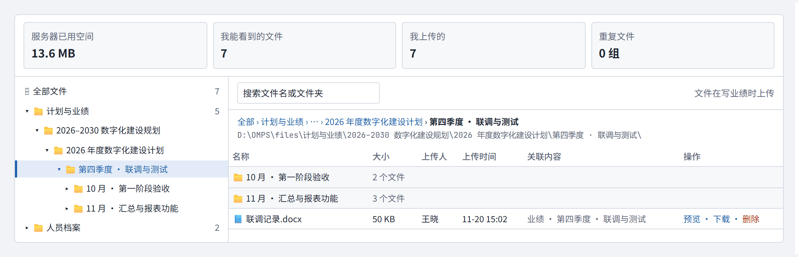

### 11.5 Permissions

| Action | Rule |
|---|---|
| Browse, preview, download | By data scope: members see files they uploaded and files of tasks they take part in; department heads see their own department's; the unit head and super admin see everything. Attachments in staff records can be viewed only by the person, the person's department head, the unit head and the super admin; family records attachments only by the person, the unit head and the super admin. |
| Upload | Only on business pages: supporting documents are uploaded when recording results; staff records and device records attachments are uploaded on their own pages. The "Files" page has no upload button; it is only for browsing, downloading, deleting and cleaning up. |
| Delete | Each user can delete only files they uploaded (the super admin can delete any file). Files attached to approved results cannot be deleted; the results must first be withdrawn or returned by the head. |
| Recycle bin | Deleted files go to the recycle bin first; the uploader can restore them within 30 days; after 30 days a scheduled task deletes them permanently. |
| Logs | Uploads, downloads, deletions, restores and duplicate clean-ups are all recorded in the operation log. |

### 11.6 Data tables

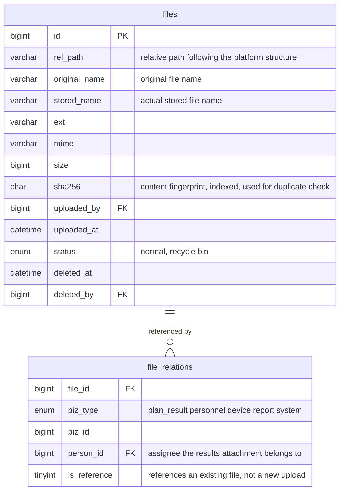

<a id="flow"></a>

## 12 Approval workflow state machine

Staff record review, results review, plan approval and device repair all share this one workflow. The workflow nodes are configured in the back end.

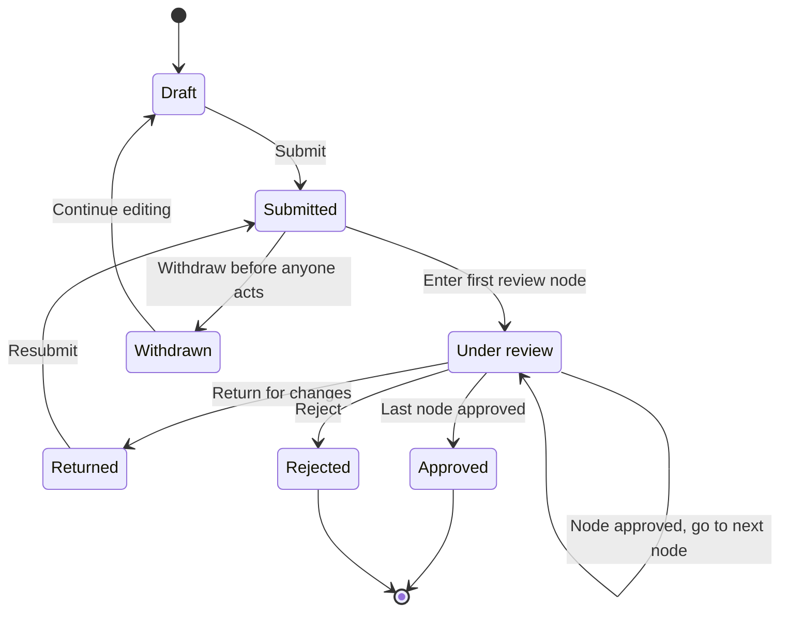

Each state change writes one `workflow_actions` row and creates a to-do and a notification for the next reviewer. Withdrawal is possible only before anyone has acted on the item; to change an approved record, a new change request must be submitted.

<a id="remind"></a>

## 13 Reminder engine, bell and follow-up

Driven by Windows Task Scheduler, so reminders are generated on time even when nobody has the web page open.

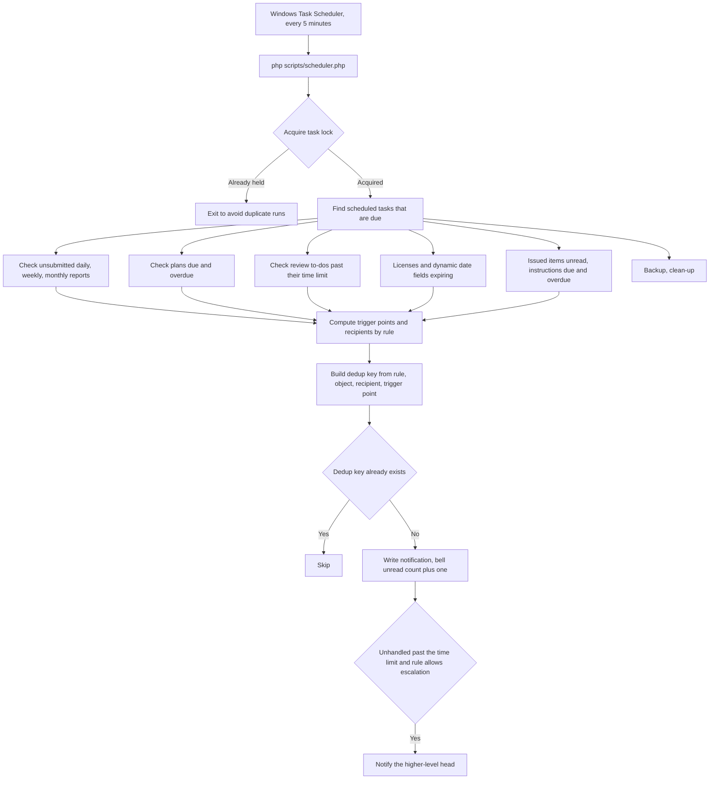

Example: a plan is due on December 31 and the rule is "30, 7 and 3 days before the due date, on the due date, and daily once overdue". The dedup key looks like `plan_due:plan#88:user#12:D-7`, and for overdue `…:OD:2027-01-02`. However many times a day the task runs, only one notification is produced.

### 13.1 The bell: everything newly received

Whether it was reported up by a subordinate or sent down by a superior, everything the user newly receives goes into the bell; the red number is the unread count.

| Direction | Messages that go into the bell |
|---|---|
| Superior → subordinate | Issued a notice, document or instruction; reminder to act; withdrawal; note read with a written comment; results approved or returned |
| Subordinate → superior | Submitted a note; completed and replied to an instruction (late completion is marked); list of people overdue for the first time; submitted results for review |
| System | Follow-up reminders (13.2), plans due, daily reports not filled in, device anomalies, system announcements |

#### How users see messages promptly

- The page asks the server for the unread count every 60 seconds (plain AJAX, no extra extensions needed)
- When there are new messages, the bell number increases and a 5-second pop-up appears in the lower right corner
- The unread count is shown in front of the browser tab title, e.g. "(3) Sample City Data Center", so it is visible even when the window is in the background
- Messages produced while the user is not logged in are kept on the server and shown at the next login

#### After clicking

- Clicking a message opens the corresponding page and sub-page directly, scrolls the item into view and highlights it in yellow ([section 17 jump-to-item](#ui)), and marks the message as read
- When an issued item is opened, the related bell messages are marked as read automatically
- "Mark all as read" clears everything at once
- Items that need action also go into "To-dos" and move to "Handled" once dealt with

### 13.2 Follow-up on instructions with a deadline

| When | Automatic system behaviour (default) |
|---|---|
| On issue | Goes into the bell and to-dos immediately |
| Unread | If still not opened 4 working hours after being issued, one reminder; for read-only items, one more reminder at 09:00 on the next working day |
| Close to deadline | One reminder each at 09:00 one day before the deadline, at 09:00 on the deadline day, and 2 hours before the deadline |
| Overdue | A reminder at 09:00 each working day, at most 10 times; on first becoming overdue, the issuer is told who is overdue |
| Stop | Stops once completed and replied to (instructions) or marked as read (notices, documents); stops after the issuer withdraws the item |

#### Interval reminders (optional)

- When issuing, "More options" lets you change this to: each working day at 09:00 / every half day (09:00, 14:00) / every 2 hours (working hours)
- From the time of issue, reminders are sent at the interval until the item is completed
- Reminders are sent only during working hours (Monday to Friday 08:30–17:30, changeable in Settings), combined with the user's own do-not-disturb periods

#### Follow-up bar at the top of the page

- When the user has instructions due within 24 hours or already overdue, a yellow follow-up bar is shown at the top of every page, listing the items and the time remaining
- "Handle" opens the instruction directly; "Remind me in 1 hour" hides the bar for now, while the bell and to-dos continue as usual
- Both the recipient and the issuer can see the reminder record: how many reminders have been sent and when the next one will be

### 13.3 How trigger times are set and how exact times are calculated

Trigger times are **not entered as text**; they are chosen from drop-downs: base + before / after + amount + unit + time of day. The "3 days before due date at 09:00" seen in the list is generated by the system from these settings (it changes to the matching language when the language is switched), and the scheduled task also uses these settings to calculate the exact time for each object.

| Base (determined by the reminder type) | Available trigger options | Examples |
|---|---|---|
| **By due date / deadline** <br>plan due, plan overdue, license expiring, issued instruction due / overdue, custom date fields | N [days / working days / hours] before the due date (time of day optional when in days); on the due date [time of day]; once overdue [each working day / each day / only on overdue day N] [time of day] | 3 days before due date at 09:00; 2 hours before deadline; once overdue, each working day at 09:00 |
| **By event time** <br>issued item unread, review to-do, record pending review, device anomaly, device fault | Immediately when it happens; N [minutes / hours / working hours / days / working days] after it happens (time of day optional when in days) | 4 working hours after issue; 24 hours after submission; immediately when a difference is detected |
| **Fixed cycle** <br>daily, weekly, monthly, quarterly, annual report not submitted | Each working day [time of day]; each week [weekday] [time of day]; last working day of each month [time of day]; day [N] of each month [time of day] | Each working day at 17:00; every Friday at 17:00 |

- **Escalation** uses the same structure: no escalation / still unhandled after N [unit] → target / on first becoming overdue → target.
- **See exact times while editing:** "Exact time examples" below the form calculates the date and time of each trigger point for a sample object, e.g. "With a deadline of 11-30 (Mon) 17:00: 1 day before deadline at 09:00 → 11-27 (Fri) 09:00; 2 hours before deadline → 11-30 (Mon) 15:00". Hovering over a trigger time in the list also shows example times.
- **Working-day rule:** reminders are sent only on working days (Monday to Friday, working hours 08:30–17:30, changeable in Settings). If a time falls on a weekend, "before due date" triggers move forward to the previous working day and all others move to the next working day; "working hours" count only working time.
- **Checks:** at least one trigger time; amount greater than 0; triggers in days must have a time of day; no duplicate trigger times within one rule; at least one reminder target.
- **How it is stored:** each trigger point is stored as one row of structured data (mode, amount, unit, time of day, weekday / day of month, overdue repeat mode); the scheduled task calculates from this and does not parse text.

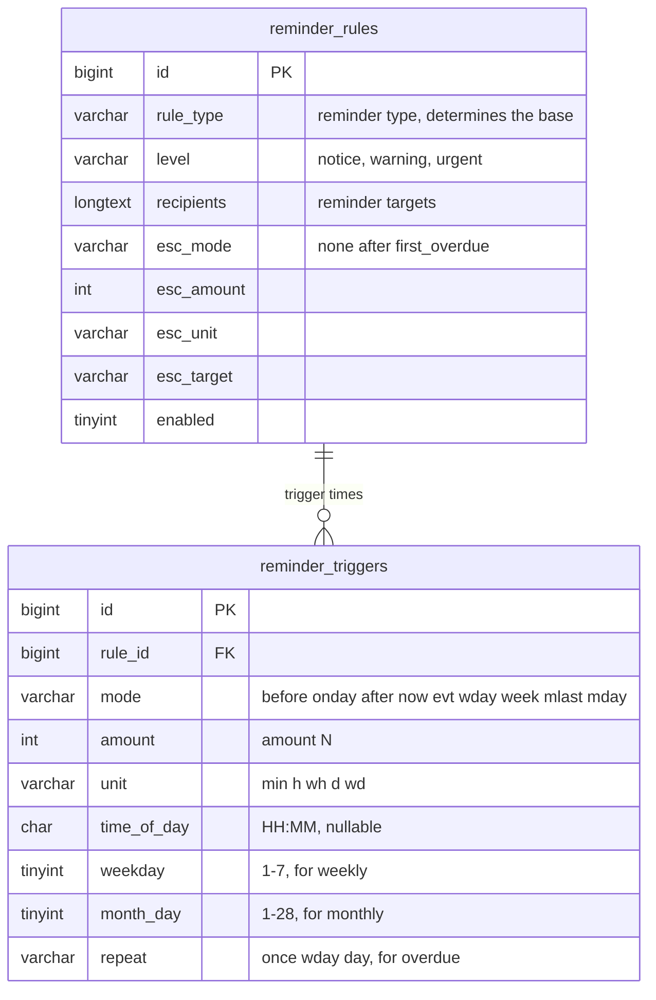

> [!NOTE]
> The reminder rules (issued item unread, issued instruction due, issued instruction overdue) are listed together with the other rules under "System → Reminder rules", and the unit head can adjust their trigger times as described in 13.3. The dedup key looks like `issue_due:issue#12:user#5:D-1`; each trigger point is sent only once.

<a id="device"></a>

## 14 Device detection (two-layer approach)

A web page can only get the information the browser allows. Hardware information is reported by a collector client that the unit has authorized and that users are informed about.

```mermaid
sequenceDiagram
  participant A as Device administrator
  participant S as OMPS server
  participant C as Collector client
  participant N as Notification center
  A->>S: Register device, generate one-time registration code
  A->>C: Install on authorized device, enter registration code
  C->>S: Register, exchange for device token
  S-->>C: Token and list of items allowed to collect
  loop At startup and once a day
    C->>S: Report computer name, OS, CPU, memory, hard disk, motherboard, monitor, network adapter, keyboard, mouse
    S->>S: Compare hash with previous snapshot
    alt Differences found
      S->>S: Compare with registered parts, create anomaly record
      S->>N: Notify device administrator and unit head
    end
  end
  
```

> [!WARNING]
> **Boundary:** the client collects only the hardware information the administrator lists in the collection scope. It does not collect keystrokes, the screen, files or browsing history (the "keyboard" and "mouse" items record only the model and serial number of external devices). The collection scope is shown openly on the device details page. Layer one (the web page) records only the login account, time, IP and browser, and is not treated as hardware detection.

<a id="dynamic"></a>

## 15 Customization: fields, statistics, theme and Banner

The super admin does all of this on one page, "System → Customization", which has four sub-pages: "Field design" adds fields to staff records, device records and plans; "Statistics page design" designs statistics pages; "System theme" sets the name, logo, primary color, menu and top bar colors, and the default theme; "Banner management" uploads and replaces login page images. "Extension subsystems" are no longer offered.

```mermaid
flowchart LR
  CFG["Add field, e.g. Hobby, searchable, usable in statistics"] --> META[("custom_fields")]
  META --> FORM["Add and edit forms"]
  META --> DET["Details"]
  META --> LIST["List columns"]
  META --> SRCH["Search"]
  META --> STAT["Statistics pages"]
  META --> EXP["Export"]
  FORM -- "Saved after type validation" --> VAL[("custom_field_values")]
  VAL --> DET & LIST & SRCH & STAT & EXP
  
```

- **Objects that can have fields added:** staff records, device records, plans.
- **Typed storage:** values are stored in the column for their type, so they can be compared, sorted and summed correctly; the table structure is not changed.
- **Controlled statistics:** a statistics page stores a query definition; the system generates parameterized SQL and automatically applies the viewer's data scope; SQL cannot be written by hand.

<a id="i18n"></a>

## 16 Multi-language design

Goal: after switching language, every piece of system-generated text in the interface is in the selected language, with no other language mixed in.

> [!WARNING]
> **Correction to v0.1:** the original design said "show the default language when a translation is missing", which would put Chinese text into the English interface and conflicts with the goal. It is now replaced by two gates, "translation must be complete before a language is enabled" and "automatic checks", which eliminate missing translations at the source. Dynamic fields originally had only two columns, `label_zh / label_en`, and could support only two languages; they are now stored in the shared translations table and can support any number of languages.

### Which text must be translated

| Source | Includes | Stored in |
|---|---|---|
| Fixed text in the program | Menus, buttons, table headers, form labels, placeholder hints, help text, confirmation dialogs, success/failure messages, form validation errors, API errors, status bar, empty-list messages, pagination, status names, notification templates, export headers, print pages and Word templates, date and number formats | JSON language packs `resources/languages/{language}/{module}.json`; PHP uses `__()` and JavaScript uses `t()`, both reading the same files |
| Text produced by back-end configuration | Custom menu names, role names, data dictionary items, dynamic field labels and options, statistics page titles, approval node names, reminder rule names, Banner text | Database table `translations` (namespace, key, language, translation), one row per enabled language |
| Business content entered by users | Person names, plan titles, daily report text, repair descriptions, etc. | Shown as entered, not translated automatically. Fields that really need to be bilingual (such as the unit name) can be set as "multi-language fields", with one value entered for each language |

### Store codes, not text

- Statuses, types and dictionary items are stored in the database only as codes (e.g. `submitted`) and translated into the current language when displayed.
- Notifications store only "translation key + parameters" (e.g. `notify.report_missing` + a date) and are rendered in the viewer's language. So after switching language, past notifications are also shown in the new language.
- The operation log stores action codes and field keys, translated into the current language when viewed; the before and after business values are shown as entered.

### System-generated messages: one key per sentence, two kinds of parameters

Notifications, to-dos, follow-up reminders, operation logs, and status and type names are all generated by the system and **must all switch to the selected language after a language switch**; only content users write themselves (names, plan names, titles and bodies of notes and issued items, replies, results content) is shown as entered.

In this example the sample values are kept in Chinese on purpose: user content (a name, a title) is shown exactly as it was typed, in every language, while system terms are translated.

| Stored content | Shown in Simplified Chinese | Shown in English |
|---|---|---|
| notify.profile_changed<br>name = 王晓 (user content)<br>field = 联系电话 (system term) | 王晓 修改了“联系电话”，需要审核 | 王晓 changed "Phone"; review needed |
| notify.issue_sent_need<br>name = 李建国, title = 报表功能上线前自测清单, due = 2026-11-20 17:30 | 李建国 下发了指令“报表功能上线前自测清单”，2026-11-20 17:30 前完成 | 李建国 sent you the instruction "报表功能上线前自测清单", due 2026-11-20 17:30 |
| type type.license / source src.device / level warning | 许可证到期 · 设备管理 · 警告 | License expiring · Devices · Warning |

- **A whole sentence is one translation entry** (e.g. `notify.profile_changed`), so word order can differ between languages; parameters are placed in the sentence with placeholders such as `{name}`.
- **Two kinds of parameters:** user content is inserted as is; system terms (field names, part names, role names, statuses, etc.) are also translation entries and are shown in the current language, e.g. "联系电话 → Phone", "硬盘 → hard disk".
- Past notifications, to-dos and logs are also shown in the language in use when they are viewed; after a language switch, existing messages change too.
- Drop-down options, radio buttons and checkboxes, and dictionary values in lists (gender, device category, transfer type, permission action, field type, chart type, data scope, role name, etc.) all use the same term translations.
- On pages such as Menus and Field design, the name column shows only the current language; names in other languages are maintained in the edit form or in "Languages".
- When a new language is added, all of these entries appear in "Translations" waiting to be filled in; unfilled entries are counted as "Missing translations", and the language cannot be enabled until completion reaches 100%.

### Default language and personal language

| Item | Rule |
|---|---|
| **Default language** | Set by the **super admin**: click "Set as default" on an enabled language in "Languages → Language list", or choose it in "Settings → Basic information → Default language" (the same setting). Only enabled languages (100% translated) can be chosen; changes are recorded in the audit log |
| **Who uses the default language** | The login page, and all users who **have not chosen a language themselves**. When the default language changes, these users see the new language the next time they open a page |
| **Personal language** | Each user chooses in the language menu in the top right corner: the first item is "Follow system default (current default language)", followed by each enabled language. The choice is saved to the user's account, affects only that user, and is kept when logging in from another computer; choosing "Follow system default" again restores the default |
| **Login page** | Shows the default language; a language switched on the login page is saved as the user's choice after logging in |
| **Original language** | System text is written in Simplified Chinese, and the original-text column in "Translations" is always Simplified Chinese, regardless of which language is the default. The original language cannot be deleted but can be disabled; any language can be disabled as long as at least one enabled language remains. When the default language is disabled, the system automatically makes the first enabled language in the list the default (v0.47) |

### Languages page

- **How to translate after adding a language:** click "Add language" in "Language list" (e.g. ja-JP, Japanese); after it is created you go straight to "Translations". Choose "Translate to: Japanese" at the top of the page; the table shows translation key · module · original text (default language) · reference (English) · **translation (Japanese) input box**. You can filter to "Untranslated only"; after filling in, click "Save changes", and the completion shown at the top and in the language list updates accordingly. Each row in the language list also has an "Edit translations" icon that jumps directly to that language.
- No matter how many languages are added later, it is always this one page: only one language is translated at a time, so the table does not keep getting wider.
- The translation list shows **all entries** in the system, including the first two sources in the table above, not just menus. It can be filtered by module (organization, staff, plans, results, devices, system, ...) and by type (menu, button, message, error, notification, status, dictionary, dynamic field, ...).
- Each entry shows its translations in all languages, with missing ones marked in red; you can filter to "Missing only".
- Entries can be exported to Excel for translators and imported again when translation is done; a pre-check runs before import, and rows with non-existent keys or bad formatting are not imported.

### Preventing text in other languages

| Gate | How |
|---|---|
| Enabling a language | Completion must reach 100% before a language can be enabled; not even one entry may be missing. Completion = translated entries ÷ all entries, counting both sources. |
| New configuration | When adding menus, dictionary items, dynamic fields, options, roles, etc., the form requires a name in every enabled language; otherwise it cannot be saved. |
| Development check | `php omps i18n:check` performs two checks: first, every translation key used in the code exists in all language files; second, it scans views, PHP output and JavaScript for hard-coded Chinese or English text that does not go through a translation function. From phase 1 onward, this is an acceptance item for every phase. |
| Page sweep | Automated tests open every page and dialog in each language and check for text not in that language (except areas marked as user-entered content). |
| Last safeguard | If a key still cannot be found at run time: development and test environments show a conspicuous `⟦key name⟧` so it is easy to spot; the production environment logs the missing key and notifies the administrator. With the gates above, this should not happen in normal use. |
| Browser built-in controls | The browser's own file selection button and date picker follow the browser language and cannot be controlled by the program. The system uses its own upload button and date control instead (local JS files shipped with the project, nothing to install), and sets `<html lang>` on the page. |

<a id="ui"></a>

## 17 UI layout wireframes

Example: the Staff records list page, with the drawer on the right editing one person. Names in the table are sample data.

> [!NOTE]
> **v0.7 interactive prototype:** the [OMPS UI prototype](https://claude.ai/artifact/6hp6ExQB6SKdTA6eR2aCvD) has been updated to this design: 4 roles plus the device administrator flag, My tasks, the Plans & Results tree, the Record results dialog, review with edit and batch approve, and Reports listed level by level.

> [!NOTE]
> **Interactive prototype:** [OMPS UI prototype](https://claude.ai/artifact/6hp6ExQB6SKdTA6eR2aCvD). It contains the login page and every page under all 8 menu groups (48 pages and sub-pages in total). You can switch between 5 demo identities to see the menus and data scope of different roles. Add, edit, delete confirmation, review, plan breakdown, results roll-up and version comparison, dynamic fields, dynamic subsystems, theme, language, and backup and restore all actually work; all data is sample data.

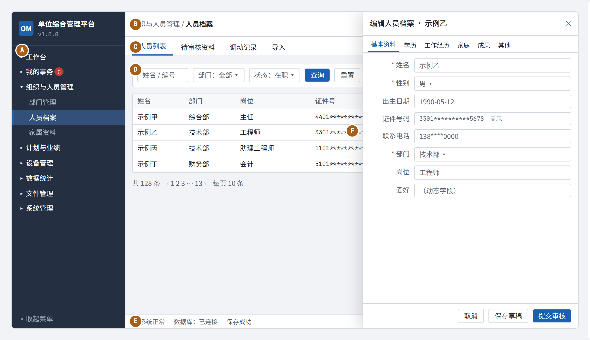

- **A** Left tree menu, 240px wide, can collapse to 64px showing icons only; generated dynamically from permissions, supports multiple levels.
- **B** Top toolbar, 56px: breadcrumb, bell, to-dos, language, theme, user menu.
- **C** Sub-tab bar: holds only the sub-tab labels and does not repeat the page name (the page name is already shown in the top bar). Pages without sub-tabs do not show this bar.
- **D** Main content area: search bar → action buttons → table → pagination; every list page has the same structure. The search bar is always: search box + "Filter" button (opens a panel: business filters, time, search scope) + tags for the active conditions, with the action buttons on the right. The pagination bar shows "N items in total" on the left, and on the right the page size (10 / 20 / 30 / 50 / 100) and « ‹ [page number] / total pages › » (type a page number to jump). Pages with no search conditions and no buttons (such as To-dos) do not show the search bar and leave no empty strip. Row actions in every table use icon buttons, right-aligned, in a fixed order, with empty slots kept aligned; see "Row action buttons" in this section.
- **E** Bottom status bar, 28px: system status, database, operation result, current user, time.
- **F** Right drawer: used for add, edit and view. 560px wide, 860px for complex forms; form sections use tabs.

Clicking "Show" on an ID number requires permission to view it in plain text and writes an audit log entry. In phase 1 the bell is shown, but notifications are only implemented in phase 5; until then clicking the bell shows "The notification center will be enabled in phase 5" — no dead button.

### Row action buttons (same on every page)

On every row of every list, action buttons are always icon buttons, placed in the rightmost "Actions" column, right-aligned.

- **Fixed order:** View → business actions (download, approve, return, transfer, etc.) → add → edit → delete; delete is always rightmost.
- **Aligned positions:** an action that a row does not have leaves an empty slot, so the same icon lines up vertically across all rows of a table.
- **Name tooltips:** hovering shows the button name; the "My tasks" and "Plans & Results" tables also have an icon legend below them.
- **Exception:** page-level buttons (such as "Add staff", "Export", "Batch approve") are still text buttons, placed in the toolbar above the table.

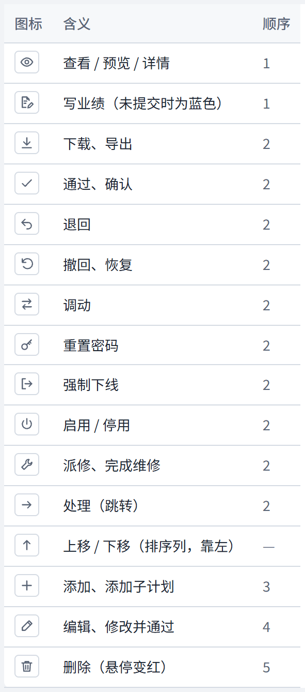

### Jump-to-item (same on every page)

When you click "View" or "Handle" from a notification, the bell, a to-do or the follow-up bar, the system opens **the right page and sub-page** directly and highlights **the exact item to look at**, so you do not have to search the list yourself.

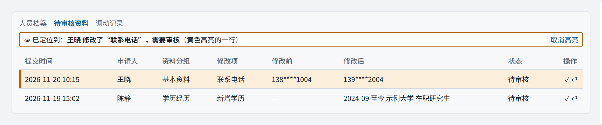

| Rule | Description |
|---|---|
| **Every message carries a target** | Notifications and to-dos both record three things: the page, the sub-page and the specific record (e.g. "Staff records → Pending review → Wang Xiao's phone number request"). When a new module is added, its messages must carry a target |
| **After opening** | ① Switch to the matching sub-page; ② if a filter hides the item, clear the filter automatically; with pagination, go to the page the item is on; on tree pages, expand its parents and set the time filter to "All"; on split-view pages, select it directly; ③ scroll it to the middle of the screen; ④ highlight it in yellow and flash 3 times |
| **Location bar** | The top of the page shows "Located: ... (the row highlighted in yellow)"; clicking "Clear highlight" or leaving the page returns to normal |
| **When not found** | If the record has already been handled or deleted, the page opens as usual and the bottom status bar says "The item you wanted to view is no longer here (it may have been handled or deleted)" |
| **Examples** | Wang Xiao changes his phone number → Staff records · Pending review · Wang Xiao's row; device license expires → Device records · that device; hard disk change → Usage & monitoring · Anomaly records · that entry; results pending review → Results review · that entry; issued instruction → Issued items · that item selected; submitted note → Notebook · Received notes · that note selected; plan due → Plans & Results · expanded down to that plan |
| **Not intrusive** | The flashing only happens right after a jump; on computers set to "reduce motion" the item is highlighted without flashing |

### Workbench (by role)

The Workbench is only for the unit head, department heads and the super admin; members go straight to "My tasks" after login. The indicators and scope each person sees depend on their own responsibilities.

| Role | 4 indicators at the top (click to open the matching page) | Left main area | Right side |
|---|---|---|---|
| **Unit head** | Awaiting my review (results submitted by department heads) · Average plan completion, whole unit · Tasks behind schedule · Results recorded today (number of people) | **Departments overview**: for each department, its head, headcount, average plan completion, tasks behind schedule, results recorded today, pending review<br>**Unit key plans**: long-term plans of the unit and of each department, and the unit's annual plans, with time progress and status | To-dos · Latest notifications · Device overview (if also device administrator) |
| **Department head** | Awaiting my review (results submitted by members) · Average plan completion, own department · Tasks behind schedule · Results recorded today (own department) | **Department members**: for each person, today's plans, today's results, completed this week, awaiting my review<br>**Department plans**: the department's long-term and annual plans, with those behind schedule listed first | To-dos · Latest notifications |
| **Super admin** | Same as unit head | Same as unit head | Plus **System status**: latest backup, online users, scheduled tasks, missing translations |
| Member | No Workbench; goes to "My tasks" after login (section 09) |   |   |

**Behind schedule** means: the plan's completion percentage is more than 10% below its time progress. A vertical line on the progress bar marks the time progress, so you can see at a glance which plans are behind.

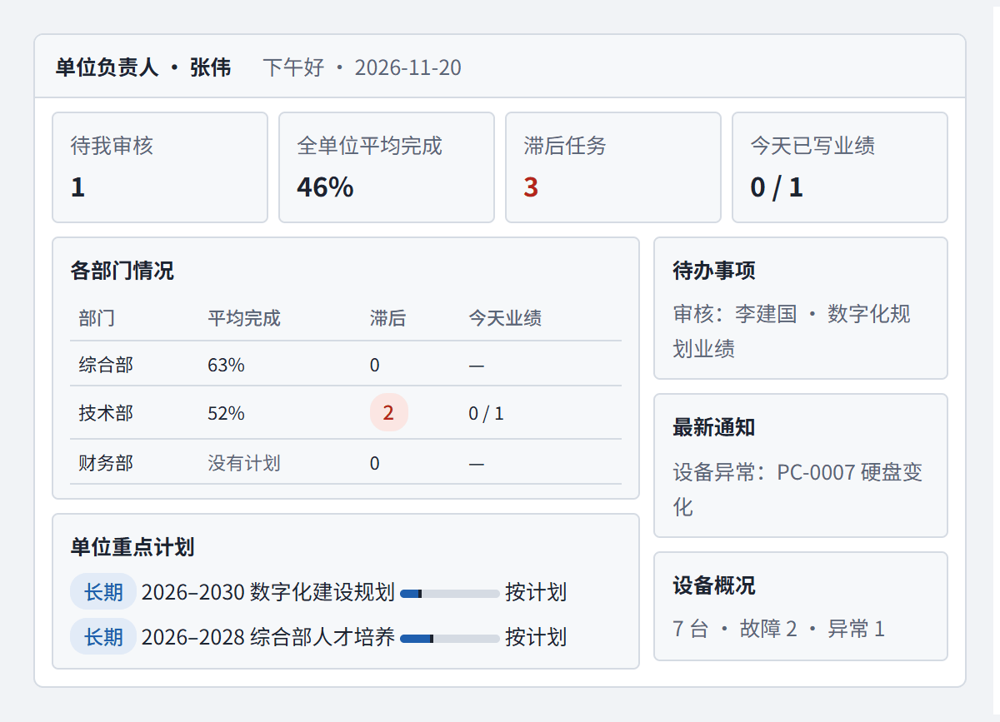

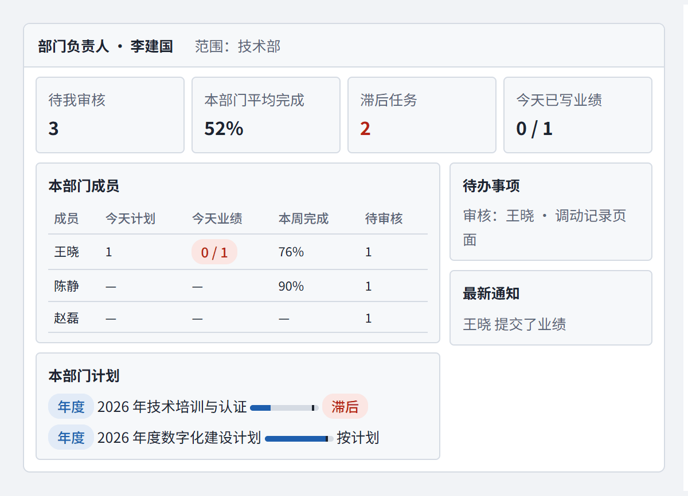

### Full page list

All pages in the left menu, shown by role.

| Menu group | Page | Who can see it | Main actions | Section |
|---|---|---|---|---|
| — | Login page | Everyone | Log in, switch language | 06 |
| — | Workbench | Unit head, department heads | Shown by role: the unit head sees the departments overview and unit key plans; department heads see their department's members and plans; the super admin also gets system status. Members go straight to "My tasks" after login | 17 |
| **My affairs** new<br>replaces the former "Message center", placed below Workbench | **To-dos** | Everyone | "Pending": everything I need to handle: results to record, items to review, issued instructions, notes to read, etc.; items leave automatically once handled. "Handled": items I have handled and their outcomes, newest first | [13](#remind) |
| ″ | **Issued items** new: Received · Issued by me (heads) | Everyone receives; heads issue | Issue notices, documents and instructions with deadlines; complete and reply; send reminders, withdraw; automatic follow-up | [10.9](#report) · [13](#remind) |
| ″ | **Notebook** new: My notes · Received notes (heads) | Everyone | Write your own notes, visible only to yourself by default; submit to your superior, who writes comments and marks them as read | [10.7](#report) |
| ″ | **My notifications** | Everyone | Full list of all messages in the bell (issued from above, reported from below, system reminders); mark as read, jump to handle | [13](#remind) |
| Organization & Staff | Departments | Unit head, super admin | Department tree (departments can have groups), ordering, member transfers | 07.1 |
| ″ | Staff records | Department heads and above; members see their own | Record form, masked ID number, data review, import; department heads add staff to their department and move subordinates out of it | 07.2 |
| ″ | Family records | Unit head, super admin | Highly sensitive; viewing is logged | 07.2 |
| Plans & Results | **My tasks** | Everyone | Tasks assigned to me and my sub-plans; + sub-plan, record results | [09](#agg) |
| ″ | **Plans & Results** | Department heads and above | Tree of plans from long-term down to day; filter this week, this month, this year; create main plans, add sub-plans, fill in completion percentage and results | [09](#agg) |
| ″ | Results review | Department heads, unit head | Edit and approve, return, batch approve | [09](#agg) |
| ″ | Reports | Everyone (scope by role) | Two sub-pages: **Report list** (preview, edit, delete, create manually, upload and delete report documents) · **Generate by conditions** (any period × task × person; lists sub-task results item by item; print, download) | [10](#report) |
| Devices | Device records | Device administrators, unit head, super admin; everyone can submit repair requests from the Workbench | Register, components, licenses, repair requests | 07.5 |
| ″ | **Usage & monitoring**: Usage records · Anomaly records · Collector clients · Collection scope | ″ | One page with four sub-pages: query usage records, confirm hardware changes, manage collector clients and collection scope | 14 |
| ″ | **Faults & repairs**: Fault registration · Repair records | ″ | One page with two sub-pages: register faults, assign for repair, complete repairs | 07.5 |
| Statistics | People statistics · Department statistics · Custom statistics | Unit head, department heads | Charts, export, print | 15 |
| — | **Files** new: All files · Uploaded by me · Duplicate files · Recycle bin | Everyone (scope by role) | Browse folders that follow the platform structure; preview, download; delete your own files; clean up duplicates; restore from the recycle bin (uploading happens when recording results) | [11](#files) |
| System | Users | Unit head, super admin | Create accounts, assign one of the 4 roles, tick the device administrator flag, reset passwords, force logout | 06 |
| ″ | Roles & permissions (4 built-in + add, edit and delete custom roles) · Menus · **Customization** (Field design · Statistics page design · System theme · Banner management) · **Reminder rules** (formerly "Message center → Reminder settings"; the unit head can also adjust them) · Languages · Operation log · Backups · Settings | Super admin | Technical operations | 06 · 15 · 16 |
| User menu | Profile · Reminder preferences · Change password | Everyone | View your own record; personal reminder preferences such as quiet hours; change password | 06 |

> [!NOTE]
> **Left menu rules:** personal items that need immediate attention sit in "My affairs" at the very top (To-dos · Issued items · Notebook · My notifications); each item shows its pending count as a red number on the right, and the collapsed group shows the total. Business pages are grouped by module below it. Members see only 4 groups: My affairs, Organization & Staff, Plans & Results, Files. 
 **When the menu is collapsed:** only icons are shown; the icon of the current group is highlighted, and icons with pending items show a red number at the top right. Clicking a group's icon opens that group's last-used page directly (the group's first page the first time), the menu stays collapsed, and the group's page list pops out to the right of the icon so you can switch directly. On phones and other narrow screens the menu is a drawer and is not affected.

> [!NOTE]
> Removed pages: Unit management, the six separate Long-term/Annual/Quarter/Month/Week/Day plan pages (merged into "Plans & Results"), My work (replaced by "My tasks"), Results statistics, Data permissions, Approval workflow, Dynamic module design, Extension subsystems.

<a id="dirs"></a>

## 18 Folder structure

> [!TIP]
> This chapter is the folder plan made during design. For the actual files and the purpose of each folder, see [CODE_STRUCTURE.en.md](CODE_STRUCTURE.en.md).

```text
OMPS/
├── app/
│   ├── Core/              # Kernel: App, Router, Request, Response, Container, View, Validator, Session, Csrf
│   ├── Database/          # Connection, QueryBuilder, Transaction, Migrator, DataScope
│   ├── Middleware/        # Auth, Csrf, Locale, Permission, SecurityHeaders, OperationLog
│   ├── Engines/           # Permission, Workflow, Notification, Aggregation, Metadata, File, I18n, Audit
│   ├── Modules/           # Each business module is self-contained
│   │   ├── System/        #   users, roles, menus, settings, logs
│   │   │   ├── Controllers/  Services/  Repositories/  Policies/  views/  routes.php  permissions.php  module.json
│   │   ├── Organization/
│   │   ├── Personnel/     #   phase 2
│   │   ├── Plan/          #   phase 3
│   │   ├── Performance/   #   phase 4
│   │   ├── Device/        #   phase 6
│   │   └── Dynamic/       #   phase 7
│   └── Helpers/
├── config/                # app.php, database.php, security.php, upload.php (read from .env)
├── database/
│   ├── migrations/        # 2026_11_20_000001_create_departments.php …
│   └── seeds/             # permissions, preset roles, menus, dictionaries (no account passwords)
├── public/                # Apache document root, the only accessible folder
│   ├── index.php
│   ├── .htaccess
│   └── assets/            # bootstrap, echarts, this system's css/js, all local
├── resources/
│   ├── views/layouts/     # Main frame: menu, top bar, status bar, drawer
│   ├── js/                # omps.js: api(), drawer(), confirm(), i18n(), table()
│   └── languages/
│       ├── zh-CN/         # common.json, menu.json, system.json, org.json …
│       └── en-US/
├── routes/                # web.php, api.php (collects each module's routes.php)
├── storage/               # not accessible by URL
│   ├── uploads/  backups/  logs/  temp/  cache/
├── scripts/               # scheduler.php, backup.php, cleanup.php, check_env.php
├── omps                   # command-line entry: php omps migrate | seed | admin:create | …
├── tests/                 # built-in lightweight test runner + permission isolation tests
├── docs/
├── .env.example
└── README.md
```

Each module has a `module.json` (code, version, dependencies, permission list, menu list). To add or upgrade a module later, just put it in the module folder and run `php omps migrate`; the system registers the version and makes an automatic backup before migrating.

<a id="extras"></a>

## 19 Handling of additional features

| Feature | Handling | Phase |
|---|---|---|
| Approval | Fixed review chain (member → department head → unit head), no workflow designer; review of data changes is handled the same way | Phases 2 and 4 |
| Staff transfer history | Recorded automatically when a person's department or post changes (personnel_assignments) | Phase 1 |
| Results scoring | Department heads can give a score when reviewing (optional); no scoring templates for now | Phase 4 |
| Target comparison | Merged into Reports: completion percentage and results listed by task | Phase 4 |
| Document generation | Word download of reports and the staff registration form, with layout from uploaded Word templates | Phase 8 |
| Data import | Excel import of staff and devices (pre-check first, then import) | Phases 2 and 6 |
| Multi-unit management | Not needed. The system serves only one unit; the database keeps an org_id column (fixed at 1) for future expansion | — |
| Extension subsystems | Not needed, removed. Dynamic fields and statistics pages are kept | — |
| System upgrade mechanism | Migration tool, module version registration, automatic backup before upgrade | Phase 1 |

<a id="phase1"></a>

## 20 Implementation plan and completion status

The system was developed in nine phases. A phase moved on to the next only after all automated tests passed on PHP 7.2.3 / 8.2 / 8.4. This chapter keeps the implementation plan of phase 1 and the record made when each phase was completed, so it is clear when each feature was completed and against which acceptance criteria.

### 20.1 Phase 1 implementation plan: base framework

When this phase is done, it is possible to create the super admin, log in and out, create departments, create users and assign the 4 roles. Different roles see different menus, and data outside one's scope cannot be read by editing the URL.

#### Tables

migrations · module_registry · departments · personnel_profiles (basic fields) · personnel_assignments · users (including role_id, is_device_admin) · user_sessions · login_logs · login_attempts · roles (fixed set of 4) · permissions · role_permissions · menus · operation_logs · audit_logs · system_settings (including unit information) · dictionaries / dictionary_items · languages · data_versions

#### Work items

1. **Core:** autoloading, .env configuration, routing (with a fallback when rewrite is unavailable), middleware, views, unified exception handling and JSON responses, input validation.
2. **Data layer:** PDO connection (character set, error mode and sql_mode fixed at connect time; see the encoding rules in section 01), parameterized query builder, Repository base class, transactions, soft delete, data scope filtering fixed by role.
3. **Command-line tools:** `php omps migrate / migrate:status / seed / admin:create / env:check / compat:check / test`. `compat:check` scans the code for incompatible constructs (the functions and syntax listed in the encoding rules of section 01); `test` is the built-in test runner (no Composer or PHPUnit). The super admin is created from the command line, with the password typed in on the spot; there is no default password.
4. **Authentication and sessions:** login, logout, lockout after failed attempts, sessions stored in the database, forced logout, other sessions invalidated after a password change, login log.
5. **Departments:** unit information settings; department tree (a department can contain teams), ordering, basic staff information, transfers recorded in history.
6. **Users and roles:** add, edit and delete users, disable users; 4 fixed roles; the "device administrator" checkbox; the super admin can fine-tune each role's function permissions.
7. **Menus and interface:** left menu generated by role; top toolbar, status bar, drawer, dialog and table components.
8. **Languages and logs:** JSON language packs, `__()` / `t()`, missing-translation check; writing the operation log and audit log, and read-only viewing of them.
9. **Tests and documentation:** automated tests for permissions and data isolation, design document, installation guide, XAMPP configuration guide, acceptance report. All automated tests are run once on XAMPP 7.2.3 and once on XAMPP 8.x, and the acceptance report lists the results of both separately.
10. **Compatibility test environment:** two XAMPP installations on the development machine (7.2.3 and 8.x, in different directories, started in turn), sharing the same program directory, each with its own database.

#### Acceptance checklist

| # | Acceptance item | Method |
|---|---|---|
| 1 | Create the super admin from the command line, log in, log out | Manual |
| 2 | Set the unit information, create 3 departments (one of them with teams); the order is kept after reordering and refreshing | Manual |
| 3 | Create 4 users: unit head, department head, member (with "device administrator" checked), member | Manual |
| 4 | The 4 users log in in turn and see different menus; the member who is also device administrator has an extra "Devices" menu | Manual + automated |
| 5 | A department head edits the URL / API parameters to read staff of another department; the result is empty or 404, and an unauthorized-access log entry is written | Automated test |
| 6 | A member calls the user management API directly and gets 403; the unit head cannot open technical pages such as Backups | Automated test |
| 7 | Repeated wrong passwords lock the account; after a password change the session in another browser is invalidated; forced logout works | Manual + automated |
| 8 | After switching between Chinese and English, no text in the other language appears on the page; `php omps i18n:check` passes | Manual + automated |
| 9 | CSRF: submissions without a token are rejected; XSS: a script entered in a name is shown as plain text on the page | Automated test |
| 10 | Running migrate again does not affect existing data | Automated test |
| 11 | With the same code, on XAMPP 7.2.3 (PHP 7.2.3 + MariaDB 10.1.31) and XAMPP 8.x (PHP 8.x + MariaDB 10.4 series): `php omps migrate` succeeds, `php omps test` passes completely, and the manual checks of items 1–10 give the same results | Manual + automated |
| 12 | In both environments, going through all pages and APIs under `error_reporting(E_ALL)` leaves no Notice, Warning or Deprecated in the PHP error log; `php omps compat:check` finds no problems | Automated test |
| 13 | Strict mode: when over-long text is written, or text is written to a numeric field, the service layer catches it first and shows a message; the message is the same in both environments, and there is no truncated data in the database | Automated test |
| 14 | Upgrade rehearsal: enter data and upload attachments in the 7.2.3 environment → export the database, copy the program and attachment directories → import into the 8.x environment → run `migrate`, `env:check` → log in and check that data, attachments, Chinese text and rare characters (such as 𠮷 (U+20BB7)) are exactly the same, without changing any code | Manual |

<a id="phase1done"></a>

### 20.2 Phase 1 completion status (2026-11-21)

The code is in `d:\Work\Others\OMPS`. Of acceptance items 1–14, everything that could be automated was written as automated tests (`php omps test`, 32 tests). In addition, the pages were checked one by one for each role with a headless browser, with no script errors.

| # | Acceptance item | Result |
|---|---|---|
| 1 | Create the super admin from the command line, log in, log out | Passed: admin:create, login and logout tests, login log |
| 2 | Unit information, department tree, order kept after reordering | Passed: add, edit and delete departments, move up and down, move a whole subtree, no cycles allowed, a department with staff or teams cannot be deleted |
| 3 | Create users of the 4 roles, device administrator flag | Passed: a new account gets a one-time temporary password, which must be changed at first login |
| 4 | Each role sees a different menu; the device administrator has an extra Devices menu | Passed |
| 5 | Department head edits the URL / parameters to read another department → empty or 404, with an unauthorized-access log entry | Passed |
| 6 | Member calling the user management API gets 403; unit head cannot open technical pages | Passed |
| 7 | Lockout after wrong passwords, other sessions invalidated after a password change, forced logout | Passed. Also added: a limit on too many failures from the same IP, and an idle timeout |
| 8 | No text in the other language after switching language; i18n:check passes | Passed: in English, the only text left in the other language on each page is user-entered content (people's names, department names, etc.) |
| 9 | CSRF, XSS | Passed. Also added a Content Security Policy (inline scripts in pages are blocked) |
| 10 | Running migrate again does not affect data | Passed |
| 11 | Same results on XAMPP 7.2.3 and 8.x | Passed: all tests pass on PHP 7.2.3 / 8.2.36 / 8.4.28; MariaDB 10.4 also passes |
| 12 | No notices under E_ALL; compat:check passes | Passed: in the development and test environments, any notice is thrown as an error |
| 13 | Strict mode: over-long values and wrong types are caught | Passed |
| 14 | Upgrade rehearsal (moving data from 7.2.3 to 8.x) | Partial: the same database has been used alternately under PHP 7.2.3 and 8.x; the full export and import rehearsal will be done before the unit's server is upgraded |

#### Changes from the design

- The interface does not use Bootstrap (no third-party framework at all) and keeps the prototype's styles; dates use the built-in date picker.
- Sessions do not use PHP's built-in session but a session table in the database: the cookie holds only a random token, and the database stores only the token's hash. A password change or forced logout invalidates all sessions at once.
- In phase 1, "Staff records" has only the basic fields (employee number, name, gender, department, position, phone, hire date, status), assignment records, and the add / remove / transfer rules of v0.29–v0.30. Full records, record review and import are in phase 2.
- The Menus page and the Languages page are moved to later phases. In phase 1, menus and languages come from module files and language packs.

<a id="phase2done"></a>

### 20.3 Phase 2 completion status: full staff records (2026-11-22)

Adds the Personnel module on top of phase 1. 40 automated tests in total (7 new staff record tests), all passing on PHP 7.2.3, 8.2.36, 8.4.28 and MariaDB 10.1.31, 10.4.34. The pages were checked with a headless browser, with no script errors.

| Feature | Implementation |
|---|---|
| **Full records** | Basic information (photo, date of birth, ethnicity, ID document, phone, email, current address, registered household address, remarks) + education history, work history, professional titles and grades, achievements, family records, attachments, shown and edited on tabs in the right-hand drawer. Every change keeps a snapshot (data_versions) and a before/after record, which can be viewed in "Change history" |
| **ID number** | Stored encrypted with AES-256-GCM, plus an HMAC fingerprint used for duplicate checks (the same ID number cannot be registered twice) and a masked number (4401\*\*\*\*\*\*\*\*\*\*1234). The format is not checked: letters, digits and other characters are all allowed, up to 30 characters (since 2026-11-23 the check digit of 18-digit ID cards is no longer verified). Lists, exports and logs show only the masked number; "Show full ID number" requires the "Staff records · Sensitive data" permission (except for one's own), and each use writes an audit log entry. The key APP_KEY is generated by `php omps key:generate` and must be backed up together with the database |
| **Self-service edits and review** | "My profile" at the top right. Each field follows a rule (profile_field_policies): **Not editable** (name, department, position, hire date, remarks; maintained by admins), **Takes effect directly** (email, current address, photo, family records), **Needs review** (phone, ID document, date of birth, registered household address, education, work history, professional titles, achievements). An edit that needs review is first saved as a request and written to the record only after it is approved. The person can withdraw requests that have not been handled, and sees the reason when a request is returned |
| **Review relationship** | Implemented with the fixed rules of section 06, without a workflow designer: anyone who has the "Staff records · Review" permission and whose data scope includes the person can review, except the person themselves. So members' edits are reviewed by the department head (and the unit head), and department heads' edits by the unit head; edits by the unit head and the super admin to their own records take effect directly. The "Pending review" sub-page of Staff records shows the count; requests can be approved one by one or in batch, or returned with a reason |
| **Family records** | Phone and address are stored encrypted. The menu "Organization & Staff → Family records" requires "Family records · View"; the full phone and address require "Family records · Sensitive data", otherwise the phone is partly hidden and the address is not shown. Every view of the list, or of the family members in a staff record, writes an audit log entry. People maintain their own family members in "My profile", and the changes take effect directly |
| **Photos and attachments** | Stored outside the web directory as described in section 11 (`FILES_PATH`, e.g. D:\OMPS\files), in folders that follow the platform structure: Staff records\department\team\name\group\file. Extension, size and file content are checked (scripts disguised as images are rejected). When a person uploads the same file again, only one copy is stored and referenced. Downloads go through a permission check and are logged. People can only delete what they uploaded; deleted files go to the recycle bin, and `php omps cleanup` removes those older than 30 days |
| **Batch import** | "Batch import" sub-page: download the template (.xlsx) → upload .xlsx or .csv → each row is checked (gender, whether the department exists and is within one's scope, ID number checksum and duplicates, date format, etc.), and rows with problems are marked with the reason → after confirmation, only the rows that passed are imported. Headers are recognized in both Chinese and English; the department is written as a name or as "department/team"; GB-encoded CSV files saved by Excel on Chinese Windows can also be read |
| **Export** | Requires "Staff records · Export". Exports .xlsx according to the current filter; ID numbers are exported only as masked numbers; each export writes an audit log entry |

#### Problems found and handled during implementation

- The php.ini of XAMPP 7.2.3 defaults to `upload_max_filesize=2M` and `post_max_size=8M`. OMPS raises these to 50 MB with php_value in `public/.htaccess`, which affects only OMPS and does not change php.ini. Uploading a 3 MB file through Apache has been tested.
- PHP's built-in CSV reading function misreads a comma that follows Chinese text under some locale settings, so CSV is now parsed by OMPS's own code.
- Photos were changed to "Takes effect directly", so that photos do not need a separate review flow, which makes things simpler.

<a id="phase3done"></a>

### 20.4 Phase 3 completion status: plans (2026-11-22)

Adds the Plan module. 45 automated tests in total (5 new plan tests), all passing on PHP 7.2.3, 8.2.36, 8.4.28. The pages were checked with a headless browser, and the operation "a department head adds a Month plan under a Quarter plan" was actually carried out once. Record results, Results review, roll-up of completion percentages and Reports belong to phase 4.

| Feature | Implementation |
|---|---|
| **Plan tree** | Long-term · Annual · Quarter · Month · Week · Day (determined automatically from the dates; plans of the same level can be nested), stored in plans (parent_id) and in the closure table plan_paths. Each plan has a period code (2026, 2026-Q4, 2026-11, 2026-W47, 2026-11-20), share of the parent, priority, goal and work content. Deleting a plan also deletes its sub-plans (soft delete; the log keeps the name of every deleted plan) |
| **Who can create what** | Heads with the "Plan · Assign tasks" permission: create Long-term / Annual top-level plans (the unit head can choose "Unit plan" or a department; for a department head it defaults to their own department), add Annual to Day plans under plans within their scope, and select several assignees (only active staff within their scope). A department head can break down their department's plans under a unit plan, but cannot edit the unit plan itself. Members: can only add sub-plans of Quarter level and below under tasks assigned to them (the assignee is automatically themselves), can edit and delete the sub-plans they created, and cannot edit tasks assigned by heads |
| **What one can see** | Whole unit: all plans; department: plans of their own department (including teams) and unit plans; own: plans assigned to them and plans they created, with parent plans shown in grey as context. Opening a plan one cannot see returns 404 and writes an unauthorized-access log entry |
| **My tasks** | Everyone. Lists the tasks assigned to me and the sub-plans I created under them, filtered by This week / This month / This year / All, and searchable. Heads can also use "+ New plan" on this page (with themselves checked as assignee by default) |
| **Plans & Results** | People with the "Assign tasks" permission. The whole tree, filterable by time, department and person, and searchable; the parents of matching plans are shown in grey. Each row: View · Add sub-plan · Edit · Delete, shown according to permissions |
| **Time display** | Generated automatically from the dates (a whole year, quarter, month or week shows its name, otherwise the dates are shown). A shorthand can be clicked (2025–2030, 2026, First half, Q4, November, Week 47); it is saved as a code and changes with the language. A custom text can also be typed (up to 20 characters). A span of whole months is shown as "Jan–May". When creating a plan, the dates default to one level below the parent, can be picked quickly, and are limited to the parent plan's range |
| **Hints** | After saving, a hint is shown when the time is outside the parent plan's range, or when the shares of the sub-plans under the same parent do not add up to 100%. Neither one prevents saving |
| **Permissions** | New permission group "Plan": View, Add, Edit, Delete, Assign tasks, Export. On upgrade, the existing built-in roles get the matching permissions automatically (assigned only when these permissions first appear; later adjustments in "Roles & permissions" are not overwritten) |

#### Changes from the design

- "Add sub-plan" uses a pop-up form instead of an input row appearing directly in the tree: the form can set the time display, assignees, goal and work content all at once, which is clearer.
- The "Completion" and "Results" columns were moved to phase 4, to go live together with Record results. For now the "Status" column shows Not started / In progress / Ended based on the dates.

<a id="phase4done"></a>

### 20.5 Phase 4 completion status: results and reports (2026-11-22)

Adds two modules, Performance and Report. 52 automated tests in total (7 new: 4 for results, 3 for reports), all passing on PHP 7.2.3, 8.2.36, 8.4.28 and MariaDB 10.1.31, 10.4.34. The pages were checked with a headless browser (Chinese and English), and the flow "a department head records results and submits them → the unit head approves them on the Results review page → generate a report → download Word / Excel" was actually carried out once.

| Feature | Implementation |
|---|---|
| **Record results** | One results entry per plan per assignee: completion percentage, results for this task, problems encountered, next steps, attachments. It can be saved as a draft, submitted, and withdrawn before review. The top of the dialog lists the results the person has already written for the sub-plans at every level under this task; they are loaded automatically when the dialog opens and can be copied down with "Quote below". When there are sub-plans, it shows "Reference: n% calculated from sub-plans by share", and clicking "Use" fills it in. Attachments are placed in the file directory under "Plans & Results / plan level / person", and identical files are not stored twice |
| **Review relationship** | Fixed: the reviewer has the "Results · Review" permission, their data scope covers the submitter, and they are not the submitter. Members' results are reviewed by the department head (and the unit head); department heads' results by the unit head; the unit head's results take effect directly when submitted |
| **Results review page** | Two tabs, Pending and Reviewed, filterable by person and searchable. Each row: View · Approve · Edit and approve · Return. Several entries can be checked for batch approve or batch return (returning requires a reason, shared by all of them). Edit and approve can change the completion percentage and the results text, give an optional score and write a review comment; the submitted original is kept in the history. Approved results can also be returned, after which the person can edit them and submit again. Every save, submit, withdraw, approve, edit and return is kept in the history and written to the operation log and the audit log (edits record the content before and after) |
| **Updating after approval** | The person can keep updating approved results. Until the new content is approved, completion percentages and reports still use the last approved content (the database stores the "approved version" separately) |
| **Completion percentage** | Uses approved results only. Plan completion = average of the assignees' completion percentages. When a person has no approved results on the plan, their value is calculated from the sub-plans weighted by share (when the sub-plan shares do not add up to 100%, it is scaled by the actual total), and it is 0 when there are none. "My tasks" and "Plans & Results" gain the columns "Completion" and "My results / Results"; plan details gain a "Results" tab that lists results by person |
| **Deleting plans** | When a member deletes their own sub-plan and there are submitted or approved results under it, the deletion is refused with a prompt to withdraw them first (approved ones must be returned by a head). Unsubmitted drafts and their attachments are deleted together with the plan, and the attachments go to the recycle bin. When a head deletes a plan, the confirmation lists how many results entries will be removed with it |
| **Reports** | Two sub-pages: Report list (default) · Generate by criteria. Criteria: period (This week / This month / This quarter / This year / Any), tasks (all or selected), people (all or selected, with one click to select a whole department; members are fixed to themselves; department heads can only select their own department). Listing rules follow 10.2: one section per task with its own-level results, then each sub-task within the period in turn; when a sub-task has no results of its own, each branch is searched downward and the results found are listed by time; only approved results are used; when a task and its parent are both selected, it is listed only once. A data snapshot is saved at generation, so later data changes do not affect reports already generated |
| **Report list** | Shows only reports created by oneself. Filters: All / This week / This month / This year / Custom period (a report is shown only if its period falls entirely within the range), plus name search. Preview, upload document, edit, delete. For a generated report only the title, opening note and supplementary note can be changed; for a manual report the name, period and body can be changed. Each save creates a version, and versions can be switched to view. Printing uses the browser's print function (A4 page); downloads are Word (.docx, or .doc when the zip extension is unavailable) and Excel details; every print and download is recorded. When a report is deleted, its report document goes to the recycle bin |
| **Permissions** | New permission groups "Results" (Edit = record results, Review) and "Reports" (View, Export). On upgrade, the built-in roles get them automatically: members get Record results and Reports; department heads and unit heads also get Review. Under the "Plans & Results" menu, "Results review" and "Reports" are added; the Workbench gains a "Results awaiting my review" count |

#### Changes from the design

- Notifications such as "Edited and approved" and "Returned", and the daily 17:00 reminder to record results, belong to phase 5 (notifications and reminders). For now the submitter sees the outcome and the return reason in the status column of "My tasks" and in the Record results dialog.
- In 9.4, "change the percentage directly in the Completion column" was changed to filling it in the Record results dialog, so that review cannot be bypassed.
- Word download was originally planned for phase 8. A simple version (title, criteria, notes, results of each section) is provided now; layout templates remain in phase 8.
- Report sections are numbered "1." and "(1)", the same in Chinese and English.
- The "Files" page (browsing, restoring from the recycle bin) has not been built yet. Attachments are already saved in the designed folder structure, and deleted ones go to the recycle bin.

#### Fixed along the way

- Left over from phase 3: when a head edited a plan and the request did not include assignees, the server wrongly reported "Select at least one assignee". Now leaving out assignees means the assignees are not changed, and a test was added.

<a id="phase5done"></a>

### 20.6 Phase 5 completion status: My affairs and reminders (2026-11-22)

Adds the Affairs module (version 0.5.0). 58 automated tests in total (6 new: notebook, issued items, review and record notifications, calendar and trigger times, scheduled reminders sent only once, reminder rules and preferences), all passing on PHP 7.2.3, 8.2.36, 8.4.28 and MariaDB 10.1.31, 10.4.34. The pages were checked with a headless browser (Chinese and English); the flow "a department head writes a note and submits it to the unit head → the unit head issues an instruction → the department head reads it, completes it and replies → the unit head writes a comment and checks progress" was actually carried out once, and the bell, pop-up toasts, follow-up bar and jump-to-item were checked.

| Feature | Implementation |
|---|---|
| **Left menu** | "My affairs" is added under Workbench: To-dos · Issued items · Notebook · My notifications, each with a red count on the right (to-dos, issued items to handle, unread received notes, unread notifications); when the group is collapsed it shows "to-dos + unread notifications". Everyone has it; no separate permission is needed |
| **The bell** | The bell at the top right shows the unread count. Opening it lists the latest 8, with "Mark all as read" and "View all notifications"; clicking one marks it as read and jumps to the matching page and record. The page polls every 60 seconds (plain AJAX); when there are new messages, a 5-second toast pops up at the bottom right and the browser tab title is prefixed with "(unread count)". Notifications store only "message type + parameters" and are shown in the viewer's language, so past notifications also change when the language is switched |
| **Messages that go to the bell** | Superior → subordinate: issued notice / document / instruction, nudge, withdrawal, note read (with comment), results approved / edited and approved / returned (with the return reason), record edit approved / returned. Subordinate → superior: note submitted, completed and replied (late completion is marked), first overdue list, results submitted, record edit submitted. System: follow-up reminders, record-results reminders, pending-review reminders; when a department head adds staff, the unit head and the super admin are told; when someone is transferred out of a department, the unit head is told. One's own actions never notify oneself; when something is withdrawn after submission, messages the other party has not read are recalled automatically |
| **Who gets review messages** | By the fixed review relationship: has the review permission, scope covers the submitter, is not the submitter. When there is a department head, only the department head is told; otherwise the unit head is told. The technical super admin does not receive business messages |
| **To-dos** | Read live from business data, not stored separately: instructions to complete and reply to (overdue ones first), notices and documents to read, received notes, results pending review, record edits pending review, returned results, today's Day plans and Week / Month / Quarter / Annual plans ending by tomorrow that have no submitted results yet, staff transferred out and waiting to be placed in a department. Items drop off automatically once handled; each row's "Handle" jumps straight to the right place |
| **Notebook** | List on the left (All / Only mine / Submitted, search), editor on the right; switching to another note saves automatically. The button says "Submit to (name)" directly: member → head of their department (searching upward); department head → unit head; the unit head has no superior. After submission the note is locked and can be withdrawn until the other party reads it; when the other party marks it "Read" they can write a comment, and after it has been read it can only be "Copied as new note". Heads have a "Received notes" sub-page, with the unread count on the tab. Every endpoint returns only notes that are "one's own, or submitted to oneself"; logs record only the title and the action, not the body |
| **Issued items** | "Received" (Pending / All) and "Issued by me" (only with the "Issued items · Add" permission; by default department heads and unit heads). One form: title, content, documents, recipients (checked by department group, with "All" and "Department heads" shortcuts), requirement (Read only / Complete and reply + deadline), and follow-up frequency under more options. The system classifies the item automatically as a notice, document or instruction. Opening an item marks it as read; for an instruction, write the completion status (attachments allowed) and click "Complete and reply". The issuer sees progress (Read x/n or Completed x/n, number overdue), and for each person: read, completed, reply, attachments, reminders sent and next reminder time. Nudges go only to those who have not completed, at most once per hour per person; after a withdrawal, those who have not completed receive a withdrawal notice. Files are stored under Issued items\issuer\title\uploader\; issued documents are visible to all recipients, reply materials only to the issuer and the uploader, and files cannot be deleted after sending |
| **Follow-up bar** | When the person has instructions due within 24 hours or overdue, a yellow follow-up bar is shown at the top of every page (item and time left). "Handle" opens that instruction; "Remind me in 1 hour" hides it for now (the bell and to-dos are not affected) |
| **Jump-to-item** | Messages and to-dos carry target links: Results review → opens the details of that entry; My tasks → opens that plan; Staff records → Pending review sub-page / staff awaiting placement; Notebook, Issued items → selects that item with a yellow flash, and the top of the page shows "Jumped to: ..." |
| **Reminder engine** | `php omps schedule:run`, run every 5 minutes by Windows Task Scheduler (the command is in the installation guide). When no task has been set up, it also runs as a side effect every 5 minutes when someone opens a page, and `env:check` warns about it. Only one instance runs at a time (file lock). Reminders are sent only during working hours (default Monday–Friday 08:30–17:30, changed in Settings); during a personal do-not-disturb period they are held and sent afterward. A dedupe key ensures each trigger point fires only once; if the server was stopped for a while, only the latest trigger point (within 2 days) per person per item is sent, so there is no sudden flood of messages |
| **Reminder rules** | System → Reminder rules ("Reminder rules · Edit" permission, by default the unit head). Six types: issued item unread (4 working hours after issue, 09:00 on the next working day), issued instruction due (09:00 1 day before the deadline, 09:00 on the day, 2 hours before), issued instruction overdue (09:00 every working day, at most 10 times; the issuer is told at the first overdue), Day plan without results (17:00 every working day), plan ending without results (09:00 1 working day before the end), review overdue (24 hours after submission). Trigger times are set with drop-down lists; the text is generated by the system and follows the language. When editing, "Example times" (with weekdays) are shown below. Checks before saving: at least one, counts greater than 0, day-based ones must have a time of day, no duplicates, the method must fit the rule type |
| **Personal reminder preferences** | User menu at the top right → Reminder preferences: whether to show the 5-second toast, do-not-disturb period (can span midnight) |
| **Other** | The Workbench gains "To-dos" and "Unread notifications" counts; Settings gains "Working hours (reminders)": start and end times and working days; `php omps cleanup` also deletes read notifications older than 180 days |

#### Changes from the design

- Notifications are stored as one row per recipient (7.7 originally had two tables, notifications + notification_recipients), which makes queries and deduplication simpler.
- To-dos have no table; they are read live from business data every time and disappear naturally once handled.
- Reminder rules first implement the six types above; rules for license expiry, device anomalies, custom date fields, etc. will come with the modules of phase 6 and later. The reminder targets and escalation targets of a rule are fixed by its type; the unit head can adjust the trigger times, level, maximum count, whether to escalate, and whether it is enabled.
- The second "unread" reminder (09:00 on the next working day) is sent for all unread items, not only for "Read only" items.
- Working days are calculated by weekday; public holidays and swapped working days are not supported yet. When needed, adjust the working days temporarily in Settings.
- When the unit head has several accounts, department heads' notes are submitted to the first unit head account.
- Received issued items do not open the first item automatically (opening counts as read); click one, or jump to it from a message.

<a id="phase6done"></a>

### 20.7 Phase 6 completion: Devices (2026-11-23)

The Device module was upgraded to 0.6.0, and a new `collector/` collector client was added. There are 63 automated tests in total (5 new: records and users, component/license attachments, repair requests and repairs, collection and anomalies, import/export), all passing on PHP 7.2.3, 8.2.36, 8.4.28 and MariaDB 10.1.31, 10.4.34. The pages were checked with a headless browser (Chinese, English). The collector client was actually registered and reporting on a development computer, and automatic component registration and hardware anomalies were checked.

| Feature | Implementation |
|---|---|
| **Who can use it** | The "Devices" menu (Device records · Usage & monitoring · Faults & repairs) is given to device administrators, the unit head and the super admin, who see all devices in the unit. When a custom role has "Devices · View", a department scope sees the department's devices and an own scope sees the devices the user is currently using. Everyone can "Report a fault" from the Workbench |
| **Device records** | The list can be searched by number, name, model, serial number, location and user, and filtered by category, status and department. Register, edit, delete (the number is released; the old number stays in the log). The detail view has 7 tabs: Basic info · Components · Licenses · Users · Faults & repairs · Attachments · Collection. Categories are a data dictionary (desktop computer, laptop, server, printer, scanner, network device, monitor, projector, telephone, other) |
| **Users** | Changing the user or department automatically records a period of use; on the "Users" tab you can also record issue, return and handover with dates. When no department is chosen, the device follows the user's department. When a department head moves a subordinate out of the department, a dialog shows how many unfinished plans and how many devices in use the person still has |
| **Components** | Add, replace, remove. Replace = fill in the removal date on the old component + add a new row + one history entry, without overwriting the original data. The history shows whether the replacement was made during a repair or by confirming a hardware change |
| **Licenses** | Software name, license number, number of seats, expiry date. A new reminder rule "Device license expiry": by default reminds the device administrators (the unit head when there is no device administrator) 30 days and 7 days before expiry and on the day itself at 09:00; adjustable in Reminder rules. Changing the expiry date restarts the reminders |
| **Attachments** | Saved to Devices\number name\Device records\uploader\; fault report photos go to …\Faults & repairs\uploader\ |
| **Bulk import/export** | Like staff import, data is checked first and then imported: headers can be in any language; category can be a code or a name; department can be a name or "department/group"; user can be a name or staff number (a staff number is required when names are duplicated). Rows with a duplicate number, a wrong category, or a department or user that cannot be found are skipped and listed with the reason. Export exports the devices matching the current filter |
| **Repair requests and repairs** | Repair request: choose a device you are using or one in your department, or search by number, name or location; write a fault description and optionally upload photos. The device status becomes "Faulty", and the device administrators receive a notification and a to-do. Assign for repair: choose a repairer (a device administrator account) or enter an external repair company; the status becomes "Under repair" and the repairer receives a notification and a to-do. Complete the repair: write the result and the cost, and optionally register replaced components; the device returns to normal and the reporter receives a notification. A repair request can also be cancelled (with a reason). "Repair records" lists completed repairs and the total cost. Reporters see their own repair requests and results in the repair request dialog; reporters without device permissions can also open "Faults & repairs" and see only their own requests (handler, result or cancellation reason); the notification that a request was repaired or cancelled opens that request directly |
| **Collector client** | A plain-text PowerShell script that runs on PowerShell 2.0, which ships with Windows 7 and later; no software is installed. A device administrator generates a one-time registration code (valid for 7 days) in the device detail view. On the computer, run install.cmd as administrator and enter the server address and registration code to obtain a device token (the server stores only a hash; the token file can be read only by SYSTEM and administrators). After that it reports 5 minutes after startup and every day at 10:00. When the same device registers again, the old client is revoked automatically; a device administrator can also revoke it manually. More than 10 wrong registration codes within 15 minutes suspend registration. Client version 1.1 (collects keyboards and mice). The install and uninstall scripts use English prompts only, so text is never garbled on Windows in any language. Clients older than 1.1 are marked "Needs update" in the "Collector clients" list; as administrator, copy the new omps-collector.ps1 over the one in C:\Program Files\OMPS Collector; no re-registration is needed |
| **Collection scope** | Ticked under "Usage & monitoring → Collection scope": computer name, operating system, CPU, memory, disks, motherboard, monitors, network adapters, plus keyboard and mouse, which are unticked by default. For keyboards and mice only external (USB, Bluetooth) devices are recorded: the serial number when there is one (the Bluetooth address for Bluetooth devices), otherwise the vendor ID and product ID, so a swap for another unit of the same model cannot be detected; built-in laptop keyboards and touchpads are not recorded. The client collects only the ticked items, and the server also discards anything outside the scope; the device detail view and the client instructions show the scope openly. Keystrokes, screens, files, browsing history and login accounts are not collected; `-Show` displays on the computer everything that will be reported |
| **Hardware comparison** | Each report records one usage entry (time, IP, computer name, changed or not). When the report is exactly the same as the last one, no comparison is made. When something changed, or the registered components were edited, it is compared with the components in use: for a device with no components, the first report registers them directly as components; for a type newly added to the collection scope (or a type that starts being reported only after a client update), the first report likewise registers it directly and does not count as a change. A mismatch creates an anomaly record (missing / newly appeared components) and notifies the device administrators and the unit head. Confirm: components are updated to match the report (same type counts as a replacement); Ignore: the registered data stays unchanged. A newer anomaly for the same device replaces the older one |
| **Workbench and to-dos** | Everyone has a "Report a fault" button; people with device permissions get three more numbers: "Devices", "Devices awaiting repair" and "Hardware changes to confirm". New to-dos: assign for repair (repair requests waiting to be assigned), repair (assigned to me), confirm hardware change |

#### Changes from the design

- The collector client is implemented as a plain-text PowerShell script plus Windows Task Scheduler, not a separately compiled Windows service: no runtime needs to be installed, and anyone can open the script to see what is collected.
- "Usage records" only record the collector client's registration and reports (time, IP, computer name); Windows login accounts are not recorded.
- device_faults / device_repairs in 7.5 are designed as one repair per repair request; devices have no separate "device administrator" field and are managed jointly by the device administrators.
- The menu address changed from /device to /device/archive (the old address redirects automatically), so that each of the three device pages is highlighted separately.

<a id="phase7done"></a>

### 20.8 Phase 7 completion: Customization and Statistics (2026-11-23)

Two new modules, Stats and Custom, and a custom field engine were added (version 0.7.0). There are 66 automated tests in total (3 new: custom fields, statistics, themes and login page images), all passing on PHP 7.2.3, 8.2.36, 8.4.28 and MariaDB 10.1.31, 10.4.34. The pages were checked with a headless browser (Chinese, English, dark).

| Feature | Implementation |
|---|---|
| **Field design** | System → Customization → Field design (super admin). Add fields to staff records, device records and plans: single-line text, multi-line text, integer, decimal, date, drop-down, yes / no. The name and the drop-down options must be filled in for every enabled language (stored in the translations table), so switching language never shows another language. Options: required, searchable (text and drop-down), usable in statistics (drop-down, yes / no, numbers, dates), shown in lists, enabled; the order can be adjusted. A field's code and type cannot be changed once it has values; options in use cannot be deleted, only disabled; fields with values cannot be deleted, only disabled (values are kept) |
| **Where fields appear** | Add / edit forms (an "Other information" group), detail views, list columns (staff list, device list), keyword search (staff, devices, plans; drop-downs are searched by option names in any language), Excel export (staff, devices), statistics. Values are stored in separate columns by type, so they can be compared, sorted and summed without changing table structure. Changes are recorded in the audit log (cf: field code) |
| **Statistics** | A new "Statistics" menu (unit head, department head; permissions Statistics · View / Export): **People statistics** (staff on duty, male and female, average age, joined this year; by department, gender, age band, highest education, year joined, and custom fields usable in statistics); **Department statistics** (for each department: head, headcount, plans in progress, average plan completion, behind schedule, results submitted this month, devices, awaiting repair; "behind schedule" = completion percentage more than 20 percentage points below the time elapsed); **Custom statistics** (pages designed by the super admin). All are calculated within the viewer's data scope; they can be printed and exported to Excel |
| **Statistics page design** | The page title is filled in for each language. Each statistics item chooses: subject (staff / devices / plans), grouping (department, gender, age band, category, level, year, custom fields usable in statistics, etc.), value (count, average age, price total / average, average completion, total / average of a custom number field), chart (bar chart, donut chart, line chart, table, single number), and whether to count only items in use / staff on duty. The system fetches data according to the definition and automatically applies the viewer's permission scope; no SQL can be written; a preview is available while editing. When a custom field is disabled or deleted, the related statistics items show "No longer valid" |
| **Charts** | Drawn in-house, with no chart library: bar chart (single color, value written at the end of the bar), donut chart (at most 8 segments, the rest merged into "Other", legend with values and shares), line chart (2px line, 8px points, crosshair on hover), single number. Every chart can be switched to a table, and hovering shows the values. Colors use a categorical palette checked for color vision deficiency (separate sets for light and dark) |
| **System theme** | Primary color (6 presets, each with colors for dark mode), left menu dark / light, top bar white / primary color, default light / dark / follow the computer, logo (when none is uploaded, the first character of the unit name is shown). Each person can also switch light / dark at the top right (saved in personal preferences) |
| **Banner management** | Up to 5 images on the left of the login page, which can be enabled / disabled and ordered; each can have one line of text (filled in separately for each language; the default text is shown when left empty). When several are enabled, one is shown at random. Before login, only the configured logo and images can be accessed |
| **Fixed along the way** | Searching the staff list by a Chinese keyword raised an error (the staff number column uses the ASCII character set, and comparing it with Chinese failed). All keyword searches now compare as utf8mb4 |

#### Changes from the design

- Statistics are calculated on the server by reading the in-scope records according to the definition and then grouping them, instead of generating SQL item by item: simpler at the size of a unit, and it guarantees that every statistic applies the same permission scope.
- Custom fields of plans are shown in the form and the detail view; the plan tree gets no extra columns. Excel import does not fill custom fields for now (export includes them).
- In "My profile", people can only view their own custom fields; they are filled in by people with edit permission.
- The "Languages" and "Menus" pages are still left for a later phase.

<a id="phase8done"></a>

### 20.9 Phase 8 completion: Document templates (2026-11-23)

A new Word template engine was added (no library: it reads and writes .docx with PHP's built-in zip and DOM extensions), version 0.8.0. There are 69 automated tests in total (3 new: fill engine, template management, staff registration form), all passing on PHP 7.2.3, 8.2.36, 8.4.28 and MariaDB 10.1.31, 10.4.34. The built-in layouts, trial-generated documents, and fill results from templates re-saved in Word were all opened and checked in Word 2007.

| Feature | Implementation |
|---|---|
| **Two kinds of document** | **Reports** (report preview → Download → Word) and the **staff registration form** (the "Registration form" button at the bottom of the staff record drawer; people can also download their own in "My profile"). Both have built-in system layouts: the report uses an A4 official-document layout (FangSong size 3 body text, 28 pt line spacing, SimHei / KaiTi headings, unit name in the header, "— 1 —" page numbers in the footer, signing unit and date); the registration form is a table layout (basic information with a photo, and one table each for education, work history, professional titles and levels, achievements, family members, and other information) |
| **Document templates** | System → Customization → Document templates (super admin). One card per kind of document: the built-in system layout and uploaded templates, one of which is "In use". **Download sample template** (the built-in layout with placeholders where the data goes) → change the layout in Word → **Upload template**; it is used right after upload. You can **Trial generate** (each placeholder shows its own name), download the original file, switch back to the built-in layout, or delete (the file goes to the recycle bin). Checks on upload: it must be a .docx and contain at least one recognized placeholder; unrecognized names are listed and kept as they are when generating, so spelling mistakes are easy to spot |
| **Placeholders** | Written as `{{name}}`. The name can be in any enabled language (e.g. `{{title}}` or the same name in Simplified Chinese), and the page lists all names in the current language. Four kinds: text; body (report sections, notes and result entries; when alone in a paragraph it produces multiple paragraphs, and applies styles such as OMPS Heading 1 if the template has them); image (photo, scaled to 2.5 × 3.5 cm); list (e.g. `{{education.school}}`, placed in a table row; the row repeats for each record, and one blank row remains when there are no records). Custom fields enabled in staff records are used by their field names. Placeholders are recognized even when Word splits typed text into several formatting runs; paragraphs that contain only placeholders and are empty after filling are removed automatically |
| **Data and permissions** | A document contains only what the viewer can see on the page: the ID number is shown in full only to the person themselves and to people with permission to view full ID numbers, and masked for everyone else; family records require the family view permission, and full phone numbers and addresses require the family sensitive-data permission; without permission the built-in layout has no family members table. Downloading another person's registration form is recorded in the audit log (including whether it had the full ID number and whether it included family). Each generation is recorded in generated_documents and the operation log |
| **Download menu** | With only the built-in layout, the report download menu still shows "Word document" and the registration form button downloads directly; once templates are uploaded, the menu lists each template (the one in use first) |
| **Without the zip extension** | A simple .doc (which Word can open) can still be downloaded; the templates page says templates cannot be used |
| **Fixed along the way** | Left over from phase 6: on the collector client's first report, if processing crossed a whole second, the component history time was one second later than the snapshot, so the next identical report was wrongly judged as "components edited by hand" and an extra snapshot was stored (automated tests occasionally failed). The snapshot time is now written after the comparison finishes |

#### Changes from the design

- The original design had only a Word template for reports; the staff registration form was added because the unit uses it often and the same template engine supports it.
- The document_templates table was settled according to actual needs: document type, name, file, recognized placeholders, unrecognized placeholders, in use or not. There are no PDF templates; PDF is still produced by browser printing.
- The built-in layouts use the fonts that ship with Windows: FangSong, SimHei, KaiTi, SimSun (all present by default on Chinese Windows); when a computer lacks these fonts, Word substitutes them automatically.
- The Files, Languages, Menus and Backups pages were completed in phase 9.

<a id="phase9done"></a>

### 20.10 Phase 9 completion: Files, menus, languages, backups (2026-11-23)

A new Files module was added, and the System module gained three pages: Menus, Languages and Backups (version 0.9.0). There are 74 automated tests in total (5 new), all passing on PHP 7.2.3, 8.2.36, 8.4.28 and MariaDB 10.1.31, 10.4.34, including a full "back up → change data → restore" drill. The pages were checked with a headless browser (Chinese, English, dark).

| Feature | Implementation |
|---|---|
| **Files** | Above "System" in the left menu, available to everyone. Statistics at the top (server space used is shown only to the unit head and the super admin); sub-pages: All files · Uploaded by me · Duplicate files · Recycle bin. On the left is a folder tree following the platform's structure (system-generated folder names are shown in the current language); on the right are the subfolders and files of the current folder; file names or folders can be searched. The super admin also sees the full path on the server. Images are previewed in the page; PDFs open in a new tab. There is no upload button |
| **Who can see what** | The uploader's own files, plus files on records the person can see under each module's existing rules (the same checks as downloading from the business pages: staff records by data scope, results by plan and review relationship, reports only by their creator, issued items only by the sender and recipients, devices by device scope); the super admin sees everything. Permission checks while building the list do not write unauthorized-access logs; directly downloading a file the person cannot see is still logged |
| **Deletion and recycle bin** | Only files you uploaded can be deleted (the super admin can delete any file); files attached to submitted or approved results cannot be deleted. A deleted file is removed from every record that uses it and goes to the recycle bin, with a note of which records it was attached to. The recycle bin shows where it was, when it was deleted and how many days remain; within 30 days the uploader can restore it to the original records (not possible if the record has been deleted); after 30 days `php omps cleanup` deletes it permanently. Deletions on business pages (reports, draft results, logo, document templates, etc.) go through the same path and can all be restored from the recycle bin |
| **Duplicate files** | Lists multiple files with the same content (SHA-256) and the space that can be saved. The earliest copy is kept; for your own copies (the super admin can handle any copy) you can choose "Refer to the kept copy": places that used it now refer to the kept copy and the duplicate itself is deleted. Other people's copies whose location you cannot see are shown only as "Someone else's copy" |
| **Folders follow plans** | When a plan is renamed, its attachment folder under "Plans & Results" is renamed with it, file paths are updated, and a log entry is written; when a folder with the new name already exists, or in similar cases, nothing is renamed and only a warning is logged (the database is authoritative) |
| **Menus** | Super admin. Lists all menus by group: rename (fill in every enabled language, or leave all empty to use the system name), move up / down to change the order (groups and menus within a group), show / hide; changes take effect immediately on save, and "Restore defaults" is available. Hiding only removes the item from the menu; the page and permissions are unchanged; Workbench, System and Menus themselves cannot be hidden. Module upgrades do not overwrite these settings. Custom menu names appear under "Menu names" in Languages |
| **Languages** | Super admin. **Language list**: completeness of each language (translated ÷ all entries), enable / disable, set as default, add a language (a code such as ja-JP and the language's own name for itself), delete languages that are not enabled. A language can be enabled only at 100% completeness; any language can be disabled, but at least one enabled language must remain; when the default language is disabled, the first enabled language automatically becomes the default; the original language (Simplified Chinese) cannot be deleted; after a language is disabled, people who chose it switch to the default language. **Translations**: one language at a time; the table is Translation key · Original (Simplified Chinese) · Reference (English) · Translation. Can be filtered by module (interface text by module; back-end configuration split into field names, drop-down options, statistics page titles, login page image text, role names, menu names), show untranslated only, and search; 100 entries per page; changed cells are highlighted in yellow and saved in one go. A translation must keep parameters such as {name} from the original; translations of an enabled language cannot be emptied. Can be exported to Excel for translators; on import the file is checked first (rows with a nonexistent key or missing parameters are not imported) and then the import is confirmed |
| **Where translations are stored** | Interface text stays in the language files; translations edited on the page or for new languages are stored in the translations table (namespace ui) and override the language files; a translation identical to the language file is not saved. Text from back-end configuration is still stored under its original namespace. php omps i18n:check checks only the language files |
| **Backups** | Super admin. Back up now; daily automatic backup (default 02:00, run as part of `php omps schedule:run`, which runs every 5 minutes); retention days (default 14 days; only automatic, pre-restore and pre-upgrade backups are deleted; manual backups are kept forever). The list shows time, type, result (with the reason on failure), contents (database size, number and size of files), duration and operator; download (the database part), restore, delete. The Workbench shows "Latest backup" to the super admin, marked red when there has been no successful backup for more than 2 days |
| **What a backup contains** | It does not rely on mysqldump: PHP writes all tables as SQL (one statement per line, each within the 1 MB packet limit). Each backup is two things with the same name: `omps_date_time_type.zip` (manifest.json + database.sql) and a folder with the same name (uploaded files); unchanged files are shared with earlier backups through hard links and take no extra space. The manifest records the version, number of tables, number of rows, number of files, and the fingerprint of APP_KEY |
| **Restore** | Restoring from the page requires entering your own login password again; on the command line it is `php omps backup:restore <file name>`. It first checks that this is an OMPS backup and that APP_KEY is the same (if not, it refuses, because ID numbers could not be read after restoring); then it automatically makes a "pre-restore" backup, replaces all tables using the upgrade account, runs newer upgrades and base data sync, and finally replaces the files folder (first placed in a temporary folder, swapped in only after success). Backup records themselves stay as they are on the server and are not rolled back by the restore. After a restore everyone must log in again. Backups copied from another server are shown as "External file" and can be restored the same way |
| **Pre-upgrade backup** | When `php omps migrate` finds pending upgrades and the system already has data, it first makes a "pre-upgrade" backup; if that fails, the upgrade does not run (`--no-backup` skips it) |

#### Changes from the design

- A backup is not "one zip containing everything": XAMPP 7.2.3 has 32-bit PHP, which miscalculates file sizes over 2 GB, and with many attachments a single zip would exceed that. It was changed to a database zip plus a folder with the same name, with unchanged files shared through hard links; the page downloads the database part, and moving to another server means copying the zip and the folder.
- What Files shows follows each module's existing rules (consistent with the download checks); no separate set of rules was created. So documents of Reports can be seen only by their creator, and attachments of issued items only by the sender and recipients; the super admin sees everything, for clean-up and restore.
- Menus can only rename, reorder and show / hide; menus cannot be moved to another group, and menus pointing to external URLs cannot be added.
- Languages filters by module, without further breakdown by type such as "menu, button, message"; Translations handles one language at a time.
- Only renaming a plan renames its attachment folder; when a person moves to another department or a device is renamed, the folder stays the same (database records are still correct, and Files shows the actual folders).

<a id="wbdone"></a>

### 20.11 Follow-up: role-based Workbench, system status, missing translations (2026-11-23)

A check against the design found that the "Workbench (shown by role)" in section 17 had never been implemented as designed (everyone saw the same row of numbers); this has now been done. There are 77 automated tests in total (3 new), all passing on PHP 7.2.3, 8.2.36, 8.4.28 and MariaDB 10.1.31, 10.4.34.

| Role | What they see |
|---|---|
| **Unit head** | 4 indicators: Awaiting my review · Average plan completion for the unit · Tasks behind schedule · Results recorded today (people / staff on duty). On the left, "Departments overview" (head, headcount, average plan completion, behind schedule, results recorded today, awaiting my review) and "Key unit plans" (the long-term plans of each department and of the unit, and the unit's annual plans; the vertical line on the completion progress bar is the time progress; status is Behind schedule / On track / Not started / Overdue / Completed). On the right, To-dos, latest notifications, and a device overview (with device permissions) |
| **Department head** | The same 4 indicators, counting only the department. On the left, "Department members" (each person's plans for today, today's results: recorded / draft / not recorded, completed this week, awaiting my review) and "Department plans" (the department's long-term and annual plans, with those behind schedule first). On the right, To-dos and latest notifications |
| **Super admin** | Same as the unit head, plus "System status": latest backup (marked red when there has been no successful backup for more than 2 days), online users (within 15 minutes), scheduled tasks (whether the Windows scheduled task is running, last run time), missing translations (count and the latest few; click to open Languages) |
| **Member** | No Workbench: "Workbench" is not shown in the menu, and opening the home page goes straight to "My tasks". The "Report a fault" button that was on the Workbench moved to the "My tasks" toolbar |
| **Behind-schedule rule** | One rule for the whole system (plan module PlanService::lagging): the completion percentage is 10 or more percentage points below the time progress. Week and day plans are not judged (they are tracked through daily results), nor are completed or cancelled plans. Department statistics in Statistics now use this rule too (previously 20 percentage points) |
| **Missing translations** | Entries used on a page that have no translation (shown as ⟦key⟧) are recorded in missing_translations (language, key, count, first and latest occurrence), and the super admin is notified the first time one appears. They can be seen in System status and under "Languages → Language list"; once the translation is added, the records can be cleared |

#### Notes

- "Results recorded today" counts results submitted today (drafts do not count); the denominator is the number of staff on duty within the scope.
- "Average plan completion for the unit / department" and "Tasks behind schedule" count only long-term, annual, quarter and month plans that have started, consistent with Statistics.
- A custom role whose data scope is "unit" or "all" sees the unit head's Workbench; "own department" sees the department head's Workbench; "own" goes to "My tasks" like a member.

## Appendix: Design change log

Each design change made during development, listed by version from newest to oldest.

- **v0.48 update:** The "Results review" menu item is renamed "Review & statistics" and gets a "Statistics" sub-page: per person, how assigned plans were executed and how many daily, weekly, monthly, quarterly and annual reports were due, submitted and missing, with percentages; every figure opens its list; filters for period, department and person; Excel export ([9.5.1](#perf-stats)).
- **v0.47 update:** Any language can be disabled (including Simplified Chinese and the default language), but at least one enabled language must remain. When the default language is disabled, the system automatically makes the first enabled language in the language list the default language and says which one it switched to; for example, after adding and enabling Japanese and then disabling Simplified Chinese and English, Japanese becomes the default language. Simplified Chinese is the original text of all translations, so it cannot be deleted, only disabled; names created while it is disabled (fields, statistics pages, etc.) have text only in the enabled languages, and Simplified Chinese can be re-enabled only after these translations are filled in ([section 16](#i18n)).
- **v0.46 update:** The "Backups" page adds "Automatic database clean-up": logs (operation log, login log, device usage records, hardware snapshots) and the audit log each get a retention period (1 month / 3 months / 6 months / 1 year / 3 years / Keep forever, default Keep forever), and backup retention changes to 7 days / 14 days / 1 month / 3 months / 6 months / 1 year / 3 years / Keep forever. Clean-up runs automatically once a day with the scheduled task (or with an open page) and deletes in batches; each device's latest hardware snapshot and any snapshot referenced by an anomaly record are kept; read notifications are kept for at most six months; business data such as plans, results, staff and devices is never deleted automatically. Saving a shorter period asks for confirmation first and cleans up immediately; a warning is shown when the audit log period is less than 1 year. The page shows the space used by the database and the logs, and the result of the last clean-up ([phase 9](#phase9done)).
- **v0.45 update:** All lists now share the same filtering and paging. Above a list there is only one search box, one "Filter" button (its number shows how many conditions are active) and tags for the active conditions (click × to clear one). Clicking "Filter" opens a panel with the list's business filters (category, status, department, etc.), time (All / Today / This week / This month / This year / Custom start and end dates, applied to the date that matters most for that list) and search scope (all fields or one field); changes take effect immediately, and "Reset" clears everything at once. Encrypted ID numbers and family members' phone numbers and addresses are not searched. The pager shows "N items in total" on the left, and on the right the page size (10 / 20 / 30 / 50 / 100, default 30, remembered by the browser) and « ‹ [page] / total pages › »; a page number can be typed into the page box and Enter jumps to it. The Notebook now pages on the server; device export and staff export follow the current filter; the total cost of repair records is calculated from the filtered results ([section 17](#ui)).
- **v0.44 update:** "To-dos" is split into two sub-pages, "Pending" and "Handled". "Handled" lists the items you have handled, newest first (completed instructions, issued items and notes marked as read, results and record changes reviewed, repair requests assigned for repair / fixed / cancelled, hardware changes confirmed or ignored); each entry shows the outcome and the time it was handled, and can be opened to view. Repair records gain a "Handled by" field. People without device permissions can also open "Faults & repairs", where they see only the devices they reported and the outcome; when a repair request is fixed or cancelled, the notification opens that entry directly (previously it went to the Workbench, and members were redirected to "My tasks") ([section 13](#remind), [section 14](#device)).
- **v0.43 update:** The collection scope adds "Keyboard" and "Mouse" (unchecked by default): only the model of external keyboards and mice is recorded, plus the serial number when there is one, or the vendor ID and product ID when there is not (devices of the same model cannot be told apart); a laptop's built-in keyboard and touchpad are not recorded. The collector client is upgraded to 1.1, and the messages of the install and uninstall scripts are now in English (to avoid garbled text on non-Chinese systems); old clients are marked "Update needed" in the list, and copying the new script over the old one is enough, with no need to register again ([section 14](#device)).
- **v0.42 update:** Plans now let "goals be broken down level by level": a long-term plan can have several goals spanning years, each goal has an annual goal for each year, an annual goal can have sub-goals of any length (such as January-May or March-July), and so on; each goal can be assigned to several people. "Level" is no longer chosen when creating a plan; the level is determined automatically from the start and end dates. A sub-plan can be at the same level as its parent, but its time span cannot be longer than the parent's; members can still only create sub-plans of one quarter or less ([section 08](#plan), [9.1](#agg)).
- **v0.41 update:** Added the role-based Workbench (section 17): the unit head, department head and super admin each see their own content, and members go straight to "My tasks" after login; the super admin sees system status (latest backup, online users, scheduled task, missing translations); missing translations found at run time are recorded and the super admin is notified. "Behind schedule" now uses the designed 10 percentage points everywhere (Statistics previously used 20). All 77 automated tests pass ([Workbench completion status](#wbdone)).
- **v0.40 update:** Phase 9 (Files, Menus, Languages, Backups) code is complete, and all designed pages are now implemented. All 74 automated tests pass on PHP 7.2.3 / 8.2 / 8.4 and MariaDB 10.1 / 10.4 ([phase 9 completion status](#phase9done)). Backups are now "a database zip + a folder with the same name", to suit the 32-bit PHP of XAMPP 7.2.3.
- **v0.39 update:** Phase 8 (Document templates: built-in Word layouts for reports and the staff registration form, uploading your own Word templates) code is complete; all 69 automated tests pass on PHP 7.2.3 / 8.2 / 8.4 and MariaDB 10.1 / 10.4, and the generated documents were checked by opening them in Word 2007 ([phase 8 completion status](#phase8done)).
- **v0.38 update:** Phase 7 (custom fields, Statistics, Statistics page design, System theme, Banner management) code is complete; all 66 automated tests pass on PHP 7.2.3 / 8.2 / 8.4 and MariaDB 10.1 / 10.4 ([phase 7 completion status](#phase7done)). It was decided to draw statistics charts ourselves (no chart library).
- **v0.37 update:** Phase 6 (Devices: Device records, Usage & monitoring, Faults & repairs, repair requests from the Workbench, collector client) code is complete; all 63 automated tests pass on PHP 7.2.3 / 8.2 / 8.4 and MariaDB 10.1 / 10.4; the collector client has registered and reported from a real Windows computer ([phase 6 completion status](#phase6done)).
- **v0.36 update:** Phase 5 (My affairs: To-dos, Issued items, Notebook, My notifications; the bell, the reminder engine and Reminder rules, personal reminder preferences, the follow-up bar, jump-to-item) code is complete; all 58 automated tests pass on PHP 7.2.3 / 8.2 / 8.4 and MariaDB 10.1 / 10.4 ([phase 5 completion status](#phase5done)).
- **v0.35 update:** Phase 4 (Record results, Results review, completion percentage roll-up, Reports) code is complete; all 52 automated tests pass on PHP 7.2.3 / 8.2 / 8.4 and MariaDB 10.1 / 10.4 ([phase 4 completion status](#phase4done)).
- **v0.34 update:** Phase 3 (plans) code is complete; all 45 automated tests pass on PHP 7.2.3 / 8.2 / 8.4 ([phase 3 completion status](#phase3done)). One compatibility rule is added: a typed parameter whose default value is null must be written as `?Type $x = null` (from PHP 8.4 the old form raises a deprecation notice), and `compat:check` now checks for it.
- **v0.33 update:** Phase 2 (full staff records) code is complete; all 40 automated tests pass on PHP 7.2.3 / 8.2 / 8.4 and MariaDB 10.1 / 10.4 ([phase 2 completion status](#phase2done)). It was found that XAMPP 7.2.3 allows only 2 MB uploads by default; this is raised to 50 MB in OMPS's own .htaccess, without changing php.ini.
- **v0.32 update:** Phase 1 code is complete in `d:\Work\Others\OMPS` and passes the automated tests of the acceptance checklist ([section 20](#phase1) "Phase 1 completion status"). Following the requirement "no third-party frameworks", the interface no longer uses Bootstrap and uses the same self-written styles and scripts as the prototype instead; date inputs now use the system's own date picker, so the browser's built-in control does not show other languages ([section 01](#env), section 02).
- **v0.31 update:** The compatibility range is made explicit: the code supports both PHP 7.2-8.x and MariaDB 10.1 and later (or MySQL 5.5-8.0), and the coding rules are listed; from phase 1 on, every phase must pass all tests on both XAMPP 7.2.3 and XAMPP 8.x ([section 01](#env), table conventions in [section 7](#db), acceptance items 11-14 in [section 20](#phase1)).
- **v0.30 update:** Adding, editing, removing and deleting staff records is now controlled by "Roles & permissions": checking "Staff records · Add / Delete" gives the matching buttons, and whom they can act on is decided by the role's default data scope (own department / whole unit). Department heads have these checked by default, and the super admin can uncheck them ([section 06](#perm), [7.2](#staffdept)).
- **v0.29 update:** ① Department heads can add staff to their own department in "Staff records" and "remove from department" subordinates (resignation, retirement, transfer out), without deleting the record ([7.2](#staffdept)); ② the report list adds filters: All, This week, This month, This year, Custom period ([10.5](#rplist)); ③ department heads can create long-term and annual plans in both "My tasks" and "Plans & Results", and a long-term plan can be split directly into years, quarters and months ([9.1](#agg)).
- **v0.28 update:** The trigger time of a reminder rule is no longer typed as text; it is set with drop-downs (reference point, before / after, amount, unit, time of day), from which the system generates the text and calculates the exact time; editing shows an "Example of exact time"; escalation notices use the same structure ([section 13](#remind) 13.3).
- **v0.27 update:** The default language is set by the super admin ("Set as default" in the language list, or in Settings); users who have not chosen their own language, and the login page, use the default language; each user can choose their own language or "Follow system default" at the top right, which affects only themselves ([section 16](#i18n)).
- **v0.26 update:** "Roles & permissions" can add, edit, copy and delete roles: the 4 built-in roles remain (and cannot be deleted), custom roles can be added with permissions copied from an existing role, and a role in use cannot be deleted ([section 06](#perm)).
- **v0.25 update:** A newly added language can be translated directly: at the top of "Translations", choose the language to translate; each entry has an input box for that language and shows the original text and the English reference; completeness is calculated live, and the language can be enabled only at 100% ([section 16](#i18n)).
- **v0.24 update:** After switching language, all system-generated text, such as notifications, to-dos, follow-up reminders, operation logs, drop-down options, dictionary values and role names, is shown in the chosen language; notifications and similar items store only "message key + parameters", and every sentence is listed in "Languages → Translations" (modules: notifications notify, to-dos todo, terms term), to be filled in entry by entry when a language is added ([section 16](#i18n)).
- **v0.23 update:** When the menu is collapsed, clicking a group icon directly opens the page of that group used last time and highlights the icon, a list of the group's pages pops out to the right, and the menu stays collapsed (left menu rules in [section 17](#ui)); the flash effect after jumping to a list row is fixed and now matches Issued items.
- **v0.22 update:** "View / Handle" in notifications and to-dos jumps to the correct page and sub-page (for example, Wang Xiao changed a contact phone number → Staff records · Records pending review), scrolls that entry into view, highlights it with a yellow flash, and shows a locator bar at the top of the page ([section 17 jump-to-item](#ui)).
- **v0.21 update:** Left menu changes: "Message center" becomes " **My affairs**", placed below the Workbench, containing To-dos · Issued items · Notebook · My notifications, each with a red count of pending items; "Plans & Results" goes back to 4 items; Reminder rules move to System, and personal reminder preferences move to the user menu at the top right ([section 17](#ui)).
- **v0.20 update:** Added **Issued items**: a superior issues notices, documents or instructions with deadlines to subordinates, the subordinates read or complete them and reply, and the superior sees progress, sends reminders and withdraws items ([section 10](#report) 10.9). All newly received messages (issued from superiors, submitted from subordinates) go to the bell; instructions with deadlines get automatic follow-ups by rule, interval reminders can be set, and a follow-up bar is shown at the top of the page ([section 13](#remind)).
- **v0.19 update:** "Notebook" moves under the "Plans & Results" menu, after "Reports" ([section 10](#report) 10.7, [section 17](#ui)).
- **v0.18 update:** Reports adds a "Report list": generated reports are saved automatically and can be previewed, edited and deleted; reports can also be created manually, and report documents can be uploaded and deleted ([section 10](#report) 10.5). Added **Notebook**: visible only to yourself by default, submitted to your superior with one click; the superior writes comments and marks it as read (10.7).
- **v0.17 update:** A plan's "time display" can be automatic or manual: when editing a plan, you can click the short form the system suggests (such as "2025-2030" or "Q1") or write your own; the default is still automatic ([section 09](#agg) 9.6).
- **v0.16 update:** Fix: after editing a plan's start and end dates, the time shown in the list was not updated. The time is now always shown from the dates: a whole year / quarter / month / week shows its name, anything else shows the exact dates; the period it belongs to is recalculated automatically by the system ([section 09](#agg) 9.6).
- **v0.15 update:** Icon buttons are extended to list rows on **all pages** (staff, departments, devices, files, reviews, users, menus, fields, statistics pages, notifications, to-dos, logs, backups, etc.): they are always placed in the "Actions" column at the far right, in the fixed order View → business action → Add → Edit → Delete, with empty slots kept for alignment and the name shown on hover (icon reference table in [section 17](#ui)).
- **v0.14 update:** Row actions in "My tasks" and "Plans & Results" become icon buttons: right-aligned in fixed positions (Record results or View · Add sub-plan · Edit · Delete), with the name shown on hover and an icon legend below the table ([section 09](#agg), [section 17](#ui)).
- **v0.13 update:** In "My tasks", sub-plans you added yourself can be edited and deleted ([section 09](#agg) 9.2, 9.6); Files has no upload button, and files are uploaded when recording results.
- **v0.12 update:** Added [section 11 File storage and management](#files): server folders follow the platform's structure (plan level by level → uploader's name → files); added the "Files" page (menu placed above "System"; All files · Uploaded by me · Duplicate files · Recycle bin); duplicate uploads are prevented by SHA-256, you can delete only files you uploaded, and deleted files go to the recycle bin for 30 days first. The following sections are renumbered up by one.
- **v0.11 update:** The Workbench is redesigned by role: the unit head sees the state of each department and the unit's key plans, the department head sees their department's members and plans, and the super admin also sees system status; list pages with no search conditions or buttons no longer show an empty search bar ([section 17](#ui)).
- **v0.10 update:** "Custom fields & statistics" in System is renamed " **Customization**", and "Theme & Banner" is merged into it, giving one page with four sub-pages: Field design · Statistics page design · System theme · Banner management ([section 17 page list](#ui), [section 15](#dynamic)). System now has 8 items.
- **v0.9 update:** The sub-tab bar no longer shows the page name, only the sub-tab labels; pages without sub-tabs do not show a sub-tab bar ([section 17](#ui)).
- **v0.8 update:** Reports in [section 10](#report) now take three conditions: any period (start - end), tasks (all / several / one) and people (all / several / one). Devices is merged into three pages, "Device records", "Usage & monitoring" and "Faults & repairs"; System gains two merged pages, "Theme & Banner" and "Custom fields & statistics", and merged pages switch with sub-page tabs ([section 17 page list](#ui)).
- **v0.7 update:** Only four roles remain: super admin, unit head, department head and member; device administrator becomes a part-time duty ([section 06](#perm)); the system serves a single unit, so unit management is removed; extension subsystems and results statistics are removed; plans become a single tree, "My tasks" and the "Record results" dialog are added, departments can have long-term plans, several people can work together on a plan, and review allows editing and batch approval ([section 09](#agg)); Reports now list sub-task results item by item.
- **v0.6 update (further simplified):** [Section 09](#agg) changes to "results follow the plan": open any plan and from top to bottom it shows plan → results → lower-level plans, with results filled in directly in the plan; the "My work" page is added; the "My results" and "Results summary" pages are removed.
- **v0.5 update (simplified):** [Section 09](#agg) changes to three rules, "one line, one button, the system drafts, the person confirms", so users do not need to make choices; Reports in [section 10](#report) only need a target and a period, everything else goes into "More options", and editing changes only the text.
- **v0.4 update:** [Section 09](#agg) adds the level-by-level generation rules: monthly report ← weekly reports, quarterly report ← monthly reports, annual report ← quarterly or monthly reports (one of the two methods), plus handling of periods that span boundaries, filling gaps when sources are missing, de-duplication rules and the "Generate draft" dialog.
- **v0.3 update:** Added [section 10 Reports](#report) (with full page design) and [section 16 Multi-language design](#i18n); added the complete page list to [section 17](#ui); sections are reordered to follow the business flow, and "Open questions" moves to the end.
