# OMPS 系统设计文档

单位综合管理平台（OMPS · Organization Management & Performance System）的设计文档。设计版本 **v0.48**，2026-11-26。

本文档说明系统**为什么这样设计、各功能按什么规则工作**：架构、权限、计划与业绩、综合报告、提醒、设备、自定义、多语言、界面规范，以及各阶段的实施记录。其他文档：

| 文档 | 内容 |
|---|---|
| [INSTALL.md](INSTALL.md) | 安装和升级 |
| [CODE_STRUCTURE.md](CODE_STRUCTURE.md) | 代码结构（目录、请求流程、模块、前端公共函数） |
| [DATABASE.md](DATABASE.md) | 数据库结构（由实际数据库生成的全部表和字段） |
| [CODING_RULES.md](CODING_RULES.md) | 编码规则 |

> [!NOTE]
> 文中的人名、部门、证件号都是示例数据。界面示意图是设计时画的线框图，与实际页面在细节上可能不同，以实际程序为准。

## 目录

- [01 环境检查结果](#01-环境检查结果)
- [02 总体架构](#02-总体架构)
- [03 部署拓扑（生产环境加固）](#03-部署拓扑生产环境加固)
- [04 模块关系](#04-模块关系)
- [05 一次请求的权限校验过程](#05-一次请求的权限校验过程)
- [06 角色与权限](#06-角色与权限)
- [07 数据库设计](#07-数据库设计)
- [08 计划层级与权重计算](#08-计划层级与权重计算)
- [09 计划与业绩](#09-计划与业绩)
- [10 综合报告、记事本与下发事项](#10-综合报告记事本与下发事项)
- [11 文件存储与管理](#11-文件存储与管理)
- [12 审批工作流状态机](#12-审批工作流状态机)
- [13 提醒引擎、铃铛与督促](#13-提醒引擎铃铛与督促)
- [14 设备检测（两层方案）](#14-设备检测两层方案)
- [15 自定义：字段、统计、主题与 Banner](#15-自定义字段统计主题与-banner)
- [16 多语言设计](#16-多语言设计)
- [17 界面布局线框图](#17-界面布局线框图)
- [18 目录结构](#18-目录结构)
- [19 补充功能的处理](#19-补充功能的处理)
- [20 实施计划与完成情况](#20-实施计划与完成情况)
- [附录 设计变更记录](#附录-设计变更记录)

<a id="env"></a>

## 01 环境检查结果

检查时间 2026-11-21（开发机已安装 XAMPP 7.2.3），工作目录 `d:\Work\Others\OMPS`

| 检查项 | 结果 | 说明 |
|---|---|---|
| 单位运行环境 | 已确定 | XAMPP 7.2.3（控制面板 v3.2.2）：PHP 7.2.3 + MariaDB 10.1.31 + Apache 2.4。不安装任何额外的包，不使用 Composer。 |
| 项目目录 | 第一阶段代码 | 按第 18 节目录结构建立。 |
| XAMPP | 已安装 | XAMPP 7.2.3 便携版（官方存档 xampp-portable-win32-7.2.3-0-VC15.zip），位于 `D:\xampp`；开发用别名 `http://localhost/omps` 指向 `OMPS/public`。 |
| PHP | 7.2.3 | 另备 PHP 8.2.36、8.4.28 免安装版，只用于兼容测试。 |
| MySQL / MariaDB | 10.1.31 | 默认 sql_mode 不是严格模式（NO_AUTO_CREATE_USER,NO_ENGINE_SUBSTITUTION），innodb_large_prefix 关闭——与设计预期一致，程序在每次连接时固定严格模式。兼容测试另用 MariaDB 10.4.34（XAMPP 8.x 同系列，默认就是严格模式），全部测试同样通过。 |
| Apache | 2.4 | mod_rewrite 可用；关闭时自动改用 `index.php?r=`，两种网址都已验证。 |
| Composer | 未安装 | 不需要。整个系统不使用 Composer。 |
| PHP 扩展 | 已检查 | XAMPP 7.2.3 默认已启用：pdo_mysql、openssl、mbstring、fileinfo、gd、zip、tokenizer；未启用 intl（不需要）。所以 .xlsx / .docx 导出、文件类型检查可以直接用，降级做法只作备用。`php omps env:check` 全部通过。 |

<a id="compat"></a>

### 兼容范围

代码以 XAMPP 7.2.3 为最低版本编写，同时保证在更新的 XAMPP 上不改代码就能运行。新版本向下兼容不是自动成立的（PHP 8.0 有不兼容改动，MariaDB 10.2 起默认严格模式），所以靠下面的编码规则和“两套环境都测试”来保证。

| 项目 | 最低版本（单位现有） | 保证支持 | 不支持 |
|---|---|---|---|
| PHP | 7.2.3 | 7.2 – 8.x（每个阶段在 XAMPP 8.x 上测试） | PHP 5.x |
| 数据库 | MariaDB 10.1.31 | MariaDB 10.1 及以上；MySQL 5.5、5.6、5.7；MySQL 8.0（OMPS 的数据库账号需设为 `mysql_native_password`，PHP 7.2 不支持 8.0 的默认认证方式） | MySQL 5.0 / 5.1（没有 utf8mb4，部分生僻字和表情符号存不进去） |
| Web 服务器 | Apache 2.4（XAMPP 自带） | Apache 2.4；没有 mod_rewrite 时自动改用 `index.php?r=` 形式 | — |

### 编码规则（两边都能运行的写法）

| 规则 | 原因 |
|---|---|
| 不使用 PHP 7.3 及以后才有的语法：箭头函数 `fn()`、类属性类型、`??=`、`match`、命名参数、`str_contains` 等 | PHP 7.2 不认识，页面直接报错 |
| 不使用 7.2 已弃用、8.0 已删除的写法：`each()`、`create_function()`、`$str{0}`、`__autoload()`、`(real)` 等 | PHP 8.0 中已删除 |
| 比较一律用 `===` / `!==`；从数据库、表单读出的值先按字段类型转换（`(int)`、`(string)`）再用 | PHP 8.0 改变了字符串和数字的比较结果；PHP 8.1 起数据库读出的数字从字符串变成整数 |
| 对数组、数字操作前先检查类型；字符串函数不传 `null`（先转成 `''`） | PHP 8.0 中 `count()` 非数组、对非数字字符串做算术会直接报错；PHP 8.1 起传 null 有弃用提示 |
| 带类型且默认值为 null 的参数写成 `?Type $x = null`，不写 `Type $x = null` | PHP 8.4 起旧写法会提示弃用（PHP 7.1 起就支持 ? 写法） |
| 类的属性全部先声明，不给对象动态添加属性；不用 `match`、`mixed` 等作为函数或类名 | PHP 8.2 起动态属性有弃用提示；8.0 起是保留字 |
| 图片处理（GD）、OpenSSL 的返回值用 `!== false` 判断，不用 `is_resource()` | PHP 8.0 中这些返回值从资源变成对象 |
| 数据库连接时固定：`charset=utf8mb4`、PDO 出错方式为异常、关闭模拟预处理，并执行 `SET SESSION sql_mode='STRICT_TRANS_TABLES,NO_ZERO_DATE,NO_ZERO_IN_DATE,ERROR_FOR_DIVISION_BY_ZERO,NO_ENGINE_SUBSTITUTION'` | 不同版本默认值不同（PHP 8.0 起 PDO 默认抛异常，MariaDB 10.2 起默认严格模式）；固定后两边表现完全一致 |
| SQL 只用两边共有的写法：不用 JSON 类型、CHECK 约束、递归查询、窗口函数、序列，不依赖结果的默认排序（一律写 `ORDER BY`） | 见第 07 节“建表约定” |
| 开发时 `error_reporting(E_ALL)`，任何 Notice、Warning、Deprecated 都算缺陷，必须修掉 | 今天的提示就是下一个版本的报错 |

> [!WARNING]
> PHP 7.2 和 MariaDB 10.1 已停止安全更新，系统只在单位内网使用，不要暴露到互联网。单位以后升级到 XAMPP 8.x 时：程序文件直接复制过去，数据库导出再导入，运行 `php omps migrate` 和 `php omps env:check` 即可，不用改代码。

必需的 PHP 扩展：`pdo_mysql` `openssl` `mbstring`，XAMPP 7.2.3 默认已启用。可选扩展 `zip` `gd` `fileinfo` `intl` 由系统启动时自动检测，缺少时改用纯 PHP 的替代做法（见第 02 节），不需要改 php.ini。

<a id="arch"></a>

## 02 总体架构

自建轻量 MVC 内核 + 分层架构。业务模块只写业务，平台引擎全局共享。

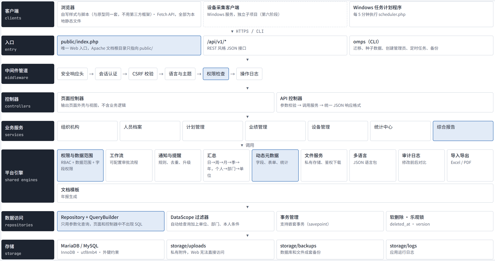

### 关键架构决定

- **不使用第三方框架。** 自建约 2000 行的内核（路由、容器、中间件、视图、校验、查询构建器），用 PSR-4 自动加载。原因：XAMPP 局域网部署不能依赖联网安装，而且以后维护的人能读懂全部代码。
- **页面加接口的模式。** 页面控制器只输出外壳，表格和表单数据通过 Fetch 调用 API。权限只在后端判断一次，前端隐藏菜单只是体验优化。
- **URL Rewrite 降级。** 优先使用 `.htaccess` 重写；如果 mod_rewrite 不可用，自动改用 `index.php?r=/path` 形式，功能不受影响。
- **零额外包、零第三方框架。** PHP 内核和前端样式、脚本都是自己写的，作为普通文件放在 `public/assets`，服务器不安装任何东西（统计图表在第七阶段决定：自绘 SVG 或随项目附带的图表文件）。日期输入用系统自带的日期选择器，文字跟随系统语言。Excel 导出：有 zip 扩展时生成 .xlsx，没有时生成 Excel 可直接打开的 XML 表格或 CSV。PDF 导出：使用专门的打印版页面，由浏览器“打印 → 另存为 PDF”。Word 年报：有 zip 扩展时生成 .docx，没有时生成 Word 可打开的 .doc。文件类型检查：没有 fileinfo 时读取文件头特征字节判断。
- **单一单位。** 系统只服务一个单位，单位下只有部门（部门下可以有小组）。数据库保留 `org_id` 字段以备将来扩展，界面不出现单位管理。

<a id="deploy"></a>

## 03 部署拓扑（生产环境加固）

XAMPP 适合开发。正式在局域网使用前，按下图加固。

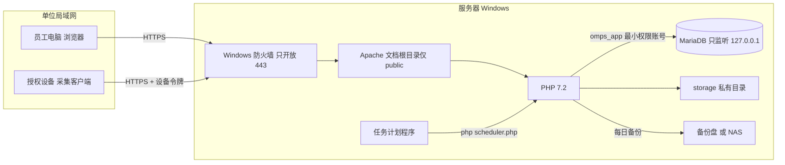

- 数据库建两个账号：`omps_app` 只有 SELECT/INSERT/UPDATE/DELETE；`omps_migrate` 有建表权限，只在命令行迁移时使用。
- root 账号设置强密码，phpMyAdmin 在生产环境禁用或只允许本机访问。
- HTTPS 使用单位内部 CA 或自签名证书；Session Cookie 设置 Secure、HttpOnly、SameSite=Lax。
- storage 目录放在 public 之外。即使配置错误，上传目录也通过 `.htaccess` 禁止执行 PHP。

<a id="modules"></a>

## 04 模块关系

业务模块之间不互相读表，统一通过平台核心的服务接口交互。

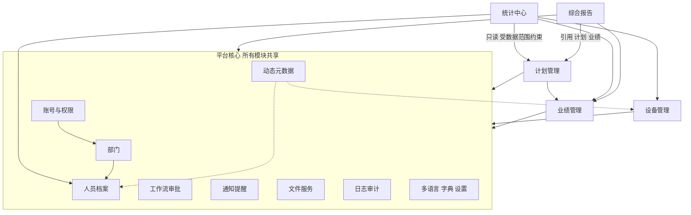

虚线表示动态字段可以扩展人员档案和设备档案。

<a id="request"></a>

## 05 一次请求的权限校验过程

以“部门负责人查看人员列表”为例，三道检查都在后端完成。

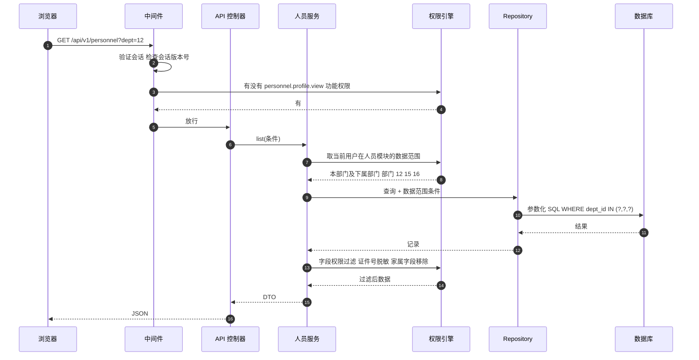

> [!NOTE]
> 如果用户把 URL 改成别的部门，比如 `dept=99`，数据范围条件仍会求交集，结果为空，不会报出该部门是否存在。访问单条记录时（`/personnel/123`），先检查这条记录是否在数据范围内，不在就返回 404，并写入越权尝试日志。

<a id="perm"></a>

## 06 角色与权限

内置 4 个角色，权限从大到小；需要时可以在“角色权限”里新增自定义角色（如“档案管理员”）。设备管理员是兼职：给任何人勾选“兼任设备管理员”即可，不单独任命。

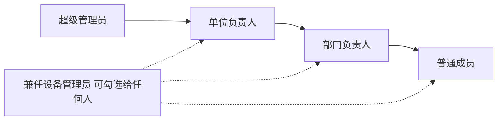

| 角色 | 能看到的数据 | 能做的事 | 不能做的事 |
|---|---|---|---|
| **超级管理员** | 全部 | 单位负责人的全部权限，加上技术操作：角色权限、菜单管理、自定义（字段设计、统计页面设计、系统主题、Banner 管理）、多语言、数据备份与恢复、系统设置、日志查询 | — |
| **单位负责人** | 全单位 | 部门与人员管理；用户账号（建账号、分配角色、勾选兼任设备管理员）；制定单位计划；审核部门负责人的业绩；综合报告；数据统计 | 技术操作 |
| **部门负责人** | 本部门（含部门下的小组） | 制定本部门的长期计划和年度计划，分配给成员（可多选）；审核成员业绩，可以直接修改后通过，可以批量通过；查看本部门人员资料，新增本部门人员，把下属移出本部门（离职、退休、调出）；本部门综合报告 | 看其他部门的数据 |
| **普通成员** | 本人，以及分配给自己的任务 | 查看分配给自己的任务；为任务制定季度、月、周、日计划；写业绩；维护本人档案 | 看其他人的数据 |
| **兼任设备管理员** （附加） | 全单位设备 | 设备档案、使用与监测、故障与维修 | 不会因此获得人员和计划的权限 |

### 固定规则

- 每个用户只有一个角色，另外可以勾选“兼任设备管理员”。
- 数据范围按角色固定，不需要配置，因此不再设“数据权限”页面。后端每个接口仍然强制检查，改 URL 或参数也拿不到范围外的数据。
- 审核关系固定：成员的业绩和资料修改由部门负责人审核；部门负责人的由单位负责人审核；单位负责人提交即生效。因此不再设“审批流程”设计页面。
- 敏感资料（完整证件号、家属资料）：超级管理员和单位负责人可以查看，每次查看都记审计日志；部门负责人和成员只能看到本人的。
- 超级管理员可以在“角色权限”中调整每个角色的功能权限（超级管理员本身除外，它始终拥有全部权限）。

### 新增、编辑、删除角色

| 操作 | 规则 |
|---|---|
| **新增角色** | 填写角色名称（每种已启用语言都要填，如简体中文、English）、说明（可不填）、默认数据范围（仅本人 / 本部门 / 全单位），并选择“权限从哪个角色复制”（默认普通成员）。创建后在右侧权限表逐项调整，点“保存权限” |
| **复制为新角色** | 从任意角色复制一份，名称自动加“（副本）”，权限完全相同，再按需修改 |
| **编辑** | 自定义角色可以改名称、说明、数据范围；内置角色名称不能改（多语言里已固定），只能改说明和数据范围；超级管理员的数据范围固定为“全部” |
| **删除** | 只能删除自定义角色；还有用户在用时不能删，提示是哪些人，并提供“去用户管理”换角色；内置 4 个角色不能删除 |
| **名称不重复** | 同一语言下角色名称不能重复 |
| **多语言** | 自定义角色名称也列在“多语言管理 → 翻译条目”（模块 role），以后新增语言时一起翻译 |
| **生效与日志** | 新增、编辑、删除角色和修改权限都记入审计日志；权限修改在相关用户下一次操作时生效 |
| **页面布局** | 左侧角色表（名称、内置 / 自定义、用户数，操作图标：查看权限 · 复制为新角色 · 编辑 · 删除），右侧是选中角色的权限表（模块 × 查看 / 新增 / 编辑 / 删除 / 导出 / 审核 / 分配任务 / 敏感资料） |

<a id="db"></a>

## 07 数据库设计

> [!TIP]
> 本章是设计时的数据模型和建表约定。实际的每张表、每个字段以 [DATABASE.md](DATABASE.md) 为准（由数据库结构生成）。

约 90 张表，分 7 个领域。下面每张 ER 图只列关键字段，完整字段写进 DATABASE_DESIGN.md。

### 所有表的公共约定

| 字段 | 类型 | 用途 |
|---|---|---|
| `id` | BIGINT UNSIGNED 自增 | 主键 |
| `org_id` | BIGINT UNSIGNED | 所属单位，所有业务表都有，用于数据隔离，建索引 |
| `created_at / updated_at` | DATETIME | 创建、更新时间 |
| `created_by / updated_by` | BIGINT UNSIGNED | 创建人、更新人（users.id） |
| `deleted_at / deleted_by` | DATETIME / BIGINT | 软删除；日志类表不设此字段（不可删） |
| `version` | INT UNSIGNED | 乐观锁，防止两人同时编辑互相覆盖（重要业务表） |
| `biz_type + biz_id` | VARCHAR(50) + BIGINT | 多态关联：文件、工作流、通知、动态字段值都用这对字段挂到任何业务记录上 |

### MariaDB 10.1 建表约定

| 限制 | 处理方式 | 对设计的影响 |
|---|---|---|
| 没有 JSON 列类型 | ER 图中标为 `json` 的列实际建为 `LONGTEXT`，由 PHP 写入前校验 JSON 格式 | 无。这些列本来只存快照，不在里面做查询 |
| 索引长度上限 767 字节 | 需要建索引的 utf8mb4 文本列不超过 `VARCHAR(191)`；编码、键名类字段用 ascii 字符集；通知去重键存成 64 位哈希 | 无 |
| CHECK 约束不生效 | 取值范围、权重合计等规则在服务层校验；枚举值用 `ENUM` 或字典表 | 无。校验本来就在服务层 |
| 严格模式：10.1 默认不开，10.2 起默认开启 | 连接时固定 `sql_mode`（含 `STRICT_TRANS_TABLES`），10.1 上也按严格模式运行；写入前在服务层按字段类型和长度校验 | 无。两个版本表现一致：超长、类型不对的数据直接报错，不会被悄悄截断 |
| 没有递归查询（CTE）和窗口函数 | 组织树用 `path` 字段，计划树用闭包表 `plan_paths`；排名类统计在 PHP 中计算 | 无。设计本来就没用 |

历史数据统一存入 `data_versions`（实体类型、实体 ID、版本号、完整快照、修改人），审计差异存入 `audit_logs`。两者分开：前者用于“查看历史版本”和“恢复”，后者用于“谁在什么时候改了什么”。

### 7.1 部门、账号、权限（第一阶段）

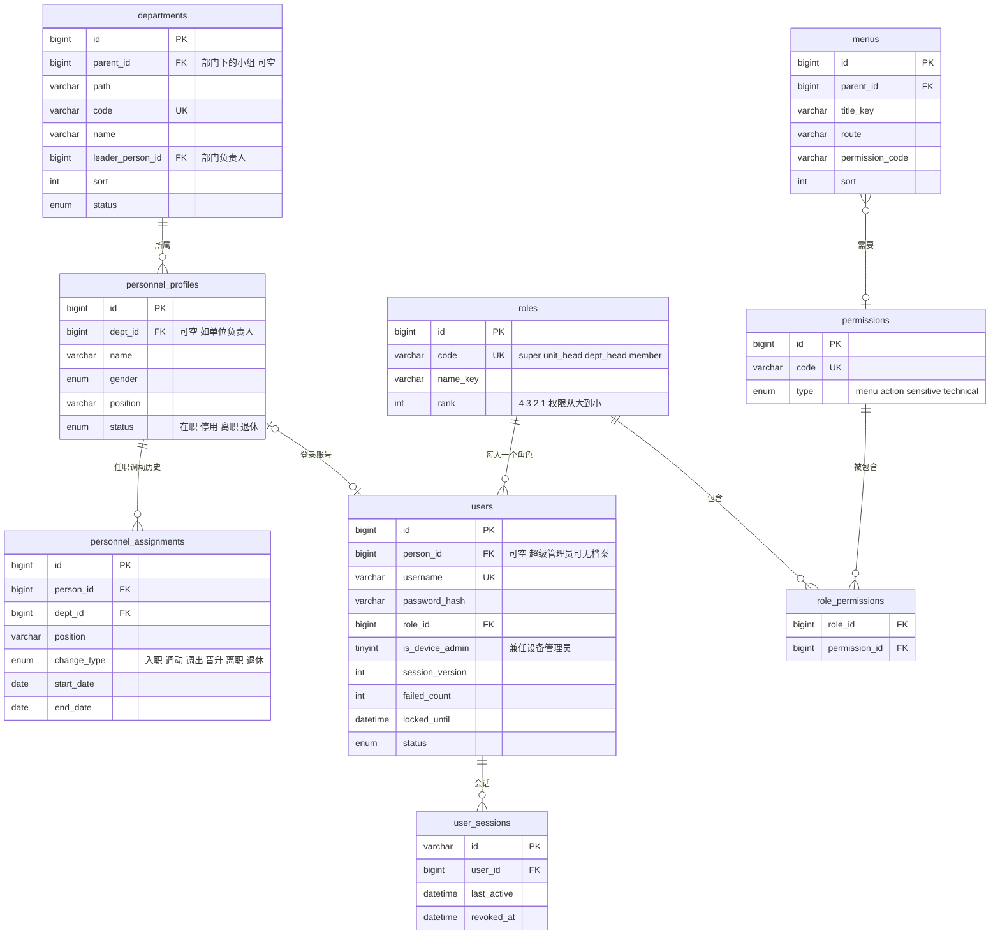

说明：系统只服务一个单位，单位名称、Logo、地址存在 `system_settings`。业务表保留 `org_id` 字段（固定为 1）以备将来扩展，界面上不出现单位管理。数据范围按角色固定：超级管理员和单位负责人看全部，部门负责人看本部门（含小组），普通成员看本人和分配给自己的任务。

### 7.2 人员档案（第二阶段）

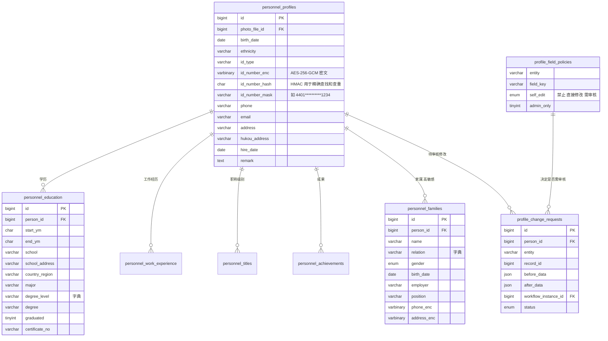

附件（证明文件、成果图片、视频）不在这些表里存路径，统一用 `file_relations` 挂到记录上。个人修改需审核的字段时，先写入 `profile_change_requests`，审核通过才写回正式档案，所以正式档案始终是已审核的数据。

<a id="staffdept"></a>

### 部门负责人新增和移出下属

部门负责人管自己部门的人：可以新增，也可以移出。“移出”不是删除——档案、计划、业绩、设备记录全部保留，只有单位负责人和超级管理员可以彻底删除档案。

| 操作 | 部门负责人怎么做 | 系统自动做的事 |
|---|---|---|
| **新增人员** | 人员列表右上角“新增人员”，填写档案。“当前部门”只能选本部门或下属小组，默认本部门 | 写入一条“入职”任职记录；通知单位负责人和超级管理员；登录账号由超级管理员开通（新增人员不会自动得到账号） |
| **移出本部门** | 在下属那一行点“移出本部门”，选原因： **离职**、 **退休**、 **调出本部门**，填生效日期和说明（可不填） | 弹窗提示他还有几项未完成计划、几台在用设备，需要另行安排。<br>离职、退休：人员状态改为离职或退休，登录账号停用。<br>调出：人员变为“待分配”，账号保留，单位负责人收到待办“为 XX 安排部门”，用“调动”安排新部门后待办自动完成 |
| **由权限决定** | “角色权限”矩阵里： **人员档案 · 新增** = 新增人员； **人员档案 · 删除** = 移出人员； **人员档案 · 编辑** = 编辑档案。部门负责人默认三项都勾选，超级管理员取消后按钮立即消失，后端接口同样拒绝 | 能对谁操作看角色的默认数据范围： **本部门** ——只能新增到本部门、移出本部门的人（上面两行的做法）； **全单位** ——还可以“调动”和彻底删除档案（单位负责人默认如此）； **本人** ——即使勾了也只能改本人档案。自定义角色（如“部门档案员”）同样适用 |
| **不能做的** | 不能新增到其他部门；不能移出自己；不能在档案表单里直接改人员状态（要用“移出本部门”，这样一定有任职记录）；不能彻底删除档案 | 每次新增、移出都写审计日志（修改前后的部门和状态）；调动记录里部门负责人只看到本部门人员的记录 |

### 7.3 计划、业绩、评分、目标（第三、四阶段）

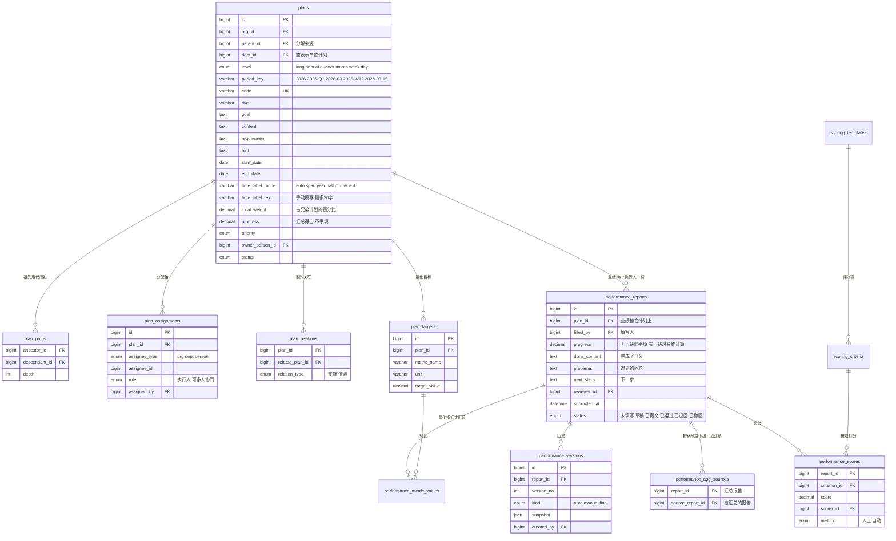

### 7.4 工作流审批（第二阶段起使用）

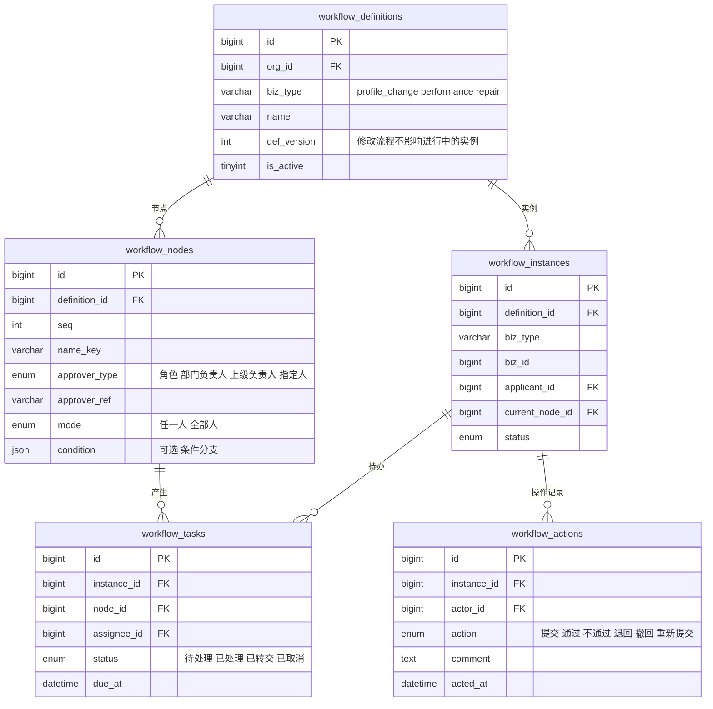

### 7.5 设备（第六阶段）

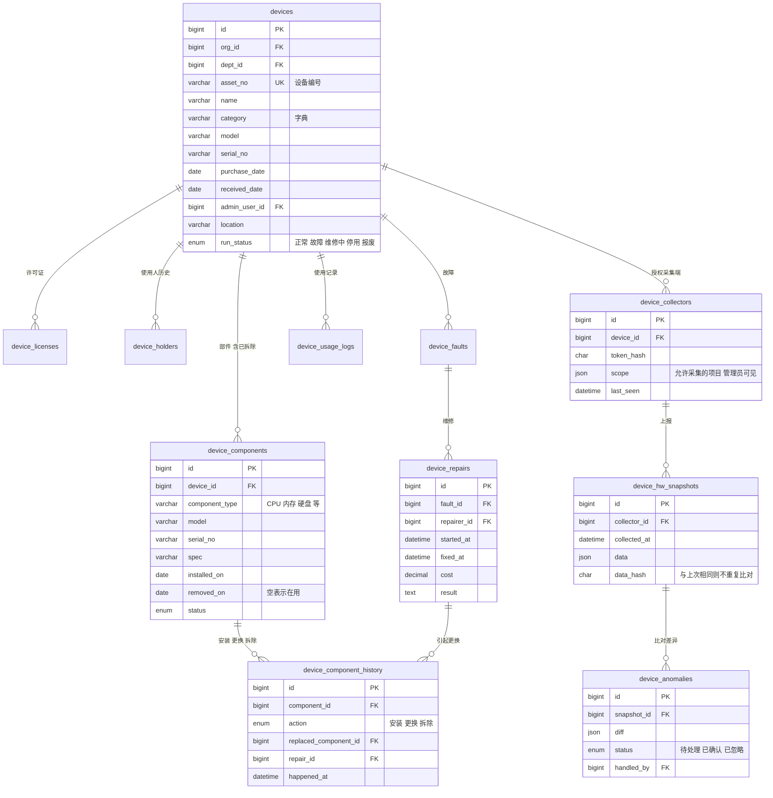

更换部件 = 把旧部件行的 `removed_on` 填上 + 新增一行新部件 + 写一条历史，不覆盖原数据。

### 7.6 动态字段与统计（第七阶段）

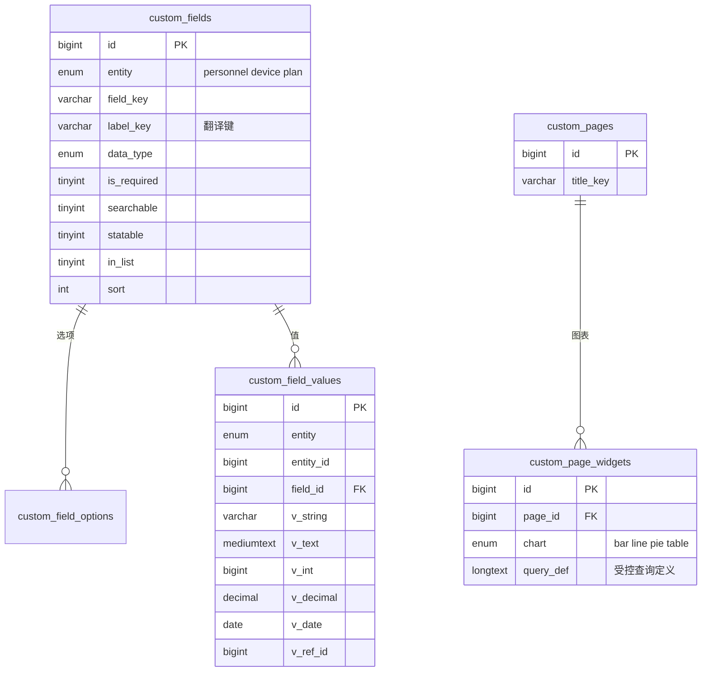

### 7.7 通知、文件、日志、系统、导入、模板、升级

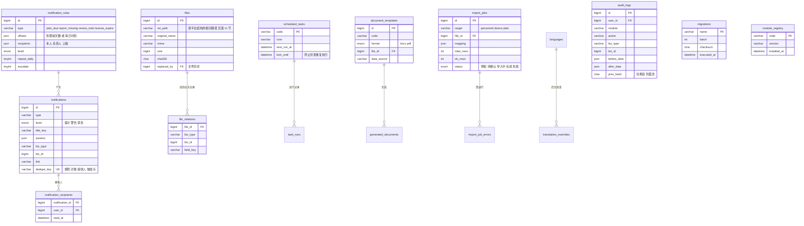

其余系统表：`login_logs`、`login_attempts`（失败限流）、`operation_logs`、`backup_logs`、`system_settings`、`dictionaries` / `dictionary_items`、`themes`、`banners`、`data_versions`、`upgrade_logs`、`missing_translations`。

<a id="plan"></a>

## 08 计划层级与权重计算

父子关系存在 `plans.parent_id` 和闭包表 `plan_paths` 中，不靠名称或日期推断。层级不用选，按开始和结束日期自动判断。

### 目标层层分解（例子）

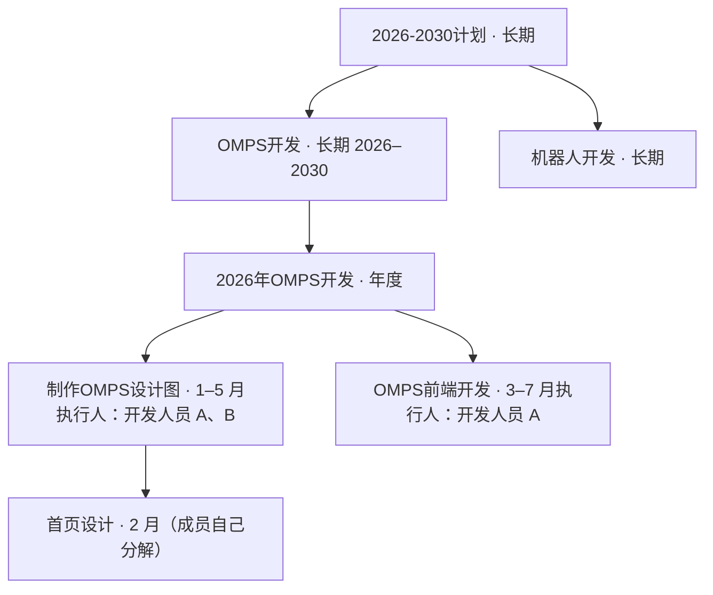

| 规则 | 说明 |
|---|---|
| **层级按日期判断** | 取能装下这段时间的最小日历周期：同一天 = 日，同一周 = 周，同一个月 = 月，同一季度 = 季度，同一年 = 年度，跨年 = 长期。例如 1 月 1 日–5 月 31 日是“年度”，列表上的时间显示为“1–5 月” |
| **可以同级嵌套** | 子计划可以和上级是同一层级，或者更低；不能比上级更长（年度目标下不能加跨年的子目标）。所以长期计划下可以分多个跨年目标，年度目标下可以分任意时长的子目标 |
| **谁能分到多长** | 负责人（单位、部门负责人）可以添加任意时长的子目标并选择执行人（可多选）；普通成员在分配给自己的任务下，只能添加一个季度以内的子计划 |
| **改日期** | 进度推迟时可以直接改日期，层级跟着日期变；超出上级时间范围时照常保存，并提示 |
| **新建时的日期** | 默认比上级低一级（长期下默认今年，年度下默认本季度……）。“快速选择时间”可一键填入：与上级相同、5 年、一年、一个季度、一个月、一周、一天，并限制在上级范围内 |

### 按周期分解（权重计算的例子）

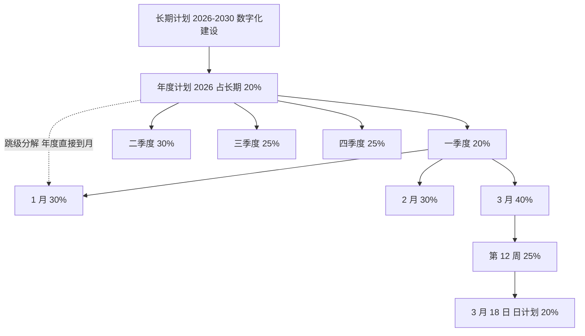

### 计算规则

1. **局部权重：** 每个计划只保存相对于兄弟计划的占比 `local_weight`。同一个父计划下的子计划合计应为 100%。管理员可设置检查方式：强制（不等于 100% 不能保存）、警告、关闭。
2. **有效权重（自动算，不存储）：** 沿路径相乘。

```text
有效权重(日计划 3月18日) = 20% × 20% × 40% × 25% × 20% = 0.08% （占长期计划）
```

1. **进度向上汇总：** 叶子计划的进度来自审核通过的业绩完成比例；父计划进度 = Σ(子计划局部权重 × 子计划进度)。父计划的进度永远是算出来的，不能手填，所以不会出现两份进度打架。

```text
进度(一季度) = 30% × 进度(1月) + 30% × 进度(2月) + 40% × 进度(3月)
```

1. **防重复计算：** 每份完成量只在它被填报的那一层计入一次。上层只做加权，不再把下层业绩条目重新加一遍。一个日计划如果同时支撑两个上级计划，主关系走 `parent_id` 计入进度，次关系走 `plan_relations`，只做展示，不计入进度。
2. **周期编码：** 统一用 `period_key`（`2026`、`2026-Q1`、`2026-03`、`2026-W12`、`2026-03-18`）。周按 ISO 周，也可在系统设置中改为自定义周期起始日。目标对比和历史同期对比都用这个编码。

<a id="agg"></a>

## 09 计划与业绩

计划从长期到日计划，放在一棵树里；业绩和完成百分比直接写在树上的每个计划里。

### 9.1 谁制定什么

| 角色 | 制定 | 分配 | 业绩 |
|---|---|---|---|
| 单位负责人 | 单位的长期计划、年度计划，以及其下任意时长的目标 | 分配给部门负责人 | 审核部门负责人的业绩 |
| 部门负责人 | 本部门的长期计划、年度计划；可以层层分解成多个跨年目标、年度目标和任意时长的子目标（如 1–5 月） | 分配给本部门成员， **可多选**，多人协同完成 | 审核成员业绩：可直接修改后通过，可批量通过 |
| 普通成员 | 对分配给自己的任务，制定一个季度以内的子计划（季度、月、周、日，或其中任意一段时间） | — | 在任务和子计划上写业绩、填完成百分比 |

**在哪里新建：** 部门负责人、单位负责人在“我的任务”和“计划与业绩”两页都有“＋ 新建计划 / 新建主计划”，执行人可多选（在“我的任务”里默认勾选本人）。普通成员没有这个按钮，只能在分配给自己的任务下添加一个季度以内的子计划。 **层级不用选**：填好开始和结束日期，系统自动判断（见[第 08 节](#plan)）。日期默认比上级低一级，也可以点“快速选择时间”：与上级相同、5 年、一年、一个季度、一个月、一周、一天；有上级计划时不会超出上级计划的时间范围（例如在 2027 年度计划下，默认 2027 年第一季度）。

**多人协同：** 一个任务分配给几个人时，每人各自制定自己的子计划、各自写业绩。任务的完成百分比 = 各人完成百分比的平均值；任务页面按人列出每个人的业绩。

### 9.2 我的任务（普通成员登录后的首页）

一眼看到分配给自己的全部任务，以及自己在下面制定的子计划。每一行都可以直接“＋子计划”或“写业绩”；自己添加的子计划还可以“编辑”“删除”。负责人分配的任务不能改，只能写业绩和添加子计划。

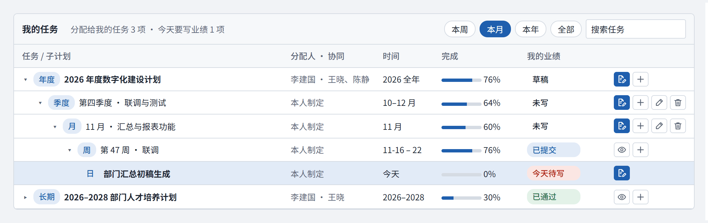


### 9.3 写业绩弹窗

上半部分自动列出自己在这个任务下已写过的子计划业绩，下半部分在此基础上补充或修改。


### 9.4 计划与业绩（一个页面，树状显示）

长期计划到日计划全部在这一页。可以直接新建主计划、添加子计划、填写完成百分比和业绩。部门负责人、单位负责人用这一页管理全部计划。

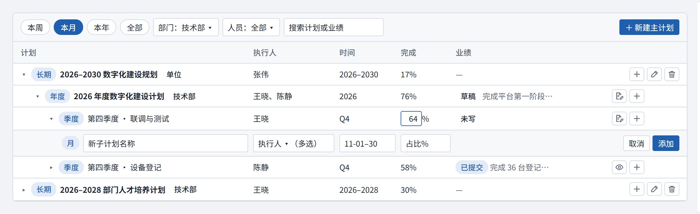


- **筛选：** 本周、本月、本年、全部；可按部门、人员筛选，搜索框同时搜计划名称和业绩内容。筛选时，符合条件的计划的上级也会显示（灰色），保证能看到它属于哪个任务。
- **直接操作：** 点添加子计划图标（＋）在该行下面出现一行输入框，填名称、执行人（多选）、时间、占比即可添加；本人负责的计划可以直接在“完成”一栏改百分比；点写业绩图标打开 9.3 的弹窗。
- **单位计划与部门计划：** 名称后面标出“单位”或部门名称，部门也可以有自己的长期计划。

### 9.5 业绩审核

部门负责人在这里处理成员提交的业绩：可以直接修改后通过，也可以勾选多条批量通过。所有操作都记日志。

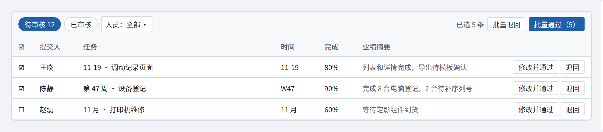

- **修改并通过：** 打开提交内容，部门负责人可以直接改完成百分比和业绩文字，点“保存并通过”。原提交内容保留在历史中，提交人会收到“已修改并通过”的通知。
- **批量通过：** 勾选多条点“批量通过”，确认一次即可。退回必须填写原因（可以多条共用一个原因）。
- **日志：** 每一条通过、退回、修改都单独记入操作日志，修改会记录修改前后的内容。

<a id="perf-stats"></a>

#### 9.5.1 执行统计（v0.48）

菜单“业绩审核”改名为 **审核与统计** ，页面分为两个子页面： **业绩审核** 和 **执行统计** 。执行统计按人员统计审核范围内的人（有登录账号、不含自己）：分配的计划执行了几个、没执行几个，日报、周报、月报、季报、年报应交几份、交了几份、没交几份，以及百分比。每个数字都可以点开，看具体是哪些。

| 部分 | 内容 |
|---|---|
| **筛选** | 统计时段（默认本月；本日、本周、本年、全部、自定义），部门（含下级部门），人员，显示“全部”或“只看有未执行或未提交的人员”，按姓名搜索 |
| **总览** | 六个指标：分配计划执行率、日报提交率、周报提交率、月报提交率、季报提交率、年报提交率；每个显示百分比、进度条和“已执行 / 未执行 / 应执行”或“已交 / 未交 / 应交”。本时段没有到期的报告显示“—” |
| **按人员统计** | 每人一行，每类一列：百分比、进度条、“已交 / 应交”，有缺的显示“未执行 n”“未交 n”“逾期 n”；最后一行合计。点列标题按百分比排序；本时段没有任何到期报告的类别不显示列 |
| **明细列表** | 点指标或单元格打开列表，可按状态切换（全部、已执行、未执行、未开始、逾期；或全部、已交、未交），分页；计划可直接打开查看 |
| **导出** | “导出 Excel”导出按人员统计表（含合计） |

| 规则 | 说明 |
|---|---|
| 分配计划 | 负责人分配给本人的计划；本人自己添加的子计划不算。计划时间与统计时段有交集即计入，已取消的不计 |
| 已执行 | 本人在这个计划，或其下自己的子计划提交过业绩（已提交或已通过）。完成百分比通过 100% 或计划已标为完成为“已完成”，其余为“执行中” |
| 未执行、未开始、逾期 | 已经开始但没有提交过业绩为未执行；还没开始也没提交的为未开始，不计入执行率；结束日期已过而未完成的标为逾期 |
| 日报到年报 | 写在对应时长计划（日、周、月、季度、年度，即计划层级）上的业绩。每个工作日一份日报，每周、每月、每季度、每年各一份 |
| 应交 | 截止时间是该周期最后一个工作日下班时（工作日和下班时间见系统设置）。截止日在统计时段内、并且已经到了截止时间的才计入；建档或入职之前的不计 |
| 已交、未交 | 已提交、已通过为已交（提前提交的也算）；草稿、被退回、已撤回、未写、没有对应计划为未交 |
| 颜色 | 90% 以上绿色，60%–90% 黄色，60% 以下红色；数字始终显示，不只靠颜色 |
| 权限 | 与业绩审核相同（`perf.audit`）：部门负责人看本部门及下级部门，单位负责人看全单位 |

### 9.6 系统规则（用户不需要设置）

|   |   |
|---|---|
| 完成百分比 | 由本人填写。有子计划时，系统按子计划占比算出参考值，显示在输入框旁边，点“采用”即可填入 |
| 多人协同 | 任务完成百分比 = 各执行人完成百分比的平均值 |
| 写业绩的汇总 | 弹窗上半部分只列出本人在该任务下各级子计划已写的业绩，按时间排列；不会修改子计划的原业绩 |
| 提醒 | 每天 17:00 前，今天的日计划还没写业绩的提醒本人；周、月、季、年计划在结束前一个工作日提醒 |
| 时间显示 | 列表上的时间按计划的开始、结束日期显示：正好是整年、整季、整月、整周（周一至周日）时显示名称（如“2026 年”“第四季度”“11 月”“第 47 周”），否则显示具体日期（如“11-01 – 11-20”，跨年时带年份）。所属周期由系统按日期自动计算，修改日期后列表立即更新。<br>**也可以手动设置**：编辑计划时“时间显示”默认为“自动”；时间段太长时，点系统按日期给出的简写（如“2025–2030”“2026 年”“上半年”“第一季度”“11 月”“第 47 周”），或自己填写（最多 20 字）。简写跟随语言切换和日期变化，日期改到不再适用时自动恢复为“自动”；自己填写的内容原样显示，日期修改后系统提醒确认。计划详情里同时显示具体日期 |
| 超出上级时间 | 子计划的时间超出上级计划时仍可保存，系统用黄色提示说明上级计划的时间范围；修改前后的时间记入操作日志 |
| 编辑和删除子计划 | 自己添加的子计划可以编辑（名称、时间、时间显示、占比、目标、工作内容）和删除。删除时，它下面的子计划一起删除，未提交的业绩草稿一起删除，附件移入回收站（30 天内可恢复）。下面有已提交或已通过业绩的，不能删除，需要先撤回；已通过的要负责人退回后才能撤回。负责人分配下来的任务，成员不能编辑或删除 |
| 历史 | 每次保存、提交、修改、通过、退回都留记录，可以查看和对比；编辑、删除计划记入操作日志 |

> [!NOTE]
> 与 v0.6 相比：六个计划层级菜单和“我的工作”合并为“我的任务”和“计划与业绩”两页；计划可多人协同；部门可以有长期计划；成员负责季、月、周、日计划；审核页可直接修改、批量通过；取消“业绩统计”页面。

<a id="report"></a>

## 10 综合报告、记事本与下发事项

按任意时段、任意任务、任意人员生成报告：系统按任务逐条列出下级任务和业绩，可以编辑说明、打印、下载。所有报告保存在“报告列表”，也可以手动新建、上传报告文档。记事本用来记自己的内容，需要时提交给上级；下发事项是上级给下属发提示、文档和有期限的指令。上下两个方向的新消息都进铃铛（[第 13 节](#remind)）。

### 10.1 报告条件

三个条件都可以选“全部”“多个”或“一个”，组合使用。

| 条件 | 怎么选 | 默认 |
|---|---|---|
| **时段** | 任意开始日期 — 截止日期；快捷按钮：本周、本月、本季度、本年 | 本年 |
| **任务** | “全部任务”，或在任务树里勾选一个或多个任务（长期、年度、季度、月度都可以选） | 全部任务 |
| **人员** | “全部人员”，或勾选一个或多个人员；按部门分组，可以一键全选某个部门 | 全部人员 |

- 只列出与时段有交集的任务；只列出所选人员参与的任务和他们的业绩。
- 同时选中一个任务和它的上级任务时，只在上级任务下列出一次，不重复。
- 范围按角色限制：单位负责人可选全单位；部门负责人只能选本部门的任务和人员；普通成员的人员固定为本人。

### 10.2 列出规则

1. **每个选中的任务一节，** 列出它的本级业绩，再逐个列出时段内的下级任务：名称、执行人、完成百分比、业绩。
2. **某个下级任务没有自己的业绩时，往下找。** 例如年度计划没有年度业绩，就把它的季度业绩（没有季度业绩时用月度业绩）按时间顺序一条一条列出来。
3. **只用已审核通过的业绩**，原业绩不会被修改。

### 10.3 页面设计

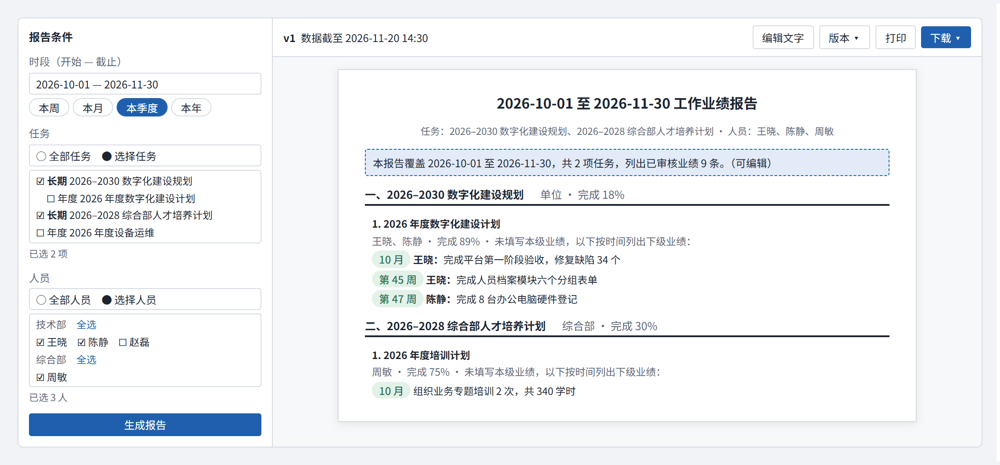

### 10.4 编辑、打印、下载

#### 编辑

- 只能改说明文字（开头说明、补充说明）；任务、完成百分比和业绩来自数据，不能改
- 每次保存自动留一个版本，可以切换查看

#### 打印和下载

- 打印：A4 打印页，用浏览器“打印 → 另存为 PDF”得到 PDF
- 下载：Word（有 zip 扩展时为 .docx，否则 .doc）、Excel 明细
- 每次打印、下载都记日志

<a id="rplist"></a>

### 10.5 报告列表（报告历史）

综合报告页面有两个子页： **报告列表** （默认）和 **按条件生成**。生成的报告自动保存到报告列表，不需要另点保存；也可以手动新建。


| 操作 | 怎么做 |
|---|---|
| **筛选** | 列表上方： **全部** （默认）· **本周** · **本月** · **本年** · **自定义时段** （选中后出现开始、截止两个日期框），可以再加名称搜索。按 **报告时段** 筛选：报告的时段完全落在所选范围内才显示——“本月”显示本月的周报、月报，不显示跨年度的报告；“本年”显示今年内的所有报告。没有时段的报告按创建日期算。筛选后显示“按报告时段：n / 总数 份”；没有结果时有“显示全部”按钮 |
| **预览** | 点报告名称或眼睛图标，打开报告纸面；下方是这份报告的“报告文档”。顶部按钮：← 报告列表 · 编辑 · 版本 · 打印 · 下载 · 删除 |
| **编辑** | 按条件生成的报告：可以改标题、开头说明和补充说明；任务、完成百分比和业绩来自数据，不能改。手动编写的报告：可以改名称、时段和正文。每次保存留一个版本，可以切换查看 |
| **手动新建** | 填写报告名称、时段（默认本月）、正文，可以同时上传文档。正文和文档至少填一项——只有一份 Word 定稿时，直接上传即可 |
| **上传、删除报告文档** | 在列表行点上传图标，或在预览页点“上传文档”。支持 Word、PDF、Excel、图片，单个不超过 50 MB；相同文件不重复保存（[第 11 节](#files)）。删除文档进入回收站，30 天内可以恢复 |
| **删除报告** | 确认后删除报告和全部版本；它的报告文档一起移入回收站，30 天内可以在“文件管理”恢复 |
| **谁能看到** | 报告列表只显示本人创建的报告。报告是给谁看的，由本人打印、下载或上传文档后自行报送 |
| **日志** | 生成、新建、修改、删除、打印、下载、上传都记入操作日志 |

### 10.6 数据表

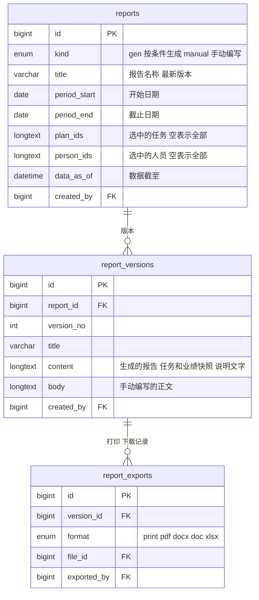

### 10.7 记事本

每个人自己的记事本。写下的内容默认 **只有自己能看到**；需要让上级知道时，点一个按钮提交，上级阅读后可以写批示。菜单位于左侧“我的事务”下。


| 规则 | 说明 |
|---|---|
| **写和保存** | 标题 + 正文，可选关联一个自己的任务。点“保存”；切换到另一条记事时系统自动保存，不会丢内容 |
| **仅自己可见** | 没提交的记事只有本人能看到。上级、单位负责人、超级管理员在界面上都看不到 |
| **提交给上级** | 按钮上直接写着对方名字，由系统决定：普通成员 → 本部门负责人；部门负责人 → 单位负责人；单位负责人没有上级，记事只自己保留。提交后对方收到待办和通知 |
| **提交后** | 记事锁定，不能修改和删除。对方阅读前可以“撤回”，撤回后恢复为仅自己可见，可以继续改 |
| **上级阅读** | 部门负责人、单位负责人多一个子页“收到的记事”（未读数量显示在标签上）。打开后可写批示（可不填），点“已阅”；提交人收到通知，在记事下方看到批示 |
| **已阅后** | 作为记录保留，不能修改或删除；要继续写，点“复制为新记事” |
| **日志** | 新建、提交、撤回、阅读、删除记入操作日志，只记标题和动作，不记正文 |

### 10.8 记事本数据表

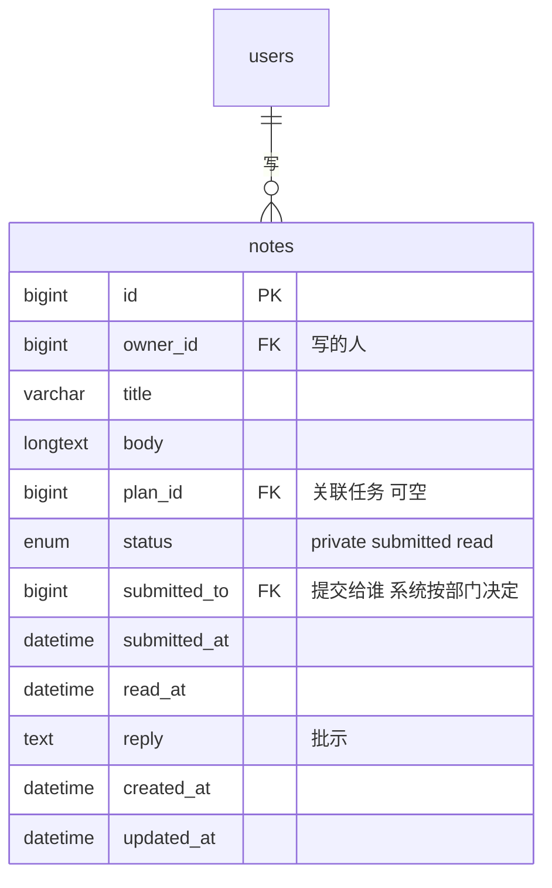

> [!NOTE]
> 正式开发时，记事列表和读取接口都按“本人，或提交给本人”过滤；没有任何角色可以绕过这条规则在界面上看到别人的私有记事。

### 10.9 下发事项（上级 → 下属）

菜单在左侧“我的事务”下。所有人都有“收到的”；部门负责人、单位负责人多一个子页“我下发的”。一个表单就能发三种东西，系统按内容自动归类：

| 类型 | 怎么发 | 对方要做什么 |
|---|---|---|
| **提示** | 只写标题和内容，选“只需阅读” | 打开即记为已阅 |
| **文档** | 上传文档，选“只需阅读” | 打开、预览或下载，打开即记为已阅 |
| **指令** | 选“需要完成并回复”，填截止时间 | 写完成情况（可上传材料），点“完成并回复”；没完成前系统按规则督促（[13.2](#remind)） |

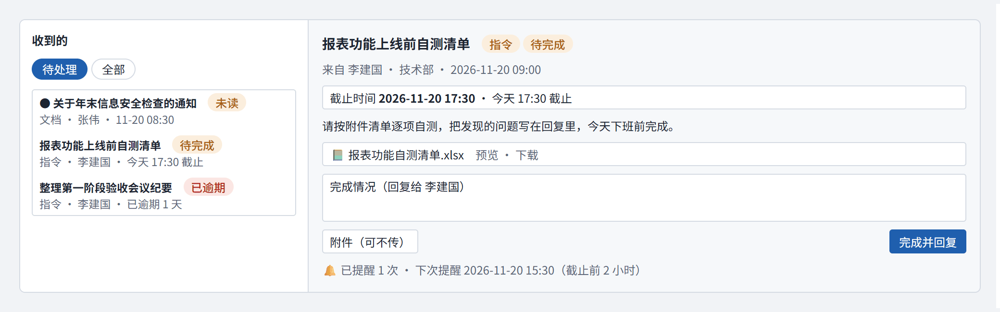

| 规则 | 说明 |
|---|---|
| **下发给谁** | 部门负责人：本部门（含小组）人员；单位负责人：全单位人员，有“各部门负责人”“全部”快捷选择。普通成员不能下发，向上报送用记事本 |
| **下发表单** | 标题、内容、文档（可不传）、接收人、要求（只需阅读 / 需要完成并回复）、截止时间。督促频率放在“更多选项”里，默认“系统自动” |
| **我下发的** | 每行显示进度（已阅 x/n 或完成 x/n）和逾期人数；图标：查看（每个人的阅读、完成、回复、附件、提醒次数和下次提醒）· 催办 · 撤回 |
| **催办** | 只发给还没阅读（提示、文档）或还没完成（指令）的人；同一个人 1 小时内只能催一次，避免刷屏 |
| **撤回** | 接收人收到撤回通知，事项变灰，不再需要处理，督促停止 |
| **文件** | 保存到 `D:\OMPS\files\下发事项\下发人\标题\上传人\`。下发人的文档所有接收人可见；回复里的材料只有下发人和上传人可见 |
| **日志** | 下发、催办、撤回、完成并回复都记入操作日志 |

### 10.10 下发事项数据表

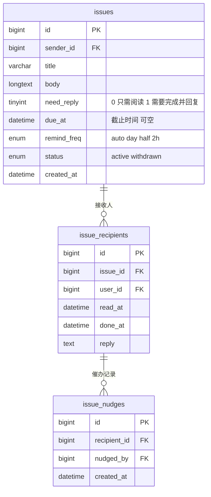

> [!NOTE]
> 附件用文件表的业务关联（biz_type = issue），和其他模块一样去重、进回收站。

<a id="files"></a>

## 11 文件存储与管理

上传到服务器的文件，按平台的结构放进对应的文件夹，最后一级是上传人的名字。文件在写业绩时上传；在“文件管理”页面可以按同样的结构浏览、预览、下载、删除。

### 11.1 服务器上的目录结构

```text
D:\OMPS\files\                                   # 文件存储根目录，在网站目录之外，网址不能直接访问
├── 计划与业绩\                                   # 按计划层级逐级建文件夹
│   ├── 2026–2030 数字化建设规划\
│   │   └── 2026 年度数字化建设计划\
│   │       ├── 第四季度 · 联调与测试\
│   │       │   ├── 10 月 · 第一阶段验收\
│   │       │   │   └── 王晓\                     # 最后一级是上传人
│   │       │   │       ├── 第一阶段验收报告.pdf
│   │       │   │       └── 验收会议照片.jpg
│   │       │   └── 11 月 · 汇总与报表功能\ …
│   │       └── 第四季度 · 设备登记与巡检\
│   │           └── 陈静\电脑登记表.xlsx
│   └── 2026–2028 综合部人才培养计划\ …
├── 人员档案\                                     # 部门 → 小组 → 姓名 → 资料分组
│   └── 技术部\软件组\王晓\学历经历\学历证明.pdf
├── 设备管理\                                     # 设备编号和名称 → 设备档案 / 故障维修 → 上传人
│   └── SJZX-PR-0004 激光打印机\故障维修\赵磊\故障照片.jpg
├── 综合报告\                                     # 创建人 → 报告名称
│   └── 张伟\10 月份单位工作总结\10月份单位工作总结（定稿）.docx
└── 系统\主题与 Banner\ …                          # Logo、登录页图片
```

### 11.2 规则

|   |   |
|---|---|
| 自动建文件夹 | 第一次往某个计划、档案或设备上传文件时，系统按上面的结构自动建好文件夹；不预先建空文件夹。 |
| 跟着平台改 | 计划改名或调整上下级时，系统同步改文件夹名或移动文件夹，并记日志；以数据库记录为准，文件夹只是方便在服务器上查找。 |
| 文件名 | 保留原文件名；去掉 \ / : \* ? " &lt; > \| 等 Windows 不允许的字符；同一文件夹里同名但内容不同时，自动加“(2)”。 |
| 路径长度 | 每级文件夹名最多 30 个字；存储根目录用短路径 D:\OMPS\files；完整路径超长时截断并加编号。PHP 7.2 在 Windows 上支持中文路径。 |
| 安全 | 下载和预览都经过权限检查并记日志；上传时检查类型、大小和文件内容；存储目录不执行任何脚本。 |

### 11.3 避免重复文件

1. **上传时检查。** 服务器计算文件的 SHA-256 指纹；如果本人已经上传过完全相同的文件，提示“已存在相同文件”，改为引用原文件，不再保存第二份。
2. **同名不同内容不算重复。** 自动改名为“文件名(2)”，两份都保留。
3. **“重复文件”子页。** 列出已有的重复文件和可节省的空间；本人可以删除自己的副本，原位置改为引用保留的那一份。

### 11.4 文件管理页面

菜单位置：左侧菜单中“系统管理”的上方（所有人可见，看到的范围按角色不同）。子页：全部文件 · 我上传的 · 重复文件 · 回收站。

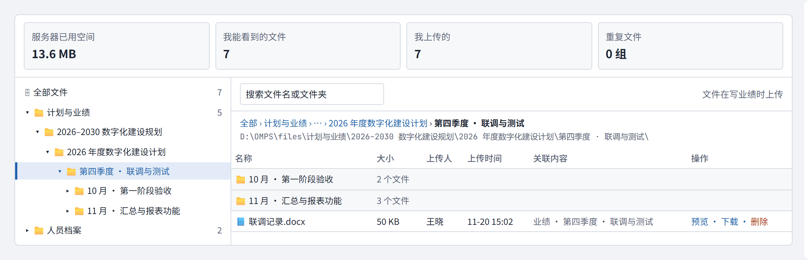

### 11.5 权限

| 操作 | 规则 |
|---|---|
| 浏览、预览、下载 | 按数据范围：普通成员看自己上传的和自己参与任务的文件；部门负责人看本部门的；单位负责人和超级管理员看全部。人员档案里的附件只有本人、本部门负责人、单位负责人、超级管理员能看；家属资料附件只有本人、单位负责人、超级管理员能看。 |
| 上传 | 只在业务页面里上传：写业绩时上传证明材料；人员档案、设备档案的附件在各自页面上传。“文件管理”页面不提供上传按钮，只用来浏览、下载、删除和清理。 |
| 删除 | 每个人只能删除自己上传的文件（超级管理员可以删除任何文件）。已通过审核的业绩所附的文件不能删除，要先撤回或由负责人退回。 |
| 回收站 | 删除的文件先进回收站，30 天内本人可以恢复；30 天后由定时任务彻底删除。 |
| 日志 | 上传、下载、删除、恢复、清理重复都记入操作日志。 |

### 11.6 数据表

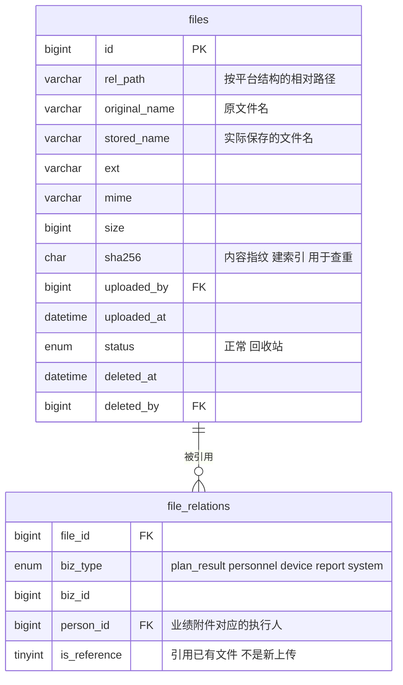

<a id="flow"></a>

## 12 审批工作流状态机

人员资料审核、业绩审核、计划审批、设备维修共用这一套。流程节点在后台配置。

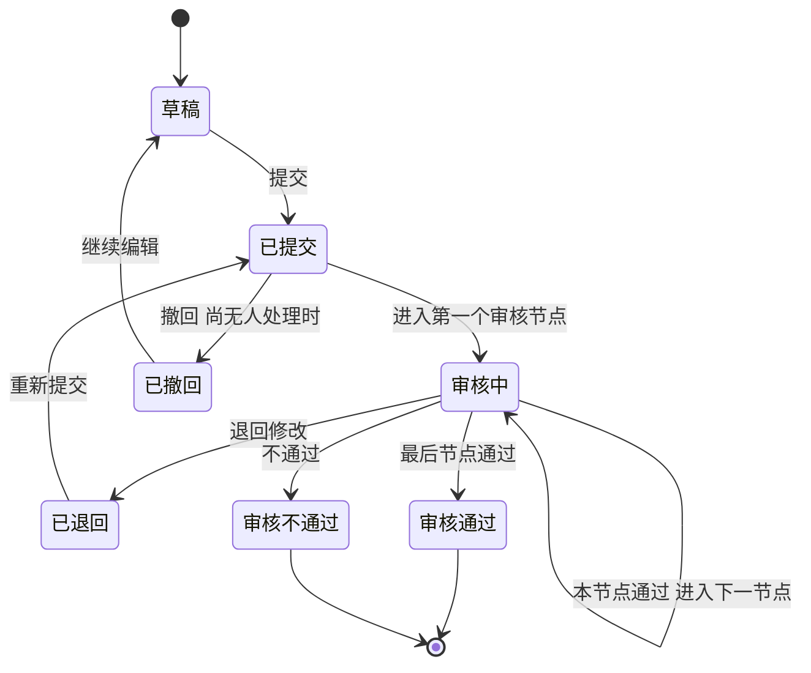

每次状态变化写一条 `workflow_actions`，并给下一位审核人生成待办和通知。撤回只能在没人处理之前进行；已通过的记录要修改，需要发起新的变更申请。

<a id="remind"></a>

## 13 提醒引擎、铃铛与督促

由 Windows 任务计划程序驱动，即使没人打开网页，提醒也会按时生成。

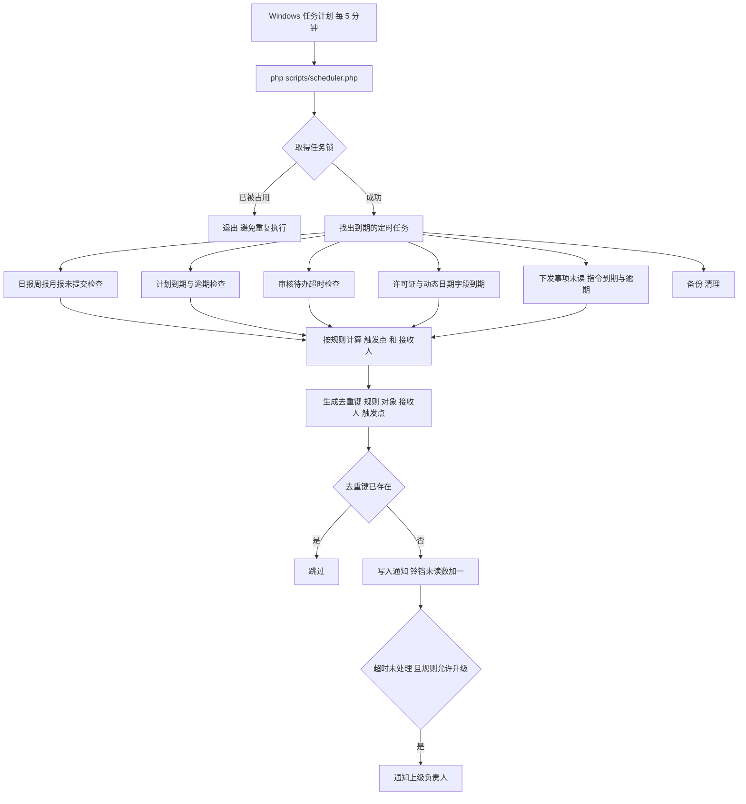

例：计划在 12 月 31 日到期，规则为“到期前 30、7、3 天和当天，逾期后每天”。去重键形如 `plan_due:plan#88:user#12:D-7`，逾期为 `…:OD:2027-01-02`。任务一天跑多少次都只产生一条。

### 13.1 铃铛：所有新收到的消息

不管是下级报上来的，还是上级发下来的，只要是本人新收到的，都进铃铛，红色数字是未读数。

| 方向 | 进铃铛的消息 |
|---|---|
| 上级 → 下属 | 下发了提示、文档、指令；催办；撤回；记事已阅并写了批示；业绩审核通过或退回 |
| 下属 → 上级 | 提交了记事；完成并回复了指令（逾期完成会标出）；首次逾期的人员名单；提交了业绩待审核 |
| 系统 | 督促提醒（13.2）、计划到期、日报未填、设备异常、系统公告 |

#### 怎么及时看到

- 页面每 60 秒向服务器询问一次未读数（普通 AJAX，不需要额外扩展）
- 有新消息时铃铛数字增加，右下角弹出 5 秒提示
- 浏览器标签标题前显示未读数，如“(3) 示例市数据中心”，窗口在后台也能看到
- 没登录时产生的消息保存在服务器，下次登录直接显示

#### 点开以后

- 点一条消息直接打开对应页面和子页，把要看的那一条滚动到眼前并黄色高亮（[第 17 节 跳转定位](#ui)），同时标记已读
- 打开下发的事项时，相关的铃铛消息自动变为已读
- “全部标记已读”一次清空
- 需要处理的事项同时进“待办事项”，处理完移到“已处理”

### 13.2 有期限指令的督促

| 时机 | 系统自动（默认） |
|---|---|
| 下发时 | 立即进铃铛和待办 |
| 未读 | 下发 4 个工作小时后仍未打开，提醒一次；只需阅读的事项次个工作日 09:00 再提醒一次 |
| 快到期 | 截止前 1 天 09:00、截止当天 09:00、截止前 2 小时，各提醒一次 |
| 已逾期 | 每个工作日 09:00 提醒，最多 10 次；首次逾期时告诉下发人谁逾期了 |
| 停止 | 完成并回复（指令）或已阅（提示、文档）后停止；下发人撤回后停止 |

#### 间隔提醒（可选）

- 下发时在“更多选项”里可以改为：每个工作日 09:00 / 每半天（09:00、14:00）/ 每 2 小时（工作时间）
- 从下发开始，按间隔提醒到完成为止
- 只在工作时间提醒（周一至周五 08:30–17:30，可在系统设置修改），和个人的免打扰时段叠加

#### 页面顶部督促条

- 本人有 24 小时内到期或已逾期的指令时，每个页面顶部显示黄色督促条，列出事项和剩余时间
- “去处理”直接打开该指令；“1 小时后再提醒”暂时隐藏，铃铛和待办照常
- 接收人和下发人都能看到提醒记录：已提醒几次、下次什么时候提醒

### 13.3 触发时间怎么设置、怎么算出具体时间

触发时间 **不用文字填写**，而是用下拉框选：基准 + 前 / 后 + 数量 + 单位 + 时刻。列表里看到的“到期前 3 天 09:00”是系统根据这些设置生成的（切换语言后自动变成对应语言），定时任务也按这些设置算出每个对象的具体时间。

| 基准（由提醒类型决定） | 可选的触发方式 | 例子 |
|---|---|---|
| **按到期 / 截止时间** <br>计划到期、计划逾期、许可证到期、下发指令到期 / 逾期、自定义日期字段 | 到期前 N [天 / 工作日 / 小时]（按天时可选时刻）；到期当天 [时刻]；逾期后 [每个工作日 / 每天 / 只在逾期第 N 天] [时刻] | 到期前 3 天 09:00；截止前 2 小时；逾期后每个工作日 09:00 |
| **按事件发生时间** <br>下发事项未读、审核待办、资料待审核、设备异常、设备故障 | 发生时立即；发生后 N [分钟 / 小时 / 工作小时 / 天 / 工作日]（按天时可选时刻） | 下发后 4 个工作小时；提交后 24 小时；检测到差异时立即 |
| **固定周期** <br>日报、周报、月报、季度、年度报告未提交 | 每个工作日 [时刻]；每周 [周几] [时刻]；每月最后一个工作日 [时刻]；每月 [几] 日 [时刻] | 每个工作日 17:00；每周五 17:00 |

- **升级通知** 同样结构化：不升级 / 超过 N [单位] 仍未处理 → 对象 / 首次逾期时 → 对象。
- **编辑时直接看到具体时间：** 表单下方“具体时间示例”按一个示例对象算出每个触发点的日期和时刻，例如“以截止时间 11-30（周一）17:00 为例：截止前 1 天 09:00 → 11-27（周五）09:00；截止前 2 小时 → 11-30（周一）15:00”。列表里把鼠标放在触发时间上也会显示示例时间。
- **工作日规则：** 只在工作日提醒（周一至周五，工作时间 08:30–17:30，可在系统设置修改）。落在周末的，“到期前”类提前到前一个工作日，其他顺延到下一个工作日；“工作小时”只计算工作时间。
- **检查：** 至少一个触发时间；数量大于 0；按天的触发必须有时刻；同一规则不能有重复的触发时间；至少一个提醒对象。
- **保存方式：** 每个触发点存为一行结构化数据（模式、数量、单位、时刻、周几 / 几日、逾期重复方式），定时任务据此计算，不解析文字。

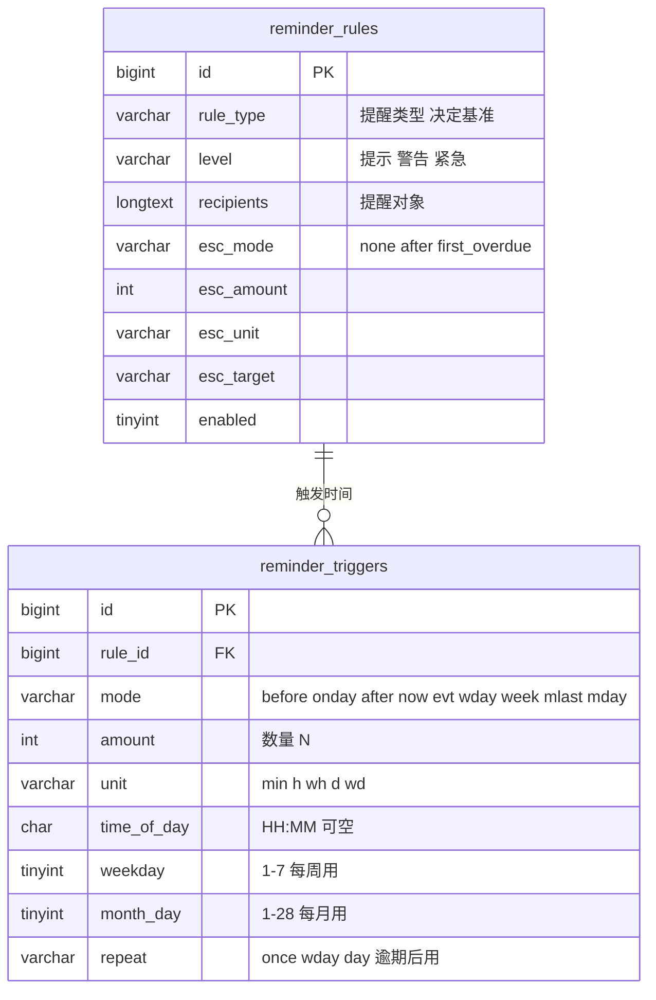

> [!NOTE]
> 提醒规则（下发事项未读、下发指令到期、下发指令逾期）和其他规则一起列在“系统管理 → 提醒规则”，单位负责人可以按 13.3 的方式调整触发时间。去重键形如 `issue_due:issue#12:user#5:D-1`，同一个触发点只发一次。

<a id="device"></a>

## 14 设备检测（两层方案）

网页只能拿到浏览器允许的信息。硬件信息由单位授权、用户知情的采集客户端上报。

```mermaid
sequenceDiagram
  participant A as 设备管理员
  participant S as OMPS 服务器
  participant C as 采集客户端
  participant N as 通知中心
  A->>S: 登记设备 生成一次性注册码
  A->>C: 在授权设备上安装 输入注册码
  C->>S: 注册 换取设备令牌
  S-->>C: 令牌 和 允许采集的项目清单
  loop 开机时 和 每天一次
    C->>S: 上报 计算机名 系统 CPU 内存 硬盘 主板 显示器 网卡 键盘 鼠标
    S->>S: 与上次快照比较哈希
    alt 有差异
      S->>S: 与登记部件比对 生成异常记录
      S->>N: 通知设备管理员 和 单位负责人
    end
  end
  
```

> [!WARNING]
> **边界：** 客户端只采集管理员在采集范围中列出的硬件信息，不采集键盘输入、屏幕、文件、浏览记录（“键盘”“鼠标”两项只记外接设备的型号和序列号）。采集范围在设备详情页公开显示。第一层（网页）只记录登录账号、时间、IP、浏览器，不当作硬件检测。

<a id="dynamic"></a>

## 15 自定义：字段、统计、主题与 Banner

超级管理员在“系统管理 → 自定义”一个页面里完成，分四个子页：“字段设计”给人员档案、设备档案、计划加字段；“统计页面设计”设计统计页面；“系统主题”设置名称、Logo、主色调、菜单和顶部栏颜色、默认主题；“Banner 管理”上传和替换登录页图片。不再提供“扩展子系统”。

```mermaid
flowchart LR
  CFG["新增字段 例如 爱好 可搜索 可统计"] --> META[("custom_fields")]
  META --> FORM["新增 编辑表单"]
  META --> DET["详情"]
  META --> LIST["列表列"]
  META --> SRCH["搜索"]
  META --> STAT["统计页面"]
  META --> EXP["导出"]
  FORM -- "按类型校验后保存" --> VAL[("custom_field_values")]
  VAL --> DET & LIST & SRCH & STAT & EXP
  
```

- **可以加字段的对象：** 人员档案、设备档案、计划。
- **类型化存储：** 值按类型存入对应列，可以正确比较、排序和求和；不修改表结构。
- **受控统计：** 统计页面保存的是查询定义，由系统生成参数化 SQL，并自动套用查看人的数据范围；不能写 SQL。

<a id="i18n"></a>

## 16 多语言设计

目标：切换语言后，界面上由系统产生的每一处文字都是所选语言，不夹杂其他语言。

> [!WARNING]
> **对 v0.1 的修正：** 原设计写的是“缺少翻译时显示默认语言”，这会让英文界面里出现中文，和目标冲突。现在改为用“启用前必须翻译完整”和“自动检查”两道关口，从源头上杜绝缺失翻译。动态字段原来只有 `label_zh / label_en` 两列，只能支持两种语言；现在改为统一存入翻译表，可以支持任意数量的语言。

### 哪些文字要翻译

| 来源 | 包括 | 存放位置 |
|---|---|---|
| 程序中固定的文字 | 菜单、按钮、表头、表单标签、占位提示、帮助说明、确认框、成功/失败提示、表单校验错误、接口错误、状态栏、空列表提示、分页、状态名称、通知模板、导出表头、打印页和 Word 模板、日期和数字格式 | JSON 语言包 `resources/languages/{语言}/{模块}.json`，PHP 用 `__()`，JavaScript 用 `t()`，读取同一份文件 |
| 后台配置产生的文字 | 自定义菜单名、角色名、数据字典项、动态字段标签和选项、统计页面标题、审批节点名、提醒规则名、Banner 文案 | 数据库 `translations` 表（命名空间、键、语言、译文），每种已启用语言一条 |
| 用户录入的业务内容 | 人员姓名、计划标题、日报正文、维修描述等 | 按原样显示，不自动翻译。确实需要双语的字段（如单位名称）可以设为“多语言字段”，录入时每种语言各填一份 |

### 存代码，不存文字

- 状态、类型、字典项在数据库里只存代码（如 `submitted`），显示时按当前语言翻译。
- 通知只保存“翻译键 + 参数”（如 `notify.report_missing` + 日期），由查看人的语言渲染。因此切换语言后，历史通知也会显示为新语言。
- 操作日志保存动作代码和字段键，查看时翻译成当前语言；修改前后的业务值按原样显示。

### 系统生成的提示：一句一键，参数分两种

通知、待办、督促提醒、操作日志、状态和类型名称都是系统生成的， **切换语言后必须全部变成该语言**；只有用户自己写的内容（姓名、计划名称、记事和下发事项的标题与正文、回复、业绩内容）按原样显示。

| 保存的内容 | 简体中文显示 | English 显示 |
|---|---|---|
| notify.profile_changed<br>name = 王晓（用户内容）<br>field = 联系电话（系统术语） | 王晓 修改了“联系电话”，需要审核 | 王晓 changed “Phone”; review needed |
| notify.issue_sent_need<br>name = 李建国，title = 报表功能上线前自测清单，due = 2026-11-20 17:30 | 李建国 下发了指令“报表功能上线前自测清单”，2026-11-20 17:30 前完成 | 李建国 sent you the instruction “报表功能上线前自测清单”, due 2026-11-20 17:30 |
| 类型 type.license / 来源 src.device / 级别 warning | 许可证到期 · 设备管理 · 警告 | License expiring · Devices · Warning |

- **整句是一个翻译条目** （如 `notify.profile_changed`），不同语言的语序可以不同，参数用 `{name}` 这样的占位符放进句子。
- **参数分两种：** 用户内容原样放进去；系统术语（字段名、部件名、角色名、状态等）也是翻译条目，按当前语言显示，如“联系电话 → Phone”“硬盘 → hard disk”。
- 历史通知、待办和日志也按查看时的语言显示，切换语言后已有的消息一起变。
- 下拉选项、单选多选、列表里的字典值（性别、设备类别、调动类型、权限动作、字段类型、图表类型、数据范围、角色名称等）都走同一套术语翻译。
- 菜单管理、字段设计等页面的名称列只显示当前语言，其他语言的名称在编辑表单或“多语言管理”里维护。
- 新增一种语言时，这些条目全部出现在“翻译条目”里待填写；没填的会记入“缺失翻译”，完成度不到 100% 不能启用。

### 默认语言和个人语言

| 项目 | 规则 |
|---|---|
| **默认语言** | 由 **超级管理员** 设置：“多语言管理 → 语言列表”中对已启用的语言点“设为默认”，或在“系统设置 → 基本信息 → 默认语言”中选择（同一个设置）。只能选已启用（翻译 100%）的语言；修改记入审计日志 |
| **谁用默认语言** | 登录页，以及所有 **没有自己选择语言** 的用户。默认语言改了，这些用户下次打开页面就变成新语言 |
| **个人语言** | 每个用户在右上角语言菜单里选择：第一项“跟随系统默认（当前默认语言）”，下面是已启用的各语言。选择保存在本人账号，只影响本人，换电脑登录也保持；选回“跟随系统默认”即恢复 |
| **登录页** | 显示默认语言；在登录页切换的语言，登录后作为本人的选择保存 |
| **原文语言** | 系统文字按简体中文编写，“翻译条目”的原文列始终是简体中文，与默认语言是哪种无关。原文语言不能删除，但可以停用；任何语言都可以停用，只要还有一种启用的语言。停用默认语言时，系统自动把列表里第一个启用的语言设为默认（v0.47） |

### 多语言管理页面

- **新增语言后怎么翻译：** 在“语言列表”点“新增语言”（如 ja-JP 日本語），创建后直接进入“翻译条目”。页面顶部选择“翻译为：日本語”，表格显示 翻译键 · 模块 · 原文（默认语言）· 参考（English）· **译文（日本語）输入框**；可以筛选“只看未翻译”，填完点“保存修改”，顶部和语言列表上的完成度随之更新。语言列表每行也有“编辑翻译”图标直接跳到该语言。
- 不论以后新增几种语言，都是这一个页面：每次只翻一种语言，表格不会越来越宽。
- 翻译列表列出系统的 **全部条目**，包括上表前两类，不只是菜单。可以按模块筛选（组织、人员、计划、业绩、设备、系统……），也可以按类型筛选（菜单、按钮、提示、错误、通知、状态、字典、动态字段……）。
- 每条显示所有语言的译文，缺失的标红；可以筛选“只看缺失”。
- 可以导出为 Excel 交给翻译人员，翻译完成后再导入；导入前先预检，键不存在或格式错误的行不会导入。

### 防止出现其他语言

| 关口 | 做法 |
|---|---|
| 启用语言 | 完成度必须达到 100% 才能启用，缺一条也不行。完成度 = 已翻译条目 ÷ 全部条目，两类来源都计入。 |
| 新增配置 | 新增菜单、字典项、动态字段、选项、角色等时，表单要求填写所有已启用语言的名称，否则不能保存。 |
| 开发检查 | `php omps i18n:check` 做两项检查：一是代码里用到的每个翻译键在所有语言文件中都存在；二是扫描视图、PHP 输出和 JavaScript，找出没有经过翻译函数的硬编码中文或英文。从第一阶段起作为每个阶段的验收项目。 |
| 页面巡检 | 自动测试用每种语言打开全部页面和弹窗，检查是否出现非本语言的文字（标记为用户录入内容的区域除外）。 |
| 最后保护 | 万一运行时仍然找不到某个键：开发和测试环境显示醒目的 `⟦键名⟧`，便于发现；生产环境记录缺失并通知管理员。有前面几道关口，正常情况下不会走到这一步。 |
| 浏览器自带控件 | 浏览器自带的文件选择按钮、日期选择框跟随浏览器语言，程序无法控制。系统改用自己的上传按钮和日期控件（随项目附带的本地 JS 文件，不需要安装），并在页面上设置 `<html lang>`。 |

<a id="ui"></a>

## 17 界面布局线框图

示意：人员档案列表页，右侧抽屉正在编辑一个人。表中姓名为示例数据。

> [!NOTE]
> **v0.7 可操作原型：** [OMPS 界面原型](https://claude.ai/artifact/6hp6ExQB6SKdTA6eR2aCvD) 已按本设计更新：4 个角色和兼任设备管理员、我的任务、计划与业绩树、写业绩弹窗、可修改和批量通过的审核、逐级列出的综合报告。

> [!NOTE]
> **可操作原型：** [OMPS 界面原型](https://claude.ai/artifact/6hp6ExQB6SKdTA6eR2aCvD)。它包含登录页和全部 8 个菜单分组下的全部页面（共 48 个页面和子页），可以切换 5 种演示身份，查看不同角色的菜单和数据范围。新增、编辑、删除确认、审核、计划分解、业绩汇总与版本对比、动态字段、动态子系统、主题、语言、备份恢复都能实际操作，全部为示例数据。

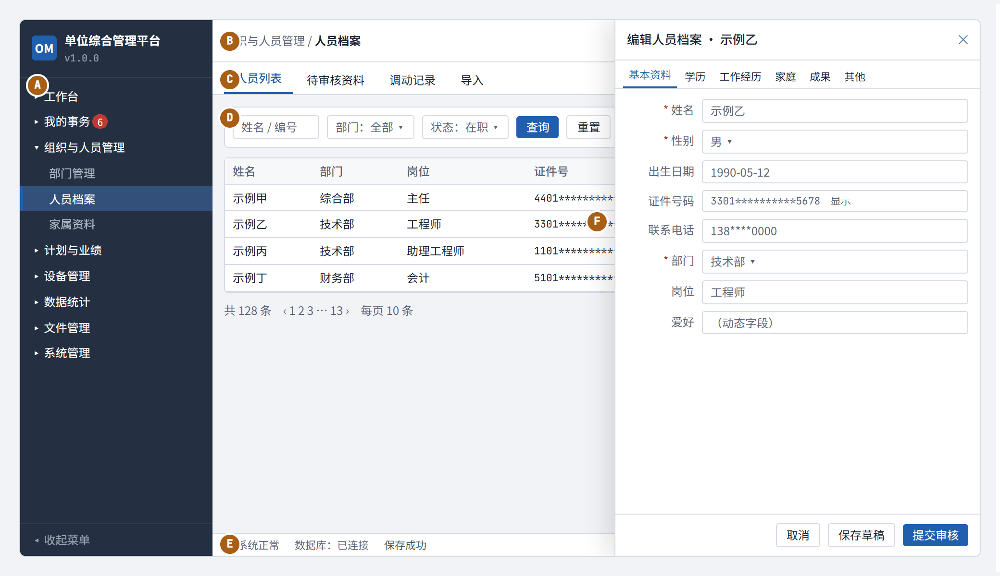

- **A** 左侧树状菜单，宽 240px，可收起到 64px 只显示图标；按权限动态生成，支持多级。
- **B** 顶部工具栏 56px：面包屑、铃铛、待办、语言、主题、用户菜单。
- **C** 子选项栏：只放子选项标签，不再重复页面名称（页面名称已在顶部栏显示）。没有子选项的页面不显示这一栏。
- **D** 主内容区：搜索栏 → 操作按钮 → 表格 → 分页，所有列表页结构一致。搜索栏统一为：搜索框 + “筛选”按钮（弹出面板：业务筛选、时间、搜索范围）+ 已生效条件标签，右侧是操作按钮；分页栏左侧“共 N 条”，右侧每页条数（10 / 20 / 30 / 50 / 100）和 « ‹ [页码] / 总页数 › »（页码可输入跳转）。没有搜索条件和按钮的页面（如待办事项）不显示搜索栏，不留空白条。所有表格的行内操作都用图标按钮，右对齐、顺序固定、空位对齐，见本节“行内操作按钮”。
- **E** 底部状态栏 28px：系统状态、数据库、操作结果、当前用户、时间。
- **F** 右侧抽屉：新增、编辑、查看用。宽 560px，复杂表单 860px，表单分组用页签。

证件号点“显示”时，需要有明文查看权限，并写审计日志。第一阶段铃铛会显示，但通知功能在第五阶段才实现；在那之前点击铃铛会提示“通知中心将在第五阶段启用”，不放空按钮。

### 行内操作按钮（所有页面统一）

所有列表的每一行，操作按钮一律用图标按钮，放在最右边的“操作”列，右对齐。

- **顺序固定：** 查看 → 业务操作（下载、通过、退回、调动等）→ 添加 → 编辑 → 删除，删除永远在最右边。
- **位置对齐：** 某一行没有的操作留出空位，同一张表里各行的同一种图标上下对齐。
- **名称提示：** 鼠标悬停显示按钮名称；“我的任务”“计划与业绩”表格下方另有图标说明。
- **例外：** 页面级按钮（如“新增人员”“导出”“批量通过”）仍用文字按钮，放在表格上方的工具栏。

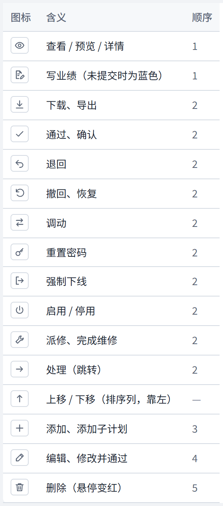

### 跳转定位（所有页面统一）

从通知、铃铛、待办、督促条点“查看”或“处理”时，系统直接打开 **正确的页面和子页**，并把 **要看的那一条** 突出显示，不用自己在列表里找。

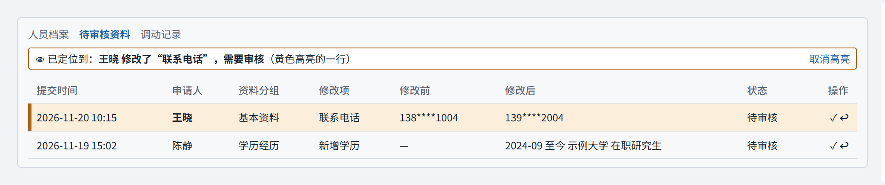

| 规则 | 说明 |
|---|---|
| **每条消息带目标** | 通知和待办都记录三样东西：页面、子页、具体记录（如“人员档案 → 待审核资料 → 王晓的联系电话申请”）。新增模块时发消息必须带上目标 |
| **打开以后** | ① 切到对应子页；② 如果有筛选条件把它挡住，自动清空筛选；分页时自动翻到它所在的那一页；树形页面自动展开它的上级、时间筛选改为“全部”；左右分栏的页面直接选中它；③ 滚动到屏幕中间；④ 黄色高亮并闪 3 下 |
| **定位条** | 页面顶部显示“已定位到：……（黄色高亮的一行）”，点“取消高亮”或离开页面后恢复正常 |
| **找不到时** | 记录已被处理或删除时，照常打开页面，底部状态栏提示“要查看的内容已不在这里（可能已处理或已删除）” |
| **例子** | 王晓修改联系电话 → 人员档案 · 待审核资料 · 王晓那一行；设备许可证到期 → 设备档案 · 该设备；硬盘变化 → 使用与监测 · 异常记录 · 该条；业绩待审核 → 业绩审核 · 该条；下发的指令 → 下发事项 · 选中该项；提交的记事 → 记事本 · 收到的记事 · 选中该条；计划到期 → 计划与业绩 · 展开到该计划 |
| **不打扰** | 闪动只在刚跳转时出现；系统设置为“减少动态效果”的电脑上只高亮不闪动 |

### 工作台（按角色显示）

工作台只给单位负责人、部门负责人和超级管理员；普通成员登录后直接进入“我的任务”。每个人看到的指标和范围都按自己的职责来定。

| 角色 | 顶部 4 个指标（点击进入对应页面） | 左侧主区 | 右侧 |
|---|---|---|---|
| **单位负责人** | 待我审核（部门负责人提交的业绩）· 全单位计划平均完成 · 滞后任务 · 今天已写业绩（人数） | **各部门情况**：每个部门的负责人、人数、计划平均完成、滞后任务、今天已写业绩、待审核<br>**单位重点计划**：单位和各部门的长期计划、单位年度计划，带时间进度和状态 | 待办事项 · 最新通知 · 设备概况（兼任设备管理员时） |
| **部门负责人** | 待我审核（成员提交的业绩）· 本部门计划平均完成 · 滞后任务 · 今天已写业绩（本部门） | **本部门成员**：每人今天的计划、今天的业绩、本周完成、待我审核<br>**本部门计划**：本部门长期和年度计划，滞后的排在前面 | 待办事项 · 最新通知 |
| **超级管理员** | 同单位负责人 | 同单位负责人 | 另加 **系统状态**：最近备份、在线用户、定时任务、缺失翻译 |
| 普通成员 | 不显示工作台，登录后进入“我的任务”（第 09 节） |   |   |

**滞后** 的判断：计划完成百分比比时间进度低 10% 以上。进度条上的竖线表示时间进度，一眼就能看出哪些计划落后。

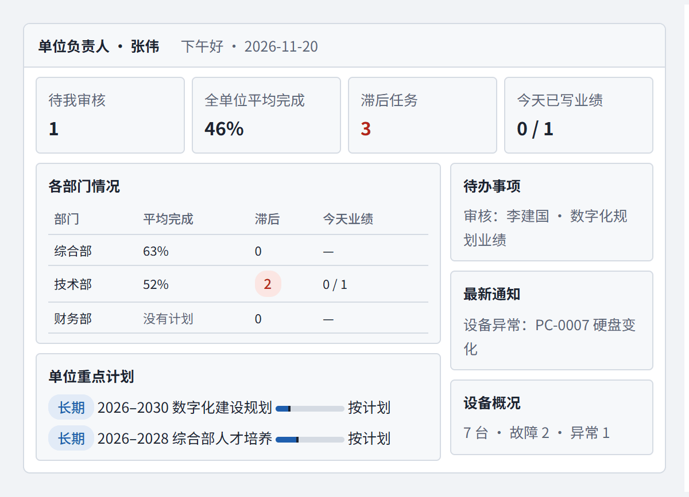

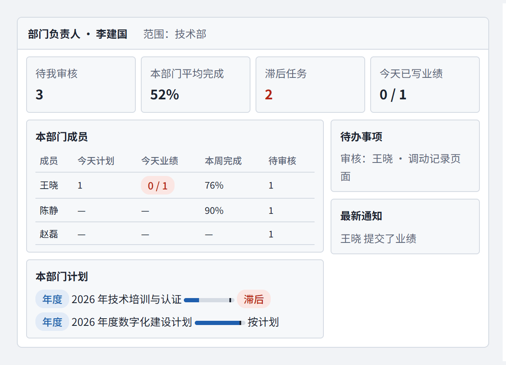

### 全部页面清单

左侧菜单的全部页面，按角色显示。

| 菜单分组 | 页面 | 谁能看到 | 主要操作 | 章节 |
|---|---|---|---|---|
| — | 登录页 | 所有人 | 登录、语言切换 | 06 |
| — | 工作台 | 单位负责人、部门负责人 | 按角色显示：单位负责人看各部门情况和单位重点计划；部门负责人看本部门成员和本部门计划；超级管理员另加系统状态。普通成员登录后直接进入“我的任务” | 17 |
| **我的事务** 新<br>替代原“消息中心”，排在工作台下面 | **待办事项** | 所有人 | “待处理”：所有需要我处理的事：待写业绩、待审核、下发的指令、待阅记事等；处理完自动移出。“已处理”：我处理过的事项和结果，最新的在前 | [13](#remind) |
| 〃 | **下发事项** 新增：收到的 · 我下发的（负责人） | 所有人接收；负责人下发 | 下发提示、文档、有期限的指令；完成并回复；催办、撤回；自动督促 | [10.9](#report) · [13](#remind) |
| 〃 | **记事本** 新增：我的记事 · 收到的记事（负责人） | 所有人 | 写自己的记事，默认仅自己可见；提交给上级，上级写批示、标记已阅 | [10.7](#report) |
| 〃 | **我的通知** | 所有人 | 铃铛里所有消息的完整列表（上级下发、下级报送、系统提醒）；标记已读、跳转处理 | [13](#remind) |
| 组织与人员管理 | 部门管理 | 单位负责人、超级管理员 | 部门树（部门下可以有小组）、排序、成员调动 | 07.1 |
| 〃 | 人员档案 | 部门负责人以上；成员看本人 | 档案表单、证件号脱敏、资料审核、导入；部门负责人新增本部门人员、把下属移出本部门 | 07.2 |
| 〃 | 家属资料 | 单位负责人、超级管理员 | 高敏感，查看记日志 | 07.2 |
| 计划与业绩 | **我的任务** | 所有人 | 分配给我的任务和我的子计划；＋子计划、写业绩 | [09](#agg) |
| 〃 | **计划与业绩** | 部门负责人以上 | 长期到日计划的树；筛选本周、本月、本年；新建主计划、添加子计划、填写完成百分比和业绩 | [09](#agg) |
| 〃 | 业绩审核 | 部门负责人、单位负责人 | 修改并通过、退回、批量通过 | [09](#agg) |
| 〃 | 综合报告 | 所有人（范围按角色） | 两个子页： **报告列表** （预览、编辑、删除、手动新建、上传和删除报告文档）· **按条件生成** （任意时段 × 任务 × 人员；逐条列出子任务业绩；打印、下载） | [10](#report) |
| 设备管理 | 设备档案 | 兼任设备管理员、单位负责人、超级管理员；所有人可在工作台报修 | 登记、部件、许可证、报修 | 07.5 |
| 〃 | **使用与监测**：使用记录 · 异常记录 · 采集客户端 · 采集范围 | 〃 | 一个页面四个子页：查询使用记录、确认硬件变化、管理采集客户端和采集范围 | 14 |
| 〃 | **故障与维修**：故障登记 · 维修记录 | 〃 | 一个页面两个子页：登记故障、派修、完成维修 | 07.5 |
| 数据统计 | 人员统计 · 部门统计 · 自定义统计 | 单位负责人、部门负责人 | 图表、导出、打印 | 15 |
| — | **文件管理** 新增：全部文件 · 我上传的 · 重复文件 · 回收站 | 所有人（范围按角色） | 按平台结构的文件夹浏览；预览、下载；删除自己的文件；清理重复；回收站恢复（上传在写业绩时进行） | [11](#files) |
| 系统管理 | 用户管理 | 单位负责人、超级管理员 | 建账号、分配 4 种角色之一、勾选兼任设备管理员、重置密码、强制下线 | 06 |
| 〃 | 角色权限（内置 4 个 + 可新增、编辑、删除自定义角色）· 菜单管理 · **自定义** （字段设计 · 统计页面设计 · 系统主题 · Banner 管理）· **提醒规则** （原“消息中心 → 提醒设置”，单位负责人也可调整）· 多语言 · 操作日志 · 数据备份 · 系统设置 | 超级管理员 | 技术操作 | 06 · 15 · 16 |
| 用户菜单 | 个人资料 · 提醒偏好 · 修改密码 | 所有人 | 查看本人档案；免打扰时段等个人提醒偏好；修改密码 | 06 |

> [!NOTE]
> **左侧菜单规则：** 个人的、需要马上处理的放在最上面的“我的事务”（待办事项 · 下发事项 · 记事本 · 我的通知），每项右侧用红色数字显示待处理数量，组收起时显示合计；业务页面按模块分组在下面。普通成员只看到 4 组：我的事务、组织与人员管理、计划与业绩、文件管理。 
 **收起菜单时：** 只显示图标，当前所在的组图标高亮，有待处理事项的图标右上角显示红色数字；点某个组的图标，直接打开该组上次使用的页面（第一次打开该组的第一个页面），菜单保持收起，同时在图标右侧弹出该组的页面列表，可以直接切换。手机等窄屏上菜单为抽屉式，不受影响。

> [!NOTE]
> 已取消的页面：单位管理、长期/年度/季度/月度/周/日计划六个独立页面（合并为“计划与业绩”）、我的工作（改为“我的任务”）、业绩统计、数据权限、审批流程、动态模块设计、扩展子系统。

<a id="dirs"></a>

## 18 目录结构

> [!TIP]
> 本章是设计时的目录规划。实际的文件和每个目录的作用见 [CODE_STRUCTURE.md](CODE_STRUCTURE.md)。

```text
OMPS/
├── app/
│   ├── Core/              # 内核：App, Router, Request, Response, Container, View, Validator, Session, Csrf
│   ├── Database/          # Connection, QueryBuilder, Transaction, Migrator, DataScope
│   ├── Middleware/        # Auth, Csrf, Locale, Permission, SecurityHeaders, OperationLog
│   ├── Engines/           # Permission, Workflow, Notification, Aggregation, Metadata, File, I18n, Audit
│   ├── Modules/           # 每个业务模块自成一体
│   │   ├── System/        #   用户、角色、菜单、设置、日志
│   │   │   ├── Controllers/  Services/  Repositories/  Policies/  views/  routes.php  permissions.php  module.json
│   │   ├── Organization/
│   │   ├── Personnel/     #   第二阶段
│   │   ├── Plan/          #   第三阶段
│   │   ├── Performance/   #   第四阶段
│   │   ├── Device/        #   第六阶段
│   │   └── Dynamic/       #   第七阶段
│   └── Helpers/
├── config/                # app.php, database.php, security.php, upload.php（从 .env 读取）
├── database/
│   ├── migrations/        # 2026_11_20_000001_create_departments.php …
│   └── seeds/             # 权限、预设角色、菜单、字典（不含任何账号密码）
├── public/                # Apache 文档根目录，唯一可访问的目录
│   ├── index.php
│   ├── .htaccess
│   └── assets/            # bootstrap, echarts, 本系统 css/js，全部本地
├── resources/
│   ├── views/layouts/     # 主框架：菜单、顶栏、状态栏、抽屉
│   ├── js/                # omps.js：api(), drawer(), confirm(), i18n(), table()
│   └── languages/
│       ├── zh-CN/         # common.json, menu.json, system.json, org.json …
│       └── en-US/
├── routes/                # web.php, api.php（汇总各模块 routes.php）
├── storage/               # 不可通过 URL 访问
│   ├── uploads/  backups/  logs/  temp/  cache/
├── scripts/               # scheduler.php, backup.php, cleanup.php, check_env.php
├── omps                   # 命令行入口：php omps migrate | seed | admin:create | …
├── tests/                 # 自带轻量测试运行器 + 权限隔离测试
├── docs/
├── .env.example
└── README.md
```

每个模块带一个 `module.json`（编码、版本、依赖、权限清单、菜单清单）。以后新增模块或升级，只需放入模块目录，然后运行 `php omps migrate`，系统会登记版本，并在迁移前自动备份。

<a id="extras"></a>

## 19 补充功能的处理

| 功能 | 处理 | 阶段 |
|---|---|---|
| 审批 | 审核关系固定（成员 → 部门负责人 → 单位负责人），不做流程设计器；资料修改审核同样处理 | 第二、四阶段 |
| 人员调动历史 | 调动部门、岗位时自动记录（personnel_assignments） | 第一阶段 |
| 业绩评分 | 部门负责人审核时可打分（可选），暂不做评分模板 | 第四阶段 |
| 目标对比 | 并入综合报告：按任务列出完成百分比和业绩 | 第四阶段 |
| 文档生成 | 综合报告和人员登记表的 Word 下载，可用上传的 Word 模板排版 | 第八阶段 |
| 数据导入 | Excel 导入人员、设备（先预检再导入） | 第二、六阶段 |
| 多单位管理 | 不需要。系统只服务一个单位；数据库保留 org_id 字段（固定为 1）以备将来扩展 | — |
| 扩展子系统 | 不需要，已取消。保留动态字段和统计页面 | — |
| 系统升级机制 | 迁移工具、模块版本登记、升级前自动备份 | 第一阶段 |

<a id="phase1"></a>

## 20 实施计划与完成情况

系统分九个阶段开发，每个阶段都在 PHP 7.2.3 / 8.2 / 8.4 上通过全部自动测试后才进入下一阶段。本章保留第一阶段的实施计划和每个阶段完成时的记录，便于了解各功能是何时、按什么验收标准完成的。

### 20.1 第一阶段实施计划：基础框架

完成后可以创建超级管理员、登录退出、建部门、建用户并分配 4 种角色，不同角色看到不同菜单，并且无法通过改 URL 读到范围外的数据。

#### 建表

migrations · module_registry · departments · personnel_profiles（基础字段） · personnel_assignments · users（含 role_id、is_device_admin） · user_sessions · login_logs · login_attempts · roles（固定 4 个） · permissions · role_permissions · menus · operation_logs · audit_logs · system_settings（含单位信息） · dictionaries / dictionary_items · languages · data_versions

#### 工作内容

1. **内核：** 自动加载、.env 配置、路由（含 rewrite 降级）、中间件、视图、统一异常处理和 JSON 响应、输入校验。
2. **数据层：** PDO 连接（连接时固定字符集、出错方式、sql_mode，见第 01 节编码规则）、参数化查询构建器、Repository 基类、事务、软删除、按角色固定的数据范围过滤。
3. **命令行工具：** `php omps migrate / migrate:status / seed / admin:create / env:check / compat:check / test`。`compat:check` 扫描代码中不兼容的写法（第 01 节编码规则里列出的函数和语法）；`test` 是自带的测试运行器（不使用 Composer 和 PHPUnit）。超级管理员由命令行创建，密码当场输入，没有默认密码。
4. **认证与会话：** 登录、退出、失败锁定、会话存数据库、强制下线、改密后其他会话失效、登录日志。
5. **部门管理：** 单位信息设置；部门树（部门下可以有小组）、排序、人员基础信息、调动并写入历史。
6. **用户与角色：** 用户增删改、停用；4 个固定角色；“兼任设备管理员”勾选；超级管理员可微调角色的功能权限。
7. **菜单与界面：** 按角色生成左侧菜单；顶部工具栏、状态栏、抽屉、弹窗、表格组件。
8. **多语言与日志：** JSON 语言包、`__()` / `t()`、缺失翻译检查；操作日志和审计日志写入与只读查看。
9. **测试与文档：** 权限和数据隔离自动测试、设计文档、安装说明、XAMPP 配置说明、验收报告。所有自动测试在 XAMPP 7.2.3 和 XAMPP 8.x 两套环境上各跑一遍，验收报告分别列出两边的结果。
10. **兼容测试环境：** 开发机上装两套 XAMPP（7.2.3 和 8.x，装在不同目录，轮流启动），共用同一份程序目录，各用自己的数据库。

#### 验收清单

| # | 验收项 | 方式 |
|---|---|---|
| 1 | 命令行创建超级管理员，登录、退出 | 手动 |
| 2 | 设置单位信息，建 3 个部门（其中一个有小组），排序后刷新仍保持 | 手动 |
| 3 | 建 4 个用户：单位负责人、部门负责人、普通成员（勾选兼任设备管理员）、普通成员 | 手动 |
| 4 | 4 个用户分别登录，菜单不同；兼任设备管理员的成员多出“设备管理”菜单 | 手动 + 自动 |
| 5 | 部门负责人改 URL / 接口参数读取其他部门人员，返回空或 404，并有越权日志 | 自动测试 |
| 6 | 普通成员直接调用用户管理接口，返回 403；单位负责人不能打开数据备份等技术页面 | 自动测试 |
| 7 | 密码连续输错被锁定；改密后另一浏览器的会话失效；强制下线生效 | 手动 + 自动 |
| 8 | 中英文切换后，页面上不出现另一种语言的文字；`php omps i18n:check` 通过 | 手动 + 自动 |
| 9 | CSRF：不带令牌的提交被拒绝；XSS：在姓名中输入脚本，页面原样显示文字 | 自动测试 |
| 10 | 重新运行 migrate 不影响已有数据 | 自动测试 |
| 11 | 同一份代码，在 XAMPP 7.2.3（PHP 7.2.3 + MariaDB 10.1.31）和 XAMPP 8.x（PHP 8.x + MariaDB 10.4 系列）上：`php omps migrate` 成功、`php omps test` 全部通过、第 1–10 项手动检查结果一致 | 手动 + 自动 |
| 12 | 两套环境在 `error_reporting(E_ALL)` 下走完全部页面和接口，PHP 错误日志中没有任何 Notice、Warning、Deprecated；`php omps compat:check` 没有发现问题 | 自动测试 |
| 13 | 严格模式：写入超长文字、数字字段写入文字时，服务层先拦截并提示；两套环境的提示相同，数据库里没有被截断的数据 | 自动测试 |
| 14 | 升级演练：在 7.2.3 环境录入数据并上传附件 → 导出数据库、复制程序和附件目录 → 导入 8.x 环境 → 运行 `migrate`、`env:check` → 登录核对数据、附件、中文和生僻字（如“𠮷”）完全一致，不改任何代码 | 手动 |

<a id="phase1done"></a>

### 20.2 第一阶段完成情况（2026-11-21）

代码在 `d:\Work\Others\OMPS`。验收清单第 1–14 项中，能自动化的都写成了自动测试（`php omps test`，32 项）；页面另用无界面浏览器按角色逐页检查，没有脚本错误。

| # | 验收项 | 结果 |
|---|---|---|
| 1 | 命令行创建超级管理员，登录、退出 | 通过 admin:create、登录退出测试、登录日志 |
| 2 | 单位信息、部门树、排序后保持 | 通过 部门增改删、上下移、移动整棵子树、不能形成循环、有人员或小组时不能删 |
| 3 | 建 4 种角色用户、兼任设备管理员 | 通过 新建账号得到一次性临时密码，首次登录必须改密 |
| 4 | 各角色菜单不同，兼任设备管理员多出设备菜单 | 通过 |
| 5 | 部门负责人改 URL / 参数读其他部门 → 空或 404，并有越权日志 | 通过 |
| 6 | 成员调用户管理接口 403；单位负责人打不开技术页面 | 通过 |
| 7 | 输错锁定、改密后其他会话失效、强制下线 | 通过 另有同 IP 失败过多限制、闲置超时 |
| 8 | 切换语言后不出现另一种语言；i18n:check 通过 | 通过 英文下各页面只剩用户录入的内容（人名、部门名等） |
| 9 | CSRF、XSS | 通过 另加内容安全策略（禁止页面内联脚本） |
| 10 | 重复 migrate 不影响数据 | 通过 |
| 11 | XAMPP 7.2.3 和 8.x 两套环境结果一致 | 通过 PHP 7.2.3 / 8.2.36 / 8.4.28 全部测试通过；MariaDB 10.4 也通过 |
| 12 | E_ALL 下没有任何提示；compat:check 通过 | 通过 开发和测试环境把任何提示都当错误抛出 |
| 13 | 严格模式：超长、类型不对被拦截 | 通过 |
| 14 | 升级演练（7.2.3 → 8.x 迁移数据） | 部分 同一个数据库已在 PHP 7.2.3 和 8.x 下交替使用；完整的导出、导入演练在单位服务器升级前做 |

#### 与设计相比的调整

- 界面不用 Bootstrap（不使用任何第三方框架），沿用原型的样式；日期用系统自带选择器。
- 会话不用 PHP 自带的 session，而是数据库中的会话表：Cookie 只放随机令牌，数据库只存令牌的哈希；改密码、强制下线时整体失效。
- “人员档案”第一阶段只有基础字段（工号、姓名、性别、部门、岗位、电话、入职日期、状态）、任职记录，以及 v0.29–v0.30 的新增 / 移出 / 调动规则；完整档案、资料审核、导入在第二阶段。
- 菜单管理页面、多语言管理页面放到后续阶段；第一阶段菜单和语言由模块文件和语言包提供。

<a id="phase2done"></a>

### 20.3 第二阶段完成情况：完整人员档案（2026-11-22）

在第一阶段基础上新增 Personnel 模块。自动测试共 40 项（新增 7 项人员档案测试），在 PHP 7.2.3、8.2.36、8.4.28 和 MariaDB 10.1.31、10.4.34 上全部通过；页面用无界面浏览器检查过，没有脚本错误。

| 功能 | 做法 |
|---|---|
| **完整档案** | 基本资料（照片、出生日期、民族、证件、电话、邮箱、现住址、户籍地址、备注）＋ 学历经历、工作经历、职称级别、获得成果、家庭资料、附件，在右侧抽屉里分页显示和编辑；每次修改留快照（data_versions）和修改前后记录，“修改历史”可查 |
| **证件号码** | AES-256-GCM 加密存储，另存 HMAC 指纹用于查重（同一证件号不能登记两次）和脱敏号码（4401\*\*\*\*\*\*\*\*\*\*1234）。不检查格式：文字、数字和其他字符都可以，最长 30 个字符（2026-11-23 起不再检查 18 位身份证的校验位）。列表、导出、日志只出现脱敏号码；“显示完整证件号”需要“人员档案 · 敏感资料”权限（本人除外），每次都写审计日志。密钥 APP_KEY 由 `php omps key:generate` 生成，必须随数据库一起备份 |
| **本人修改与审核** | 右上角“个人资料”。每个字段按规则（profile_field_policies）： **不可改** （姓名、部门、岗位、入职日期、备注，由管理员维护）、 **直接生效** （邮箱、现住址、照片、家庭资料）、 **需审核** （电话、证件、出生日期、户籍、学历、工作经历、职称、成果）。需审核的修改先存为申请，审核通过才写入档案；本人可以撤回未处理的申请，退回时能看到原因 |
| **审核关系** | 按第 06 节固定规则实现，不建流程设计器：有“人员档案 · 审核”权限、且数据范围包含此人的人可以审核，本人除外。所以成员的修改由部门负责人（以及单位负责人）审核，部门负责人的修改由单位负责人审核；单位负责人和超级管理员本人修改直接生效。人员档案页“待审核资料”子页显示数量，可逐条或批量通过、写原因退回 |
| **家属资料** | 电话和住址加密存储。菜单“组织与人员管理 → 家属资料”需要“家属资料 · 查看”；完整电话和住址需要“家属资料 · 敏感资料”，否则电话部分隐藏、住址不显示。每次查看列表或档案里的家属都写审计日志。本人在“个人资料”里维护自己的家属，直接生效 |
| **照片和附件** | 按第 11 节存到网站目录之外（`FILES_PATH`，如 D:\OMPS\files），文件夹与平台结构一致：人员档案\部门\小组\姓名\分组\文件。检查扩展名、大小和文件内容（伪装成图片的脚本会被拒绝）；本人重复上传同一文件只保存一份并引用；下载经过权限检查并记日志；只能删除自己上传的，删除后进回收站，`php omps cleanup` 清理 30 天以前的 |
| **批量导入** | “批量导入”子页：下载模板（.xlsx）→ 上传 .xlsx 或 .csv → 逐行检查（性别、部门是否存在且在管理范围内、证件号校验和重复、日期格式等），有问题的行标出原因 → 确认后只导入检查通过的行。表头中英文都认；部门写名称或“部门/小组”；Excel 在中文 Windows 上另存的 GB 编码 CSV 也能读 |
| **导出** | 需要“人员档案 · 导出”。按当前筛选导出 .xlsx，证件号只导出脱敏号码，导出操作写审计日志 |

#### 实现中发现并处理的问题

- XAMPP 7.2.3 的 php.ini 默认 `upload_max_filesize=2M`、`post_max_size=8M`。OMPS 在 `public/.htaccess` 中用 php_value 放宽到 50 MB，只影响 OMPS，不改 php.ini；已通过 Apache 实测上传 3 MB 文件。
- PHP 自带的 CSV 读取函数在部分区域设置下会把中文后面的逗号读错，改为自己解析 CSV。
- 照片改为“直接生效”，避免照片还要单独走审核流程，操作更简单。

<a id="phase3done"></a>

### 20.4 第三阶段完成情况：计划（2026-11-22）

新增 Plan 模块。自动测试共 45 项（新增 5 项计划测试），在 PHP 7.2.3、8.2.36、8.4.28 上全部通过；页面用无界面浏览器检查过，并实际走了一遍“部门负责人在季度计划下添加月计划”的操作。写业绩、业绩审核、完成百分比汇总和综合报告属于第四阶段。

| 功能 | 做法 |
|---|---|
| **计划树** | 长期 · 年度 · 季度 · 月 · 周 · 日（按日期自动判断，可以同级嵌套），保存在 plans（parent_id）和闭包表 plan_paths 中；每个计划有周期编码（2026、2026-Q4、2026-11、2026-W47、2026-11-20）、占上级比例、优先级、目标、工作内容。删除时连同下级一起删除（软删除，日志保留每个被删计划的名称） |
| **谁能建什么** | 有“计划 · 分配任务”权限的负责人：新建长期 / 年度主计划（单位负责人可选“单位计划”或某个部门，部门负责人默认本部门），在管辖范围内的计划下添加年度到日计划，执行人可多选（只能选管辖范围内的在职人员）。部门负责人可以在单位计划下分解本部门的计划，但不能修改单位计划本身。普通成员：只能在分配给自己的任务下添加季度及以下的子计划（执行人自动是本人），可以编辑、删除自己建的子计划，不能修改负责人分配的任务 |
| **看得到什么** | 全单位：全部计划；部门：本部门（含小组）的计划和单位计划；本人：分配给自己的和自己建的计划，上级计划以灰色显示作为背景。看不到的计划访问时返回 404 并记越权日志 |
| **我的任务** | 所有人。列出分配给我的任务和我在下面建的子计划，按本周 / 本月 / 本年 / 全部筛选，可搜索；负责人在这一页也能“＋ 新建计划”（执行人默认勾选本人） |
| **计划与业绩** | 有“分配任务”权限的人。整棵树，可按时间、部门、人员筛选和搜索；符合条件的计划的上级以灰色显示。每行：查看 · 添加子计划 · 编辑 · 删除，按权限显示 |
| **时间显示** | 按日期自动生成（整年、整季、整月、整周显示名称，否则显示日期）；可以点简写（2025–2030、2026 年、上半年、第四季度、11 月、第 47 周），保存为代码，切换语言时一起变；也可以自己填写（最多 20 字）。整月的时间段显示为“1–5 月”。新建时日期默认比上级低一级，可快速选择，并限制在上级计划范围内 |
| **提示** | 保存后提示：时间超出上级计划范围；同一上级下的子计划占比合计不是 100%。都不阻止保存 |
| **权限** | 新增权限组“计划”：查看、新增、编辑、删除、分配任务、导出。升级时已有的内置角色自动获得对应权限（只在这些权限第一次出现时分配，以后在“角色权限”里的调整不会被覆盖） |

#### 与设计相比的调整

- “添加子计划”用弹出表单，而不是在树里直接出现一行输入框：表单里能同时设置时间显示、执行人、目标和工作内容，操作更清楚。
- “完成”和“业绩”两栏放到第四阶段，和写业绩一起上线；现在“状态”一栏按日期显示未开始 / 进行中 / 已到期。

<a id="phase4done"></a>

### 20.5 第四阶段完成情况：业绩与综合报告（2026-11-22）

新增 Performance、Report 两个模块。自动测试共 52 项（新增 7 项：业绩 4 项、报告 3 项），在 PHP 7.2.3、8.2.36、8.4.28 和 MariaDB 10.1.31、10.4.34 上全部通过；页面用无界面浏览器检查过（中文、英文），并实际走了一遍“部门负责人写业绩并提交 → 单位负责人在业绩审核页通过 → 生成综合报告 → 下载 Word / Excel”。

| 功能 | 做法 |
|---|---|
| **写业绩** | 每个计划、每个执行人一份业绩：完成百分比、本任务业绩、遇到的问题、下一步、附件。可以保存草稿、提交、审核前撤回。弹窗上方列出本人在这个任务下各级子计划已写的业绩，打开时自动填入，可“引用到下面”；有子计划时显示“参考：子计划按占比计算为 n%”，点“采用”填入。附件按“计划与业绩 / 计划层级 / 人员”放在文件目录里，相同文件不重复保存 |
| **审核关系** | 固定：审核人有“业绩 · 审核”权限，数据范围覆盖提交人，且不是本人。成员的业绩由部门负责人（以及单位负责人）审核；部门负责人的由单位负责人审核；单位负责人的业绩提交后直接生效 |
| **业绩审核页** | 待审核 / 已审核两个标签，可按人员筛选、搜索。每行：查看 · 通过 · 修改并通过 · 退回。可勾选多条批量通过、批量退回（退回必须填原因，多条共用）。修改并通过可以改完成百分比、业绩文字，并可打分（可不填）、写审核意见；提交的原文保留在历史中。已通过的业绩也可以退回，退回后本人可以修改重新提交。每一次保存、提交、撤回、通过、修改、退回都留历史，并记操作日志和审计日志（修改记录前后内容） |
| **通过后再更新** | 已通过的业绩本人可以继续更新；新内容通过之前，完成百分比和报告仍使用上次通过的内容（数据库里单独保存“已通过版本”） |
| **完成百分比** | 只用已通过的业绩。计划完成 = 各执行人完成百分比的平均值；某人在这个计划上没有已通过的业绩时，按子计划占比加权计算（子计划占比合计不是 100% 时按实际合计折算），都没有时算 0。“我的任务”“计划与业绩”增加“完成”和“我的业绩 / 业绩”两栏；计划详情增加“业绩”标签，按人列出业绩 |
| **删除计划** | 成员删除自己的子计划时，如果下面有已提交或已通过的业绩，不能删除，提示先撤回（已通过的要负责人退回）；未提交的草稿和附件随计划一起删除，附件进回收站。负责人删除计划时，确认框列出将一起移除的业绩份数 |
| **综合报告** | 两个子页：报告列表（默认）· 按条件生成。条件：时段（本周 / 本月 / 本季度 / 本年 / 任意）、任务（全部或勾选）、人员（全部或勾选，按部门一键全选；成员固定为本人；部门负责人只能选本部门）。列出规则按 10.2：每个任务一节，本级业绩，再逐个列出时段内的下级任务；下级任务没有自己的业绩时，逐个分支往下找，按时间列出；只用已通过的业绩；同时选中任务和它的上级时只列一次。生成时保存数据快照，以后数据变化不影响已生成的报告 |
| **报告列表** | 只显示本人创建的报告；筛选全部 / 本周 / 本月 / 本年 / 自定义时段（报告时段完全落在范围内才显示）和名称搜索；预览、上传文档、编辑、删除。生成的报告只能改标题、开头说明、补充说明；手动报告可以改名称、时段、正文；每次保存一个版本，可以切换查看。打印用浏览器打印（A4 纸面），下载 Word（.docx，没有 zip 扩展时为 .doc）和 Excel 明细；每次打印、下载都记录。删除报告时，报告文档进回收站 |
| **权限** | 新增权限组“业绩”（编辑 = 写业绩，审核）和“综合报告”（查看，导出）。升级时内置角色自动获得：成员 写业绩、报告；部门负责人和单位负责人另有审核。菜单“计划与业绩”下新增“业绩审核”“综合报告”；工作台增加“待我审核的业绩”数字 |

#### 与设计相比的调整

- “已修改并通过”“已退回”等通知、每天 17:00 的写业绩提醒，属于第五阶段（通知与提醒）；目前提交人在“我的任务”的状态栏和写业绩弹窗里看到结果和退回原因。
- 9.4 中“在完成一栏直接改百分比”改为在写业绩弹窗里填写，避免绕过审核。
- Word 下载原定第八阶段，现在先提供简洁版（标题、条件、说明、各节业绩）；排版模板仍在第八阶段。
- 报告各节编号用“1、”“（1）”，中英文一致。
- “文件管理”页面（浏览、回收站恢复）还没有做；附件已按设计的目录结构保存，删除进回收站。

#### 顺带修正

- 第三阶段遗留：负责人编辑计划时如果请求里没有带执行人，服务端会误报“请至少选择一名执行人”。现在不带执行人表示不改执行人，并加了测试。

<a id="phase5done"></a>

### 20.6 第五阶段完成情况：我的事务与提醒（2026-11-22）

新增 Affairs 模块（版本 0.5.0）。自动测试共 58 项（新增 6 项：记事本、下发事项、审核与资料通知、日历与触发时间、定时提醒只发一次、提醒规则与偏好），在 PHP 7.2.3、8.2.36、8.4.28 和 MariaDB 10.1.31、10.4.34 上全部通过；页面用无界面浏览器检查过（中文、英文），实际走了一遍“部门负责人写记事提交给单位负责人 → 单位负责人下发指令 → 部门负责人阅读、完成并回复 → 单位负责人写批示、查看进度”，并检查了铃铛、弹出提示、督促条和跳转定位。

| 功能 | 做法 |
|---|---|
| **左侧菜单** | 工作台下面新增“我的事务”：待办事项 · 下发事项 · 记事本 · 我的通知，每项右侧红色数字（待办数、待处理的下发事项、未读的收到记事、未读通知），组收起时显示“待办 + 未读通知”。所有人都有，不需要单独授权 |
| **铃铛** | 右上角铃铛显示未读数，点开列出最近 8 条，可“全部标记已读”“查看全部通知”；点一条即标记已读并跳到对应页面和记录。页面每 60 秒询问一次（普通 AJAX），有新消息时右下角弹出 5 秒提示，浏览器标签标题前显示“(未读数)”。通知只保存“消息类型 + 参数”，按查看人的语言显示，切换语言后历史通知一起变 |
| **进铃铛的消息** | 上级 → 下属：下发提示 / 文档 / 指令、催办、撤回、记事已阅（含批示）、业绩通过 / 修改并通过 / 退回（带退回原因）、资料修改通过 / 退回。下属 → 上级：提交了记事、完成并回复（逾期完成会标出）、首次逾期名单、提交了业绩、提交了资料修改。系统：督促提醒、写业绩提醒、待审核提醒；部门负责人新增人员时告诉单位负责人和超级管理员；调出本部门时告诉单位负责人。自己的操作不会通知自己；提交后撤回，对方未读的消息自动收回 |
| **审核消息发给谁** | 按固定审核关系：有审核权限、范围覆盖提交人、不是本人；有部门负责人时只告诉部门负责人，没有时告诉单位负责人；技术用的超级管理员不收业务消息 |
| **待办事项** | 实时从业务数据读出，不另存：完成并回复的指令（逾期的排最前）、待阅的提示和文档、收到的记事、待审核的业绩、待审核的资料修改、被退回的业绩、今天的日计划和明天前结束的周 / 月 / 季 / 年计划还没提交业绩、调出后待安排部门的人员。处理完自动移出；每行“处理”直接跳到对应位置 |
| **记事本** | 左边列表（全部 / 仅自己 / 已提交，搜索），右边编辑；切换到别的记事时自动保存。按钮直接写着“提交给 某某”：成员 → 所在部门（向上找）负责人；部门负责人 → 单位负责人；单位负责人没有上级。提交后锁定，对方阅读前可撤回；对方“已阅”时可写批示，已阅后只能“复制为新记事”。负责人有“收到的记事”子页，未读数显示在标签上。任何接口都只返回“自己的，或提交给自己的”记事；日志只记标题和动作，不记正文 |
| **下发事项** | “收到的”（待处理 / 全部）和“我下发的”（有“下发事项 · 新增”权限才有，默认部门负责人和单位负责人）。一个表单：标题、内容、文档、接收人（按部门分组勾选，有“全部”“各部门负责人”快捷选择）、要求（只需阅读 / 需要完成并回复 + 截止时间）、更多选项里的督促频率。系统自动归类为提示、文档或指令。打开即已阅；指令写完成情况（可带附件）点“完成并回复”。下发人看进度（已阅 x/n 或完成 x/n、逾期人数），查看每个人的阅读、完成、回复、附件、已提醒次数和下次提醒时间；催办只发给没完成的人，同一人 1 小时内只能催一次；撤回后未完成的人收到撤回通知。文件存到 下发事项\下发人\标题\上传人\；下发的文档所有接收人可见，回复材料只有下发人和上传人可见，发出后不能删除 |
| **督促条** | 本人有 24 小时内到期或已逾期的指令时，每个页面顶部显示黄色督促条（事项和剩余时间），“去处理”打开该指令，“1 小时后再提醒”暂时隐藏（铃铛和待办照常） |
| **跳转定位** | 消息和待办都带目标链接：业绩审核 → 打开该条详情；我的任务 → 打开该计划；人员档案 → 待审核资料子页 / 待分配人员；记事本、下发事项 → 选中该条、黄色闪动，页面顶部显示“已定位到：……” |
| **提醒引擎** | `php omps schedule:run`，由 Windows 任务计划每 5 分钟运行（安装说明已写命令）；没建任务时，有人打开页面也会每 5 分钟顺带运行一次，`env:check` 会提示。同一时间只运行一个（文件锁）。只在工作时间发（默认周一至周五 08:30–17:30，在系统设置修改）；个人免打扰时段内暂不发，结束后补发。去重键保证每个触发点只发一次；服务器停过一段时间时，每人每个事项只补发最近的一个触发点（2 天内），不会一下子发很多条 |
| **提醒规则** | 系统管理 → 提醒规则（“提醒规则 · 编辑”权限，默认单位负责人）。六类：下发事项未读（下发后 4 个工作小时、次个工作日 09:00）、下发指令到期（截止前 1 天 09:00、当天 09:00、前 2 小时）、下发指令逾期（每个工作日 09:00，最多 10 次，首次逾期告诉下发人）、日计划未写业绩（每个工作日 17:00）、计划结束未写业绩（结束前 1 个工作日 09:00）、待审核超时（提交后 24 小时）。触发时间用下拉框设置，文字由系统生成并跟随语言；编辑时下方显示“具体时间示例”（含星期）；保存前检查：至少一个、数量大于 0、按天的必须选时刻、不能重复、方式要符合规则类型 |
| **个人提醒偏好** | 右上角用户菜单 → 提醒偏好：是否弹出 5 秒提示、免打扰时段（可跨午夜） |
| **其他** | 工作台增加“待办事项”“未读通知”数字；系统设置增加“工作时间（提醒）”：上下班时间和工作日；`php omps cleanup` 另外删除 180 天前的已读通知 |

#### 与设计相比的调整

- 通知按接收人一人一行保存（7.7 原为 notifications + notification_recipients 两张表），查询和去重更简单。
- 待办事项不建表，每次从业务数据实时读出，处理完自然消失。
- 提醒规则先实现上面六类；许可证到期、设备异常、自定义日期字段等规则随第六阶段以后的模块加入。规则的提醒对象和升级对象由规则类型固定，单位负责人可调整触发时间、级别、最多次数、是否升级和启用。
- “未读”第二次提醒（次个工作日 09:00）对所有未读事项都发，不只是“只需阅读”的事项。
- 工作日按星期计算，暂不支持法定节假日和调休，需要时在系统设置里临时调整工作日。
- 单位负责人有多个账号时，部门负责人的记事提交给第一个单位负责人账号。
- 收到的下发事项不会自动打开第一条（打开即算已阅），需要点一下或从消息跳转。

<a id="phase6done"></a>

### 20.7 第六阶段完成情况：设备管理（2026-11-23）

Device 模块升级到 0.6.0，并新增 `collector/` 采集客户端。自动测试共 63 项（新增 5 项：档案与使用人、部件许可证附件、报修与维修、采集与异常、导入导出），在 PHP 7.2.3、8.2.36、8.4.28 和 MariaDB 10.1.31、10.4.34 上全部通过；页面用无界面浏览器检查过（中文、英文）；采集客户端在开发电脑上实际注册、上报，并检查了部件自动登记和硬件异常。

| 功能 | 做法 |
|---|---|
| **谁能用** | “设备管理”菜单（设备档案 · 使用与监测 · 故障与维修）给兼任设备管理员、单位负责人和超级管理员，看全单位设备；自定义角色有“设备 · 查看”时，部门范围看本部门设备，本人范围看自己在用的设备。所有人都能在工作台“报修” |
| **设备档案** | 列表按编号、名称、型号、序列号、位置、使用人搜索，按类别、状态、部门筛选；登记、编辑、删除（编号释放，原编号留在日志里）；详情 7 个标签：基本信息 · 部件 · 许可证 · 使用人 · 故障维修 · 附件 · 采集。类别是数据字典（台式电脑、笔记本电脑、服务器、打印机、扫描仪、网络设备、显示器、投影仪、电话、其他） |
| **使用人** | 改使用人或部门时自动记一段使用期间；也可以在“使用人”标签写明领用、归还、转交和日期。不选部门时跟随使用人的部门。部门负责人把下属移出本部门时，弹窗提示他还有几项未完成计划、几台在用设备 |
| **部件** | 添加、更换、拆除；更换 = 旧部件填拆除日期 + 新增一行 + 一条历史，不覆盖原数据。历史标出是维修时更换还是确认硬件变化 |
| **许可证** | 软件名、许可证号、授权数、到期日期。新增提醒规则“设备许可证到期”：默认到期前 30 天、7 天和当天 09:00 提醒设备管理员（没有设备管理员时提醒单位负责人），可在提醒规则中调整；修改到期日期后重新提醒 |
| **附件** | 保存到 设备管理\编号 名称\设备档案\上传人\；报修照片在 …\故障维修\上传人\ |
| **批量导入导出** | 和人员导入一样先检查再导入：表头可用任一语言，类别填代码或名称，部门填名称或“部门/小组”，使用人填姓名或人员编号（重名时要求填编号）；编号重复、类别不对、找不到部门或使用人的行跳过并列出原因。导出当前筛选的设备 |
| **报修与维修** | 报修：选自己在用或本部门的设备，也可以按编号、名称、位置查找；写故障描述，可传照片；设备状态变为“故障”，设备管理员收到通知和待办。派修：选维修人（设备管理员账号）或填外部维修单位，状态“维修中”，维修人收到通知和待办。完成维修：写结果、费用，可登记更换的部件；设备恢复正常，报修人收到通知。也可以取消报修（写原因）。“维修记录”列出已修好的维修和合计费用。报修人在报修对话框里看到自己的报修和结果；没有设备权限的报修人也能打开“故障与维修”，只看到自己报修的记录（处理人、结果或取消原因），报修修好或取消的通知直接打开这一条 |
| **采集客户端** | 明文 PowerShell 脚本，Windows 7 及以上自带的 PowerShell 2.0 即可运行，不安装任何软件。设备管理员在设备详情生成一次性注册码（7 天有效）；在电脑上以管理员身份运行 install.cmd，输入服务器地址和注册码，换取设备令牌（服务器只存哈希；令牌文件只允许系统和管理员读取）；之后开机 5 分钟和每天 10:00 上报。同一台设备重新注册时，旧客户端自动撤销；设备管理员也可以手动撤销。错误注册码 15 分钟内超过 10 次暂停注册。客户端版本 1.1（采集键盘和鼠标）；安装、卸载脚本只用英文提示，任何语言的 Windows 都不会乱码。比 1.1 旧的客户端在“采集客户端”列表标“需更新”，以管理员身份把新的 omps-collector.ps1 复制到 C:\Program Files\OMPS Collector 覆盖即可，不需要重新注册 |
| **采集范围** | “使用与监测 → 采集范围”勾选：计算机名、操作系统、CPU、内存、硬盘、主板、显示器、网卡，以及默认不勾选的键盘、鼠标。键盘和鼠标只记外接（USB、蓝牙）设备：有序列号时记序列号（蓝牙设备记蓝牙地址），没有时记厂商 ID 和产品 ID，所以换成同型号的另一个无法发现；笔记本自带的键盘和触摸板不记。客户端只采集勾选的项目，服务器也丢弃范围以外的内容；设备详情和客户端说明公开显示范围。不采集键盘输入、屏幕、文件、浏览记录和登录账号；`-Show` 可以在电脑上看到将上报的全部内容 |
| **硬件比对** | 每次上报记一条使用记录（时间、IP、计算机名、有无变化）。和上次完全相同时不再比对；有变化、或登记的部件被修改过时，与在用部件比对：没有部件的设备，第一次上报直接登记为部件；新加入采集范围的类型（或客户端更新后才开始上报的类型），第一次上报时同样直接登记，不算变化；不一致时生成异常记录（不见了的 / 新出现的部件），通知设备管理员和单位负责人。确认：部件按上报更新（同类型记为更换）；忽略：登记不变。同一设备的旧异常被新的取代 |
| **工作台和待办** | 所有人有“报修”按钮；有设备权限的人多出“设备”“待修设备”“硬件变化待确认”三个数字。待办增加：派修（待派修的报修）、维修（派给我的）、确认硬件变化 |

#### 与设计相比的调整

- 采集客户端用明文 PowerShell 脚本加 Windows 任务计划实现，而不是单独编译的 Windows 服务：不需要安装运行库，任何人都能打开脚本查看采集了什么。
- “使用记录”只记录采集客户端的注册和上报（时间、IP、计算机名），不记录 Windows 登录账号。
- 7.5 中的 device_faults / device_repairs 设计为一条报修对应一次维修；设备没有单独的“设备管理员”字段，由兼任设备管理员统一管理。
- 菜单地址从 /device 改为 /device/archive（旧地址自动跳转），以便三个设备页面分别高亮。

<a id="phase7done"></a>

### 20.8 第七阶段完成情况：自定义与数据统计（2026-11-23）

新增 Stats、Custom 两个模块和自定义字段引擎（版本 0.7.0）。自动测试共 66 项（新增 3 项：自定义字段、数据统计、主题与登录页图片），在 PHP 7.2.3、8.2.36、8.4.28 和 MariaDB 10.1.31、10.4.34 上全部通过；页面用无界面浏览器检查过（中文、英文、深色）。

| 功能 | 做法 |
|---|---|
| **字段设计** | 系统管理 → 自定义 → 字段设计（超级管理员）。给人员档案、设备档案、计划加字段：单行文字、多行文字、整数、小数、日期、下拉选择、是 / 否。名称和下拉选项必须每种已启用语言都填写（存在翻译表），切换语言不会出现其他语言。可设：必填、可搜索（文字和下拉）、可统计（下拉、是 / 否、数字、日期）、列表中显示、启用，可以调整顺序。字段编码和类型在有值以后不能改；已用的选项不能删除只能停用；有值的字段不能删除只能停用（值保留） |
| **字段出现在哪里** | 新增 / 编辑表单（“其他信息”一组）、详情、列表列（人员列表、设备列表）、关键字搜索（人员、设备、计划；下拉按任一语言的选项名搜索）、Excel 导出（人员、设备）、统计。值按类型分列保存，可以比较、排序、求和，不改表结构。修改记入审计日志（cf: 字段编码） |
| **数据统计** | 新菜单“数据统计”（单位负责人、部门负责人，权限 统计 · 查看 / 导出）： **人员统计** （在职人数、男女、平均年龄、本年入职；按部门、性别、年龄段、最高学历、入职年份，以及可统计的自定义字段）； **部门统计** （每个部门：负责人、人数、进行中计划、计划平均完成、滞后、本月提交业绩、设备、待修；“滞后”= 完成百分比比已用时间少 20 个百分点以上）； **自定义统计** （超级管理员设计的页面）。都按查看人的数据范围统计；可以打印、导出 Excel |
| **统计页面设计** | 页面标题每种语言填写；每个统计项选择：对象（人员 / 设备 / 计划）、分组方式（部门、性别、年龄段、类别、层级、年份、可统计的自定义字段等）、统计值（数量、平均年龄、价格合计 / 平均、平均完成、自定义数字字段的合计 / 平均）、图表（条形图、环形图、折线图、表格、单个数字）、是否只统计在用 / 在职。系统按定义取数并自动套用查看人的权限范围，不能写 SQL；编辑时可以预览。自定义字段被停用或删除后，相关统计项显示“已失效” |
| **图表** | 自绘，不引入图表库：条形图（单一颜色，数值写在条尾）、环形图（最多 8 块，其余并入“其他”，图例带数值和占比）、折线图（2px 线、8px 点、悬停十字线）、单个数字；每个图都可以切换为表格，悬停显示数值。颜色用经过色觉检查的分类色板（浅色和深色各自一套） |
| **系统主题** | 主色调（6 组预设，每组都有深色模式用的配色）、左侧菜单深 / 浅、顶部栏白色 / 主色调、默认浅色 / 深色 / 跟随电脑、Logo（不上传时显示单位名称首字）。每个人还可以在右上角切换浅色 / 深色（保存在个人偏好） |
| **Banner 管理** | 登录页左侧图片最多 5 张，可启用 / 停用、排序；每张可配一句文字（每种语言分别填写，不填显示默认文字）。多张启用时随机显示。登录前只能访问已配置的 Logo 和图片 |
| **顺带修正** | 人员列表按中文关键字搜索时报错（工号列是 ASCII 字符集，与中文比较出错）。现在所有关键字搜索都按 utf8mb4 比较 |

#### 与设计相比的调整

- 统计在服务器上按定义读出范围内的记录后分组计算，没有逐条生成 SQL：单位规模下更简单，也保证每个统计都套用同一套权限范围。
- 计划的自定义字段显示在表单和详情中，计划树不增加列；Excel 导入暂不填写自定义字段（导出包含）。
- 本人在“个人资料”里只能查看自定义字段，由有编辑权限的人填写。
- “多语言管理”“菜单管理”页面仍在后续阶段。

<a id="phase8done"></a>

### 20.9 第八阶段完成情况：文档模板（2026-11-23）

新增 Word 模板引擎（不引入任何库：用 PHP 自带的 zip 和 DOM 扩展读写 .docx），版本 0.8.0。自动测试共 69 项（新增 3 项：填充引擎、模板管理、人员登记表），在 PHP 7.2.3、8.2.36、8.4.28 和 MariaDB 10.1.31、10.4.34 上全部通过。内置版式、试生成的文档，以及用 Word 重新保存过的模板填充结果，都用 Word 2007 打开检查过。

| 功能 | 做法 |
|---|---|
| **两种文档** | **综合报告** （报告预览 → 下载 → Word）和 **人员登记表** （人员档案抽屉底部“登记表”按钮；本人在“个人资料”里也能下载自己的）。都有系统内置版式：报告为 A4 公文式排版（仿宋三号正文、28 磅行距、黑体 / 楷体标题、页眉单位名称、页脚“— 1 —”页码、落款单位和日期）；登记表为表格式（基本资料带照片，学习经历、工作经历、职称级别、获得成果、家庭成员、其他信息各一张表） |
| **文档模板** | 系统管理 → 自定义 → 文档模板（超级管理员）。每种文档一张卡片：系统内置版式和上传的模板，其中一个“使用中”。 **下载示例模板** （内置版式，数据处是占位符）→ 在 Word 里改排版 → **上传模板**，上传后直接使用；可以 **试生成** （每个占位符显示它自己的名称）、下载原文件、改回内置版式、删除（文件进回收站）。上传时检查：必须是 .docx、至少有一个能识别的占位符；识别不了的名称列出来，生成时原样保留，方便发现拼写错误 |
| **占位符** | 写成 `{{名称}}`。名称用任一已启用语言都可以（如 `{{标题}}` 或 `{{title}}`），页面上列出当前语言的全部名称。四类：文字；正文（报告的各节、说明和业绩条目，单独占一段时生成多段，模板里如有 OMPS 一级标题等样式就套用）；图片（照片，按 2.5 × 3.5 厘米缩放）；列表（如 `{{学习经历.学校}}`，放在表格的一行里，每条记录重复一行，没有记录时保留一行空白）。人员档案中启用的自定义字段按字段名称使用。Word 把打字内容拆成多段格式时也能识别；只含占位符、填完为空的段落自动去掉 |
| **数据和权限** | 文档只包含查看人在页面上能看到的内容：证件号码只有本人和有查看完整证件号权限的人是完整号码，其他人是打码号码；家属资料需要家属查看权限，电话和住址完整需要家属敏感权限；没有权限时内置版式不出现家庭成员表。下载他人的登记表记入审计日志（含是否带完整证件号、是否含家属）。每次生成记入 generated_documents 和操作日志 |
| **下载菜单** | 只有内置版式时，报告下载菜单仍是“Word 文档”，登记表按钮直接下载；上传了模板以后，菜单列出各个模板（使用中的在最前） |
| **没有 zip 扩展时** | 仍可下载简易的 .doc（Word 能打开），模板页面提示不能使用模板 |
| **顺带修正** | 第六阶段遗留：采集客户端第一次上报时，如果处理跨过整秒，部件历史的时间会比快照晚一秒，下一次相同的上报会被误判为“部件被手工修改过”而多存一份快照（自动测试偶尔失败）。现在快照时间在比对完成后写入 |

#### 与设计相比的调整

- 原设计只有综合报告的 Word 模板；增加了人员登记表，因为单位常用、而且同一套模板引擎就能支持。
- document_templates 表按实际需要定为：文档类型、名称、文件、识别的占位符、无法识别的占位符、是否使用中；不做 PDF 模板，PDF 仍用浏览器打印。
- 内置版式的字体用 Windows 自带的仿宋、黑体、楷体、宋体（中文 Windows 默认都有）；电脑上没有这些字体时 Word 会自动替换。
- 文件管理、多语言管理、菜单管理、数据备份页面已在第九阶段完成。

<a id="phase9done"></a>

### 20.10 第九阶段完成情况：文件、菜单、语言、备份（2026-11-23）

新增 Files 模块，System 模块增加菜单管理、多语言管理、数据备份三个页面（版本 0.9.0）。自动测试共 74 项（新增 5 项），在 PHP 7.2.3、8.2.36、8.4.28 和 MariaDB 10.1.31、10.4.34 上全部通过，其中包括“备份 → 修改数据 → 恢复”的完整演练；页面用无界面浏览器检查过（中文、英文、深色）。

| 功能 | 做法 |
|---|---|
| **文件管理** | 左侧菜单“系统管理”上方，所有人可用。上方是统计（服务器已用空间只对单位负责人和超级管理员显示）；子页：全部文件 · 我上传的 · 重复文件 · 回收站。左边是按平台结构的文件夹树（系统生成的文件夹名随语言显示），右边是当前文件夹的子文件夹和文件，可搜索文件名或文件夹；超级管理员还能看到服务器上的完整路径。图片在页面内预览，PDF 在新标签页打开。不提供上传按钮 |
| **谁能看到** | 上传人自己的文件，加上按各模块原有规则能看到的记录上的文件（与在业务页面下载时的检查相同：人员档案按数据范围，业绩按计划和审核关系，报告只有创建人，下发事项只有发送人和接收人，设备按设备范围）；超级管理员看全部。生成列表时的权限检查不写越权日志，直接下载看不到的文件仍会记录 |
| **删除和回收站** | 只能删除自己上传的文件（超级管理员可删任何文件）；已提交或已通过的业绩所附文件不能删除。删除后从所有用到它的记录上移除，进入回收站，同时记下原来挂在哪些记录上。回收站显示原来所在、删除时间和剩余天数；30 天内上传人可以恢复到原来的记录，记录已删除时不能恢复；30 天后由 `php omps cleanup` 彻底删除。业务页面里的删除（报告、草稿业绩、Logo、文档模板等）也走同一套，都能从回收站恢复 |
| **重复文件** | 列出内容相同（SHA-256）的多份文件和可以节省的空间。保留最早的一份；本人的副本（超级管理员可处理任何副本）可以“改为引用保留的一份”：原来用到它的地方改为引用，副本本身删除。看不到位置的别人的副本只显示“其他人的副本” |
| **文件夹跟着计划改** | 计划改名时，它在“计划与业绩”下的附件文件夹同步改名，文件路径一起更新，并记日志；新名字的文件夹已存在等情况下不改，只记警告（以数据库为准） |
| **菜单管理** | 超级管理员。按分组列出全部菜单：改名（每种已启用的语言都要填写，或者都不填表示用系统名称）、上下移动调整顺序（分组和组内菜单）、显示 / 隐藏，保存后立即生效，可以“恢复默认”。隐藏只是不在菜单里显示，页面和权限不变；工作台、系统管理、菜单管理本身不能隐藏。模块升级不会覆盖这些设置。自定义的菜单名出现在多语言管理的“菜单名称”里 |
| **多语言管理** | 超级管理员。 **语言列表**：每种语言的完成度（已翻译 ÷ 全部条目）、启用 / 停用、设为默认、新增语言（代码如 ja-JP 和这种语言自己的名称）、删除未启用的语言。完成度 100% 才能启用；任何语言都可以停用，但至少保留一种启用的语言；停用默认语言时，第一个启用的语言自动成为默认语言；原文语言（简体中文）不能删除；停用后选了这种语言的人改用默认语言。 **翻译条目**：每次翻译一种语言，表格为 翻译键 · 原文（简体中文）· 参考（English）· 译文；可按模块筛选（界面文字按模块，后台配置分为字段名称、下拉选项、统计页面标题、登录页图片文字、角色名称、菜单名称）、只看未翻译、搜索，每页 100 条，改过的格子标黄，一次保存。译文必须保留原文中的 {name} 这类参数；已启用的语言不能把译文清空。可以导出 Excel 给翻译人员，导入时先检查（键不存在、缺参数的行不导入）再确认导入 |
| **翻译存在哪里** | 界面文字仍在语言文件中；在页面上改的或新语言的译文存在 translations 表（命名空间 ui），覆盖语言文件；和语言文件相同时不保存。后台配置的文字仍按原来的命名空间保存。php omps i18n:check 只检查语言文件 |
| **数据备份** | 超级管理员。立即备份；每天自动备份（默认 02:00，由每 5 分钟运行的 `php omps schedule:run` 顺带执行）；保留天数（默认 14 天，只删除自动、恢复前、升级前的备份，手动备份一直保留）；列表显示时间、类型、结果（失败时显示原因）、内容（数据库大小、文件数和大小）、用时、操作人；下载（数据库部分）、恢复、删除。工作台为超级管理员显示“最近备份”，超过 2 天没有成功的备份时标红 |
| **备份的内容** | 不依赖 mysqldump，由 PHP 把全部表写成 SQL（每条语句一行，单条不超过 1 MB 的数据包限制）。每份备份是同名的两样东西：`omps_日期_时间_类型.zip`（manifest.json + database.sql）和同名文件夹（上传的文件）；没有变化的文件用硬链接与之前的备份共用，不重复占用空间。manifest 中记下版本、表数、行数、文件数，以及 APP_KEY 的指纹 |
| **恢复** | 页面上恢复要再输入一次自己的登录密码；命令行为 `php omps backup:restore 文件名`。先检查是否为 OMPS 备份、APP_KEY 是否相同（不同则拒绝，否则恢复后证件号读不出来）；然后自动做一份“恢复前”备份，再用升级账号替换全部表、执行较新的升级和基础数据同步，最后替换文件文件夹（先放到临时文件夹，成功后再替换）。备份记录本身保持服务器上的样子，不随恢复回退。恢复后所有人重新登录。从另一台服务器复制过来的备份显示为“外部文件”，同样可以恢复 |
| **升级前备份** | `php omps migrate` 发现有待执行的升级且系统已有数据时，先做一份“升级前”备份，失败则不升级（`--no-backup` 可跳过） |

#### 与设计相比的调整

- 备份不是“一个 zip 包含全部”：XAMPP 7.2.3 是 32 位 PHP，超过 2 GB 的文件大小会算错，附件多了以后单个 zip 也会超过。改为数据库 zip 加同名文件夹，未变化的文件硬链接共用；页面上下载的是数据库部分，迁移服务器时复制 zip 和文件夹。
- 文件管理的可见范围按各模块已有的规则（与下载时的检查一致），没有另设一套。因此综合报告的文档只有创建人能看到，下发事项的附件只有发送人和接收人能看到；超级管理员看全部，以便清理和恢复。
- 菜单管理只能改名、排序、显示 / 隐藏，不能把菜单移到别的分组，也不能新增指向外部网址的菜单。
- 多语言管理的筛选按模块，没有再按“菜单、按钮、提示”等类型细分；翻译条目每次一种语言。
- 只有计划改名时附件文件夹同步改名；人员调动部门、设备改名时文件夹不变（数据库记录仍正确，文件管理按实际文件夹显示）。

<a id="wbdone"></a>

### 20.11 补充完成：按角色的工作台、系统状态、缺失翻译（2026-11-23）

对照设计检查时发现第 17 节“工作台（按角色显示）”一直没有按设计实现（所有人看到同一排数字），这次补上。自动测试共 77 项（新增 3 项），在 PHP 7.2.3、8.2.36、8.4.28 和 MariaDB 10.1.31、10.4.34 上全部通过。

| 角色 | 看到的内容 |
|---|---|
| **单位负责人** | 4 个指标：待我审核 · 全单位计划平均完成 · 滞后任务 · 今天已写业绩（人数 / 在职人数）。左侧“各部门情况”（负责人、人数、计划平均完成、滞后、今天已写业绩、待我审核）和“单位重点计划”（各部门和单位的长期计划、单位年度计划；完成进度条上的竖线是时间进度，状态为滞后 / 按计划 / 未开始 / 已到期 / 已完成）。右侧待办事项、最新通知、设备概况（有设备权限时） |
| **部门负责人** | 同样 4 个指标，只算本部门。左侧“本部门成员”（每人今天的计划、今天的业绩：已写 / 草稿 / 未写、本周完成、待我审核）和“本部门计划”（本部门的长期和年度计划，滞后的排在前面）。右侧待办事项、最新通知 |
| **超级管理员** | 同单位负责人，另加“系统状态”：最近备份（超过 2 天没有成功的备份标红）、在线用户（15 分钟内）、定时任务（Windows 任务计划是否在运行，最后运行时间）、缺失翻译（条数和最近几条，点击进入多语言管理） |
| **普通成员** | 没有工作台：菜单里不显示“工作台”，打开首页直接进入“我的任务”。原来在工作台上的“报修”按钮移到“我的任务”的工具栏 |
| **滞后的判断** | 全系统一个规则（计划模块 PlanService::lagging）：完成百分比比时间进度低 10 个百分点以上。周计划和日计划不判断（它们通过每天的业绩跟踪），已完成和已取消的计划不判断。数据统计的部门统计也改用这个规则（原来是 20 个百分点） |
| **缺失翻译** | 页面上用到却没有译文的条目（显示为 ⟦键名⟧）记入 missing_translations（语言、键、次数、首次和最近一次），第一次出现时通知超级管理员；在系统状态和“多语言管理 → 语言列表”下方可以看到，补上译文后可以清除记录 |

#### 说明

- “今天已写业绩”按今天提交的业绩统计（草稿不算），分母是范围内的在职人数。
- “全单位 / 本部门计划平均完成”和“滞后任务”只算已开始的长期、年度、季度、月计划，与数据统计口径一致。
- 自定义角色的数据范围是“单位”或“全部”时显示单位负责人的工作台，是“本部门”时显示部门负责人的工作台，是“本人”时和普通成员一样进入“我的任务”。

## 附录 设计变更记录

开发过程中设计的每次调整，按版本从新到旧排列。

- **v0.48 更新：** “业绩审核”菜单改名为“审核与统计”，增加“执行统计”子页面：按人员统计分配计划的执行情况，以及日报、周报、月报、季报、年报的应交、已交、未交和百分比，每个数字可点开看明细；可按时段、部门、人员筛选，可导出 Excel（[9.5.1](#perf-stats)）。
- **v0.47 更新：** 任何语言都可以停用（包括简体中文和默认语言），但至少保留一种启用的语言。停用默认语言时，系统自动把语言列表里第一个启用的语言设为默认语言，并提示改成了哪种；例如新增并启用日本語后停用简体中文和 English，日本語就成为默认语言。简体中文是所有翻译的原文，不能删除，只能停用；停用期间新建的名称（字段、统计页面等）只有启用语言的文字，简体中文要补齐这些译文才能重新启用（[第 16 节](#i18n)）。
- **v0.46 更新：** “数据备份”页面增加“自动清理数据库”：日志（操作日志、登录日志、设备使用记录、硬件快照）和审计日志各设一个保留期限（1 个月 / 3 个月 / 半年 / 1 年 / 3 年 / 永久保留，默认永久保留），备份保留改为 7 天 / 14 天 / 1 个月 / 3 个月 / 半年 / 1 年 / 3 年 / 永久保留。每天随定时任务（或打开的页面）自动执行一次，分批删除；每台设备最新的硬件快照和异常记录引用的快照保留；已读通知最多保留半年；计划、业绩、人员、设备等业务数据从不自动删除。缩短期限保存时先确认，并立即清理；审计日志少于 1 年时提示。页面显示数据库和日志占用空间、上次清理结果（[第九阶段](#phase9done)）。
- **v0.45 更新：** 所有列表统一了筛选和分页。列表上方只留一个搜索框、一个“筛选”按钮（数字表示生效的条件数）和已生效条件的标签（点 × 清除）；点“筛选”弹出面板，里面是该列表的业务筛选（类别、状态、部门等）、时间（全部 / 本日 / 本周 / 本月 / 本年 / 自定义起止日期，按该列表最有意义的日期）和搜索范围（全部字段或某一字段），改动立即生效，“重置”一次清空。加密的证件号、家属电话和住址不参与搜索。分页栏左侧“共 N 条”，右侧每页条数（10 / 20 / 30 / 50 / 100，默认 30，浏览器记住）和 « ‹ [页码] / 总页数 › »，页码框可直接输入后回车跳转。记事本改为服务器分页；设备导出、人员导出跟随当前筛选；维修记录合计费用按筛选结果计算（[第 17 节](#ui)）。
- **v0.44 更新：** “待办事项”分为“待处理”和“已处理”两个子页：已处理按时间倒序列出自己处理过的事项（完成的指令、已阅的下发和记事、审核过的业绩和资料修改、派修 / 修好 / 取消的报修、确认或忽略的硬件变化），每条显示结果和处理时间，可以点开查看。报修记录增加“处理人”。没有设备权限的人也能打开“故障与维修”，只看到自己报修的设备和处理结果；报修被修好或取消时，通知直接打开这一条（原来跳到工作台，普通成员会被转到“我的任务”）（[第 13 节](#remind)、[第 14 节](#device)）。
- **v0.43 更新：** 采集范围增加“键盘”“鼠标”（默认不勾选）：只记外接键盘和鼠标的型号，有序列号时记序列号，没有时记厂商 ID 和产品 ID（同型号的无法区分）；笔记本自带的键盘和触摸板不记。采集客户端升级到 1.1，安装和卸载脚本的提示改为英文（避免非中文系统乱码）；旧客户端在列表中标“需更新”，复制新脚本覆盖即可，不需要重新注册（[第 14 节](#device)）。
- **v0.42 更新：** 计划改为“目标可以层层分解”：长期计划下可以有多个跨年的目标，每个目标每年有年度目标，年度目标下可以有任意时长的子目标（如 1–5 月、3–7 月），依此类推；每个目标可以分配给多人。新建时不再选“层级”，层级按开始和结束日期自动判断；子计划可以和上级同一层级，但时间跨度不能比上级更长；普通成员仍只能制定一个季度以内的子计划（[第 08 节](#plan)、[9.1](#agg)）。
- **v0.41 更新：** 补上了按角色的工作台（第 17 节）：单位负责人、部门负责人、超级管理员各看自己的内容，普通成员登录后直接进入“我的任务”；超级管理员的系统状态（最近备份、在线用户、定时任务、缺失翻译）；运行中发现的缺失翻译会记录并通知超级管理员。“滞后”统一为设计的 10 个百分点（数据统计原来用 20）。自动测试 77 项全部通过（[工作台完成情况](#wbdone)）。
- **v0.40 更新：** 第九阶段（文件管理、菜单管理、多语言管理、数据备份）代码完成，设计中的全部页面都已实现。自动测试 74 项在 PHP 7.2.3 / 8.2 / 8.4 和 MariaDB 10.1 / 10.4 上全部通过（[第九阶段完成情况](#phase9done)）。备份改为“数据库 zip + 同名文件夹”，以适应 XAMPP 7.2.3 的 32 位 PHP。
- **v0.39 更新：** 第八阶段（文档模板：综合报告和人员登记表的 Word 内置版式、上传自己的 Word 模板）代码完成，自动测试 69 项在 PHP 7.2.3 / 8.2 / 8.4 和 MariaDB 10.1 / 10.4 上全部通过，生成的文档用 Word 2007 打开检查过（[第八阶段完成情况](#phase8done)）。
- **v0.38 更新：** 第七阶段（自定义字段、数据统计、统计页面设计、系统主题、Banner 管理）代码完成，自动测试 66 项在 PHP 7.2.3 / 8.2 / 8.4 和 MariaDB 10.1 / 10.4 上全部通过（[第七阶段完成情况](#phase7done)）。统计图表决定为自绘（不引入图表库）。
- **v0.37 更新：** 第六阶段（设备管理：设备档案、使用与监测、故障与维修、工作台报修、采集客户端）代码完成，自动测试 63 项在 PHP 7.2.3 / 8.2 / 8.4 和 MariaDB 10.1 / 10.4 上全部通过；采集客户端在真实 Windows 电脑上注册和上报过（[第六阶段完成情况](#phase6done)）。
- **v0.36 更新：** 第五阶段（我的事务：待办事项、下发事项、记事本、我的通知；铃铛、提醒引擎和提醒规则、个人提醒偏好、督促条、跳转定位）代码完成，自动测试 58 项在 PHP 7.2.3 / 8.2 / 8.4 和 MariaDB 10.1 / 10.4 上全部通过（[第五阶段完成情况](#phase5done)）。
- **v0.35 更新：** 第四阶段（写业绩、业绩审核、完成百分比汇总、综合报告）代码完成，自动测试 52 项在 PHP 7.2.3 / 8.2 / 8.4 和 MariaDB 10.1 / 10.4 上全部通过（[第四阶段完成情况](#phase4done)）。
- **v0.34 更新：** 第三阶段（计划）代码完成，自动测试 45 项在 PHP 7.2.3 / 8.2 / 8.4 上全部通过（[第三阶段完成情况](#phase3done)）。兼容规则新增一条：带类型且默认值为 null 的参数必须写成 `?Type $x = null`（PHP 8.4 起旧写法会提示弃用），`compat:check` 已能检查。
- **v0.33 更新：** 第二阶段（完整人员档案）代码完成，40 项自动测试在 PHP 7.2.3 / 8.2 / 8.4 和 MariaDB 10.1 / 10.4 上全部通过（[第二阶段完成情况](#phase2done)）。发现 XAMPP 7.2.3 默认只允许上传 2 MB，已在 OMPS 自己的 .htaccess 中放宽到 50 MB，不改 php.ini。
- **v0.32 更新：** 第一阶段代码已在 `d:\Work\Others\OMPS` 完成并通过验收清单的自动测试（[第 20 节](#phase1)“第一阶段完成情况”）。按“不使用任何第三方框架”的要求，界面不再使用 Bootstrap，改用原型同一套自写样式和脚本；日期输入改用系统自带的日期选择器，避免浏览器自带控件显示其他语言（[第 01 节](#env)、第 02 节）。
- **v0.31 更新：** 明确兼容范围：代码同时支持 PHP 7.2–8.x 和 MariaDB 10.1 及以上（或 MySQL 5.5–8.0），列出编码规则；第一阶段起每个阶段都要在 XAMPP 7.2.3 和 XAMPP 8.x 两套环境上通过全部测试（[第 01 节](#env)、[7 节](#db)建表约定、[第 20 节](#phase1)验收第 11–14 项）。
- **v0.30 更新：** 人员档案的新增、编辑、移出、删除改为由“角色权限”决定：勾“人员档案 · 新增 / 删除”即有对应按钮，能对谁操作由角色的默认数据范围决定（本部门 / 全单位）。部门负责人默认勾选，超级管理员可以取消（[第 06 节](#perm)、[7.2](#staffdept)）。
- **v0.29 更新：** ① 部门负责人可以在“人员档案”新增本部门人员，并把下属“移出本部门”（离职、退休、调出），档案不删除（[7.2](#staffdept)）；② 报告列表增加筛选：全部、本周、本月、本年、自定义时段（[10.5](#rplist)）；③ 部门负责人在“我的任务”和“计划与业绩”都能新建长期计划和年度计划，长期计划下可直接分年度、季度、月（[9.1](#agg)）。
- **v0.28 更新：** 提醒规则的触发时间不再手写文字，改为下拉框设置（基准、前 / 后、数量、单位、时刻），系统据此生成文字并算出具体时间；编辑时显示“具体时间示例”；升级通知同样结构化（[第 13 节](#remind) 13.3）。
- **v0.27 更新：** 默认语言由超级管理员设置（语言列表“设为默认”或系统设置），没有自己选择语言的用户和登录页都用默认语言；每个用户可以在右上角选择自己的语言或“跟随系统默认”，只影响本人（[第 16 节](#i18n)）。
- **v0.26 更新：** “角色权限”可以新增、编辑、复制、删除角色：内置 4 个角色保留（不能删除），可新增自定义角色并从已有角色复制权限；在用的角色不能删除（[第 06 节](#perm)）。
- **v0.25 更新：** 新增语言后可以直接翻译：“翻译条目”顶部选择要翻译的语言，每条都有该语言的输入框，并显示原文和英文参考；完成度实时计算，100% 才能启用（[第 16 节](#i18n)）。
- **v0.24 更新：** 切换语言后，通知、待办、督促提醒、操作日志以及下拉选项、字典值、角色名等系统生成的文字全部显示为所选语言；通知等只保存“消息键 + 参数”，每一句都列在“多语言管理 → 翻译条目”中（模块：通知 notify、待办 todo、术语 term），新增语言时逐条填写（[第 16 节](#i18n)）。
- **v0.23 更新：** 收起菜单后点组图标，直接打开该组上次使用的页面并高亮图标，右侧弹出该组页面列表，菜单保持收起（[第 17 节](#ui) 左侧菜单规则）；列表行跳转后的闪亮效果修正，与下发事项一致。
- **v0.22 更新：** 通知、待办的“查看 / 处理”跳转到正确的页面和子页（如王晓修改联系电话 → 人员档案 · 待审核资料），并把那一条滚动到眼前、黄色高亮闪动，页面顶部显示定位条（[第 17 节 跳转定位](#ui)）。
- **v0.21 更新：** 左侧菜单调整：“消息中心”改为“ **我的事务**”，放在工作台下面，包含待办事项 · 下发事项 · 记事本 · 我的通知，每项显示红色待处理数；“计划与业绩”恢复为 4 项；提醒规则移到系统管理，个人提醒偏好移到右上角用户菜单（[第 17 节](#ui)）。
- **v0.20 更新：** 新增 **下发事项**：上级给下属下发提示、文档或有期限的指令，下属阅读或完成并回复，上级看进度、催办、撤回（[第 10 节](#report) 10.9）。所有新收到的消息（上级下发、下级报送）都进铃铛；有期限的指令按规则自动督促，可设间隔提醒，页面顶部显示督促条（[第 13 节](#remind)）。
- **v0.19 更新：** “记事本”移到“计划与业绩”菜单下，排在“综合报告”之后（[第 10 节](#report) 10.7、[第 17 节](#ui)）。
- **v0.18 更新：** 综合报告增加“报告列表”：生成的报告自动保存，可以预览、编辑、删除，也可以手动新建报告、上传和删除报告文档（[第 10 节](#report) 10.5）。新增 **记事本**：默认仅自己可见，一键提交给上级，上级写批示并标记已阅（10.7）。
- **v0.17 更新：** 计划的“时间显示”可以自动，也可以手动：编辑计划时可点系统给出的简写（如“2025–2030”“第一季度”），或自己填写；默认仍为自动（[第 09 节](#agg) 9.6）。
- **v0.16 更新：** 修正：编辑计划的开始、结束日期后，列表上的时间没有更新。现在时间始终按日期显示，整年 / 季 / 月 / 周显示名称，其他显示具体日期；所属周期由系统自动重新计算（[第 09 节](#agg) 9.6）。
- **v0.15 更新：** 图标按钮推广到 **所有页面** 的列表行（人员、部门、设备、文件、审核、用户、菜单、字段、统计页面、通知、待办、日志、备份等）：统一放在最右边的“操作”列，顺序固定为 查看 → 业务操作 → 添加 → 编辑 → 删除，空位对齐，悬停显示名称（[第 17 节](#ui)图标对照表）。
- **v0.14 更新：** “我的任务”和“计划与业绩”中的行内操作改为图标按钮：右对齐、位置固定（写业绩或查看 · 添加子计划 · 编辑 · 删除），悬停显示名称，表格下方有图标说明（[第 09 节](#agg)、[第 17 节](#ui)）。
- **v0.13 更新：** “我的任务”中，自己添加的子计划可以编辑和删除（[第 09 节](#agg) 9.2、9.6）；文件管理不提供上传按钮，文件在写业绩时上传。
- **v0.12 更新：** 新增 [第 11 节 文件存储与管理](#files)：服务器文件夹按平台结构存放（计划逐级 → 上传人姓名 → 文件），新增“文件管理”页面（菜单位于“系统管理”上方；全部文件 · 我上传的 · 重复文件 · 回收站），按 SHA-256 防止重复上传，只能删除自己上传的文件，删除先进回收站 30 天。后面的章节号顺延一位。
- **v0.11 更新：** 工作台按角色重新设计：单位负责人看各部门情况和单位重点计划，部门负责人看本部门成员和本部门计划，超级管理员另加系统状态；列表页没有搜索条件和按钮时不显示空白的搜索栏（[第 17 节](#ui)）。
- **v0.10 更新：** 系统管理中“自定义字段与统计”改名为“ **自定义**”，并把“主题与 Banner”并入，一个页面四个子页：字段设计 · 统计页面设计 · 系统主题 · Banner 管理（[第 17 节页面清单](#ui)、[第 15 节](#dynamic)）。系统管理现为 8 项。
- **v0.9 更新：** 子选项栏不再显示页面名称，只显示子选项标签；没有子选项的页面不显示子选项栏（[第 17 节](#ui)）。
- **v0.8 更新：** [第 10 节](#report) 综合报告改为三个条件：任意时段（开始 — 截止）、任务（全部 / 多个 / 一个）、人员（全部 / 多个 / 一个）。设备管理合并为“设备档案”“使用与监测”“故障与维修”三页；系统管理合并出“主题与 Banner”“自定义字段与统计”两页，合并页用子页标签切换（[第 17 节页面清单](#ui)）。
- **v0.7 更新：** 角色只保留超级管理员、单位负责人、部门负责人、普通成员，设备管理员改为兼职（[第 06 节](#perm)）；只服务一个单位，取消单位管理；取消扩展子系统和业绩统计；计划改为一棵树，新增“我的任务”和“写业绩”弹窗，部门可有长期计划，计划可多人协同，审核可修改并批量通过（[第 09 节](#agg)）；综合报告改为逐条列出子任务业绩。
- **v0.6 更新（再简化）：** [第 09 节](#agg) 改为“业绩跟着计划走”：打开任何计划，从上到下就是 计划 → 业绩 → 下级计划，业绩直接在计划里填写；新增“我的工作”页；取消“我的业绩”和“业绩汇总”两个页面。
- **v0.5 更新（简化）：** [第 09 节](#agg) 改为“一条线、一个按钮、系统起草、本人确认”三条规则，用户不需要做选择；[第 10 节](#report) 综合报告只需选对象和时段，其余收进“更多选项”，编辑只改文字。
- **v0.4 更新：** [第 09 节](#agg) 补充逐级生成规则：月报←周报、季度报告←月报、年度报告←季度报告或月报（两种方式二选一），以及跨期处理、缺少来源时的补齐、去重规则和“生成初稿”对话框。
- **v0.3 更新：** 新增 [第 10 节 综合报告](#report)（含完整页面设计）和 [第 16 节 多语言设计](#i18n)；在 [第 17 节](#ui) 加入全部页面清单；章节按业务顺序重新排列，“待确认事项”移到最后。
